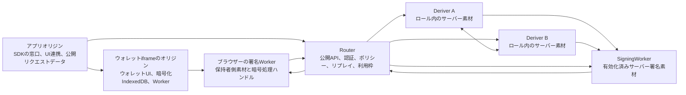

# アーキテクチャ {#architecture}

Seamsは、アプリ向けに鍵、認証情報、ポリシー制御を提供します。
アプリは、誰が操作しているかを証明し、承認済みアクションに証明を紐づけます。
その後、ウォレット、決済経路、市場、加盟店API、エージェントのツールを使う前に、ポリシーを適用できます。

アーキテクチャには、3つの役割があります。

1. 署名権限を、保持者側とサーバー側の素材に分割する。
2. 実行前にポリシーを判断する。
3. 復元、エクスポート、委任、ローテーションを明示的にする。

## 構成図 {#component-map}



## ランタイムのロールと境界 {#runtime-roles-and-boundaries}

| ロール                     | 役割                                                                                 |
| -------------------------- | ------------------------------------------------------------------------------------ |
| アプリオリジン             | 導入用UIと公開SDK呼び出し。リクエストデータと公開結果を受け取る。                    |
| ウォレットiframeのオリジン | ウォレットUI、オリジン内の暗号化レコード、認証方法のフロー、Worker、セッション状態。 |
| ブラウザーの署名Worker     | 保持者側署名素材、コンパクトなライフサイクル入力、操作内の署名状態。                 |
| Router                     | 受付、ポリシー、セッション検証、リプレイ、利用回数、署名利用枠の公開API境界。        |
| Deriver A                  | A側の封印素材とプロトコル状態を持つ導出ロール。                                      |
| Deriver B                  | B側の封印素材とプロトコル状態を持つ導出ロール。                                      |
| SigningWorker              | 受け付けたセッションの有効化済みサーバー署名素材で、通常署名を処理する。             |

アプリオリジンは、保持者シェア、PRF出力、メールOTP秘密素材、VoiceIDテンプレート、サーバーシェア、ルートシェア、エクスポート鍵を受け取りません。
明示的なエクスポートは、ウォレットオリジンのビューアーに鍵素材を表示し、操作結果だけをアプリへ返します。

## 製品のレイヤー {#product-layers}

この構成には、提案段階の決済、エージェント、外部証明の機能を含みます。
パスキー、メールOTP、ウォレットのライフサイクル、署名、所有者が選ぶリージョン移動はリリース済みです。
[リリース状況](/ja/releases)と、各機能の提供状況を確認してください。

| レイヤー           | 役割                                                                                                       |
| ------------------ | ---------------------------------------------------------------------------------------------------------- |
| 証明               | パスキー、メールOTP、VoiceID、デバイス・組織・ウォレットの証明、設定済み外部認証情報。                     |
| ポリシーと委任条件 | 署名済み委任条件、型付き操作意図のダイジェスト、ポリシーのエポック、利用枠、有効期限、取り消し、監査状態。 |
| 鍵の基盤           | 保持者・サーバーのシェア、Router A/B、SigningWorker、復元、エクスポート、委任、ローテーション。            |
| 制御ゲートウェイ   | 資金、権限、在庫、API状態の変更前に、許可、拒否、追加確認、人の承認を判断する。                            |
| 実行アダプター     | ウォレット署名、決済、加盟店API、市場、エージェントのツール、将来のデバイス操作。                          |

## Router A/Bの構成 {#router-a-b-architecture}

Router A/Bは、鍵の導出と署名受付の背後にある、分割サーバーの境界です。

Ed25519の登録、復元、エクスポート、シェア更新、SigningWorkerの有効化は、専用のStreaming Yao受付・実行ルートを使います。
ECDSAは、専用の厳密なRouter A/Bルートを使います。
デバイス連携で新しい署名シェアを用意する場合は、該当する型付きライフサイクルを使います。

```text
クライアントWorker -> Router -> Deriver A + Deriver B -> クライアントまたはSigningWorker
```

日常の署名は、通常署名の経路を使います。

```text
クライアントWorker -> Router -> SigningWorker -> Router -> クライアントWorker
```

Routerは、公開ルーティング情報、ポリシーの判断、セッション受付、リプレイ状態、利用枠状態、暗号化ロールエンベロープを扱います。
暗号化エンベロープにより、ロールの秘密をRouterから分離します。
Deriver AとBは、ロール専用の素材を受け取ります。
SigningWorkerは、選択した署名ルート、鍵バージョン、レーン、セッション用の有効化済みサーバー署名素材を受け取ります。

## Ed25519とECDSAの導出 {#ed25519-and-ecdsa-derivation}

Ed25519は、Deriver AとBの間で固定回路のStreaming Yao手順を使います。
回路は、標準的なエクスポート互換の導出を維持します。

```text
d -> SHA-512(d) -> clamp -> a
```

数MBのガーブルド回路ストリームは、Deriver間だけを流れます。
クライアントとRouterは、小さな暗号化エンベロープと出力パッケージを交換します。

ECDSAは、曲線固有の厳密なRouter A/B経路を維持します。
Deriver AとBは、しきい値PRF導出で、加算形式のsecp256k1スカラーシェアを生成します。
Ed25519のYao回路は使いません。

Ed25519・ECDSAの通常署名は、有効化済みシェアと事前署名状態を消費します。
どちらも通常署名中にDeriverを呼びません。

現在の構成は、Deriverの正しい実行を仮定し、A+Bの共謀と共有アカウント管理者の侵害を保証の対象から除きます。
より強い能動的安全性は、別の目標です。
[Streaming Yaoの安全性](/ja/concepts/threshold-signing/streaming-yao-ab#security-properties)を参照してください。

## ウォレットごとのホームリージョン {#per-wallet-regional-homes}

リージョン別ホスト環境は、信頼できる登録場所のメタデータで、新しいウォレットごとにホームを割り当てます。
同じプロジェクトでも、異なるホームを持てます。
ディレクトリーは、後続操作をそのウォレットのリージョンのGateway、Wallet Runtime、署名ロールへ送ります。
これらのサービス間で、ウォレットの所有権は固定されます。
全サービスが同じリージョンで動くと説明する前に、各サービスの物理配置を確認してください。

1つのウォレットの全デバイスは、同じホームを使います。
移動するとクライアントとホームの通信距離は変わりますが、ホームは変わりません。
所有者は、リージョン設定または`seams.placement.move`で別のリージョンへ移動できます。自動移動は行いません。
共有のテナント権限と、ウォレット所有のリージョン状態は独立しています。

ステージングは、US、WEUR、APAC、OC（オセアニア）に対応しています。
OCのD1プライマリーはシドニーから提供し、GatewayとWallet Runtimeもシドニーを対象とします。
本番OCの割り当ては準備中です。Wallet Serverには、データ管轄の型`oc`を含みます。

## 資産管理モデル {#custody-model}

Seamsは、ホスト基盤だけではユーザーのウォレットの署名や鍵のエクスポートができない、非カストディ型の仕組みです。
有効な署名には、次の全条件が必要です。

1. 選択した保持者レーンが参加する。
2. Routerが、セッション、ポリシー、リプレイ、利用回数、予算の確認後に操作を受け付ける。
3. SigningWorkerが、そのレーンと鍵バージョン用の有効化済みサーバー素材で参加する。

エクスポートには、新たな承認を伴う別のフローが必要です。
鍵のローテーションとレーンの委任は、範囲を限定した署名機能を作成・変換します。
アプリ、エージェント、ホストするRouterにウォレット秘密鍵を渡しません。

## ローテーションと委任 {#rotation-and-delegation}

ローテーションには、安全性への効果が異なる複数の操作があります。

| 操作                             | 一般的な結果                                                                      |
| -------------------------------- | --------------------------------------------------------------------------------- |
| エンベロープの再ラッピング       | 同じ平文シェアを、新しい暗号化で保護する。                                        |
| テナントルートの更新             | A/B運用シェアとエポックを変更する。導出ルート、ウォレット鍵、アドレスは維持する。 |
| サーバーの鍵管理のローテーション | 同じ有効なサーバー寄与を、新しい鍵管理エンベロープやロール設定へ移す。            |
| レーンシェアの更新               | 保持者・サーバーのレーンシェアを変更し、アドレスは維持する。                      |
| 委任レーンの作成                 | ポリシーの下で、デバイス、エージェント、サービスへ限定したレーンを与える。        |
| ウォレットの鍵交換               | ウォレット鍵を変更する。通常はアドレスも変わる。                                  |

テナントルートの更新は、1つの署名レーンの更新やKMSラッピング鍵のローテーションとは別です。
ライフサイクルの境界は[鍵のローテーション](/ja/concepts/delegation/key-rotation)を、保存と消去の制約は[テナントルートのバックアップ](/ja/deploy-and-operate/tenant-root-backups)を参照してください。

委任を受けるデバイスとエージェントは、レーン限定の署名権限を受け取ります。
ウォレット秘密鍵、復元権限、エクスポート権限、広いアカウント管理権は受け取りません。
取り消しは、レーン状態、ポリシーのエポック、利用枠、有効期限、リプレイの確認で適用します。

## 図のソース {#diagram-sources}

構成図は、Mermaidコードブロックで描画します。再利用用のソースコピーは、`/diagrams/`にあります。

- `/diagrams/platform-layers.mmd`
- `/diagrams/runtime-architecture.mmd`
- `/diagrams/router-ab-flows.mmd`
- `/diagrams/custody-boundaries.mmd`
- `/diagrams/delegated-lanes.mmd`

Mermaidを直接描画できない用途には、SVG出力を追加できます。
