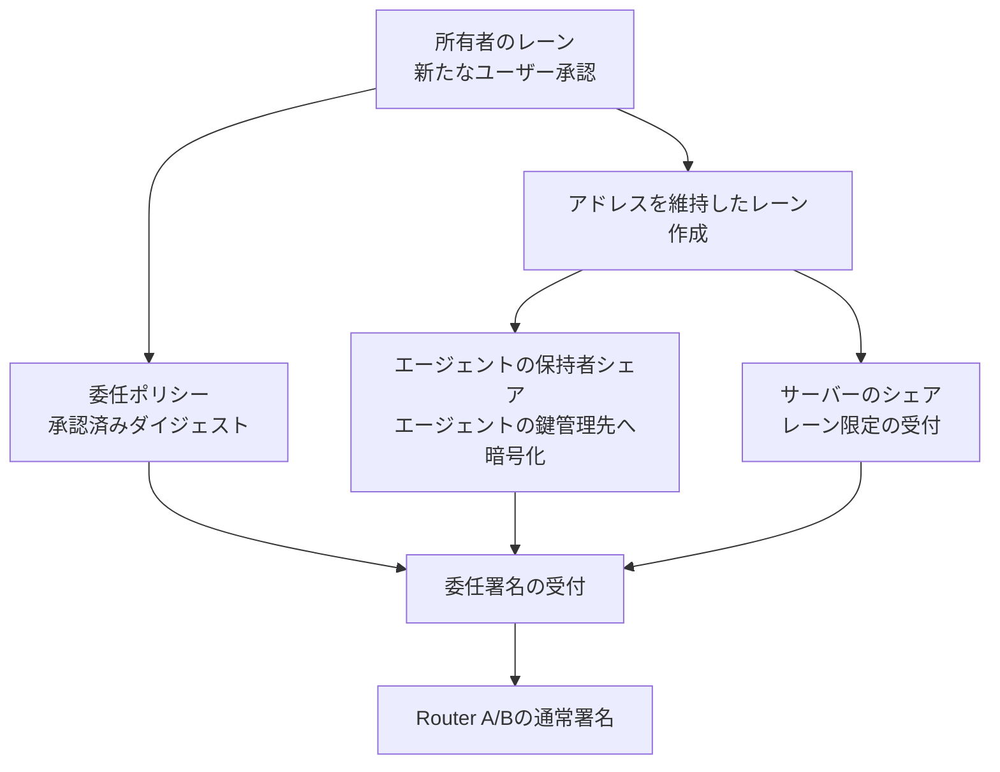

# 権限を委任したエージェント {#delegated-agents}

エージェントレーンの発行は計画中です。公開済みWallet SDKには、この公開APIはありません。
以下のフローは、意図する承認と鍵管理の境界を説明します。

エージェントは、範囲を限定した署名レーンを受け取ります。
レーンは、委任ポリシー、型付き操作意図の確認、利用枠、有効期限、取り消し状態、監査要件に紐づきます。

## フロー {#flow}

各エージェント署名リクエストは、レーン状態、委任条件、操作意図のダイジェスト、利用枠、有効期限、冪等性、リプレイの確認に成功する必要があります。

## 不変条件 {#invariants}

1. エージェントはウォレット秘密鍵を受け取らない。
2. エージェントは復元要素を変更できない。
3. エージェントはウォレット鍵をエクスポートできない。
4. エージェントは委任条件の範囲外で署名できない。
5. エージェントの取り消しは、ウォレットのアドレスを変更しない。
