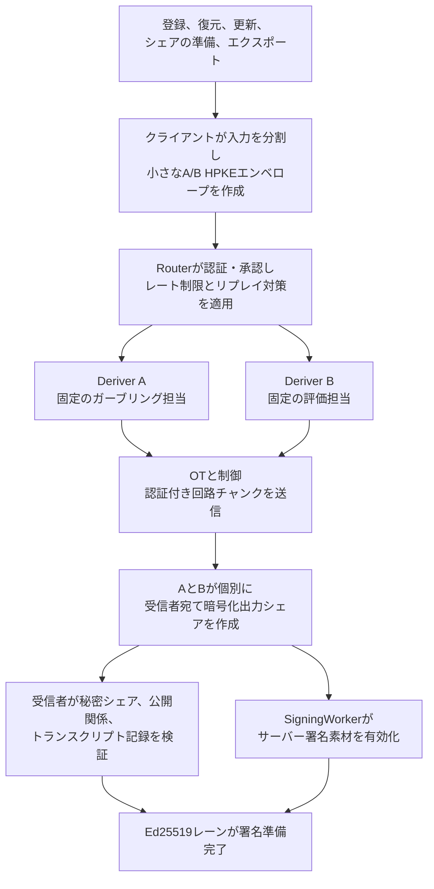
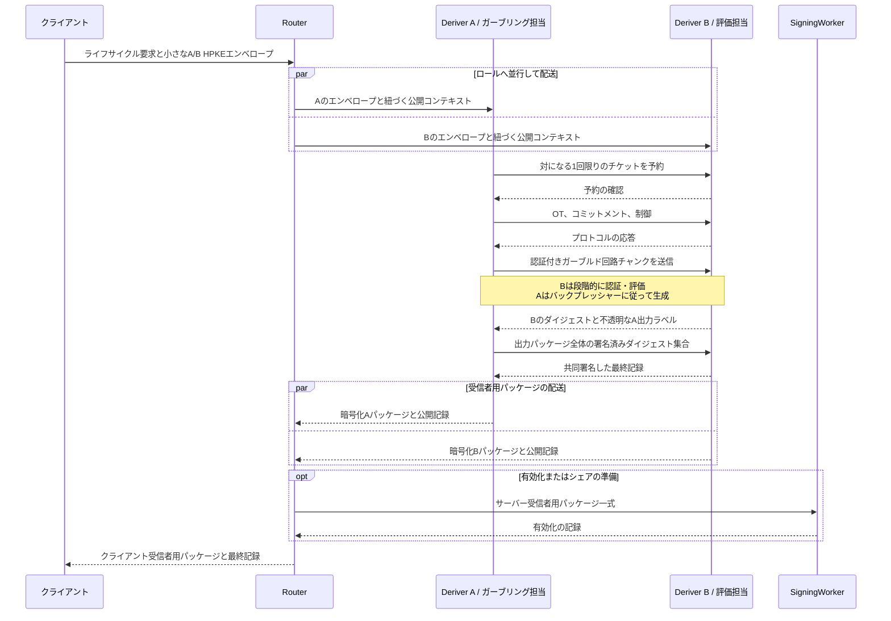
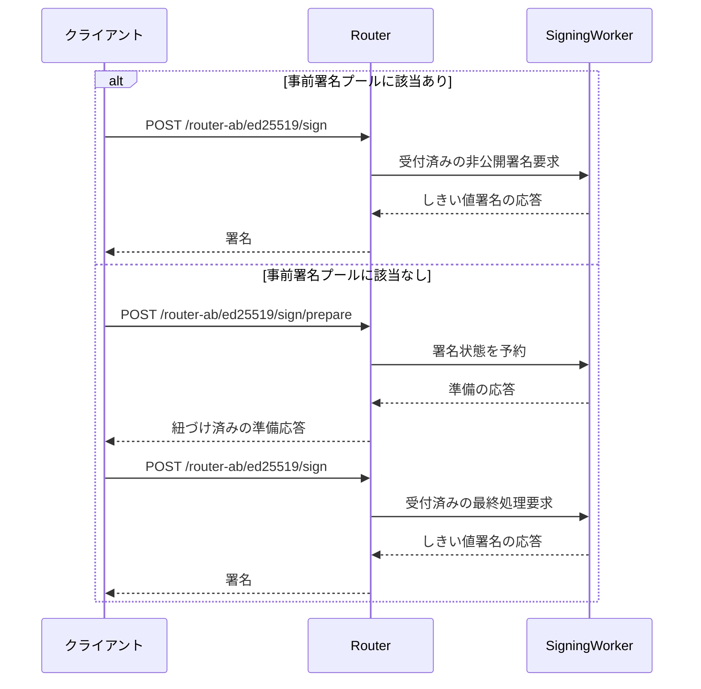

# Streaming Yao A/B {#streaming-yao-a-b}

Streaming Yaoは、Router A/Bで承認されたEd25519のライフサイクルプロトコルです。
Deriver Aは、固定回路を暗号化テーブルへ符号化します。この処理をガーブリングと呼びます。
Deriver Bは、そのテーブルを評価します。回路は、標準鍵エクスポートに対応するEd25519導出を計算します。
どちらのDeriverも、完全なシード、スカラー、署名出力を知りません。

構成は、分離したDeriverロールでfree-XOR/half-gatesを使います。
現在の安全性の保証は、正しい実行を仮定し、参加者による中止を許容します。
共有Cloudflareアカウントのコントロールプレーンが正常である間、ロールの分離を維持します。
より強い能動的安全性と独立管理のDeriverアカウント構成は延期中です。
デプロイ済みベンチマークは、これらを保証しません。

ホスト構成は、WorkersとDurable Objects内で、WebAssemblyにコンパイルしたRust計算を実行します。
以下の7月のWorker・WebSocket計測は、過去の実装ベンチマークです。
値はWorker時計の差分であり、そのWorker自身のCPU時間を含みません。
実際の手順の所要時間、現在のウォレット全体の遅延、費用を示すものではありません。

## Yaoを実行する操作 {#when-yao-runs}

Yaoは、Ed25519素材を作成、再現、再分配、エクスポートする、低頻度のライフサイクル手順で実行します。

| 操作                                               | Yaoを使うか | 理由                                                                   |
| -------------------------------------------------- | ----------- | ---------------------------------------------------------------------- |
| 登録と初回の有効化                                 | はい        | 本来のEd25519識別情報用に、クライアントとSigningWorkerのシェアを作る。 |
| 新しいデバイス・認証情報への復元                   | はい        | 登録済み公開鍵を維持し、受信者用シェアを再作成する。                   |
| 署名シェア・SigningWorkerの更新                    | はい        | 新しい有効化エポックで、受信者用シェアを新たに生成する。               |
| 明示的な鍵エクスポート                             | はい        | 新たなエクスポート承認後、マスクしたシードシェアを解放する。           |
| 新しい署名レーンを用意するデバイス連携             | はい        | 新しい受信者用の署名シェアを作る。                                     |
| 既存の封印済み素材を承認するだけのデバイス連携     | いいえ      | 導出や再分配を行わない。                                               |
| トランザクション、メッセージ、委任アクションの署名 | いいえ      | 有効化済みしきい値シェアを使う。                                       |
| ECDSAのライフサイクルまたは署名                    | いいえ      | 別の厳密なRouter A/Bしきい値PRF・加算シェアのプロトコルを使う。        |

委任アクションは通常の署名です。新しい委任署名レーンの準備は、ライフサイクルの手順です。
この違いが、Yaoの実行有無を決めます。

## ライフサイクルのフロー {#lifecycle-flow}



大きなガーブルド回路ストリームは、AとB間を直接流れます。
クライアントとRouterが交換する要求と暗号化出力パッケージは、MiBではなくKiB単位の小さなものです。

## サーバー側の処理順序 {#server-side-sequence}



正確なA/Bリクエストのグラフは、選択したプロトコルアセットで固定します。
設計目標はA/B間1往復で、直列の2～4往復を許容します。
回路チャンクは1つのストリーミング要求に属し、チャンクごとに往復を増やしません。

クライアントから見ると、通常、1回のYao手順はRouterとの1往復に収まります。
非同期のデプロイでは、手順のハンドルを返し、認証付きポーリングを使えます。
製品の操作全体には、独立した認証、復元、有効化の段階も含む場合があります。

## 通常署名のフロー {#normal-signing-flow}

Ed25519の通常署名は、Yao処理もDeriver呼び出しも行いません。



| フロー                         |   クライアントとRouter |   RouterとSigningWorker |             A/B |  Yao |
| ------------------------------ | ---------------------: | ----------------------: | --------------: | ---: |
| Ed25519のライフサイクル手順    |              通常1往復 | 必要な場合、有効化に1回 | 目標1、許容2～4 | あり |
| Ed25519署名、プールに該当あり  |                  1往復 |                   1往復 |               0 | なし |
| Ed25519署名、プールに該当なし  |                  2往復 |                   2往復 |               0 | なし |
| バックグラウンドの事前署名補充 | ユーザー操作の往復なし |    バックグラウンド処理 |               0 | なし |

## 計算と組み込みクライアント {#compute-and-embedded-clients}

Streaming Yaoは、AとBで計算量の多い処理を行います。
主な処理は、固定回路上の共通鍵ハッシュ、XOR、紛失通信（OT）、トランスクリプトの確認です。
ストリーミングは、ピークメモリーを制御し、ガーブリング、転送、評価を並行できます。
暗号処理の総量は減りません。

3段階を並行させると、実時間は次の値に近づきます。

```text
max（ガーブリングのCPU時間、転送時間、評価のCPU時間）+ プロトコルの往復時間
```

Cloudflareでは、この式が成り立つのは、コミット`6ec1c61d`（2026年10月12日）以降のDeriver Aビルドだけです。
Worker WebSocketは、イベントループが進むまでメッセージをキューに保持します。
7月のベンチマークペアを含む以前のWebSocketビルドでは、Aが初めて待機する前に、全テーブルフレームを生成・キュー登録していました。
Bの評価は、ガーブリング完了後に始まりました。段階は直列に動き、実時間は次の値に近くなりました。

```text
ガーブリングのCPU時間 + 評価のCPU時間 + プロトコルの往復時間
```

このコミット以降、Aは各テーブルフレームの後にイベントループを1回進めます。
次のフレームを生成する前に、現在のフレームを送信します。
プロトコルのメッセージ、順序、バイト列は同じです。

クライアントの処理量は、より小さくなります。

1. 小さな入力を分割する。
2. ハイブリッド公開鍵暗号（HPKE）のエンベロープを2つ作る。
3. 小さな受信者パッケージを開く。
4. コミットメントと公開鍵を検証する。
5. 得られた署名素材を保存する。

クライアントは、回路の生成・評価、OT、数MBの転送、ガーブルドテーブルのバッファリングを行いません。

この分担は、クライアント側のHSS評価より、モバイルや組み込みクライアントに適しています。
デバイスには、安全な乱数生成、保護された鍵保存、一般的な曲線・AEADの処理、Routerへの通信が必要です。
通常署名は、デバイスのしきい値署名シェアを使い、Yaoから独立しています。

## 計測した転送量と遅延 {#measured-payload-and-latency}

固定の有効化手順は、Deriver間で正確に`2,222,584`バイトを転送します。
AからBが`2,185,420`バイト、BからAが`37,164`バイトです。
符号化した最大エンベロープは`131,180`バイトです。
明示的なエクスポートは、A/B間で`103,416`バイトを転送します。通常署名のDeriver間通信はありません。

### 2026年7月：Worker時計の差分 {#july-2026-worker-clock-spans}

選択した同一アカウントのService Binding WebSocketを、2026年7月17日の2組のデプロイ済み計測で評価しました。
表の各値は、Deriver Aのプロトコル開始・終了時の`Date.now()`の差です。
デプロイ済みCloudflareのWorker時計は、その呼び出し自身のCPU時間を除外します。
したがって、時計の差分は待機時間だけを示します。これらは過去のデータで、手順の所要時間ではありません。

| 通信方式と計測                           | 時計の差分p50 | 時計の差分p95 | 時計の差分p99 | 時計の差分平均 | 失敗 |
| ---------------------------------------- | ------------: | ------------: | ------------: | -------------: | ---: |
| Service Binding HTTPストリーム、対照60組 |        234 ms |        258 ms |        318 ms |       232.5 ms | 0/60 |
| Service Binding WebSocket、候補60組      |        202 ms |        230 ms |        236 ms |       204.7 ms | 0/60 |
| Service Binding WebSocket、対照40組      |        198 ms |        222 ms |        232 ms |       200.8 ms | 0/40 |
| Native Workers RPCストリーム、候補40組   |        231 ms |        249 ms |        264 ms |       227.5 ms | 0/40 |
| 別アカウントの公開WebSocket、別時点      |        203 ms |        315 ms |        424 ms |       219.4 ms | 0/30 |

後の本番アセットの計測では、21回が成功し、失敗はありませんでした。
ウォーム状態の20サンプルの時計差分は、p50が`202 ms`、p95が`216 ms`、p99が`219 ms`でした。
昇格用計測のデプロイ直後の最初の群は、同じ時計で、p50が`298 ms`、p95が`360 ms`、p99が`480 ms`でした。
次のウォーム群は、p50が`196 ms`、p95が`224 ms`、p99が`296 ms`でした。
Cloudflareは、呼び出しが新しいisolateを作ったかを公開しません。
そのため、最初の観測値はウォームアップの動作を示し、コールドスタートの分布を示すものではありません。

時計差分は、AのCPU時間を含みません。本番アセットの計測では、その平均は手順ごとに`226.3 ms`でした。
[費用モデル](#cost-model)を参照してください。

### 2026年10月：実時間 {#october-2026-real-time}

[2026年10月12日の計測](https://github.com/seams-tech/seams-wallet/blob/main/docs/evidence/refactor-155h-probe-hosted.md)で、同じベンチマークペアを再実行しました。
Worker時計の差分と、2つの実時間を記録しました。
1つはクライアントの経過時間、もう1つは`wrangler tail`が報告するAの呼び出しの経過時間です。
表は、単体の有効化手順について、各実行の中央値の範囲を示します。クライアントは東京にありました。

| 実行群                               | Worker時計の差分 |  Aの実時間 | クライアントの実時間 |     AのCPU |     BのCPU |
| ------------------------------------ | ---------------: | ---------: | -------------------: | ---------: | ---------: |
| 東京、フレーム後のyield導入前、3実行 |       251–359 ms | 520–608 ms |           535–643 ms | 216–353 ms | 181–295 ms |
| 東京、フレーム後のyieldあり、3実行   |        94–106 ms | 292–333 ms |           318–353 ms | 195–231 ms | 184–191 ms |
| 香港配置、yield導入前、3実行         |       299–401 ms | 583–648 ms |           658–732 ms | 275–330 ms | 241–292 ms |
| 香港配置、yieldあり、2実行           |       103–184 ms | 455–485 ms |           528–573 ms | 321–323 ms | 186–295 ms |
| ローカルworkerd、Apple M4 Pro、1実行 |           135 ms |     未記録 |               139 ms |     未記録 |     未記録 |

東京の各実行は21回、香港は31回、ローカルは6回の手順を含みます。

記録から、次の結果が分かります。

- **Worker時計の差分は、所要時間ではありません。** yield導入前は時計が250～400 msでも、Aの呼び出しは520～650 ms続きます。差はAのCPU時間に近くなります。時計差分とクライアントの実時間を比較しないでください。
- **yield導入前の単体手順は、実時間で520～640 msでした。** 東京での結果です。生成と評価が直列だったため、実時間は両ロールのCPU時間の和に近くなりました。
- **フレーム後のyieldにより、東京の実時間は290～350 msになります。** 香港配置では、Aの実時間が455～485 msです。yieldは、各フレーム後にイベントループを1回進める処理です。[計算と組み込みクライアント](#compute-and-embedded-clients)を参照してください。
- **ローカルworkerdは異なります。** 時計は実時間に従います。Worker時計の135 msに対し、クライアント実時間は139 msでした。

これらの数値には、次の制約があります。

- ベンチマークペアは、ホストするウォレット構成全体ではありません。実際の構成には、受付、製品上の確認、封印、永続記録が加わります。
- この記録は、ベンチマークペアでのyieldだけを計測し、ホストするウォレット経路でのyieldは計測していません。
- 新しいisolateは、初回に400～1,000 msのCPUを使います。配置リージョンの指定時、31回中6～8回で新しいisolateに当たり、クライアント実時間のp90は1.3～1.6秒でした。
- 香港への要求は、東京のエッジから入ります。クライアント実時間には、配置リージョンへの通信を含みます。

ローカルのリリースモードでのライフサイクル計測は、実装の基準値です。デプロイ先の遅延を示しません。

| 操作         |       p50 |        p95 |        p99 |
| ------------ | --------: | ---------: | ---------: |
| 登録         | 94.070 ms | 100.068 ms | 102.040 ms |
| 復元         | 64.607 ms |  70.351 ms |  72.197 ms |
| 更新         | 64.205 ms |  72.893 ms |  74.966 ms |
| エクスポート | 19.035 ms |  23.780 ms |  24.566 ms |
| 通常署名     |  2.362 ms |   2.430 ms |   2.471 ms |

正式なベンチマークのソースは、実装とともに保存しています。

- [現在のCloudflareデプロイ構成](https://github.com/seams-tech/seams-wallet/blob/main/docs/router-ab/deployment.md)
- [ローカルのライフサイクル遅延レポート](https://github.com/seams-tech/seams-wallet/blob/main/crates/router-ab-dev/reports/ed25519-yao-local-latency-v1.json)
- [同一アカウントのWorkerベンチマークレポート](https://github.com/seams-tech/seams-wallet/blob/main/crates/ed25519-yao/docs/phase9b-same-account-report.md)
- [2026年10月12日のベンチマークペアの実時間記録](https://github.com/seams-tech/seams-wallet/blob/main/docs/evidence/refactor-155h-probe-hosted.md)

## Cloudflareへのデプロイ {#cloudflare-deployment}

対応する2つの構成で、クライアントプロトコルは同一です。
構成は起動前に選び、リクエストからは選択できません。

| 構成                            | 状況と用途                                                     | A/B間の通信               | 安全性の性質                                                           |
| ------------------------------- | -------------------------------------------------------------- | ------------------------- | ---------------------------------------------------------------------- |
| Cloudflareアカウント1つ         | 採用済みP0本番、ステージング、ローカルの同等構成、ベンチマーク | Service Binding WebSocket | 共有の制御が正常である間、Workerランタイムとロール内の秘密を分離する。 |
| 独立したCloudflareアカウント2つ | より強い運用者分離の実験。延期中。                             | 計測時点では公開WebSocket | 再接続と遅い側の遅延条件を満たすと、独立管理で制御の境界を強化できる。 |

同一アカウント構成は、アカウント管理とデプロイの制御が正常である間、1つのWorker内に限定した侵害を封じ込めます。
アカウント管理者や共有デプロイ認証情報は、両Workerを置き換え、実質的なA+B共謀を作れます。
選択したP0の保証は、その脅威を含みません。
別アカウント実験は、正確なワイヤープロトコルを維持しました。
Worker時計差分のp95は`315 ms`で、目標の`250 ms`に達しませんでした。後に判明した再接続の不具合も未解決です。

## 安全性の性質 {#security-properties}

選択したP0構成は、共有アカウントの制御が正常な間、受動的で正しい実行の下で、ロール分割の秘匿性を提供します。

- Routerは、公開メタデータ、タイミング、暗号文、署名済み記録を見る。
- Deriver Aは、Bの平文入力や結合した出力を受け取らない。
- Deriver Bは、Aの平文入力や結合した出力を受け取らない。
- 出力シェアを承認済みプロトコル内で生成し、クライアントとSigningWorkerへ別々に暗号化する。
- 1回限りのチケットで、前処理、ラベル、マスク、トランスクリプトのノンスの再利用を防ぐ。
- クライアントがシードを再構成できるのは、新たに承認したエクスポート中だけ。
- 通常署名は、秘密鍵を再構成しない。

保証の対象には、悪意あるDeriver、A+Bの共謀、共有アカウント管理者の侵害、Cloudflare全体の侵害、公平性、
出力配送の保証、Deriverが中止した場合の可用性を含みません。
能動的安全性、不正者に対して安全なOT、入力の一貫性、認証付き秘密出力は、将来の強い構成の対象です。

## 費用モデル {#cost-model}

次の見積もりは、過去のWorkerベンチマークに適用します。
現在のホスト費用には、Durable Object計算、リージョンD1、バックアップの保存・リクエストも含みます。
実際のデプロイで、別々に計測してください。

2026年7月10日のCloudflare Workers Standardの計画用基準は、次を仮定します。

- 有料アカウントごとに、月額最低`$5`。
- リクエストとCPUの利用枠を含む。
- CPUの超過料金は、100万CPU-msあたり`$0.02`。
- Workersのデータ転送・送出に追加料金なし。

料金やEnterprise契約は変わるため、デプロイの見積もりでは入力値を更新してください。

この基準では、大きなA→Bの転送量は遅延と任意の保存に影響しますが、Workersの帯域料金は`$0`です。
CPU、能動的プロトコルのラウンド、再試行、Durable Objects、事前配置した回路の保存が変動費を生みます。

本番アセットの計測では、平均CPU時間はAが`226.3 ms`、Bが`167.0 ms`、合計が手順ごとに`393.2 ms`でした。
isolateのメモリーの標本p99は、Aが`27.7 MB`、Bが`33.8 MB`で、`exceededMemory`はありませんでした。
7月17日の料金基準では、月間の含まれる利用枠を差し引く前の、100万回あたりのリクエストとCPUの総額は約`$8.16`です。
Service Bindingの呼び出しとWorker帯域に別料金はなく、ベンチマークWorkerはストレージバインディングを使いません。

過去の約`300 ms`というリポジトリーのHSS計測は、シミュレーターとラッパーの経路を対象としました。
本来の簡潔なHSS構成の遅延、費用、安全性は証明しません。
完了した簡潔HSSの分析は、群演算の多い計算を予測し、増幅、能動的安全性、完全な通信量を未解決としました。
Ed25519の選択した経路は、Streaming Yaoです。上記の計測は、デプロイ済みP0構成を説明します。
より強い能動的安全性の構成には、独自の遅延、リソース、費用の証跡が必要です。
