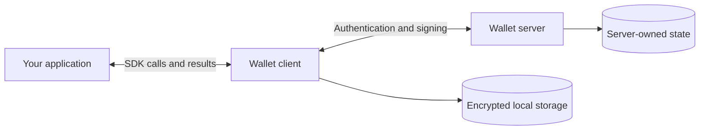

# How the wallet works

For published integration instructions, use the
[public documentation](https://docs.wallet.seams.sh/) and
[release notes](../apps/docs/src/releases.md). The current browser SDK, server SDK,
and VoiceID plugin use **0.67.0**. The signed recovery CLI uses **0.29.0**.
The wallet iframe protocol is **23.0.0**.

Seams Wallet lets people use blockchain accounts with a passkey or an email
verification code. An application uses the Wallet SDK to handle sign-in, request
signatures, and manage access to those accounts.

Apps can also [reuse Google login for wallet settings](../apps/docs/src/guides/google-sso.md)
after an owner-approved association. Settings sessions retain separate permissions from signing.

A wallet keeps its keys as the user adds sign-in methods, links devices, or
recovers access. Normal signing uses cryptographic material held by the client
and separate server roles.

## The three parts

- **Your application** decides what the user wants to do, such as send a
  transaction. It opens the Wallet UI through the SDK.
- **The wallet client** handles authentication screens, prepares signing requests,
  and runs client cryptography. It stores local secret material encrypted.
- **The wallet server** checks permissions and usage limits, stores account state,
  and runs the server side of signing.

The server is divided into roles so each role has access only to the material
it needs. You can understand the usual wallet flow before learning those roles.

## Using a wallet

Registration creates the wallet's keys and protects access with the user's chosen
sign-in method.

Unlocking creates a **Wallet Session**: permission to use selected keys for a
limited time and number of signatures. The client and server then work together
to sign requests allowed by that session.

Refreshing the page can restore an existing session. It grants no extra time or
signatures. Exporting keys requires fresh approval for that export.

If the user loses access, a recovery code lets them set up a new sign-in method
for the same wallet. Existing valid access stays available.

To try these flows, start with the
[local Wallet Console Lite example](../examples/wallet-console-lite/README.md).

## Choose a topic

Read Specs 1–3 for the core system. Continue with the topics relevant to your work.

| Spec | What you will learn |
| --- | --- |
| [1. Runtime](spec-1-runtime-and-platform-boundaries.md) | What runs in the client and server |
| [2. Authentication and custody](spec-2-auth-custody-and-credentials.md) | How sign-in, device linking, and recovery preserve wallet access |
| [3. Sessions and signing lanes](spec-3-wallet-sessions-and-execution-lanes.md) | What unlocking allows and how signing uses that permission |
| [4. Persistence](spec-4-persistence-and-durable-authority.md) | What is saved and how interrupted requests recover |
| [5. Router A/B](spec-5-router-ab-threshold-protocol.md) | How the cryptographic roles work together |
| [6. Tenant recovery](spec-6-tenant-roots-recovery-and-portability.md) | How operators back up and move the server side |
| [7. Integration](spec-7-hosted-surfaces-and-provider-boundaries.md) | How an application opens Wallet UI and connects providers |
| [8. Agent payments](spec-8-agent-authority-spending-and-payment-rails.md) | Wise first for Japanese businesses, then eligible Airwallex cards and bank transfers |
| [9. Testing](spec-9-behaviour-and-test-authority.md) | How to check a change against expected behaviour |

The specs state architecture requirements. Exact user journeys live in
[Intended Behaviours](intended-behaviours.md), and each chapter links to further
detail where needed.

For the optional browser authentication package, see
[VoiceID current state and future improvements](voiceid-current-state.md).

Code excerpts link to their source. Diagrams show the main relationships and
steps; the linked references cover the full protocols and record formats.

Current contracts belong in the numbered specifications, intended behaviors,
and crate specifications. Public integration instructions belong in `apps/docs`.
Keep dated measurement evidence separate. Refactor documents retain the problem,
decisions, rationale, and pending work while they are open. When a plan is
finished, delete it, and add one short summary below with a link to its last
text at a commit.

## Implementation history

- [R150–R155: regional wallet homes, custody objects and registration latency](archive/refactor-150-155.md).
- [Optimizations 10 and 11: registration, ECDSA presign and NEAR latency](archive/optimization-10-11.md).
- R225 and R226, retired on 2026-11-26 with nothing built. R225 planned Jev rules that only
  tighten the deterministic payment rules. R226 (first named "child lock") let an owner write
  such limits for their own wallet in plain English. The last texts are
  [R225 at `61bf248cf`](https://github.com/seams-tech/seams-wallet/blob/61bf248cf/docs/refactor-225-jev-policy-engine.md)
  and [R226 at `90fe27446`](https://github.com/seams-tech/seams-wallet/blob/90fe27446/docs/refactor-226-child-lock.md).
- R180, R191 and R230, deleted on 2026-11-27 with nothing built. R180 proposed enterprise OIDC
  and SAML login for operators. R191 planned Whisper turbo in the browser VoiceID package; its
  download of about 602 MB was too large. R230 assessed Rivet with regional PostgreSQL as a
  backend in place of Cloudflare. The last texts are
  [R180 at `822dfb30f`](https://github.com/seams-tech/seams-wallet/blob/822dfb30f/docs/refactor-180-enterprise-sso.md),
  [R191 at `3d1f46498`](https://github.com/seams-tech/seams-wallet/blob/3d1f46498/docs/refactor-191-voiceid-whisper-turbo-plan.md)
  and [R230 at `2afe47d43`](https://github.com/seams-tech/seams-wallet/blob/2afe47d43/docs/refactor-230-rivet.md).
- Plans finished and deleted on 2026-11-27. Each link goes to the last text.
  - [R127 at `f0aa22e87`](https://github.com/seams-tech/seams-wallet/blob/f0aa22e87/docs/refactor-127-preact.md): the built-in wallet surfaces render
    with Preact instead of Lit, and their styles are in `wallet-ui.css`.
  - [R160 at `f0aa22e87`](https://github.com/seams-tech/seams-wallet/blob/f0aa22e87/docs/refactor-160-tla.md): a bounded TLA+ model of Router A/B
    admission, step-up and presignature use, and a fix for admission expiry (2026-10-02).
  - [R170 at `f0aa22e87`](https://github.com/seams-tech/seams-wallet/blob/f0aa22e87/docs/refactor-170.md), with its
    [inventory](https://github.com/seams-tech/seams-wallet/blob/f0aa22e87/docs/refactor-170-inventory.md) and
    [completion receipt](https://github.com/seams-tech/seams-wallet/blob/f0aa22e87/docs/refactor-170-completion.md): the application
    client is separate from wallet execution, which runs on the wallet origin (2026-10-05).
  - [R171 at `f0aa22e87`](https://github.com/seams-tech/seams-wallet/blob/f0aa22e87/docs/refactor-171.md): the public Wallet SDK API, grouped by
    connection, configuration, events, authentication, registration and chain (2026-10-05).
  - [R190a at `3d1f46498`](https://github.com/seams-tech/seams-wallet/blob/3d1f46498/docs/refactor-190a-voiceid-adaptive-enrollment-plan.md): adaptive
    VoiceID enrollment as a manual option that the user confirms. Automatic learning stays
    deferred (2026-10-26).
  - [R190b at `25470301b`](https://github.com/seams-tech/seams-wallet/blob/25470301b/docs/refactor-190b-voiceid-evm.md): VoiceID unlock and transfers on
    EVM chains (2026-10-26).
  - [R220 at `d92fd6415`](https://github.com/seams-tech/seams-wallet/blob/d92fd6415/docs/refactor-220-wallet-assets.md): assets, Receive and Send in
    Settings, in SDK 0.55.0. The owner decided not to build Phases 2 and 3 (2026-11-08).
  - [R227 at `46871993a`](https://github.com/seams-tech/seams-wallet/blob/46871993a/docs/refactor-227-speak-to-sign-without-passkey.md): Speak-to-Sign
    payments and typed contract calls without a passkey, in 0.59.0 to 0.61.0. Its status
    lists the manual checks on staging that remain for the owner (2026-11-27).
  - [R232 at `110a67a38`](https://github.com/seams-tech/seams-wallet/blob/110a67a38/docs/refactor-232-wallet-plugins-by-evidence.md): Wallet plugins by
    evidence, cut by the owner to its Speak-to-Sign part. Released in Wallet SDK 0.68.0
    (2026-11-12).
  - [R231 at `01d9e4445`](https://github.com/seams-tech/seams-wallet/blob/01d9e4445/docs/refactor-231-near-custody-across-sites.md): NEAR custody material
    across sites and devices. The Router re-issues client material for the current epoch
    (0.62 and 0.63, 2026-11-10).
  - [R253 at `17ce51fc5`](https://github.com/seams-tech/seams-wallet/blob/17ce51fc5/docs/refactor-253-signing-session-seal-oprf.md): a POPRF replaces
    shamir-3-pass for the signing-session seal, on staging and production (2026-11-26).
  - [R252 at `4457c9f24`](https://github.com/seams-tech/seams-wallet/blob/4457c9f24/docs/refactor-252-email-otp-device-factor.md): the Email OTP factor
    is a device factor. The device keeps the POPRF input, so the server alone cannot open an
    Email OTP wallet. Slices 0 to 5 are in 0.75.0 and 0.76.0. D5 (no release for a Wallet
    Session bearer, an operation on each grant) is in the next release (2026-11-27).
  - [The Rust warning cleanup at `cf9710953`](https://github.com/seams-tech/seams-wallet/blob/cf9710953/docs/rust-warning-cleanup.md): the checklist and
    revert log of the 2026-10-21 review. Backend Wasm shrank by 22.19% across five services.
