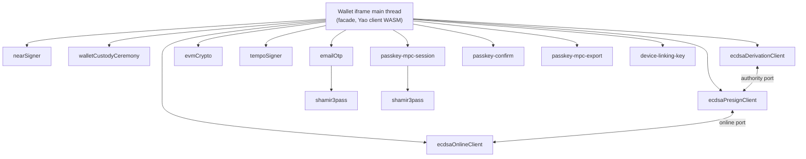

# Browser workers and WASM modules

The wallet client runs its cryptography in several Web Workers. Each worker
loads only the WASM modules that it needs and owns one kind of state. This
document records which worker owns what, and why the workers are separate.

Read this document before you merge two workers, split a worker, or move an
operation from one worker to another. A change to the worker layout must update
this document in the same change.

Checked against the source on October 21, 2026.

## Where the workers run

All workers start inside the wallet iframe, from the wallet's own origin. The
[wallet host runtime](../packages/wallet/src/SeamsWeb/walletIframe/host/WalletHostRuntime.ts)
constructs the signing surface that creates them. The application page never
creates a wallet worker.

The iframe main thread is a facade. It runs the UI, routing, validation, and
non-secret result handling. It also loads the Ed25519 Yao client WASM for
registration, login, and local session material (see
[`yaoClient.ts`](../packages/wallet/src/core/signingEngine/threshold/ed25519/yaoClient.ts)).

The SDK enables the optional VoiceID plugin by configuration. The Wallet iframe
loads its implementation on first use. Browser MediaRecorder captures deliberate
samples, and local ONNX Runtime Web inference verifies the speaker. Inference
uses one WebAssembly thread. A same-origin AudioWorklet supplies 16 kHz frames
to local Silero speech detection on the iframe main thread. The worklet holds only
short audio frames and has no signing or custody authority.
Audio is discarded after inference. The Wallet origin stores its template and
nonextractable WebCrypto device keys in IndexedDB. A separate nonextractable
AES-GCM key encrypts the random method factor at rest. The factor is decrypted
only along the voice verification flow and erased after core installation.
The server verifies the device signature; the trusted Wallet code enforces
speaker matching. These keys provide browser-origin isolation, without a
hardware-attestation claim. No native host or Keychain is involved.

The core opens the seed-encrypted NEAR custody cache in the existing Yao WASM
runtime on the iframe main thread. The custody worker opens the method envelope
and retains its existing session-scoped custody handle. JavaScript never
receives the wallet custody seed. Existing workers keep their responsibilities.

The [worker transport](../packages/wallet/src/core/signingEngine/workerManager/workerTransport.ts)
creates one worker per kind, on first use. Other managers create the
confirmation, export, session, and device-linking workers. The Email OTP and
passkey session workers each create their own nested Shamir worker.

## Worker inventory

Workers that the worker transport creates:

| Kind | Script | WASM modules and when they load | Secret state it holds |
| --- | --- | --- | --- |
| `nearSigner` | [`near-signer.worker.ts`](../packages/wallet/src/core/signingEngine/workerManager/workers/near-signer.worker.ts) | `near_signer` at worker start | None. It builds and finalizes NEAR transactions, delegates, and NEP-413 digests. It rejects payloads with PRF, seed, private key, or signing share fields. |
| `walletCustodyCeremony` | [`wallet-custody-ceremony.worker.ts`](../packages/wallet/src/core/signingEngine/workerManager/workers/wallet-custody-ceremony.worker.ts) | `wallet_custody_ceremony` only to start a key-set ceremony, restore a NEAR registration, or rotate recovery codes. `near_signer` for envelope open, reseal, and linking. Yao client for lane-source operations. | Ceremony handles that hold the wallet custody seed and owner roots (WASM). Unlocked export-root capabilities: a WASM custody handle and a JavaScript copy of the factor secret, kept for the owner Wallet Session. Receives `factorSecret` (a passkey PRF result, the Email OTP factor key, or the VoiceID factor key) and recovery codes. |
| `ecdsaDerivationClient` | [`ecdsa-derivation-client.worker.ts`](../packages/wallet/src/core/signingEngine/workerManager/workers/ecdsa-derivation-client.worker.ts) | `router_ab_ecdsa_client` at worker start; registration can prewarm it | All ECDSA client secrets: role-local signing state, linked-holder material, registration and export ceremonies, and the opaque presign authority. Rejects PRF and private key fields. |
| `ecdsaPresignClient` | [`ecdsa-presign-client.worker.ts`](../packages/wallet/src/core/signingEngine/workerManager/workers/ecdsa-presign-client.worker.ts) | None | No key bytes. It holds presignature lifecycle state, handles, and public points, and sends all cryptography to the derivation worker. |
| `ecdsaOnlineClient` | [`ecdsa-online-client.worker.ts`](../packages/wallet/src/core/signingEngine/workerManager/workers/ecdsa-online-client.worker.ts) | None | None. It forwards signature-share requests to the presign worker. |
| `evmCrypto` | [`evm-crypto.worker.ts`](../packages/wallet/src/core/signingEngine/workerManager/workers/evm-crypto.worker.ts) | `evm_crypto` at worker start | None. Hashing, encoding, and verification helpers. |
| `tempoSigner` | [`tempo-signer.worker.ts`](../packages/wallet/src/core/signingEngine/workerManager/workers/tempo-signer.worker.ts) | `tempo_signer` at worker start | None. Tempo sender hash and transaction encoding. |
| `emailOtp` | [`email-otp.worker.ts`](../packages/wallet/src/core/signingEngine/workerManager/workers/email-otp.worker.ts) | All on demand: `evm_crypto`, `email_otp_runtime`, `wallet_custody_ceremony` (ECDSA restore at login, recovery rotation), Yao client. Nested Shamir worker. | OTP-released factor secrets and warm session secrets (JavaScript bytes), and active Yao clients (WASM). See [Email OTP](otp/email-otp.md). |

Workers that other managers create:

| Worker | Created by | WASM modules | Secret state it holds |
| --- | --- | --- | --- |
| [`passkey-mpc-session`](../packages/wallet/src/core/signingEngine/workerManager/workers/passkey-mpc-session.worker.ts) | `PasskeyMpcSessionManager` | None directly. Nested Shamir worker. | Warm-session PRF material and its sealed copies, until expiry, use, or clear. |
| [`passkey-confirm`](../packages/wallet/src/core/signingEngine/workerManager/workers/passkey-confirm.worker.ts) | `UiConfirmManager` | None | None. It runs the confirmation exchange off the main thread. |
| [`passkey-mpc-export`](../packages/wallet/src/core/signingEngine/workerManager/workers/passkey-mpc-export.worker.ts) | `PasskeyMpcExportManager` | Yao client, for Ed25519 export only | Per request only: PRF output and the private key shown to the user. Both are cleared after the request. |
| [`device-linking-key`](../packages/wallet/src/core/signingEngine/workerManager/workers/device-linking-key.worker.ts) | `deviceLinkingWorkerChannels` | Yao client, for Ed25519 sealing only | Non-extractable link keys, recipient private keys, and a factor secret, until the attempt is discarded or closed. |
| [`shamir3pass`](../packages/wallet/src/core/signingEngine/workerManager/workers/shamir3pass.worker.ts) | Nested in `emailOtp` and `passkey-mpc-session` | `shamir3pass_runtime` on first message | Lock key pairs inside WASM memory. JavaScript holds only numeric handles. |

## WASM modules

| Module | Source | Size | Loaded by |
| --- | --- | ---: | --- |
| `near_signer` (`wasm_signer_worker_bg.wasm`) | `wasm/near_signer` | 412 KB | `nearSigner`, `walletCustodyCeremony` |
| `wallet_custody_ceremony` | `wasm/wallet_custody_ceremony` | 543 KB | `walletCustodyCeremony`, `emailOtp` |
| `router_ab_ed25519_yao_client` | `crates/router-ab-ed25519-yao-client` | 731 KB | Iframe main thread, `walletCustodyCeremony`, `emailOtp`, `device-linking-key`, `passkey-mpc-export` |
| `router_ab_ecdsa_client` | `wasm/router_ab_ecdsa_client` | 792 KB | `ecdsaDerivationClient` |
| `evm_crypto` | `wasm/evm_crypto` | 1,304 KB | `evmCrypto`, `emailOtp` |
| `tempo_signer` | `wasm/tempo_signer` | 778 KB | `tempoSigner` |
| `email_otp_runtime` | `wasm/email_otp_runtime` | 201 KB | `emailOtp` |
| `shamir3pass_runtime` | `wasm/shamir3pass_runtime` | 119 KB | `shamir3pass` |

Sizes are uncompressed release builds. `wallet_custody_ceremony` links both the
NEAR Ed25519 and the ECDSA protocol crates. It is the largest dependency set in
the client, which is why it loads only for ceremonies.

## Why the workers are separate

The separation follows six rules. Each rule names the code or contract that
depends on it.

### 1. Secret-free workers stay free of secrets

`nearSigner`, `ecdsaPresignClient`, `ecdsaOnlineClient`, `evmCrypto`,
`tempoSigner`, and `passkey-confirm` hold no secret material. `nearSigner` and
`ecdsaDerivationClient` reject request payloads that contain named secret fields
(`assertNoPrfSecretsInSignerPayload`). The comment in the NEAR signer states the
rule: raw PRF fields must never traverse into signer payloads.

These workers also process transaction data that comes from the application. A
worker that parses application data must not also hold custody material.

The guard checks a fixed list of field names. It does not reject a field with
another name, such as `factorSecret`. The rule therefore depends on keeping
secret-bearing operations out of these workers, not only on the guard.

### 2. Each secret-bearing worker owns one kind of material

| Worker | Material it owns |
| --- | --- |
| `walletCustodyCeremony` | The wallet custody seed, owner roots, and unlocked export-root capabilities |
| `ecdsaDerivationClient` | ECDSA client shares, linked-holder material, and presign authority |
| `emailOtp` | Email OTP factor secrets and Email OTP warm sessions |
| `passkey-mpc-session` | Passkey warm-session PRF material |
| `device-linking-key` | Device-linking keys for one linking attempt |
| `passkey-mpc-export` | Material for one export, for one request |

A ceremony keeps its state in its worker between protocol round trips. The
custody worker comment states the reason: the seed, the owner root, and the ECDSA
pending blob must never exist as JavaScript values on the main thread. The main
thread carries only public protocol messages and the final ciphertext.

### 3. A fault destroys only one worker's state

The worker transport terminates a worker that times out, throws an uncaught
error, or sends an unknown message frame, and that worker's state is lost. A
change of the worker base origin terminates all transport workers.

| Kind | Default timeout |
| --- | --- |
| `nearSigner`, `ecdsaDerivationClient` | 60 s |
| Other transport kinds | 20 s, or the request's own timeout |
| Nested `shamir3pass` | 15 s, and a timeout does not terminate it |

Separate workers limit what one fault destroys. For example, a NEAR signer
timeout does not erase open custody ceremonies or unlocked capabilities. If two
workers are merged, a fault in either one's operations destroys the state of both.

The three ECDSA workers are coupled on purpose. Resetting `ecdsaDerivationClient`
or `ecdsaPresignClient` terminates all three and clears the presignature pool.
Resetting `ecdsaOnlineClient` terminates only that worker.

### 4. Registration-only code stays off the signing path

The [ceremony worker URL resolver](../packages/wallet/src/core/walletRuntimePaths/walletCustodyCeremonyWorker.ts)
states the rule. The ceremony worker loads a module that links both protocol
crates, so nothing on the recurring signing path should resolve it. Ordinary
signing must not load `wallet_custody_ceremony`.

Inside the custody worker, envelope, linking, and lane-source operations load
only their own modules. See
[Intended Behaviours](intended-behaviours.md#worker-preparation).

### 5. An operation starts only the workers that it uses

A signed-out host starts no signer or custody worker. Selecting several chains
does not start every chain's worker. Passkey registration with NEAR starts the
NEAR signer worker and the Yao client during preparation. These are contracts in
[Intended Behaviours](intended-behaviours.md#worker-preparation).

A merged worker would load the WASM of every operation it serves. To keep this
rule, it would need on-demand loading for each module.

### 6. Long work blocks only its own worker

A worker has one thread, and WASM work blocks it. The NEAR signer, custody,
ECDSA derivation, and ECDSA presign workers also queue their requests and run
them one at a time. A long custody step or ECDSA derivation therefore cannot
delay a request that runs in another worker.

## Accepted duplication

Some WASM modules load in more than one worker:

- `near_signer` loads in `nearSigner` and in `walletCustodyCeremony`. During a
  NEAR registration, both instances can exist.
- The Yao client loads on the iframe main thread and in four workers.
- `wallet_custody_ceremony` and `evm_crypto` each load in two workers.
- Two parents each start their own Shamir worker.

Each extra instance costs one compile from the HTTP cache and its own WASM
memory. This duplication is accepted. Rules 1 to 3 outweigh it. Worker start and
WASM loading run during setup and the passkey step, so they are not on the
registration path after the passkey.

## Decision: keep the custody ceremony worker separate from the NEAR signer

Date: October 21, 2026.

A proposal suggested that `nearSigner` host the custody ceremonies, with
`wallet_custody_ceremony` loaded on demand. It would remove one worker start
and one `near_signer` instance.

The proposal was declined:

- The custody worker receives `factorSecret`, which is a passkey PRF result
  (see `WalletCustodyCeremonyWorkerOperationMap` in
  [`workerTypes.ts`](../packages/wallet/src/core/signingEngine/workerManager/workerTypes.ts)).
  The NEAR signer must receive no PRF material (rule 1).
- A NEAR signer timeout would destroy open ceremonies and unlocked capabilities
  (rule 3).
- No speed gain is measurable. In 12 hosted registrations on SDK 0.15.6, all
  client work after the passkey, apart from `respond` and `finalize`, took
  37–70 ms.

Revisit this decision only with a measured memory or startup problem. A merge
also needs an explicit decision to let PRF results into the merged worker,
recorded in this document.

## Separations with no recorded reason

Two separations have no recorded reason:

- **The three ECDSA workers.** All ECDSA secrets are in `ecdsaDerivationClient`.
  The presign and online workers hold only handles and public bytes. The likely
  reason is rule 1, but no document states it.
- **The nested Shamir worker.** Its lock keys stay in WASM memory, behind numeric
  handles. No document states why it runs in its own worker.

Do not merge these workers on the assumption that the separation is accidental.
First record a reason here, and check rules 1 to 6.

## Before you change the worker layout

1. Name the rule above that the change affects. If it breaks a rule, record the
   decision and its reason in this document.
2. Update the inventory and the WASM table.
3. Check the worker contracts in [Intended Behaviours](intended-behaviours.md)
   and the asset assertions in the registration contract tests.
4. Check what a timeout of the changed worker now destroys.
