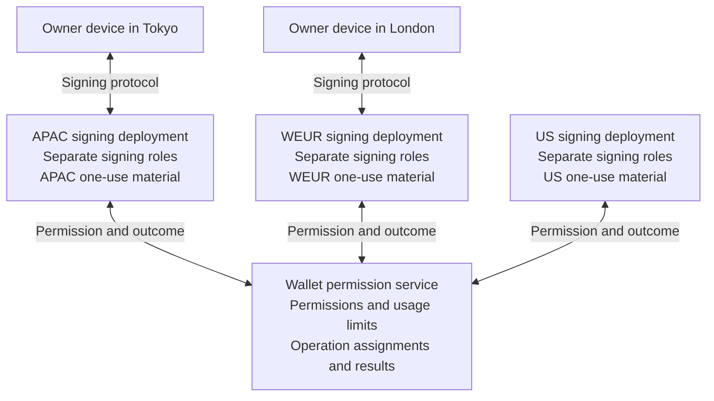

# Refactor 155: one permission authority with regional wallet signing

Status: intent and validation plan, October 5, 2026. No implementation or protocol
feasibility claim. This is a candidate replacement for
[R153](refactor-153-wallet-region-selection.md) and
[R154](refactor-154-automatic-wallet-relocation.md).

## Intent

Let the owner use the same wallet across regions without selecting a region or
moving the complete wallet. Route each new signing operation to a nearby, ready
signing deployment. Preserve wallet keys, addresses, device identities, and
permissions.

Keep one permission authority for each wallet. Allow several regions to execute
different approved operations. Each region has separate one-use signing material
and durable execution records. The owner's device still supplies the contributions
required by the signing protocol.

The desired experience has no travel-related first-use preparation delay.
Meeting that target requires prepared server material and any required device
material in the destination region. Regional material is acceptable to the owner.
Its preparation, expiration, and replacement costs must remain bounded.

Global permission checks still have network latency. New devices, empty pools,
recovery, and unavailable regions can introduce preparation or recovery delays.
Measure these conditions before making a product guarantee.

## Terms and ownership

| Term | Meaning |
| --- | --- |
| Permission service | The logical service that owns permission decisions and operation assignments for a wallet. |
| Permission home | The authoritative location for that wallet's permission records. It can stay fixed while the owner travels. |
| Signing deployment | A regional installation of the existing, separate signing roles. |
| Execution permit | An authenticated approval for one exact operation and one regional executor. |
| Regional material | Role-owned material prepared for a regional installation. Its one-use components must be unique to that installation. |
| Execution assignment | The durable record that identifies where an operation may execute. |

“Global” means all regions consult the same permission authority for a wallet.
Different wallets can have different permission homes. The design does not require
one process or database for all wallets.



| Owner | Authoritative state |
| --- | --- |
| Permission service | Device authority, session validity, revocation, wallet allowance, operation assignment, and reconciled operation outcomes. It also determines eligible key versions and regional installations. |
| Regional signing roles | Their own protected material, local sessions, one-use consumption, execution claims, and durable results awaiting reconciliation. |
| Owner device | Existing device credentials and client signing material. Region-specific preparation must preserve the device identity. |
| Existing shared authorities | Tenant policy, identity uniqueness, and tenant custody obligations. Their ownership remains explicit. |

The permission service holds no wallet signing secrets. Each signing deployment
preserves the existing separation between Router, Deriver A, Deriver B, and
SigningWorker. Replicating a role must preserve its custody boundary.

The [R152 ownership contract](refactor-152-state-ownership.md) is the starting map.
R155 needs a revised ownership map before implementation. The existing map proves
fixed-home ownership and transfer selectors; it does not prove simultaneous
regional execution.

## Proposed operation contract

```mermaid
sequenceDiagram
    participant D as Owner device
    participant R as Nearby signing deployment
    participant P as Wallet permission service

    D->>R: Submit the operation and device authorization
    R->>P: Request permission for the exact operation
    Note over P: Check authority and allowance.<br/>Record assignment and allowance change together.
    P-->>R: Return the execution permit
    Note over R: Verify the permit.<br/>Durably claim local one-use material.
    R->>D: Perform the signing protocol
    D->>R: Supply the required device contribution
    Note over R: Persist the exact operation result.
    R-->>D: Return the result
    R-->>P: Report the durable result; retry delivery as needed
```

- Bind the permit to the full wallet scope, device authority, operation ID, exact
  request digest, key version, regional executor identity, and execution generation.
  Define its validity window and authenticated issuer at the protocol boundary.
- Commit the permission decision, operation assignment, and allowance change
  atomically before issuing the permit. Preserve existing one-use proof rules.
  Shared tenant decisions need an explicit consistency contract with this admission.
- An exact retry returns the existing assignment or result. Reusing an operation
  ID with a different request must fail. Concurrent regions cannot consume the
  same allowance twice for one operation.
- Each participating role verifies the execution authority at its effect boundary.
  Gateway routing alone cannot enforce an assignment. Deferred work, restored
  storage, and direct role calls must obey the same authority.
- Local claims enforce one-use consumption. A signed permit alone does not prevent
  replay. Regional material must remain distinct through restart and restoration.
- Persist the exact regional result before returning it. Reconcile the result with
  the permission service through durable, repeatable delivery. A missing completion
  report means the operation needs reconciliation; it cannot authorize fresh execution.
- Keep an uncertain operation assigned to its original executor. A timeout or permit
  expiry does not prove that signing stopped. Reassignment requires a defined fence
  and evidence that another execution is safe. Never refund an uncertain claim blindly.

The proposed device-revocation rule blocks new permits after revocation commits.
Previously admitted operations may finish. Confirm that this matches the intended
wallet contract. Stronger cancellation needs further coordination. Recovery and
key retirement must define separate barriers for in-flight operations and regional
material before reporting completion.

The operation journal cannot make an external blockchain effect part of its local
transaction. Preserve existing broadcast, nonce, sponsorship, and result-replay
rules where those operations share the signing path.

## Regional material and readiness

One wallet keeps one key set. Independent regional installations must produce
signatures for that same key set and retain every existing device identity.

Generate separate one-use material for each region. Copying a presignature and
changing its identifier is unsafe. Long-lived role material needs a separate
protocol decision: identify what can be installed in several regions, what must
be distinct, and what remains with a shared authority.

Readiness must include all required roles and device contributions for the exact
key version and device authority. A deployed Worker or a server-only pool does
not establish signing readiness. Define how an offline device regains readiness
after pool expiry, key recovery, or a new regional installation.

The SDK chooses a nearby ready deployment without owner region selection. A new
operation may choose a different region; a retry follows its existing assignment.
Prefer ready capacity when the nearest deployment needs preparation. Record the
resulting latency and make preparation failures recoverable.

Bound preparation by wallet, device, region, and material lifetime. Include failed
attempts, duplicate requests, background refill, and recovery storms in the budget.
The R153 five-minute move limit does not directly control concurrent regional pools.
Select pool targets and expiry policy after measuring cost and readiness.

## Permission service and consistency

The permission service is a logical coordinator with a single authoritative order
for each wallet's permission decisions. Reuse existing storage and transaction
boundaries where they can express that contract.

A replicated implementation may use a consensus-backed service. A custom Raft
implementation is outside this plan. Choose the storage design after identifying
which decisions must commit together. A quorum can add cross-region latency and
cannot make disconnected regions independently approve conflicting operations.

Cloudflare provides strongly consistent transactions within each Durable Object.
Separate objects and D1 databases need application-level coordination.
[Cloudflare storage model](https://developers.cloudflare.com/durable-objects/reference/glossary/).
D1 replicas are asynchronous read copies; writes still reach the primary.
They cannot independently approve operations from stale permission state.
[D1 read replication](https://developers.cloudflare.com/d1/best-practices/read-replication/).

If the permission service is unavailable, new operations cannot obtain permits.
Already admitted operations follow their recorded execution contract. Regional
execution does not imply independent authorization during a network partition.

The target is a small number of global coordination calls with regional signing
exchanges. Do not promise one remote call until every shared policy and custody
dependency has been traced. Compare the full signing path with the R152 baseline.

## Preliminary validation

All checks below remain open. Earlier transfer probes establish role-preserving
copying under one active home. They do not establish this multi-region contract.

| Check | Required finding or evidence |
| --- | --- |
| ECDSA installations | Show that independent regional installations sign for the same wallet keys and device identities. Examine activation, lane, server, epoch, seal, and client bindings. Prove independent presignature generation and consumption. |
| Ed25519 Yao installations | Show the same identity continuity. Examine pair sessions, capability replacement, role identities, tenant-root use, and prepared/claimed/burned state. Identify every exclusive resource or global lock. |
| Full owner and linked devices | Cover both protocols for founding and linked owner devices. Establish whether regional preparation requires a device to be online or to approve a new installation. Preserve permissions and credentials. |
| Permission and execution split | Map each existing record to one owner. Identify atomic admission requirements, shared policy checks, direct role admissions, and deferred writes. Define authenticated permits and mandatory enforcement points. |
| Recovery and revocation | Define ordering for device revocation, session expiry, quota exhaustion, key recovery, and retirement across all installations. Prevent a restored region from accepting retired authority or material. |
| Failure and retry semantics | Exercise concurrent duplicate requests, conflicting payloads, lost replies, missing completion reports, and restarts. An uncertain operation must retain one execution assignment and one allowance charge. |
| Regional readiness and cost | Establish how server and device material becomes ready before travel. Measure refill cost, expiration, storage, inactive-device behavior, and bounded recovery/refill work. |
| Geographic latency | Measure first use after travel, warm signing, empty pools, and permission-service latency. Record actual role/storage locations and the entire client-to-result path. Separate chain confirmation from signing. |

First inspect the protocol bindings and current source. Record exact revisions,
established facts, proposed changes, and unresolved assumptions for each protocol.
Do not introduce new lifecycle or wire types until this review identifies the
smallest required contract change.

Then build a composed E2E feasibility scenario. Use one wallet, a founding device,
a linked device, and separate regional role/storage installations. Sign with both
protocols in multiple regions. Include a duplicate operation during a lost reply,
a restart before result reconciliation, device revocation, and recovery.

Retain repeatable evidence: revisions, commands, installation identities, public
keys, signature verification, operation assignments, allowance changes, and material
consumption. Exclude secrets from artifacts. Local E2E proves behavior; a hosted
geographic run must establish the latency claim. No new unit tests are planned.

## Adoption decision and relationship to R153/R154

R155 is the preferred direction to evaluate. It supersedes R153/R154 only if the
validation supports identity continuity, safe execution, and a better travel
experience at acceptable cost and complexity.

- [ ] Both protocols support independent regional installations with the same
  wallet keys and device identities, including linked devices and recovery.
- [ ] Admission, replay, revocation, retirement, and failure handling have one
  coherent ownership contract with no duplicate signing or allowance consumption.
- [ ] Destination readiness can meet the travel target without repeated owner
  setup or unbounded preparation work. Document any required product compromise.
- [ ] End-to-end measurements show the expected benefit after global coordination
  and shared custody costs. Record first-use and warm behavior separately.
- [ ] The implementation review accepts the added custody footprint, operating
  cost, and lifecycle complexity compared with whole-wallet relocation.

If these criteria pass, record the decision here and mark R153/R154 superseded.
Replace manual home selection and automatic whole-wallet moves with automatic
selection of a ready signing deployment. Update the intended-behavior contract
and its composed acceptance tests with the implementation.

Review the committed R153 directory and execution journals during that change.
Reuse only contracts that retain a clear owner and purpose. Retire unused move
APIs, schema, settings, tests, and plan requirements through the supported reset
or persistence boundary. Avoid maintaining two competing placement systems.

R152 remains the ownership, deployment, and identity foundation. Its assumption
that all wallet execution belongs to one home must change explicitly where R155
assigns independent operations to different regions. Keep the permission service,
regional roles, and SDK routing in their existing ownership modules with narrow
typed interfaces. No plugin framework is needed.

If a criterion fails, record the specific limitation and compare alternatives.
R153/R154 remain the documented single-home alternative until the adoption decision.
This draft enables no runtime feature and changes no current signing behavior.
