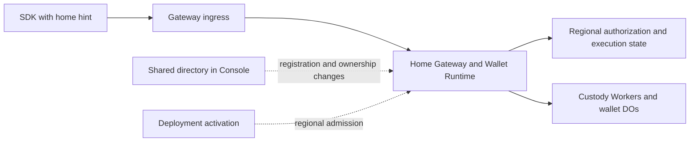

# Regional execution without routine Console calls

Status: implementation in progress. Local wallet execution authority is separated from registration coordination. Regional deployment admission and transactional D1 writer fences are implemented. Routine signing still requires the remaining routing changes.
Date: October 6, 2026.

## Objective

Remove synchronous Console calls from established-session signing and presignature
refill. Regional Gateways, Wallet Runtimes, and custody roles must enforce execution
authority using their admitted local state. Keep shared coordination for directory
changes, registration reservations, deployment changes, and relocation.

Reduce registration's Console dependency to operations that need shared ownership
or discovery coordination. Run registration continuations at the reserved home.
Console availability must not determine whether an already admitted wallet can
sign at its active home.

This is a separation of responsibilities within the existing deployment. It does
not require another Worker, database, signing secret, environment-variable family,
or configuration framework. It does not guarantee physical colocation of custody
Workers, DOs, Containers, and D1. Their remaining network hops are separate work.

## Terms and boundaries

- **Shared directory:** cross-region records that identify a wallet's home and
  enforce existing identity, credential, and registration claims. Console hosts it today.
- **Regional execution:** authentication, operation admission, protocol execution,
  budget accounting, reservations, and durable completion at an admitted home.
- **Ownership generation:** a version identifying one period of wallet ownership
  at a home. Relocation installs a later generation. It is not a browser connection generation.
- **Fence:** durable state that prevents an inactive home or deployment from
  admitting or committing unauthorized work.
- **Routing hint:** a suggested region supplied by the client. It grants no authority.

The directory coordinates ownership changes. Local fences enforce execution.
A previously issued session or routing response cannot reopen a fenced home.

## Evidence and present coupling

The October 6 comparison measured roughly 90–100ms for the Gateway binding lookup
on ordinary APAC requests. Moving Console toward the Gateway increased Console
D1 reads by about 50ms and gave no signing improvement. That change was reverted.

The comparison used a frozen SDK that still made a separate status request.
Current SDK code already reconciles session authority from prepare. Preserve that
optimization and use matching current SDK/Gateway builds for the new comparison.
Do not count its earlier saving again or treat the binding span as a guaranteed
end-to-end saving. See [the call-path evidence](evidence/r155-call-path-20261006.json)
and [the R155 results](refactor-155-reusuable-DO.md).

Current calls do more than inspect dashboard configuration:

| Current responsibility | Owner today | Required destination |
| --- | --- | --- |
| Resolve active deployment and verify writer version/resource | Console, before Gateway dispatch | Regional deployment admission installed during activation |
| Resolve session locator to wallet home | Console on routine requests | Session routing metadata, with local authorization |
| Supply tenant identity to the Gateway | Console binding response | Validated regional deployment configuration |
| Reserve one registration allocation and home | Shared directory | Keep shared reservation; reuse it for continuations |
| Enforce cross-region identity and passkey claims | Shared directory | Keep existing uniqueness and ownership rules |
| Publish discovery and lifecycle locators | Shared directory | Keep at the lifecycle transitions that require them |
| Check session, revocation, policy, budget, and one-use material | Regional authorization and custody state | Keep fresh local enforcement |
| Coordinate relocation | Console plus regional participants | Keep coordination; require local fences before ownership changes |

Registration has no cryptographic requirement to call Console. Its current shared
reservation prevents the same registration from creating different wallets when
a lost response is retried through another region. Its identity and credential
claims prevent conflicting records in independent regional databases.
Retain those guarantees without putting directory reads before every continuation.

## Target request paths



Normal signing and refill must make zero Console requests, including internal
forwarding, background writes, alarms, and continuations. The first ingress may
use the existing regional service bindings to forward once. New public regional
hostnames are not required.

| Flow | Directory involvement in the target design |
| --- | --- |
| Established-session signing and refill | None on the normal path |
| Registration setup | Reserve the exact wallet, operation, and home |
| Registration continuations | None where persisted local reservation and authority are sufficient |
| Registration claims and completion | Commit shared claims and discovery at their required transitions |
| Unlock with a known home | Regional execution where existing factor/identity contracts permit it |
| New-device discovery or missing routing information | Explicit directory discovery |
| Stale route after relocation | Controlled rediscovery, separate from ordinary authorization failures |
| Deployment activation and retirement | Install or fence regional deployment authority |
| Wallet relocation | Coordinate source freeze, transfer, destination activation, and directory update |

## Design rules

1. Return home routing metadata with existing registration and authenticated
   session responses. Carry the ownership generation where the execution contract
   requires it. Reuse existing wallet, session, home, and generation types.
2. Treat client routing metadata as untrusted input. Parse a region from the
   configured catalog once. Authenticate the operation at the selected home and
   compare its authoritative local ownership state. Never accept a client URL,
   region, generation, or forwarding marker as execution authority.
3. Keep fresh regional session and policy checks. Preserve revocation, expiry,
   budget, material retirement, exclusive reservation, and terminal replay.
   Combine ownership/deployment predicates with existing admission transactions
   where possible. Avoid adding one separate D1 request per new check.
4. Install tenant identity and admitted deployment/resource identity through the
   existing deployment workflow. Regional state must reject an old writer after
   retirement. A cached Console response or static configuration alone cannot
   preserve immediate retirement semantics.
5. Use the existing registration reservation as the durable anchor for local
   continuations. Keep shared credential claims at the point their inputs become
   available. Do not assume every registration variant has all claims at setup.
6. Preserve explicit pending and terminal registration states across local and
   directory writes. A lost reply must resume the same operation. Registration
   success requires the ownership and discovery records needed for later access.
   Do not replace these records with an untracked background publication.
7. Reuse R153's ownership generations and local execution fences. Freeze source
   admission and settle or fence admitted work before activating the destination.
   A route refresh cannot make an inactive destination executable.
8. Directory discovery must be bounded. Ordinary 401 responses, exhausted budgets,
   and protocol failures must not trigger region probing or automatic rediscovery.
   Preserve operation identity on permitted retries, including uncertain finalize replies.
9. Keep the current shared uniqueness rules. Removing all directory coordination
   from registration is outside this plan. Moving a directory endpoint to another
   Worker would not by itself reduce coordination or latency.
10. Use one final implementation. Add no legacy routing flags, stale-authority
    fallback, alternate token scheme, or compatibility path for disposable test wallets.

## Change inventory

Paths below are repository-relative. Confirm moved files before editing. R153
work is active; listed local authority components are integration points, not a
claim that their full relocation contract is already complete.

| Repository and area | Existing sources | Required change |
| --- | --- | --- |
| Private Gateway entry | `packages/wallet-console-server-ts/src/router/cloudflare/d1GatewayWorker.ts` | Remove unconditional Console resolution from routine execution; use locally admitted deployment context |
| Private Console lookup | `walletPlacement/gatewaySession.ts`, `tenantDeployment/runtimeBinding.ts`, under the same package | Replace combined request-time lookup; retain only directory/control uses with real callers |
| Private regional routing | `walletPlacement/regionalDispatch.ts`, `authenticationDispatch.ts`, `sessionLocators.ts` | Route from bounded metadata; keep explicit discovery and remove obsolete session-locator reads/publications when no consumers remain |
| Private registration | `walletPlacement/registrationAdmission.ts`, `d1.ts`, `passkeyClaims.ts`, `identityService.ts`, registration offer client/service | Separate shared claims from local continuation admission and completion recovery |
| Private activation | `tenantDeployment/d1.ts`, `resourceVerification.ts`, `deployment/wallet-system/targets.json` and existing render/activation scripts | Install regional scope and writer admission; enforce retirement without per-request Console calls |
| Private relocation | `walletPlacement/executionAuthority.ts`, relocation coordinator and participant modules | Make directory observations control-plane inputs; preserve source and destination execution fences |
| Public runtime/auth | `packages/wallet-server/src/router/cloudflare/d1/registration/d1WalletExecutionAuthority.ts`, `d1WalletOperationStore.ts`, authorization stores/statements | Enforce admitted local generation and deployment at real operation boundaries |
| Public SDK/wire | Existing session responses, relayer clients, registration flow, signing and refill callers | Carry home routing metadata through owner, linked-device, restored, and step-up flows |
| Public custody | `crates/router-ab-cloudflare/src/` signing, pool, DO, and relocation modules | Preserve exact wallet/generation context across requests, deferred work, and terminal replay |
| Public specifications | `docs/intended-behaviours.md`, R153 and R155 plans | Specify Console-outage behavior and the new routing/authority contract |
| Private acceptance | `tests/e2e/regional-*`, `tests/relayer/wallet-relocation-directory.e2e.test.ts`, `tests/e2e/hosted-product/` | Verify composed routing, outages, relocation, registration retries, and hosted timings |

## Phase 1 — Freeze the authority and call inventory

- [ ] Trace owner and linked-device ECDSA, Ed25519, step-up signing, and refill.
  Include internal dispatch, alarms, continuations, completion, and error paths.
- [ ] Inventory every Console read/write on those paths. Identify its data,
  enforcement guarantee, existing local equivalent, and replacement owner.
- [ ] Trace passkey and Google/email registration separately. Classify each
  directory call as reservation, global claim, discovery publication, or repeated read.
- [ ] Pin the R153 generation/fence contract and the deployment retirement contract.
  Record whether each required local enforcement path is implemented and verified.
- [ ] Define typed outcomes for local execution, discovery required, relocation
  paused, retired authority, and ordinary auth failure. Keep routing separate from authorization.

Exit: each removed call has an explicit replacement or evidence that it is redundant.

## Phase 2 — Install and enforce regional execution authority

- [x] Extend the existing activation workflow to install required local tenant,
  resource, and writer admission before enabling regional traffic.
- [ ] Reuse local wallet-generation state. Keep identity fields required and
  represent admission/retirement states with exhaustive domain types.
- [ ] Enforce current authority at operation admission and durable side effects.
  A read performed before a freeze is insufficient to authorize a later write.
- [x] Define deployment cutover failure handling. Do not complete retirement
  while an old regional writer remains authorized. Rollback must not revive a
  retired wallet generation or discard terminal operation history.
- [ ] Preserve valid terminal replay while rejecting new execution under retired
  authority. Use existing replay and relocation rules rather than parallel logic.

Exit: regional enforcement provides the safety previously supplied by Console
lookups, including concurrent cutover and relocation. Console-independent signing
must not be enabled before this gate passes.

## Phase 3 — Route sessions and remove routine Console calls

- [x] Add region metadata to existing registration/session issuance and restore
  boundaries. Update shared types, SDK persistence, transport, and response parsers together.
- [x] Forward through existing regional bindings using catalog-validated hints.
  Preserve the public entrypoint and enforce a bounded forwarding path.
- [ ] Authenticate locally and reject wrong wallet, tenant, resource, generation,
  revoked session, and frozen-home combinations.
- [ ] Remove the unconditional combined Console lookup from signing and refill,
  including forwarded destination requests and internal/deferred execution.
- [ ] Keep explicit discovery for missing/stale routing. Avoid treating all
  signing failures as routing failures. Bound rediscovery and preserve retry identity.
- [ ] Preserve prepare-based session reconciliation. Do not reintroduce the
  separate session-status request or increase routine D1 round trips accidentally.

Exit: ordinary signing/refill and their background work make zero Console calls.

## Phase 4 — Reduce registration coordination

- [ ] Reserve the wallet, home, and stable operation identities through the
  existing directory authority. Retries through another ingress reuse the reservation.
- [ ] Persist local registration admission and route continuations from that state.
  Remove repeated directory checks whose guarantees now have local enforcement.
- [ ] Retain global identity and credential claims. Batch related statements
  within their owning database when that preserves their existing semantics.
- [ ] Make completion recoverable across regional and directory writes. Verify
  lost replies, cancellation, conflicting retries, and cleanup of incomplete attempts.
- [ ] Publish required discovery information before registration success. Return
  the admitted home with the initial session and preserve early presign preparation.

Exit: each remaining registration Console call changes or discovers shared state
for a documented reason. Protocol continuations use their reserved regional authority.

## Phase 5 — Verify behavior and Console independence

Extend existing E2E scenarios and type fixtures. Add no unit-test suite or source
text guards. Update the intended-behavior specification with the implementation.
Classify existing outage assertions before changing them: a deliberate contract
change does not make unrelated authentication failures obsolete.

- [x] Establish a session, make Console unavailable, and verify ready signing and
  a three-signature sequence that forces refill. Assert zero attempted Console calls.
- [ ] Repeat for owner and linked-device signing, relevant ECDSA/Ed25519 paths,
  session restore, and step-up paths with otherwise available prerequisites.
- [x] Verify shared-budget exhaustion followed by fresh passkey step-up for both
  NEAR and ECDSA through remote ingress with zero Console calls.
- [ ] During the outage, verify revocation, budget exhaustion, material retirement,
  wrong-region hints, malformed metadata, and concurrent double-use rejection.
- [ ] Restart Gateways/DOs and verify authority survives without in-memory Console
  caches. Check deferred refill, alarms, and background completion explicitly.
- [ ] Race signing/refill with R153 source freeze and destination activation.
  Verify no two homes execute the same ownership generation and no late write escapes a fence.
- [ ] Exercise stale routing and an uncertain finalize reply across relocation.
  Preserve exact replay rules and prevent duplicate budget or material consumption.
- [ ] Retry registration through two regions with lost setup/completion replies.
  Verify one allocation, one home, stable identities, and discoverable completion.
- [ ] Race conflicting identity/credential claims across regions. Verify existing
  uniqueness rules and cancellation cleanup remain intact.
- [ ] Exercise partial deployment activation, old-writer traffic, retirement, and
  rollback. Verify denied writers cannot regain execution through stale local state.
- [ ] Produce repeatable artifacts with request counts, state transitions, and
  independently verified signatures. Exclude secrets and credential bodies.

Exit: the composed E2E evidence proves the new dependency boundary and retained guarantees.

## Phase 6 — Controlled staging comparison

- [ ] Freeze matching SDK, Gateway, Runtime, Console, and custody candidates.
  Record source revisions, deployment versions, actual D1 regions, and placement settings.
- [ ] Capture a fresh control with the current prepare-based session validation.
  Hold protocol, pool target, prewarm, client location, and workload constant.
- [ ] Compare ready signing, immediate registration-to-sign, and three consecutive
  signatures. Record medians, maxima, refill waits, HTTP requests, D1 calls, and
  attempted Console calls. Keep confirmation and test automation timing separate.
- [ ] Verify all four regional routes and same-wallet travel. Run a bounded
  Console-outage acceptance scenario without disturbing concurrent experiments.
- [ ] Repeat the control/candidate comparison before claiming a latency gain.
  Record failures and rejected candidates alongside successful measurements.
- [ ] Use existing staging resources within the **$25 total Cloudflare budget**.
  Add no keepalive or new infrastructure. Preserve exact restoration instructions
  for deployment versions and non-versioned settings. Production deployment and npm publication are outside this plan.

Exit: publish measured results and limitations. Zero routine Console calls is a
required result; a particular millisecond saving is not promised in advance.

## Phase 7 — Remove obsolete paths and close the refactor

- [ ] Delete replaced session lookup adapters, remote admission wrappers, unused
  DTOs, dead exports, and redundant publications. Keep directory locators still
  needed by discovery, recovery, registration, or relocation.
- [ ] Remove old request shapes and disposable-test-state assumptions. Keep any
  unavoidable storage conversion at the persistence boundary, then retire it.
- [ ] Update public contracts, deployment documentation, examples, and R153
  integration notes. Name the remaining Console dependencies explicitly.
- [ ] Run relevant type fixtures, composed E2E checks, and the bloat gate. Review
  the final implementation for duplicate authority sources and hidden Console calls.
- [ ] Commit only owned changes on `dev` in each repository. Preserve concurrent
  R153 work. Record final evidence and any separate unfinished work honestly.

## Completion criteria

- Existing admitted sessions sign and refill during a Console outage.
- Regional checks enforce current authorization, deployment admission, ownership,
  budgets, and one-use material without relying on a stale directory snapshot.
- Registration retains cross-region retry and ownership guarantees with fewer
  repeated directory calls; discovery remains correct after completion.
- Relocation and deployment retirement cannot leave two active execution owners.
- All four regional routes pass acceptance, with measured latency and request counts.
- The old routine Console path is deleted. No compatibility switch or second
  authority mechanism remains beside its replacement.

Related plans: [R152](refactor-152-regional-D1.md),
[R153](refactor-153-wallet-region-selection.md),
[R155](refactor-155-reusuable-DO.md).

## Implementation evidence — October 6, 2026

The first implementation slice separates `WalletExecutionAuthority` from
`WalletRegistrationReservationAuthority`. Recovery, export, and signer installation
now receive the D1 service's local execution authority. They cannot obtain ordinary
execution authority through the registration adapter.

The local query requires the exact tenant, wallet, and active ownership generation.
The existing registration wrapper retains completion reconciliation and generation
fences. The obsolete Console ordinary-admission adapter and standalone registration
receipt lookup are removed. Registration retries can still consult the shared directory.

Verification:

- Wallet server type check and wallet-state type fixtures pass. Type fixtures reject
  registration authority as execution authority, including object spreads.
- `node tests/e2e/authorization-storage-transfer.e2e.mjs` passes. Its repeatable artifact
  is `.artifacts/r153/authorization-storage-transfer/evidence.json`. It verifies
  registration completion retry, destination activation, source retirement, and tenant
  separation. The standalone local admission query is exercised against active and
  retired homes.
- Private Console server type check passes.
- Private `wallet-relocation-directory.e2e.test.ts` passes (1 test). Its directory
  assertions now call the shared directory client directly.
- `pnpm report:bloat --check` passes. No ratcheted measure grew.

This slice does not establish Console-independent signing. Local deployment writer
admission, cutover fencing, regional session routing, outage acceptance, and hosted
measurements remain open. No latency gain is claimed for this slice.

## Regional deployment implementation — October 6, 2026

Deployment activation now prepares every configured regional database before Console
commits activation. Preparation pauses prior admission. After Console commits, regional
activation installs the admitted binding and verified Gateway/Wallet Runtime versions.
The existing `reuse_active` operation completes a partially delivered activation.
Monotonic sequence guards reject delayed preparation or activation from an older deployment.
If preparation fails before the central commit, affected regions remain paused. A new
operator-authorized activation can replace that prepared proposal.

Gateway and Wallet Runtime deployment reads now use regional D1. Gateway session
discovery still calls Console and checks that the directory response matches the local
binding revision. Scheduled prewarm uses regional deployment admission. No new secret,
Worker, database, or environment variable is required. Migration `0066` installs the
admission table and its transactional writer guard. Apply it before activating these
Worker builds. Existing remote deployments were not changed during this implementation.

Each runtime D1 batch checks its exact admitted binding and writer in the same
transaction as its statements. Deferred work keeps that database adapter, so a request
admitted before cutover cannot write after preparation retires its writer. The guard
adds a local SQL statement to the existing batch. It does not add a network roundtrip.
Its latency and D1 charge impact remain unmeasured. Privileged deployment/relocation
control routes retain their separate control authority and use the underlying database.

Verification:

- Private server type check passes.
- Deployment binding and regional renewal E2E tests pass.
- Renewal covers lost central replies, interrupted regional activation, retry, old-writer
  rejection, delayed-write rejection, current-writer batches, stale command rejection,
  private control retries, and rejection of wrong-writer/public-origin control requests.
- The test emits `deployment-renewal-evidence.json` and its SHA-256. The retained copy is
  [regional admission evidence](evidence/r155b-regional-admission-20261006.json).
- Public bloat check passes.
- The broad private test type check remains non-green because of unrelated application
  aliases and stale fixtures. The changed files had no reported errors.

Remaining gates: complete session-home metadata and forwarding, remove routine directory
reads, verify all signing/refill paths during a Console outage, audit custody-side deferred
execution, reduce registration continuation lookups, and run the controlled hosted comparison.
No new signing-latency result is claimed.

## Local session routing — October 6, 2026

Gateway now checks the regional session tables before requesting Console discovery.
The lookup uses the exact tenant and credential digest. It returns the wallet identity
for the existing dispatcher scope checks. It uses the deployment-fenced database.

A matching record selects the local handler. The existing authorization service still
checks credential validity, revocation, budget, and execution generation. Retired records
also select local handling, so revocation cannot cause directory rediscovery. Unknown
credentials retain directory discovery. No new table, cache, secret, or SDK token is added.

Verification:

- Private server type check and deployment-binding E2E pass.
- `node tests/relayer/local-session-routing.e2e.mjs` passes against real Miniflare D1
  with production routing and authorization code.
- Known direct credentials make zero Console routing calls during a simulated outage.
  Hosted credentials and exchange codes resolve to the correct local wallet.
- Wrong-tenant lookup fails. Revoked credentials remain local and fail authorization.
  The initial three-use quota remains intact. Unknown credentials attempt discovery once.
- The runner emits a repeatable artifact with a production bundle digest. The retained
  copy is [local session evidence](evidence/r155b-local-session-routing-20261006.json).
- Public bloat check passes.

This adds one local D1 lookup and removes the Console discovery request for known local
sessions. End-to-end latency remains unmeasured. This test does not execute an MPC signature.
Cross-region discovery, complete Console-outage signing/refill acceptance, custody deferred
execution, registration continuation lookups, and hosted measurements remain open.

## Bounded forwarding and response metadata — October 6, 2026

Gateway accepts `X-Seams-Wallet-Region` only for US, WEUR, APAC, or OC. It resolves
the hint against the admitted resource catalog and forwards through existing service
bindings. A forwarding marker prevents a second hop. The destination still checks
local session and execution authority. The hint grants no authority.

A missing credential at a hinted or forwarded destination returns
`wallet_home_discovery_required` with HTTP 409. It does not contact Console or probe
other regions. Requests without a hint retain explicit directory discovery.
Local Gateway responses expose their serving region through the same header. CORS
allows the request header and exposes the response header to browser clients.

The local routing E2E verifies one-hop transport, destination-local credential lookup,
loop rejection, invalid-target rejection, explicit discovery on a route miss, and CORS
metadata. Server type checks and the existing deployment-binding E2E pass. Bloat checks
pass. Updated evidence remains in the local session routing artifact.

SDK ingestion and persistence of this metadata remain incomplete. No automatic client
routing or full MPC outage result is claimed. The next integration must retain the
home with each session across owner, linked-device, hosted exchange, and restore flows.

## Session home persistence — October 6, 2026

Primary and hosted credentials now carry required home metadata: a direct endpoint
or one configured regional home. Managed issuance reads the home from its existing
regional publisher. Standalone issuance uses the direct endpoint. No token format,
secret, or routing cache is added. Parsers reject missing or invalid metadata.

The SDK credential parser preserves the home in the existing authorization row.
Session status and ECDSA activation requests send the regional hint from that credential.
The hosted-session parser also retains it. Static fixtures reject missing home data,
mixed direct/regional states, and arbitrary target URLs.

The routing E2E verifies issuance, hosted exchange, serialization through the SDK
record writer/parser, and request-header construction. It does not simulate a browser
reload or perform an MPC signature. Public server, SDK, and private server type checks
pass; bloat checks pass. The retained local-session artifact records this boundary test.

Remaining SDK work includes normal-signing and refill credential projections, hosted
request consumers, exchange routing before redemption, and complete linked-device and
reload acceptance. Do not treat this checkpoint as full client routing completion.

## Signing, refill, and exchange propagation — October 6, 2026

The SDK now requires home metadata in both ECDSA and Ed25519 protocol credentials.
Owner, linked-device, login-prefill, recovery, restore, and step-up projections retain
that metadata. Prepare/finalize, presignature pool requests, and Ed25519 step-up use
the shared session-header builder. Existing prepare-based session reconciliation remains.

Hosted exchange issuance returns the home. Its response parser, iframe message, and
redemption request retain it. Both exchange minting and redemption send the regional hint.
Hosted credential inventory requests also retain the home. Linked-device encrypted
delivery now requires the canonical credential type instead of a handwritten subset.

Public server and SDK type checks, private server type checks, and the focused routing
E2E pass. The E2E also verifies home preservation across the exchange iframe payload.
Bloat checks pass. The intended browser registration/refresh and mixed ECDSA/Ed25519
signing cases are running against the local backend; no browser result is claimed yet.
This remains an implementation checkpoint, not full regional MPC outage acceptance.

Remaining gates include bounded stale-route rediscovery, registration continuation
admission, custody/deferred-path review, complete outage/concurrency acceptance, and
the hosted ECDSA/Ed25519 comparison. No new latency result is claimed.

## Completed-registration continuation admission — October 6, 2026

A continuation for an exact, locally completed registration now reads its active
execution generation without Console. The lookup requires tenant, wallet, registration
origin, and ceremony identity. Pending registrations retain the shared admission check;
cancellation and completion races must be resolved before that check can be removed.
This adds a local lookup before pending admission. Its latency impact is unmeasured.

The routing E2E verifies completed admission with the directory unavailable and rejects
a different ceremony. Regional hints also apply to requests without session tokens,
which allows bounded forwarding of registration continuations. Handler authorization
remains required. Server types, the focused routing E2E, and bloat checks pass.
Browser lifecycle and authorization-transfer verification are still running.

### Signing proxy ownership contract repair — October 6

The local Ed25519 browser contract exposed a production regression: the Gateway
proxy matched an obsolete owner-admission field list. The required
`ownership_generation` field prevented that match, so the proxy forwarded the
browser bearer token. The custody Router correctly rejected it. The proxy now
requires the current generation field and strips the token for owner admission.
The custody rejection remains unchanged. Server type-checking and the bloat
check pass. After rebuilding the server bundle, the immediate-signing/refresh
browser contract passed (one Chromium E2E, 34.3 seconds total test time).
It exercises registration, immediate NEAR signing, reload, and restored signing.
Command: `SEAMS_INTENDED_SKIP_BUILD=1 node scripts/run-wallet-intended-isolated.mjs
-- e2e/intended-behaviours/passkey.ed25519-yao-local.contract.test.ts --grep
"public Ed25519 Yao registration"` from `tests/`, after
`pnpm -C packages/wallet-server run build`. This is correctness evidence,
not a hosted latency measurement. The first attempted rerun used the old Worker
bundle and was stopped; it does not measure the fix.

The authorization-storage-transfer E2E passed. Its repeatable artifact is
`.artifacts/r153/authorization-storage-transfer/evidence.json`. It verifies
local execution admission with zero central ordinary reads before destination
activation and after cleanup, immutable generation, and one quota charge on
exact retry. This test does not execute MPC signing or prove a complete
Console-outage signing flow.

### Mixed-curve browser acceptance — October 6

The existing mixed-curve contract passed with the rebuilt server bundle: one
Chromium E2E, 38.6 seconds total test time. It registers an Ed25519 wallet,
adds ECDSA signing, signs NEAR/Tempo/Arc, unlocks and signs again, and injects
a lost finalize response. Use the same isolated command above with
`--grep "public ECDSA add-signer"` to repeat it. Both curve contracts now pass.
These local tests verify transport and lifecycle behavior. They do not establish
regional latency or Console-outage independence.

Registration coordination still needs local continuation routing and a durable
terminal decision. The current completion order calls the directory before
updating local execution state. A registering-state fast path alone could admit
work during that cancellation window. Close that window before removing the
pending-ceremony directory check.

### Durable registration terminal decision — October 6

Migration 0067 adds an immutable completion decision to the existing execution
generation row. Completion fixes the outcome before contacting Console. A
cancellation also retires local execution in that transaction. Establishment
activates local execution only after Console acknowledges completion. Exact
retries can republish the same decision; conflicting outcomes fail before any
Console request.

The real-D1 local-session-routing scenario passes for lost establishment and
cancellation replies, exact retry, conflicting outcomes, and ordinary admission
before/after completion. Server type-checking and the bloat gate pass. Pending
registration admission still uses Console until continuation routing and durable
write enforcement are verified. Authorization-transfer verification is running.

### Registration continuation routing and cancellation writes — October 6

Private commit `ceb98c3` routes a known ceremony from the exact tenant's regional
execution record. It preserves session-to-wallet matching and the handler's
authorization checks. Unknown ceremonies retain directory discovery.

Migration 0068 rejects inserts and updates of cancelled registration ceremony
and setup records. Cleanup deletes remain available. The real-D1 routing scenario
verifies late-write rejection after a lost cancellation reply, prevents recreation
after cleanup, and preserves exact completion retry. The bloat gate passes.
Custody and session-publication write coverage still needs verification before
pending registration admission can become fully local.

### Registration lifecycle and session cancellation guards — October 6

The shared transactional lifecycle guard now rejects cancelled registrations.
The custody state store and registration operation journal already include this
guard in their write batches. Migration 0069 also blocks Wallet Session insertion
for a cancelled registration, including issuance admitted before cancellation.
The real-D1 scenario verifies guard rejection, calls the production authorization
service after cancellation, and confirms no session row was persisted. Server
type-checking and the bloat gate pass. Pending registration still uses Console
admission; remote custody effects and completion reconciliation remain under review.

### Local pending registration admission — October 6

An exact local registration generation now admits pending continuations without
a Console read. Initial admission still establishes the reserved home through
Console. Completed local generations admit ordinary execution. Retired local
generations reject execution. A fixed establishment or cancellation decision
is republished on continuation retry after an uncertain completion reply.
The former directory-based activation recovery branch was removed.

The real-D1 scenario passes after recreating the authority object with the
directory configured to reject any second admission lookup. It also verifies
terminal reconciliation, conflicting completion, cancellation write guards,
and session publication refusal. Type-checking and the bloat gate pass.
Browser contracts and authorization-transfer verification are running. Full
hosted Console-outage acceptance and remote-effect cancellation remain unproven.

### Bounded explicit home discovery — October 6

Signing prepare/finalize and ECDSA refill transports now retry once without the
region hint when the Gateway explicitly returns `wallet_home_discovery_required`.
The same URL, body, bearer token, and abort signal are retained. Other errors
remain terminal. This does not add a routing cache or change the stored credential.
A moved session can require discovery again until its routing metadata is renewed.

The network scenario verifies successful discovery, no retry on HTTP 401, and
a maximum of two attempts when discovery is refused again. It checks exact body
and token preservation. The existing regional D1 routing scenario also passes.
SDK type-checking passes. Both browser contracts passed after local registration
admission; the discovery transport still needs composed browser acceptance.

### Composed Console-outage acceptance — October 6

Two regional browser contracts passed (1.5 minutes total suite time). Each
registers a real mixed-curve wallet, disables both Console services, and completes
three signatures. The ECDSA sequence records three prepare/finalize pairs plus
seven refill-init and 35 successful refill-step requests during the outage. The
Ed25519 sequence records three prepare/finalize pairs. Both record zero attempted
Console calls, including awaited background work.

Repeat from the private repository:
`SEAMS_WALLET_SERVER_CANDIDATE=/Users/pta/Dev/rust/seams-wallet/packages/wallet-server
SEAMS_INTENDED_SKIP_BUILD=1 node tests/scripts/run-regional-real.mjs
passkey.registration.contract.test.ts` after building the candidate runtime.
Evidence: `docs/evidence/r155b-console-outage-ecdsa.json` and
`docs/evidence/r155b-console-outage-ed25519.json`. The harness uses production
session resolution, regional dispatch, Gateway handlers, D1, and local custody
Workers. Deployment admission is fixture configuration. These results do not
prove physical regional latency, linked-device/step-up outage behavior, restart,
or relocation concurrency.

### Owner preflight routing repair — October 6

Travel acceptance exposed an Ed25519 production regression: owner execution-lane
preflight sent the token without its home. A remote Gateway therefore tried
Console discovery during the outage. Preflight now requires the canonical
operation credential and uses its home metadata and bounded discovery transport.
Both Ed25519 and ECDSA callers pass that credential.

After rebuilding the SDK, both owner browser cases complete signatures through
WEUR, APAC, and OC ingress for a US wallet with Console disabled. Type-checking
and the bloat gate pass. Linked-device cases are running. This tests regional
routing in local Workers, not physical travel latency.

### Linked-device installation generation repair — October 6

Both linked-device outage cases initially failed before the outage: their
source-preserving Ed25519 Router target omitted required `ownership_generation`.
The adapter now requires local established-home admission and sends that
generation in the target. It refuses retired ownership before remote execution.
Server type-checking and the bloat gate pass. Linked-device browser acceptance
is being repeated; no linked-device outage success is claimed yet.

### Linked-device Console-outage acceptance (2026-10-06)

The composed browser E2E now passes for linked ECDSA and Ed25519. Each case
registers an owner in US, installs a linked device through WEUR, disables both
Console transports, and completes three signatures. Each records three successful
home prepare/finalize pairs and zero attempted Console calls. ECDSA also completes
presignature refill steps during the outage.

The ECDSA test exposed a production regression: linked reusable sessions received
the operation-step-up reconciliation callback. Commit `69b17933` selects linked
session reconciliation instead. It checks the current selected authority, exact
session record, quota identity, remaining uses, and expiry against prepare's
response before client signing. It adds no session-status request.

Verification: SDK type-check, SDK build, bloat check, and both linked browser cases
pass. The first rerun stopped before tests because local Worker ports were occupied;
the same command passed after those ports became free.

Repeat from the private repository:

```sh
SEAMS_WALLET_SERVER_CANDIDATE=/Users/pta/Dev/rust/seams-wallet/packages/wallet-server SEAMS_INTENDED_SKIP_BUILD=1 node tests/scripts/run-regional-real.mjs passkey.registration.contract.test.ts --grep 'linked (ecdsa|ed25519)'
```

Evidence: [ECDSA](./evidence/r155b-console-outage-linked-ecdsa.json) and
[Ed25519](./evidence/r155b-console-outage-linked-ed25519.json). These are local
composition results. Hosted latency, restart, revocation, and relocation-race
acceptance remain separate gates.

### Console-outage process restart acceptance (2026-10-06)

Private commit `aa679a9` extends the existing process-restart harness. Both browser
cases pass: ECDSA and Ed25519 each complete three signatures through WEUR for a US
wallet after the Gateway and all five local role Workers restart. Console remains
unavailable. D1 and DO storage reopen in place; production in-memory state is not
copied. Only test observations and outage controls survive in memory.

Both cases record zero attempted Console calls and three successful home
prepare/finalize pairs. ECDSA also completes refill work. Process receipts verify
replacement PIDs and an incremented role-worker generation. These local results
verify restart recovery; they do not measure hosted latency or an in-flight crash.

An initial attempt found stale SDK output after the credential gained a required
ownership generation. Rebuilding the SDK resolved that candidate mismatch. Local
port collisions also stopped startup attempts before test execution. The final
matched run passed both cases in 1.7 minutes.

Repeat the linked-outage command above with `--grep 'role restart'`.
Evidence: [ECDSA requests](./evidence/r155b-console-outage-ecdsa-restart.json),
[ECDSA restart](./evidence/r155b-restart-evidence-ecdsa-restart.json),
[Ed25519 requests](./evidence/r155b-console-outage-ed25519-restart.json), and
[Ed25519 restart](./evidence/r155b-restart-evidence-ed25519-restart.json).

### Linked revocation during Console outage

Private commit `dc8f441` extends the linked-device browser acceptance cases.
Both pass: the linked device completes three signatures, the owner revokes it
while Console is unavailable, and both NEAR and ECDSA signing then fail.
The existing harness verifies that the owner no longer lists the revoked device.
Each case still has exactly three successful home prepare/finalize pairs and zero
attempted Console calls. The ECDSA case also records rejected refill and prepare
requests with HTTP 401 after revocation.

Run the same regional browser command with `--grep 'linked (ecdsa|ed25519)'`.
Evidence: [ECDSA-led](./evidence/r155b-revocation-outage-ecdsa.json) and
[Ed25519-led](./evidence/r155b-revocation-outage-ed25519.json). Both curves are tried
and rejected after revocation in each case. This verifies ordinary linked-device
revocation during an outage, not an in-flight revocation race.

NEAR prepare now returns the fresh session-status projection through the shared
Gateway response builder. Its SDK reconciles the exact selected authority before
creating a signature share for transaction and signature-only signing. The separate
status-read removal remains pending: signing planning must be isolated from export
and restoration readers before using local observations. Registration, local signing
measurements, and verification are recorded in
[the NEAR-only benchmark](./optimization-12-NEAR-only-20261006.md).

### Shared budget and passkey step-up during Console outage — 2026-10-07

Private commit `304f2d7` adds one mixed-curve browser scenario. A US wallet unlocks,
Console becomes unavailable, and WEUR ingress completes one NEAR signature plus
concurrent Tempo/Arc signatures. The independent home budget check confirms
exhaustion. APAC ingress then completes NEAR step-up. OC ingress completes ECDSA
step-up. All five signatures verify independently.

The scenario exposed three production gaps:

1. ECDSA step-up issuance omitted the session token and regional home. It now
   requires the canonical credential and uses the existing bounded home-discovery
   transport. Session-based export issuance uses that transport too. Fresh
   factor-proof exports remain explicit. The optional legacy-cookie transport and
   its nested fetch wrapper were removed.
2. The destination Gateway still queried Console for authenticated ECDSA step-up.
   It now uses the resolved local wallet and rejects a different request wallet.
   The operation handler still verifies the factor proof and material.
3. ECDSA step-up used an active-quota reader, which threw after exhaustion. It now
   uses the existing exact-operation context reader. It verifies live authority,
   expiry, material, and fresh evidence without granting reusable quota. The
   existing complete-session equality helper replaces a duplicate field comparison.

The passing artifact records zero Console attempts, three authorization-grant
operations, and two verified-step-up operations in US. WEUR, APAC, and OC contain
no operation records. All recorded requests avoid server errors. Awaited refill
work is included. Evidence: [step-up outage](./evidence/r155b-step-up-outage.json).

Reproduce from the private repository with the candidate server and frozen SDK
configured, using `tests/scripts/run-regional-real.mjs` and
`passkey.registration.contract.test.ts --grep 'shared budget exhaustion'`.
Private raw runs are `/tmp/r155b-stepup*.log`. Public build and verification logs
are `.artifacts/r155b-step-up/`. The first attempt's independent status request
bypassed the regional harness; that fixture was corrected before the production
failures above were diagnosed. A build attempt during the server edit failed on
an import and stale type uses; it is excluded from passing evidence.

This result covers passkey step-up and shared-budget exhaustion. Email OTP step-up,
material-retirement races, relocation/cutover races, deferred alarm acceptance,
registration conflicts, and the matched hosted comparison remain separate gates.

Verification also passes for the rebuilt candidate's public passkey unlock/export
and shared-budget lifecycle E2E (33.9 seconds), SDK and server type-checks/builds,
Wallet lifecycle type fixtures, private Console-server type-check, and the bloat
gate. No hosted deployment or npm publication was performed.

### NEAR status-read reuse — 2026-10-07

NEAR exact signing preparation now passes its freshly read authorization directly
to sealed-runtime binding. This removes the duplicate HTTP read at that boundary.
The three existing NEAR browser scenarios pass before and after the change.
Complete-scenario status calls fall 35→29, 29→25, and 32→27. Prepare/finalize counts
and changed-authority rejection remain unchanged. Other status-read removal is
still pending. No hosted latency reduction is claimed.

See [NEAR measurements](./optimization-12-NEAR-only-20261006.md#near-duplicate-status-read-removal--2026-10-07)
and [repeatable evidence](./evidence/near-status-reuse-20261007.json).

### Email OTP step-up routing and remaining shared limiter — 2026-10-07

The composed Email OTP outage scenario registers and unlocks a mixed wallet in US,
then exhausts its shared budget through WEUR ingress. NEAR step-up enters through
APAC. The intended final ECDSA step-up enters through OC.

Two routing defects were identified and corrected in the candidate:
- The signing challenge used the unauthenticated login request variant. Signing
  now requires an explicit operation-step-up variant with the exact unexpired
  session credential. Transaction challenge types reject the login/export variants.
- The OTP Worker sent only the bearer token. It now uses the existing regional
  header builder and bounded discovery transport. A locally matched session routes
  challenge/factor-release directly, with request-wallet equality enforced.

The scenario remains incomplete. Three reusable signatures verify and the shared
budget reaches zero. The next OTP challenge reaches the home handler but fails
closed because the shared rate limiter calls `/internal/wallet-placement/v1/rate-limit`
on the unavailable Console. The home returns 500; forwarding reports 503. The test
attaches the exact attempted Console paths. No OTP or credential bodies are published.
[Sanitized dependency evidence](./evidence/r155b-email-otp-dependency.json).

Do not replace global counters with independent regional counters: the existing
IP, subject, wallet, provider, and organization limits must remain global. Direct
access to the current Console D1 would expand Gateway access beyond those counters.
The existing Gateway intentionally has no Console DB binding. The proposed isolated
rate-limit D1 requires an explicit update to the no-new-infrastructure constraint.
Cloudflare documents a proxy Worker for table-specific access restrictions:
[official D1 access-control guidance](https://developers.cloudflare.com/d1/tutorials/build-an-api-to-access-d1/).

The first attempt stopped before registration due to an expired Google test token.
The existing token-refresh script repaired that environment prerequisite. Later
failures exposed the routing defects and then the shared limiter dependency. These
are failed acceptance attempts, not evidence that Email OTP outage support is done.
Source snapshots, builds and logs are under `.artifacts/r155b-email-outage/`.

The normal Email OTP registration/unlock lifecycle E2E passes (47.7s), including
NEAR/ECDSA step-up, reload, and key export. SDK/private Console type checks, lifecycle
type fixtures, and the bloat gate pass. This does not close the outage gate.

### Regional routing rejection acceptance — 2026-10-07

The existing private regional browser suite now uses a real US wallet and its
captured NEAR signing request to verify three failures during Console outage:

| Mutation | Result |
| --- | --- |
| Malformed region metadata | 400 `invalid_wallet_region` |
| APAC home hint for the US session, entering through WEUR | 409 `wallet_home_discovery_required` |
| Different request wallet with the valid session credential | 403 `wallet_session_scope_mismatch` |

The first valid signature enters through WEUR. After the rejected requests,
APAC and OC ingress each complete another signature with the original reusable
budget. All three signatures verify. The verifier counts three successful home
prepare/finalize pairs and zero attempted Console calls. This proves the rejected
requests do not prevent those remaining budgeted operations. It does not establish
tenant/resource forgery rejection, concurrent double-use, hosted placement, or latency.

The case passes in 1.0 minute. Reproduce in `seams-monorepo`:
`tests/scripts/run-regional-real.mjs passkey.registration.contract.test.ts --grep 'regional routing rejects'`
with the existing candidate server and frozen SDK environment variables. The frozen
SDK is `.artifacts/r155b-email-outage/stepup-dist` in `seams-wallet`. The test writes
`rejections.json` and `console-outage.json` under the private
`.artifacts/r155b/console-outage/routing-rejections/` directory.
[Sanitized combined evidence](./evidence/r155b-routing-rejections.json).

### NEAR prepare-based planning consolidation — 2026-10-07

NEAR signing preparation now consumes existing local status observations and
requires fresh prepare reconciliation before creating a signature share. It
falls back to a fresh read when the full session projection differs. Cached
observations never overwrite persisted authority. Export/funding/restoration
readers remain fresh.

In matched browser scenarios, full-scenario status calls fall 29→19, 25→17, and
27→18. Actual SDK signing intervals in the transaction case fall 5→2, 5→2, and
9→5 status requests. Prepare/finalize counts remain unchanged. Both arms pass all
three NEAR cases. Linked revocation and shared-budget passkey step-up also pass
through regional ingress during Console outage. No hosted latency gain is claimed.
See [NEAR results](./optimization-12-NEAR-only-20261006.md#signing-preparation-uses-existing-observations--2026-10-07)
and [evidence](./evidence/near-signing-observation-20261007.json).

### Rejected NEAR lane-selection optimization — 2026-10-07

A diagnostic trace located one remaining status read in signing lane selection.
An experimental change reused the existing checked session observation there.
The three local NEAR contracts passed. Immediate signing status calls fell from
two to one; the reload signature fell from five to four.

The composed Console-outage acceptance rejected this candidate. Linked-device
revocation passed, but shared-budget exhaustion and step-up failed twice at
`/wallet/execution-lane/owner`. The home returned HTTP 503 with
`wallet_session_unavailable`. The previous frozen SDK passed that same budget
scenario against the current server. This is classified as a production regression.
The experimental source changes were reverted before commit.

The demonstrated boundary is lane selection followed by owner-lane preflight
during budget step-up. The exact server rejection cause still needs tracing.
Before removing this read, make preflight and prepare handle an exhausted
observation through the existing step-up path. Preserve fresh authority checks
before generating a client signature share. Do not weaken revocation or budget checks.

[Sanitized experimental request counts](./evidence/near-lane-observation-20261007.json).
These lower counts describe a rejected candidate, not shipped behavior or a
hosted latency improvement. Current immediate-signature status calls remain two.

### NEAR owner-lane preflight after budget exhaustion — 2026-10-07

The rejected lane-selection experiment exposed an owner-preflight defect. NEAR
preflight called the reader for a spendable session. An exhausted session made
that reader fail, producing HTTP 503 before signing could request step-up.

NEAR preflight now uses the existing exact-operation identity reader. It checks
the live authority, factor, expiry, signer family, and exact material activation.
It can return lane metadata after exhaustion. It grants no signing allowance.
Prepare and finalize retain their admission checks. ECDSA preflight keeps its
existing path. The redundant wallet-ID reparse was removed because both readers
already return a validated WalletId.

This server correction did not make the experimental client optimization ready.
With the status read removed, NEAR step-up progressed but the subsequent ECDSA
confirmation timed out. Narrowing the server change to NEAR and refreshing status
on a prepare-exhaustion response did not resolve that timeout. Both client changes
were reverted. The remaining client issue needs confirmation-flow tracing.
Immediate signing therefore still has two status calls in the accepted SDK.

One earlier run was invalidated by rebuilding watched server output during the
test. It is excluded from acceptance evidence. Later runs used fixed build inputs.

Final acceptance uses the accepted SDK and the NEAR-only server correction.
The composed test captures the unlocked session's NEAR owner-lane request,
consumes its three shared uses, and replays that metadata read through WEUR.
The read returns HTTP 200 from US. Fresh NEAR and ECDSA step-up then succeed.
The verifier records three reusable grants, two verified step-up operations,
and zero Console calls. Linked Ed25519 revocation also passes. Both final tests
passed in 1.7 minutes. Server type-check/build and the bloat check passed.

[Sanitized acceptance evidence](./evidence/near-preflight-exhaustion-20261007.json).
The executable composed scenario remains in the private repository at
`tests/e2e/regional-real/passkey.registration.contract.test.ts`.
