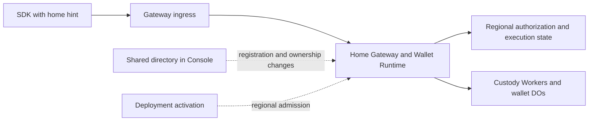

# Regional execution without routine Console calls

Status: implementation in progress. Local wallet execution authority is separated from registration coordination. Regional deployment admission and transactional D1 writer fences are implemented. Routine signing still requires the remaining routing changes.
Date: October 6, 2026.

## Objective

Remove synchronous Console calls from established-session signing and presignature
refill. Regional Gateways, Wallet Runtimes, and custody roles must enforce execution
authority using their admitted local state. Keep shared coordination for directory
changes, registration reservations, deployment changes, and relocation.

Reduce registration's Console dependency to operations that need shared ownership
or discovery coordination. Run registration continuations at the reserved home.
Console availability must not determine whether an already admitted wallet can
sign at its active home.

This is a separation of responsibilities within the existing deployment. It does
not require another Worker, database, signing secret, environment-variable family,
or configuration framework. It does not guarantee physical colocation of custody
Workers, DOs, Containers, and D1. Their remaining network hops are separate work.

## Terms and boundaries

- **Shared directory:** cross-region records that identify a wallet's home and
  enforce existing identity, credential, and registration claims. Console hosts it today.
- **Regional execution:** authentication, operation admission, protocol execution,
  budget accounting, reservations, and durable completion at an admitted home.
- **Ownership generation:** a version identifying one period of wallet ownership
  at a home. Relocation installs a later generation. It is not a browser connection generation.
- **Fence:** durable state that prevents an inactive home or deployment from
  admitting or committing unauthorized work.
- **Routing hint:** a suggested region supplied by the client. It grants no authority.

The directory coordinates ownership changes. Local fences enforce execution.
A previously issued session or routing response cannot reopen a fenced home.

## Evidence and present coupling

The October 6 comparison measured roughly 90–100ms for the Gateway binding lookup
on ordinary APAC requests. Moving Console toward the Gateway increased Console
D1 reads by about 50ms and gave no signing improvement. That change was reverted.

The comparison used a frozen SDK that still made a separate status request.
Current SDK code already reconciles session authority from prepare. Preserve that
optimization and use matching current SDK/Gateway builds for the new comparison.
Do not count its earlier saving again or treat the binding span as a guaranteed
end-to-end saving. See [the call-path evidence](evidence/r155-call-path-20261006.json)
and [the R155 results](refactor-155-reusuable-DO.md).

Current calls do more than inspect dashboard configuration:

| Current responsibility | Owner today | Required destination |
| --- | --- | --- |
| Resolve active deployment and verify writer version/resource | Console, before Gateway dispatch | Regional deployment admission installed during activation |
| Resolve session locator to wallet home | Console on routine requests | Session routing metadata, with local authorization |
| Supply tenant identity to the Gateway | Console binding response | Validated regional deployment configuration |
| Reserve one registration allocation and home | Shared directory | Keep shared reservation; reuse it for continuations |
| Enforce cross-region identity and passkey claims | Shared directory | Keep existing uniqueness and ownership rules |
| Publish discovery and lifecycle locators | Shared directory | Keep at the lifecycle transitions that require them |
| Check session, revocation, policy, budget, and one-use material | Regional authorization and custody state | Keep fresh local enforcement |
| Coordinate relocation | Console plus regional participants | Keep coordination; require local fences before ownership changes |

Registration has no cryptographic requirement to call Console. Its current shared
reservation prevents the same registration from creating different wallets when
a lost response is retried through another region. Its identity and credential
claims prevent conflicting records in independent regional databases.
Retain those guarantees without putting directory reads before every continuation.

## Target request paths

Normal signing and refill must make zero Console requests, including internal
forwarding, background writes, alarms, and continuations. The first ingress may
use the existing regional service bindings to forward once. New public regional
hostnames are not required.

| Flow | Directory involvement in the target design |
| --- | --- |
| Established-session signing and refill | None on the normal path |
| Registration setup | Reserve the exact wallet, operation, and home |
| Registration continuations | None where persisted local reservation and authority are sufficient |
| Registration claims and completion | Commit shared claims and discovery at their required transitions |
| Unlock with a known home | Regional execution where existing factor/identity contracts permit it |
| New-device discovery or missing routing information | Explicit directory discovery |
| Stale route after relocation | Controlled rediscovery, separate from ordinary authorization failures |
| Deployment activation and retirement | Install or fence regional deployment authority |
| Wallet relocation | Coordinate source freeze, transfer, destination activation, and directory update |

## Design rules

1. Return home routing metadata with existing registration and authenticated
   session responses. Carry the ownership generation where the execution contract
   requires it. Reuse existing wallet, session, home, and generation types.
2. Treat client routing metadata as untrusted input. Parse a region from the
   configured catalog once. Authenticate the operation at the selected home and
   compare its authoritative local ownership state. Never accept a client URL,
   region, generation, or forwarding marker as execution authority.
3. Keep fresh regional session and policy checks. Preserve revocation, expiry,
   budget, material retirement, exclusive reservation, and terminal replay.
   Combine ownership/deployment predicates with existing admission transactions
   where possible. Avoid adding one separate D1 request per new check.
4. Install tenant identity and admitted deployment/resource identity through the
   existing deployment workflow. Regional state must reject an old writer after
   retirement. A cached Console response or static configuration alone cannot
   preserve immediate retirement semantics.
5. Use the existing registration reservation as the durable anchor for local
   continuations. Keep shared credential claims at the point their inputs become
   available. Do not assume every registration variant has all claims at setup.
6. Preserve explicit pending and terminal registration states across local and
   directory writes. A lost reply must resume the same operation. Registration
   success requires the ownership and discovery records needed for later access.
   Do not replace these records with an untracked background publication.
7. Reuse R153's ownership generations and local execution fences. Freeze source
   admission and settle or fence admitted work before activating the destination.
   A route refresh cannot make an inactive destination executable.
8. Directory discovery must be bounded. Ordinary 401 responses, exhausted budgets,
   and protocol failures must not trigger region probing or automatic rediscovery.
   Preserve operation identity on permitted retries, including uncertain finalize replies.
9. Keep the current shared uniqueness rules. Removing all directory coordination
   from registration is outside this plan. Moving a directory endpoint to another
   Worker would not by itself reduce coordination or latency.
10. Use one final implementation. Add no legacy routing flags, stale-authority
    fallback, alternate token scheme, or compatibility path for disposable test wallets.

## Change inventory

Paths below are repository-relative. Confirm moved files before editing. R153
work is active; listed local authority components are integration points, not a
claim that their full relocation contract is already complete.

| Repository and area | Existing sources | Required change |
| --- | --- | --- |
| Private Gateway entry | `packages/wallet-console-server-ts/src/router/cloudflare/d1GatewayWorker.ts` | Remove unconditional Console resolution from routine execution; use locally admitted deployment context |
| Private Console lookup | `walletPlacement/gatewaySession.ts`, `tenantDeployment/runtimeBinding.ts`, under the same package | Replace combined request-time lookup; retain only directory/control uses with real callers |
| Private regional routing | `walletPlacement/regionalDispatch.ts`, `authenticationDispatch.ts`, `sessionLocators.ts` | Route from bounded metadata; keep explicit discovery and remove obsolete session-locator reads/publications when no consumers remain |
| Private registration | `walletPlacement/registrationAdmission.ts`, `d1.ts`, `passkeyClaims.ts`, `identityService.ts`, registration offer client/service | Separate shared claims from local continuation admission and completion recovery |
| Private activation | `tenantDeployment/d1.ts`, `resourceVerification.ts`, `deployment/wallet-system/targets.json` and existing render/activation scripts | Install regional scope and writer admission; enforce retirement without per-request Console calls |
| Private relocation | `walletPlacement/executionAuthority.ts`, relocation coordinator and participant modules | Make directory observations control-plane inputs; preserve source and destination execution fences |
| Public runtime/auth | `packages/wallet-server/src/router/cloudflare/d1/registration/d1WalletExecutionAuthority.ts`, `d1WalletOperationStore.ts`, authorization stores/statements | Enforce admitted local generation and deployment at real operation boundaries |
| Public SDK/wire | Existing session responses, relayer clients, registration flow, signing and refill callers | Carry home routing metadata through owner, linked-device, restored, and step-up flows |
| Public custody | `crates/router-ab-cloudflare/src/` signing, pool, DO, and relocation modules | Preserve exact wallet/generation context across requests, deferred work, and terminal replay |
| Public specifications | `docs/intended-behaviours.md`, R153 and R155 plans | Specify Console-outage behavior and the new routing/authority contract |
| Private acceptance | `tests/e2e/regional-*`, `tests/relayer/wallet-relocation-directory.e2e.test.ts`, `tests/e2e/hosted-product/` | Verify composed routing, outages, relocation, registration retries, and hosted timings |

## Phase 1 — Freeze the authority and call inventory

- [ ] Trace owner and linked-device ECDSA, Ed25519, step-up signing, and refill.
  Include internal dispatch, alarms, continuations, completion, and error paths.
- [ ] Inventory every Console read/write on those paths. Identify its data,
  enforcement guarantee, existing local equivalent, and replacement owner.
- [ ] Trace passkey and Google/email registration separately. Classify each
  directory call as reservation, global claim, discovery publication, or repeated read.
- [ ] Pin the R153 generation/fence contract and the deployment retirement contract.
  Record whether each required local enforcement path is implemented and verified.
- [ ] Define typed outcomes for local execution, discovery required, relocation
  paused, retired authority, and ordinary auth failure. Keep routing separate from authorization.

Exit: each removed call has an explicit replacement or evidence that it is redundant.

## Phase 2 — Install and enforce regional execution authority

- [x] Extend the existing activation workflow to install required local tenant,
  resource, and writer admission before enabling regional traffic.
- [ ] Reuse local wallet-generation state. Keep identity fields required and
  represent admission/retirement states with exhaustive domain types.
- [ ] Enforce current authority at operation admission and durable side effects.
  A read performed before a freeze is insufficient to authorize a later write.
- [x] Define deployment cutover failure handling. Do not complete retirement
  while an old regional writer remains authorized. Rollback must not revive a
  retired wallet generation or discard terminal operation history.
- [ ] Preserve valid terminal replay while rejecting new execution under retired
  authority. Use existing replay and relocation rules rather than parallel logic.

Exit: regional enforcement provides the safety previously supplied by Console
lookups, including concurrent cutover and relocation. Console-independent signing
must not be enabled before this gate passes.

## Phase 3 — Route sessions and remove routine Console calls

- [ ] Add region metadata to existing registration/session issuance and restore
  boundaries. Update shared types, SDK persistence, transport, and response parsers together.
- [x] Forward through existing regional bindings using catalog-validated hints.
  Preserve the public entrypoint and enforce a bounded forwarding path.
- [ ] Authenticate locally and reject wrong wallet, tenant, resource, generation,
  revoked session, and frozen-home combinations.
- [ ] Remove the unconditional combined Console lookup from signing and refill,
  including forwarded destination requests and internal/deferred execution.
- [ ] Keep explicit discovery for missing/stale routing. Avoid treating all
  signing failures as routing failures. Bound rediscovery and preserve retry identity.
- [ ] Preserve prepare-based session reconciliation. Do not reintroduce the
  separate session-status request or increase routine D1 round trips accidentally.

Exit: ordinary signing/refill and their background work make zero Console calls.

## Phase 4 — Reduce registration coordination

- [ ] Reserve the wallet, home, and stable operation identities through the
  existing directory authority. Retries through another ingress reuse the reservation.
- [ ] Persist local registration admission and route continuations from that state.
  Remove repeated directory checks whose guarantees now have local enforcement.
- [ ] Retain global identity and credential claims. Batch related statements
  within their owning database when that preserves their existing semantics.
- [ ] Make completion recoverable across regional and directory writes. Verify
  lost replies, cancellation, conflicting retries, and cleanup of incomplete attempts.
- [ ] Publish required discovery information before registration success. Return
  the admitted home with the initial session and preserve early presign preparation.

Exit: each remaining registration Console call changes or discovers shared state
for a documented reason. Protocol continuations use their reserved regional authority.

## Phase 5 — Verify behavior and Console independence

Extend existing E2E scenarios and type fixtures. Add no unit-test suite or source
text guards. Update the intended-behavior specification with the implementation.
Classify existing outage assertions before changing them: a deliberate contract
change does not make unrelated authentication failures obsolete.

- [ ] Establish a session, make Console unavailable, and verify ready signing and
  a three-signature sequence that forces refill. Assert zero attempted Console calls.
- [ ] Repeat for owner and linked-device signing, relevant ECDSA/Ed25519 paths,
  session restore, and step-up paths with otherwise available prerequisites.
- [ ] During the outage, verify revocation, budget exhaustion, material retirement,
  wrong-region hints, malformed metadata, and concurrent double-use rejection.
- [ ] Restart Gateways/DOs and verify authority survives without in-memory Console
  caches. Check deferred refill, alarms, and background completion explicitly.
- [ ] Race signing/refill with R153 source freeze and destination activation.
  Verify no two homes execute the same ownership generation and no late write escapes a fence.
- [ ] Exercise stale routing and an uncertain finalize reply across relocation.
  Preserve exact replay rules and prevent duplicate budget or material consumption.
- [ ] Retry registration through two regions with lost setup/completion replies.
  Verify one allocation, one home, stable identities, and discoverable completion.
- [ ] Race conflicting identity/credential claims across regions. Verify existing
  uniqueness rules and cancellation cleanup remain intact.
- [ ] Exercise partial deployment activation, old-writer traffic, retirement, and
  rollback. Verify denied writers cannot regain execution through stale local state.
- [ ] Produce repeatable artifacts with request counts, state transitions, and
  independently verified signatures. Exclude secrets and credential bodies.

Exit: the composed E2E evidence proves the new dependency boundary and retained guarantees.

## Phase 6 — Controlled staging comparison

- [ ] Freeze matching SDK, Gateway, Runtime, Console, and custody candidates.
  Record source revisions, deployment versions, actual D1 regions, and placement settings.
- [ ] Capture a fresh control with the current prepare-based session validation.
  Hold protocol, pool target, prewarm, client location, and workload constant.
- [ ] Compare ready signing, immediate registration-to-sign, and three consecutive
  signatures. Record medians, maxima, refill waits, HTTP requests, D1 calls, and
  attempted Console calls. Keep confirmation and test automation timing separate.
- [ ] Verify all four regional routes and same-wallet travel. Run a bounded
  Console-outage acceptance scenario without disturbing concurrent experiments.
- [ ] Repeat the control/candidate comparison before claiming a latency gain.
  Record failures and rejected candidates alongside successful measurements.
- [ ] Use existing staging resources within the **$25 total Cloudflare budget**.
  Add no keepalive or new infrastructure. Preserve exact restoration instructions
  for deployment versions and non-versioned settings. Production deployment and npm publication are outside this plan.

Exit: publish measured results and limitations. Zero routine Console calls is a
required result; a particular millisecond saving is not promised in advance.

## Phase 7 — Remove obsolete paths and close the refactor

- [ ] Delete replaced session lookup adapters, remote admission wrappers, unused
  DTOs, dead exports, and redundant publications. Keep directory locators still
  needed by discovery, recovery, registration, or relocation.
- [ ] Remove old request shapes and disposable-test-state assumptions. Keep any
  unavoidable storage conversion at the persistence boundary, then retire it.
- [ ] Update public contracts, deployment documentation, examples, and R153
  integration notes. Name the remaining Console dependencies explicitly.
- [ ] Run relevant type fixtures, composed E2E checks, and the bloat gate. Review
  the final implementation for duplicate authority sources and hidden Console calls.
- [ ] Commit only owned changes on `dev` in each repository. Preserve concurrent
  R153 work. Record final evidence and any separate unfinished work honestly.

## Completion criteria

- Existing admitted sessions sign and refill during a Console outage.
- Regional checks enforce current authorization, deployment admission, ownership,
  budgets, and one-use material without relying on a stale directory snapshot.
- Registration retains cross-region retry and ownership guarantees with fewer
  repeated directory calls; discovery remains correct after completion.
- Relocation and deployment retirement cannot leave two active execution owners.
- All four regional routes pass acceptance, with measured latency and request counts.
- The old routine Console path is deleted. No compatibility switch or second
  authority mechanism remains beside its replacement.

Related plans: [R152](refactor-152-regional-D1.md),
[R153](refactor-153-wallet-region-selection.md),
[R155](refactor-155-reusuable-DO.md).

## Implementation evidence — October 6, 2026

The first implementation slice separates `WalletExecutionAuthority` from
`WalletRegistrationReservationAuthority`. Recovery, export, and signer installation
now receive the D1 service's local execution authority. They cannot obtain ordinary
execution authority through the registration adapter.

The local query requires the exact tenant, wallet, and active ownership generation.
The existing registration wrapper retains completion reconciliation and generation
fences. The obsolete Console ordinary-admission adapter and standalone registration
receipt lookup are removed. Registration retries can still consult the shared directory.

Verification:

- Wallet server type check and wallet-state type fixtures pass. Type fixtures reject
  registration authority as execution authority, including object spreads.
- `node tests/e2e/authorization-storage-transfer.e2e.mjs` passes. Its repeatable artifact
  is `.artifacts/r153/authorization-storage-transfer/evidence.json`. It verifies
  registration completion retry, destination activation, source retirement, and tenant
  separation. The standalone local admission query is exercised against active and
  retired homes.
- Private Console server type check passes.
- Private `wallet-relocation-directory.e2e.test.ts` passes (1 test). Its directory
  assertions now call the shared directory client directly.
- `pnpm report:bloat --check` passes. No ratcheted measure grew.

This slice does not establish Console-independent signing. Local deployment writer
admission, cutover fencing, regional session routing, outage acceptance, and hosted
measurements remain open. No latency gain is claimed for this slice.

## Regional deployment implementation — October 6, 2026

Deployment activation now prepares every configured regional database before Console
commits activation. Preparation pauses prior admission. After Console commits, regional
activation installs the admitted binding and verified Gateway/Wallet Runtime versions.
The existing `reuse_active` operation completes a partially delivered activation.
Monotonic sequence guards reject delayed preparation or activation from an older deployment.
If preparation fails before the central commit, affected regions remain paused. A new
operator-authorized activation can replace that prepared proposal.

Gateway and Wallet Runtime deployment reads now use regional D1. Gateway session
discovery still calls Console and checks that the directory response matches the local
binding revision. Scheduled prewarm uses regional deployment admission. No new secret,
Worker, database, or environment variable is required. Migration `0066` installs the
admission table and its transactional writer guard. Apply it before activating these
Worker builds. Existing remote deployments were not changed during this implementation.

Each runtime D1 batch checks its exact admitted binding and writer in the same
transaction as its statements. Deferred work keeps that database adapter, so a request
admitted before cutover cannot write after preparation retires its writer. The guard
adds a local SQL statement to the existing batch. It does not add a network roundtrip.
Its latency and D1 charge impact remain unmeasured. Privileged deployment/relocation
control routes retain their separate control authority and use the underlying database.

Verification:

- Private server type check passes.
- Deployment binding and regional renewal E2E tests pass.
- Renewal covers lost central replies, interrupted regional activation, retry, old-writer
  rejection, delayed-write rejection, current-writer batches, stale command rejection,
  private control retries, and rejection of wrong-writer/public-origin control requests.
- The test emits `deployment-renewal-evidence.json` and its SHA-256. The retained copy is
  [regional admission evidence](evidence/r155b-regional-admission-20261006.json).
- Public bloat check passes.
- The broad private test type check remains non-green because of unrelated application
  aliases and stale fixtures. The changed files had no reported errors.

Remaining gates: complete session-home metadata and forwarding, remove routine directory
reads, verify all signing/refill paths during a Console outage, audit custody-side deferred
execution, reduce registration continuation lookups, and run the controlled hosted comparison.
No new signing-latency result is claimed.

## Local session routing — October 6, 2026

Gateway now checks the regional session tables before requesting Console discovery.
The lookup uses the exact tenant and credential digest. It returns the wallet identity
for the existing dispatcher scope checks. It uses the deployment-fenced database.

A matching record selects the local handler. The existing authorization service still
checks credential validity, revocation, budget, and execution generation. Retired records
also select local handling, so revocation cannot cause directory rediscovery. Unknown
credentials retain directory discovery. No new table, cache, secret, or SDK token is added.

Verification:

- Private server type check and deployment-binding E2E pass.
- `node tests/relayer/local-session-routing.e2e.mjs` passes against real Miniflare D1
  with production routing and authorization code.
- Known direct credentials make zero Console routing calls during a simulated outage.
  Hosted credentials and exchange codes resolve to the correct local wallet.
- Wrong-tenant lookup fails. Revoked credentials remain local and fail authorization.
  The initial three-use quota remains intact. Unknown credentials attempt discovery once.
- The runner emits a repeatable artifact with a production bundle digest. The retained
  copy is [local session evidence](evidence/r155b-local-session-routing-20261006.json).
- Public bloat check passes.

This adds one local D1 lookup and removes the Console discovery request for known local
sessions. End-to-end latency remains unmeasured. This test does not execute an MPC signature.
Cross-region discovery, complete Console-outage signing/refill acceptance, custody deferred
execution, registration continuation lookups, and hosted measurements remain open.

## Bounded forwarding and response metadata — October 6, 2026

Gateway accepts `X-Seams-Wallet-Region` only for US, WEUR, APAC, or OC. It resolves
the hint against the admitted resource catalog and forwards through existing service
bindings. A forwarding marker prevents a second hop. The destination still checks
local session and execution authority. The hint grants no authority.

A missing credential at a hinted or forwarded destination returns
`wallet_home_discovery_required` with HTTP 409. It does not contact Console or probe
other regions. Requests without a hint retain explicit directory discovery.
Local Gateway responses expose their serving region through the same header. CORS
allows the request header and exposes the response header to browser clients.

The local routing E2E verifies one-hop transport, destination-local credential lookup,
loop rejection, invalid-target rejection, explicit discovery on a route miss, and CORS
metadata. Server type checks and the existing deployment-binding E2E pass. Bloat checks
pass. Updated evidence remains in the local session routing artifact.

SDK ingestion and persistence of this metadata remain incomplete. No automatic client
routing or full MPC outage result is claimed. The next integration must retain the
home with each session across owner, linked-device, hosted exchange, and restore flows.

## Session home persistence — October 6, 2026

Primary and hosted credentials now carry required home metadata: a direct endpoint
or one configured regional home. Managed issuance reads the home from its existing
regional publisher. Standalone issuance uses the direct endpoint. No token format,
secret, or routing cache is added. Parsers reject missing or invalid metadata.

The SDK credential parser preserves the home in the existing authorization row.
Session status and ECDSA activation requests send the regional hint from that credential.
The hosted-session parser also retains it. Static fixtures reject missing home data,
mixed direct/regional states, and arbitrary target URLs.

The routing E2E verifies issuance, hosted exchange, serialization through the SDK
record writer/parser, and request-header construction. It does not simulate a browser
reload or perform an MPC signature. Public server, SDK, and private server type checks
pass; bloat checks pass. The retained local-session artifact records this boundary test.

Remaining SDK work includes normal-signing and refill credential projections, hosted
request consumers, exchange routing before redemption, and complete linked-device and
reload acceptance. Do not treat this checkpoint as full client routing completion.

## Signing, refill, and exchange propagation — October 6, 2026

The SDK now requires home metadata in both ECDSA and Ed25519 protocol credentials.
Owner, linked-device, login-prefill, recovery, restore, and step-up projections retain
that metadata. Prepare/finalize, presignature pool requests, and Ed25519 step-up use
the shared session-header builder. Existing prepare-based session reconciliation remains.

Hosted exchange issuance returns the home. Its response parser, iframe message, and
redemption request retain it. Both exchange minting and redemption send the regional hint.
Hosted credential inventory requests also retain the home. Linked-device encrypted
delivery now requires the canonical credential type instead of a handwritten subset.

Public server and SDK type checks, private server type checks, and the focused routing
E2E pass. The E2E also verifies home preservation across the exchange iframe payload.
Bloat checks pass. The intended browser registration/refresh and mixed ECDSA/Ed25519
signing cases are running against the local backend; no browser result is claimed yet.
This remains an implementation checkpoint, not full regional MPC outage acceptance.

Remaining gates include bounded stale-route rediscovery, registration continuation
admission, custody/deferred-path review, complete outage/concurrency acceptance, and
the hosted ECDSA/Ed25519 comparison. No new latency result is claimed.

## Completed-registration continuation admission — October 6, 2026

A continuation for an exact, locally completed registration now reads its active
execution generation without Console. The lookup requires tenant, wallet, registration
origin, and ceremony identity. Pending registrations retain the shared admission check;
cancellation and completion races must be resolved before that check can be removed.
This adds a local lookup before pending admission. Its latency impact is unmeasured.

The routing E2E verifies completed admission with the directory unavailable and rejects
a different ceremony. Regional hints also apply to requests without session tokens,
which allows bounded forwarding of registration continuations. Handler authorization
remains required. Server types, the focused routing E2E, and bloat checks pass.
Browser lifecycle and authorization-transfer verification are still running.
