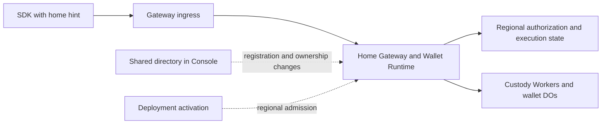

# Regional execution without routine Console calls

Status: implementation and local acceptance in progress. Established-session routing, regional deployment admission, and transactional D1 writer fences are implemented. Local owner, linked-device, and step-up signing pass during Console outage. Remaining relocation coverage, final cleanup, and hosted comparison remain open. The tested source contents now match committed dev.
Date: October 6, 2026.

## Objective

Remove synchronous Console calls from established-session signing and presignature
refill. Regional Gateways, Wallet Runtimes, and custody roles must enforce execution
authority using their admitted local state. Keep shared coordination for directory
changes, registration reservations, deployment changes, and relocation.

Reduce registration's Console dependency to operations that need shared ownership
or discovery coordination. Run registration continuations at the reserved home.
Console availability must not determine whether an already admitted wallet can
sign at its active home.

This is a separation of responsibilities within the existing deployment. It does
not require another Worker, database, signing secret, environment-variable family,
or configuration framework. It does not guarantee physical colocation of custody
Workers, DOs, Containers, and D1. Their remaining network hops are separate work.

## Terms and boundaries

- **Shared directory:** cross-region records that identify a wallet's home and
  enforce existing identity, credential, and registration claims. Console hosts it today.
- **Regional execution:** authentication, operation admission, protocol execution,
  budget accounting, reservations, and durable completion at an admitted home.
- **Ownership generation:** a version identifying one period of wallet ownership
  at a home. Relocation installs a later generation. It is not a browser connection generation.
- **Fence:** durable state that prevents an inactive home or deployment from
  admitting or committing unauthorized work.
- **Routing hint:** a suggested region supplied by the client. It grants no authority.

The directory coordinates ownership changes. Local fences enforce execution.
A previously issued session or routing response cannot reopen a fenced home.

## Evidence and present coupling

The October 6 comparison measured roughly 90–100ms for the Gateway binding lookup
on ordinary APAC requests. Moving Console toward the Gateway increased Console
D1 reads by about 50ms and gave no signing improvement. That change was reverted.

The comparison used a frozen SDK that still made a separate status request.
Current SDK code already reconciles session authority from prepare. Preserve that
optimization and use matching current SDK/Gateway builds for the new comparison.
Do not count its earlier saving again or treat the binding span as a guaranteed
end-to-end saving. See [the call-path evidence](evidence/r155-call-path-20261006.json)
and [the R155 results](refactor-155-reusuable-DO.md).

Current calls do more than inspect dashboard configuration:

| Current responsibility | Owner today | Required destination |
| --- | --- | --- |
| Resolve active deployment and verify writer version/resource | Console, before Gateway dispatch | Regional deployment admission installed during activation |
| Resolve session locator to wallet home | Console on routine requests | Session routing metadata, with local authorization |
| Supply tenant identity to the Gateway | Console binding response | Validated regional deployment configuration |
| Reserve one registration allocation and home | Shared directory | Keep shared reservation; reuse it for continuations |
| Enforce cross-region identity and passkey claims | Shared directory | Keep existing uniqueness and ownership rules |
| Publish discovery and lifecycle locators | Shared directory | Keep at the lifecycle transitions that require them |
| Check session, revocation, policy, budget, and one-use material | Regional authorization and custody state | Keep fresh local enforcement |
| Coordinate relocation | Console plus regional participants | Keep coordination; require local fences before ownership changes |

Registration has no cryptographic requirement to call Console. Its current shared
reservation prevents the same registration from creating different wallets when
a lost response is retried through another region. Its identity and credential
claims prevent conflicting records in independent regional databases.
Retain those guarantees without putting directory reads before every continuation.

## Target request paths



Normal signing and refill must make zero Console requests, including internal
forwarding, background writes, alarms, and continuations. The first ingress may
use the existing regional service bindings to forward once. New public regional
hostnames are not required.

| Flow | Directory involvement in the target design |
| --- | --- |
| Established-session signing and refill | None on the normal path |
| Registration setup | Reserve the exact wallet, operation, and home |
| Registration continuations | None where persisted local reservation and authority are sufficient |
| Registration claims and completion | Commit shared claims and discovery at their required transitions |
| Unlock with a known home | Regional execution where existing factor/identity contracts permit it |
| New-device discovery or missing routing information | Explicit directory discovery |
| Stale route after relocation | Controlled rediscovery, separate from ordinary authorization failures |
| Deployment activation and retirement | Install or fence regional deployment authority |
| Wallet relocation | Coordinate source freeze, transfer, destination activation, and directory update |

## Design rules

1. Return home routing metadata with existing registration and authenticated
   session responses. Carry the ownership generation where the execution contract
   requires it. Reuse existing wallet, session, home, and generation types.
2. Treat client routing metadata as untrusted input. Parse a region from the
   configured catalog once. Authenticate the operation at the selected home and
   compare its authoritative local ownership state. Never accept a client URL,
   region, generation, or forwarding marker as execution authority.
3. Keep fresh regional session and policy checks. Preserve revocation, expiry,
   budget, material retirement, exclusive reservation, and terminal replay.
   Combine ownership/deployment predicates with existing admission transactions
   where possible. Avoid adding one separate D1 request per new check.
4. Install tenant identity and admitted deployment/resource identity through the
   existing deployment workflow. Regional state must reject an old writer after
   retirement. A cached Console response or static configuration alone cannot
   preserve immediate retirement semantics.
5. Use the existing registration reservation as the durable anchor for local
   continuations. Keep shared credential claims at the point their inputs become
   available. Do not assume every registration variant has all claims at setup.
6. Preserve explicit pending and terminal registration states across local and
   directory writes. A lost reply must resume the same operation. Registration
   success requires the ownership and discovery records needed for later access.
   Do not replace these records with an untracked background publication.
7. Reuse R153's ownership generations and local execution fences. Freeze source
   admission and settle or fence admitted work before activating the destination.
   A route refresh cannot make an inactive destination executable.
8. Directory discovery must be bounded. Ordinary 401 responses, exhausted budgets,
   and protocol failures must not trigger region probing or automatic rediscovery.
   Preserve operation identity on permitted retries, including uncertain finalize replies.
9. Keep the current shared uniqueness rules. Removing all directory coordination
   from registration is outside this plan. Moving a directory endpoint to another
   Worker would not by itself reduce coordination or latency.
10. Use one final implementation. Add no legacy routing flags, stale-authority
    fallback, alternate token scheme, or compatibility path for disposable test wallets.

## Change inventory

Paths below are repository-relative. Confirm moved files before editing. R153
work is active; listed local authority components are integration points, not a
claim that their full relocation contract is already complete.

| Repository and area | Existing sources | Required change |
| --- | --- | --- |
| Private Gateway entry | `packages/wallet-console-server-ts/src/router/cloudflare/d1GatewayWorker.ts` | Remove unconditional Console resolution from routine execution; use locally admitted deployment context |
| Private Console lookup | `walletPlacement/gatewaySession.ts`, `tenantDeployment/runtimeBinding.ts`, under the same package | Replace combined request-time lookup; retain only directory/control uses with real callers |
| Private regional routing | `walletPlacement/regionalDispatch.ts`, `authenticationDispatch.ts`, `sessionLocators.ts` | Route from bounded metadata; keep explicit discovery and remove obsolete session-locator reads/publications when no consumers remain |
| Private registration | `walletPlacement/registrationAdmission.ts`, `d1.ts`, `passkeyClaims.ts`, `identityService.ts`, registration offer client/service | Separate shared claims from local continuation admission and completion recovery |
| Private activation | `tenantDeployment/d1.ts`, `resourceVerification.ts`, `deployment/wallet-system/targets.json` and existing render/activation scripts | Install regional scope and writer admission; enforce retirement without per-request Console calls |
| Private relocation | `walletPlacement/executionAuthority.ts`, relocation coordinator and participant modules | Make directory observations control-plane inputs; preserve source and destination execution fences |
| Public runtime/auth | `packages/wallet-server/src/router/cloudflare/d1/registration/d1WalletExecutionAuthority.ts`, `d1WalletOperationStore.ts`, authorization stores/statements | Enforce admitted local generation and deployment at real operation boundaries |
| Public SDK/wire | Existing session responses, relayer clients, registration flow, signing and refill callers | Carry home routing metadata through owner, linked-device, restored, and step-up flows |
| Public custody | `crates/router-ab-cloudflare/src/` signing, pool, DO, and relocation modules | Preserve exact wallet/generation context across requests, deferred work, and terminal replay |
| Public specifications | `docs/intended-behaviours.md`, R153 and R155 plans | Specify Console-outage behavior and the new routing/authority contract |
| Private acceptance | `tests/e2e/regional-*`, `tests/relayer/wallet-relocation-directory.e2e.test.ts`, `tests/e2e/hosted-product/` | Verify composed routing, outages, relocation, registration retries, and hosted timings |

## Phase 1 — Freeze the authority and call inventory

- [ ] Trace owner and linked-device ECDSA, Ed25519, step-up signing, and refill.
  Include internal dispatch, alarms, continuations, completion, and error paths.
- [ ] Inventory every Console read/write on those paths. Identify its data,
  enforcement guarantee, existing local equivalent, and replacement owner.
- [ ] Trace passkey and Google/email registration separately. Classify each
  directory call as reservation, global claim, discovery publication, or repeated read.
- [ ] Pin the R153 generation/fence contract and the deployment retirement contract.
  Record whether each required local enforcement path is implemented and verified.
- [ ] Define typed outcomes for local execution, discovery required, relocation
  paused, retired authority, and ordinary auth failure. Keep routing separate from authorization.

Exit: each removed call has an explicit replacement or evidence that it is redundant.

## Phase 2 — Install and enforce regional execution authority

- [x] Extend the existing activation workflow to install required local tenant,
  resource, and writer admission before enabling regional traffic.
- [ ] Reuse local wallet-generation state. Keep identity fields required and
  represent admission/retirement states with exhaustive domain types.
- [ ] Enforce current authority at operation admission and durable side effects.
  A read performed before a freeze is insufficient to authorize a later write.
- [x] Define deployment cutover failure handling. Do not complete retirement
  while an old regional writer remains authorized. Rollback must not revive a
  retired wallet generation or discard terminal operation history.
- [ ] Preserve valid terminal replay while rejecting new execution under retired
  authority. Use existing replay and relocation rules rather than parallel logic.

Exit: regional enforcement provides the safety previously supplied by Console
lookups, including concurrent cutover and relocation. Console-independent signing
must not be enabled before this gate passes.

## Phase 3 — Route sessions and remove routine Console calls

- [x] Add region metadata to existing registration/session issuance and restore
  boundaries. Update shared types, SDK persistence, transport, and response parsers together.
- [x] Forward through existing regional bindings using catalog-validated hints.
  Preserve the public entrypoint and enforce a bounded forwarding path.
- [ ] Authenticate locally and reject wrong wallet, tenant, resource, generation,
  revoked session, and frozen-home combinations.
- [ ] Remove the unconditional combined Console lookup from signing and refill,
  including forwarded destination requests and internal/deferred execution.
- [x] Keep explicit discovery for missing/stale routing. Avoid treating all
  signing failures as routing failures. Bound rediscovery and preserve retry identity.
- [ ] Preserve prepare-based session reconciliation. Do not reintroduce the
  separate session-status request or increase routine D1 round trips accidentally.

Exit: ordinary signing/refill and their background work make zero Console calls.

## Phase 4 — Reduce registration coordination

- [ ] Reserve the wallet, home, and stable operation identities through the
  existing directory authority. Retries through another ingress reuse the reservation.
- [x] Persist local registration admission and route continuations from that state.
  Remove repeated directory checks whose guarantees now have local enforcement.
- [ ] Retain global identity and credential claims. Batch related statements
  within their owning database when that preserves their existing semantics.
- [ ] Make completion recoverable across regional and directory writes. Verify
  lost replies, cancellation, conflicting retries, and cleanup of incomplete attempts.
- [ ] Publish required discovery information before registration success. Return
  the admitted home with the initial session and preserve early presign preparation.

Exit: each remaining registration Console call changes or discovers shared state
for a documented reason. Protocol continuations use their reserved regional authority.

## Phase 5 — Verify behavior and Console independence

Extend existing E2E scenarios and type fixtures. Add no unit-test suite or source
text guards. Update the intended-behavior specification with the implementation.
Classify existing outage assertions before changing them: a deliberate contract
change does not make unrelated authentication failures obsolete.

- [x] Establish a session, make Console unavailable, and verify ready signing and
  a three-signature sequence that forces refill. Assert zero attempted Console calls.
- [ ] Repeat for owner and linked-device signing, relevant ECDSA/Ed25519 paths,
  session restore, and step-up paths with otherwise available prerequisites.
- [x] Verify shared-budget exhaustion followed by fresh passkey step-up for both
  NEAR and ECDSA through remote ingress with zero Console calls.
- [ ] During the outage, verify revocation, budget exhaustion, material retirement,
  wrong-region hints, malformed metadata, and concurrent double-use rejection.
- [ ] Restart Gateways/DOs and verify authority survives without in-memory Console
  caches. Check deferred refill, alarms, and background completion explicitly.
- [ ] Race signing/refill with R153 source freeze and destination activation.
  Verify no two homes execute the same ownership generation and no late write escapes a fence.
- [ ] Exercise stale routing and an uncertain finalize reply across relocation.
  Preserve exact replay rules and prevent duplicate budget or material consumption.
- [ ] Retry registration through two regions with lost setup/completion replies.
  Verify one allocation, one home, stable identities, and discoverable completion.
- [ ] Race conflicting identity/credential claims across regions. Verify existing
  uniqueness rules and cancellation cleanup remain intact.
- [ ] Exercise partial deployment activation, old-writer traffic, retirement, and
  rollback. Verify denied writers cannot regain execution through stale local state.
- [ ] Produce repeatable artifacts with request counts, state transitions, and
  independently verified signatures. Exclude secrets and credential bodies.

Exit: the composed E2E evidence proves the new dependency boundary and retained guarantees.

## Phase 6 — Controlled staging comparison

- [ ] Freeze matching SDK, Gateway, Runtime, Console, and custody candidates.
  Record source revisions, deployment versions, actual D1 regions, and placement settings.
- [ ] Capture a fresh control with the current prepare-based session validation.
  Hold protocol, pool target, prewarm, client location, and workload constant.
- [ ] Compare ready signing, immediate registration-to-sign, and three consecutive
  signatures. Record medians, maxima, refill waits, HTTP requests, D1 calls, and
  attempted Console calls. Keep confirmation and test automation timing separate.
- [ ] Verify all four regional routes and same-wallet travel. Run a bounded
  Console-outage acceptance scenario without disturbing concurrent experiments.
- [ ] Repeat the control/candidate comparison before claiming a latency gain.
  Record failures and rejected candidates alongside successful measurements.
- [ ] Use existing staging resources within the **$25 total Cloudflare budget**.
  Add no keepalive or new infrastructure. Preserve exact restoration instructions
  for deployment versions and non-versioned settings. Production deployment and npm publication are outside this plan.

Exit: publish measured results and limitations. Zero routine Console calls is a
required result; a particular millisecond saving is not promised in advance.

## Phase 7 — Remove obsolete paths and close the refactor

- [ ] Delete replaced session lookup adapters, remote admission wrappers, unused
  DTOs, dead exports, and redundant publications. Keep directory locators still
  needed by discovery, recovery, registration, or relocation.
- [ ] Remove old request shapes and disposable-test-state assumptions. Keep any
  unavoidable storage conversion at the persistence boundary, then retire it.
- [ ] Update public contracts, deployment documentation, examples, and R153
  integration notes. Name the remaining Console dependencies explicitly.
- [ ] Run relevant type fixtures, composed E2E checks, and the bloat gate. Review
  the final implementation for duplicate authority sources and hidden Console calls.
- [ ] Commit only owned changes on `dev` in each repository. Preserve concurrent
  R153 work. Record final evidence and any separate unfinished work honestly.

## Completion criteria

- Existing admitted sessions sign and refill during a Console outage.
- Regional checks enforce current authorization, deployment admission, ownership,
  budgets, and one-use material without relying on a stale directory snapshot.
- Registration retains cross-region retry and ownership guarantees with fewer
  repeated directory calls; discovery remains correct after completion.
- Relocation and deployment retirement cannot leave two active execution owners.
- All four regional routes pass acceptance, with measured latency and request counts.
- The old routine Console path is deleted. No compatibility switch or second
  authority mechanism remains beside its replacement.

Related plans: [R152](refactor-152-regional-D1.md),
[R153](refactor-153-wallet-region-selection.md),
[R155](refactor-155-reusuable-DO.md).

## Implementation evidence — October 6, 2026

The first implementation slice separates `WalletExecutionAuthority` from
`WalletRegistrationReservationAuthority`. Recovery, export, and signer installation
now receive the D1 service's local execution authority. They cannot obtain ordinary
execution authority through the registration adapter.

The local query requires the exact tenant, wallet, and active ownership generation.
The existing registration wrapper retains completion reconciliation and generation
fences. The obsolete Console ordinary-admission adapter and standalone registration
receipt lookup are removed. Registration retries can still consult the shared directory.

Verification:

- Wallet server type check and wallet-state type fixtures pass. Type fixtures reject
  registration authority as execution authority, including object spreads.
- `node tests/e2e/authorization-storage-transfer.e2e.mjs` passes. Its repeatable artifact
  is `.artifacts/r153/authorization-storage-transfer/evidence.json`. It verifies
  registration completion retry, destination activation, source retirement, and tenant
  separation. The standalone local admission query is exercised against active and
  retired homes.
- Private Console server type check passes.
- Private `wallet-relocation-directory.e2e.test.ts` passes (1 test). Its directory
  assertions now call the shared directory client directly.
- `pnpm report:bloat --check` passes. No ratcheted measure grew.

This slice does not establish Console-independent signing. Local deployment writer
admission, cutover fencing, regional session routing, outage acceptance, and hosted
measurements remain open. No latency gain is claimed for this slice.

## Regional deployment implementation — October 6, 2026

Deployment activation now prepares every configured regional database before Console
commits activation. Preparation pauses prior admission. After Console commits, regional
activation installs the admitted binding and verified Gateway/Wallet Runtime versions.
The existing `reuse_active` operation completes a partially delivered activation.
Monotonic sequence guards reject delayed preparation or activation from an older deployment.
If preparation fails before the central commit, affected regions remain paused. A new
operator-authorized activation can replace that prepared proposal.

Gateway and Wallet Runtime deployment reads now use regional D1. Gateway session
discovery still calls Console and checks that the directory response matches the local
binding revision. Scheduled prewarm uses regional deployment admission. No new secret,
Worker, database, or environment variable is required. Migration `0066` installs the
admission table and its transactional writer guard. Apply it before activating these
Worker builds. Existing remote deployments were not changed during this implementation.

Each runtime D1 batch checks its exact admitted binding and writer in the same
transaction as its statements. Deferred work keeps that database adapter, so a request
admitted before cutover cannot write after preparation retires its writer. The guard
adds a local SQL statement to the existing batch. It does not add a network roundtrip.
Its latency and D1 charge impact remain unmeasured. Privileged deployment/relocation
control routes retain their separate control authority and use the underlying database.

Verification:

- Private server type check passes.
- Deployment binding and regional renewal E2E tests pass.
- Renewal covers lost central replies, interrupted regional activation, retry, old-writer
  rejection, delayed-write rejection, current-writer batches, stale command rejection,
  private control retries, and rejection of wrong-writer/public-origin control requests.
- The test emits `deployment-renewal-evidence.json` and its SHA-256. The retained copy is
  [regional admission evidence](evidence/r155b-regional-admission-20261006.json).
- Public bloat check passes.
- The broad private test type check remains non-green because of unrelated application
  aliases and stale fixtures. The changed files had no reported errors.

Remaining gates: complete session-home metadata and forwarding, remove routine directory
reads, verify all signing/refill paths during a Console outage, audit custody-side deferred
execution, reduce registration continuation lookups, and run the controlled hosted comparison.
No new signing-latency result is claimed.

## Local session routing — October 6, 2026

Gateway now checks the regional session tables before requesting Console discovery.
The lookup uses the exact tenant and credential digest. It returns the wallet identity
for the existing dispatcher scope checks. It uses the deployment-fenced database.

A matching record selects the local handler. The existing authorization service still
checks credential validity, revocation, budget, and execution generation. Retired records
also select local handling, so revocation cannot cause directory rediscovery. Unknown
credentials retain directory discovery. No new table, cache, secret, or SDK token is added.

Verification:

- Private server type check and deployment-binding E2E pass.
- `node tests/relayer/local-session-routing.e2e.mjs` passes against real Miniflare D1
  with production routing and authorization code.
- Known direct credentials make zero Console routing calls during a simulated outage.
  Hosted credentials and exchange codes resolve to the correct local wallet.
- Wrong-tenant lookup fails. Revoked credentials remain local and fail authorization.
  The initial three-use quota remains intact. Unknown credentials attempt discovery once.
- The runner emits a repeatable artifact with a production bundle digest. The retained
  copy is [local session evidence](evidence/r155b-local-session-routing-20261006.json).
- Public bloat check passes.

This adds one local D1 lookup and removes the Console discovery request for known local
sessions. End-to-end latency remains unmeasured. This test does not execute an MPC signature.
Cross-region discovery, complete Console-outage signing/refill acceptance, custody deferred
execution, registration continuation lookups, and hosted measurements remain open.

## Bounded forwarding and response metadata — October 6, 2026

Gateway accepts `X-Seams-Wallet-Region` only for US, WEUR, APAC, or OC. It resolves
the hint against the admitted resource catalog and forwards through existing service
bindings. A forwarding marker prevents a second hop. The destination still checks
local session and execution authority. The hint grants no authority.

A missing credential at a hinted or forwarded destination returns
`wallet_home_discovery_required` with HTTP 409. It does not contact Console or probe
other regions. Requests without a hint retain explicit directory discovery.
Local Gateway responses expose their serving region through the same header. CORS
allows the request header and exposes the response header to browser clients.

The local routing E2E verifies one-hop transport, destination-local credential lookup,
loop rejection, invalid-target rejection, explicit discovery on a route miss, and CORS
metadata. Server type checks and the existing deployment-binding E2E pass. Bloat checks
pass. Updated evidence remains in the local session routing artifact.

SDK ingestion and persistence of this metadata remain incomplete. No automatic client
routing or full MPC outage result is claimed. The next integration must retain the
home with each session across owner, linked-device, hosted exchange, and restore flows.

## Session home persistence — October 6, 2026

Primary and hosted credentials now carry required home metadata: a direct endpoint
or one configured regional home. Managed issuance reads the home from its existing
regional publisher. Standalone issuance uses the direct endpoint. No token format,
secret, or routing cache is added. Parsers reject missing or invalid metadata.

The SDK credential parser preserves the home in the existing authorization row.
Session status and ECDSA activation requests send the regional hint from that credential.
The hosted-session parser also retains it. Static fixtures reject missing home data,
mixed direct/regional states, and arbitrary target URLs.

The routing E2E verifies issuance, hosted exchange, serialization through the SDK
record writer/parser, and request-header construction. It does not simulate a browser
reload or perform an MPC signature. Public server, SDK, and private server type checks
pass; bloat checks pass. The retained local-session artifact records this boundary test.

Remaining SDK work includes normal-signing and refill credential projections, hosted
request consumers, exchange routing before redemption, and complete linked-device and
reload acceptance. Do not treat this checkpoint as full client routing completion.

## Signing, refill, and exchange propagation — October 6, 2026

The SDK now requires home metadata in both ECDSA and Ed25519 protocol credentials.
Owner, linked-device, login-prefill, recovery, restore, and step-up projections retain
that metadata. Prepare/finalize, presignature pool requests, and Ed25519 step-up use
the shared session-header builder. Existing prepare-based session reconciliation remains.

Hosted exchange issuance returns the home. Its response parser, iframe message, and
redemption request retain it. Both exchange minting and redemption send the regional hint.
Hosted credential inventory requests also retain the home. Linked-device encrypted
delivery now requires the canonical credential type instead of a handwritten subset.

Public server and SDK type checks, private server type checks, and the focused routing
E2E pass. The E2E also verifies home preservation across the exchange iframe payload.
Bloat checks pass. The intended browser registration/refresh and mixed ECDSA/Ed25519
signing cases are running against the local backend; no browser result is claimed yet.
This remains an implementation checkpoint, not full regional MPC outage acceptance.

Remaining gates include bounded stale-route rediscovery, registration continuation
admission, custody/deferred-path review, complete outage/concurrency acceptance, and
the hosted ECDSA/Ed25519 comparison. No new latency result is claimed.

## Completed-registration continuation admission — October 6, 2026

A continuation for an exact, locally completed registration now reads its active
execution generation without Console. The lookup requires tenant, wallet, registration
origin, and ceremony identity. Pending registrations retain the shared admission check;
cancellation and completion races must be resolved before that check can be removed.
This adds a local lookup before pending admission. Its latency impact is unmeasured.

The routing E2E verifies completed admission with the directory unavailable and rejects
a different ceremony. Regional hints also apply to requests without session tokens,
which allows bounded forwarding of registration continuations. Handler authorization
remains required. Server types, the focused routing E2E, and bloat checks pass.
Browser lifecycle and authorization-transfer verification are still running.

### Signing proxy ownership contract repair — October 6

The local Ed25519 browser contract exposed a production regression: the Gateway
proxy matched an obsolete owner-admission field list. The required
`ownership_generation` field prevented that match, so the proxy forwarded the
browser bearer token. The custody Router correctly rejected it. The proxy now
requires the current generation field and strips the token for owner admission.
The custody rejection remains unchanged. Server type-checking and the bloat
check pass. After rebuilding the server bundle, the immediate-signing/refresh
browser contract passed (one Chromium E2E, 34.3 seconds total test time).
It exercises registration, immediate NEAR signing, reload, and restored signing.
Command: `SEAMS_INTENDED_SKIP_BUILD=1 node scripts/run-wallet-intended-isolated.mjs
-- e2e/intended-behaviours/passkey.ed25519-yao-local.contract.test.ts --grep
"public Ed25519 Yao registration"` from `tests/`, after
`pnpm -C packages/wallet-server run build`. This is correctness evidence,
not a hosted latency measurement. The first attempted rerun used the old Worker
bundle and was stopped; it does not measure the fix.

The authorization-storage-transfer E2E passed. Its repeatable artifact is
`.artifacts/r153/authorization-storage-transfer/evidence.json`. It verifies
local execution admission with zero central ordinary reads before destination
activation and after cleanup, immutable generation, and one quota charge on
exact retry. This test does not execute MPC signing or prove a complete
Console-outage signing flow.

### Mixed-curve browser acceptance — October 6

The existing mixed-curve contract passed with the rebuilt server bundle: one
Chromium E2E, 38.6 seconds total test time. It registers an Ed25519 wallet,
adds ECDSA signing, signs NEAR/Tempo/Arc, unlocks and signs again, and injects
a lost finalize response. Use the same isolated command above with
`--grep "public ECDSA add-signer"` to repeat it. Both curve contracts now pass.
These local tests verify transport and lifecycle behavior. They do not establish
regional latency or Console-outage independence.

Registration coordination still needs local continuation routing and a durable
terminal decision. The current completion order calls the directory before
updating local execution state. A registering-state fast path alone could admit
work during that cancellation window. Close that window before removing the
pending-ceremony directory check.

### Durable registration terminal decision — October 6

Migration 0067 adds an immutable completion decision to the existing execution
generation row. Completion fixes the outcome before contacting Console. A
cancellation also retires local execution in that transaction. Establishment
activates local execution only after Console acknowledges completion. Exact
retries can republish the same decision; conflicting outcomes fail before any
Console request.

The real-D1 local-session-routing scenario passes for lost establishment and
cancellation replies, exact retry, conflicting outcomes, and ordinary admission
before/after completion. Server type-checking and the bloat gate pass. Pending
registration admission still uses Console until continuation routing and durable
write enforcement are verified. Authorization-transfer verification is running.

### Registration continuation routing and cancellation writes — October 6

Private commit `ceb98c3` routes a known ceremony from the exact tenant's regional
execution record. It preserves session-to-wallet matching and the handler's
authorization checks. Unknown ceremonies retain directory discovery.

Migration 0068 rejects inserts and updates of cancelled registration ceremony
and setup records. Cleanup deletes remain available. The real-D1 routing scenario
verifies late-write rejection after a lost cancellation reply, prevents recreation
after cleanup, and preserves exact completion retry. The bloat gate passes.
Custody and session-publication write coverage still needs verification before
pending registration admission can become fully local.

### Registration lifecycle and session cancellation guards — October 6

The shared transactional lifecycle guard now rejects cancelled registrations.
The custody state store and registration operation journal already include this
guard in their write batches. Migration 0069 also blocks Wallet Session insertion
for a cancelled registration, including issuance admitted before cancellation.
The real-D1 scenario verifies guard rejection, calls the production authorization
service after cancellation, and confirms no session row was persisted. Server
type-checking and the bloat gate pass. Pending registration still uses Console
admission; remote custody effects and completion reconciliation remain under review.

### Local pending registration admission — October 6

An exact local registration generation now admits pending continuations without
a Console read. Initial admission still establishes the reserved home through
Console. Completed local generations admit ordinary execution. Retired local
generations reject execution. A fixed establishment or cancellation decision
is republished on continuation retry after an uncertain completion reply.
The former directory-based activation recovery branch was removed.

The real-D1 scenario passes after recreating the authority object with the
directory configured to reject any second admission lookup. It also verifies
terminal reconciliation, conflicting completion, cancellation write guards,
and session publication refusal. Type-checking and the bloat gate pass.
Browser contracts and authorization-transfer verification are running. Full
hosted Console-outage acceptance and remote-effect cancellation remain unproven.

### Bounded explicit home discovery — October 6

Signing prepare/finalize and ECDSA refill transports now retry once without the
region hint when the Gateway explicitly returns `wallet_home_discovery_required`.
The same URL, body, bearer token, and abort signal are retained. Other errors
remain terminal. This does not add a routing cache or change the stored credential.
A moved session can require discovery again until its routing metadata is renewed.

The network scenario verifies successful discovery, no retry on HTTP 401, and
a maximum of two attempts when discovery is refused again. It checks exact body
and token preservation. The existing regional D1 routing scenario also passes.
SDK type-checking passes. Both browser contracts passed after local registration
admission; the discovery transport still needs composed browser acceptance.

### Composed Console-outage acceptance — October 6

Two regional browser contracts passed (1.5 minutes total suite time). Each
registers a real mixed-curve wallet, disables both Console services, and completes
three signatures. The ECDSA sequence records three prepare/finalize pairs plus
seven refill-init and 35 successful refill-step requests during the outage. The
Ed25519 sequence records three prepare/finalize pairs. Both record zero attempted
Console calls, including awaited background work.

Repeat from the private repository:
`SEAMS_WALLET_SERVER_CANDIDATE=/Users/pta/Dev/rust/seams-wallet/packages/wallet-server
SEAMS_INTENDED_SKIP_BUILD=1 node tests/scripts/run-regional-real.mjs
passkey.registration.contract.test.ts` after building the candidate runtime.
Evidence: `docs/evidence/r155b-console-outage-ecdsa.json` and
`docs/evidence/r155b-console-outage-ed25519.json`. The harness uses production
session resolution, regional dispatch, Gateway handlers, D1, and local custody
Workers. Deployment admission is fixture configuration. These results do not
prove physical regional latency, linked-device/step-up outage behavior, restart,
or relocation concurrency.

### Owner preflight routing repair — October 6

Travel acceptance exposed an Ed25519 production regression: owner execution-lane
preflight sent the token without its home. A remote Gateway therefore tried
Console discovery during the outage. Preflight now requires the canonical
operation credential and uses its home metadata and bounded discovery transport.
Both Ed25519 and ECDSA callers pass that credential.

After rebuilding the SDK, both owner browser cases complete signatures through
WEUR, APAC, and OC ingress for a US wallet with Console disabled. Type-checking
and the bloat gate pass. Linked-device cases are running. This tests regional
routing in local Workers, not physical travel latency.

### Linked-device installation generation repair — October 6

Both linked-device outage cases initially failed before the outage: their
source-preserving Ed25519 Router target omitted required `ownership_generation`.
The adapter now requires local established-home admission and sends that
generation in the target. It refuses retired ownership before remote execution.
Server type-checking and the bloat gate pass. Linked-device browser acceptance
is being repeated; no linked-device outage success is claimed yet.

### Linked-device Console-outage acceptance (2026-10-06)

The composed browser E2E now passes for linked ECDSA and Ed25519. Each case
registers an owner in US, installs a linked device through WEUR, disables both
Console transports, and completes three signatures. Each records three successful
home prepare/finalize pairs and zero attempted Console calls. ECDSA also completes
presignature refill steps during the outage.

The ECDSA test exposed a production regression: linked reusable sessions received
the operation-step-up reconciliation callback. Commit `69b17933` selects linked
session reconciliation instead. It checks the current selected authority, exact
session record, quota identity, remaining uses, and expiry against prepare's
response before client signing. It adds no session-status request.

Verification: SDK type-check, SDK build, bloat check, and both linked browser cases
pass. The first rerun stopped before tests because local Worker ports were occupied;
the same command passed after those ports became free.

Repeat from the private repository:

```sh
SEAMS_WALLET_SERVER_CANDIDATE=/Users/pta/Dev/rust/seams-wallet/packages/wallet-server SEAMS_INTENDED_SKIP_BUILD=1 node tests/scripts/run-regional-real.mjs passkey.registration.contract.test.ts --grep 'linked (ecdsa|ed25519)'
```

Evidence: [ECDSA](./evidence/r155b-console-outage-linked-ecdsa.json) and
[Ed25519](./evidence/r155b-console-outage-linked-ed25519.json). These are local
composition results. Hosted latency, restart, revocation, and relocation-race
acceptance remain separate gates.

### Console-outage process restart acceptance (2026-10-06)

Private commit `aa679a9` extends the existing process-restart harness. Both browser
cases pass: ECDSA and Ed25519 each complete three signatures through WEUR for a US
wallet after the Gateway and all five local role Workers restart. Console remains
unavailable. D1 and DO storage reopen in place; production in-memory state is not
copied. Only test observations and outage controls survive in memory.

Both cases record zero attempted Console calls and three successful home
prepare/finalize pairs. ECDSA also completes refill work. Process receipts verify
replacement PIDs and an incremented role-worker generation. These local results
verify restart recovery; they do not measure hosted latency or an in-flight crash.

An initial attempt found stale SDK output after the credential gained a required
ownership generation. Rebuilding the SDK resolved that candidate mismatch. Local
port collisions also stopped startup attempts before test execution. The final
matched run passed both cases in 1.7 minutes.

Repeat the linked-outage command above with `--grep 'role restart'`.
Evidence: [ECDSA requests](./evidence/r155b-console-outage-ecdsa-restart.json),
[ECDSA restart](./evidence/r155b-restart-evidence-ecdsa-restart.json),
[Ed25519 requests](./evidence/r155b-console-outage-ed25519-restart.json), and
[Ed25519 restart](./evidence/r155b-restart-evidence-ed25519-restart.json).

### Linked revocation during Console outage

Private commit `dc8f441` extends the linked-device browser acceptance cases.
Both pass: the linked device completes three signatures, the owner revokes it
while Console is unavailable, and both NEAR and ECDSA signing then fail.
The existing harness verifies that the owner no longer lists the revoked device.
Each case still has exactly three successful home prepare/finalize pairs and zero
attempted Console calls. The ECDSA case also records rejected refill and prepare
requests with HTTP 401 after revocation.

Run the same regional browser command with `--grep 'linked (ecdsa|ed25519)'`.
Evidence: [ECDSA-led](./evidence/r155b-revocation-outage-ecdsa.json) and
[Ed25519-led](./evidence/r155b-revocation-outage-ed25519.json). Both curves are tried
and rejected after revocation in each case. This verifies ordinary linked-device
revocation during an outage, not an in-flight revocation race.

NEAR prepare now returns the fresh session-status projection through the shared
Gateway response builder. Its SDK reconciles the exact selected authority before
creating a signature share for transaction and signature-only signing. The separate
status-read removal remains pending: signing planning must be isolated from export
and restoration readers before using local observations. Registration, local signing
measurements, and verification are recorded in
[the NEAR-only benchmark](./optimization-12-NEAR-only-20261006.md).

### Shared budget and passkey step-up during Console outage — 2026-10-07

Private commit `304f2d7` adds one mixed-curve browser scenario. A US wallet unlocks,
Console becomes unavailable, and WEUR ingress completes one NEAR signature plus
concurrent Tempo/Arc signatures. The independent home budget check confirms
exhaustion. APAC ingress then completes NEAR step-up. OC ingress completes ECDSA
step-up. All five signatures verify independently.

The scenario exposed three production gaps:

1. ECDSA step-up issuance omitted the session token and regional home. It now
   requires the canonical credential and uses the existing bounded home-discovery
   transport. Session-based export issuance uses that transport too. Fresh
   factor-proof exports remain explicit. The optional legacy-cookie transport and
   its nested fetch wrapper were removed.
2. The destination Gateway still queried Console for authenticated ECDSA step-up.
   It now uses the resolved local wallet and rejects a different request wallet.
   The operation handler still verifies the factor proof and material.
3. ECDSA step-up used an active-quota reader, which threw after exhaustion. It now
   uses the existing exact-operation context reader. It verifies live authority,
   expiry, material, and fresh evidence without granting reusable quota. The
   existing complete-session equality helper replaces a duplicate field comparison.

The passing artifact records zero Console attempts, three authorization-grant
operations, and two verified-step-up operations in US. WEUR, APAC, and OC contain
no operation records. All recorded requests avoid server errors. Awaited refill
work is included. Evidence: [step-up outage](./evidence/r155b-step-up-outage.json).

Reproduce from the private repository with the candidate server and frozen SDK
configured, using `tests/scripts/run-regional-real.mjs` and
`passkey.registration.contract.test.ts --grep 'shared budget exhaustion'`.
Private raw runs are `/tmp/r155b-stepup*.log`. Public build and verification logs
are `.artifacts/r155b-step-up/`. The first attempt's independent status request
bypassed the regional harness; that fixture was corrected before the production
failures above were diagnosed. A build attempt during the server edit failed on
an import and stale type uses; it is excluded from passing evidence.

This result covers passkey step-up and shared-budget exhaustion. Email OTP step-up,
material-retirement races, relocation/cutover races, deferred alarm acceptance,
registration conflicts, and the matched hosted comparison remain separate gates.

Verification also passes for the rebuilt candidate's public passkey unlock/export
and shared-budget lifecycle E2E (33.9 seconds), SDK and server type-checks/builds,
Wallet lifecycle type fixtures, private Console-server type-check, and the bloat
gate. No hosted deployment or npm publication was performed.

### NEAR status-read reuse — 2026-10-07

NEAR exact signing preparation now passes its freshly read authorization directly
to sealed-runtime binding. This removes the duplicate HTTP read at that boundary.
The three existing NEAR browser scenarios pass before and after the change.
Complete-scenario status calls fall 35→29, 29→25, and 32→27. Prepare/finalize counts
and changed-authority rejection remain unchanged. Other status-read removal is
still pending. No hosted latency reduction is claimed.

See [NEAR measurements](./optimization-12-NEAR-only-20261006.md#near-duplicate-status-read-removal--2026-10-07)
and [repeatable evidence](./evidence/near-status-reuse-20261007.json).

### Email OTP step-up routing and remaining shared limiter — 2026-10-07

The composed Email OTP outage scenario registers and unlocks a mixed wallet in US,
then exhausts its shared budget through WEUR ingress. NEAR step-up enters through
APAC. The intended final ECDSA step-up enters through OC.

Two routing defects were identified and corrected in the candidate:
- The signing challenge used the unauthenticated login request variant. Signing
  now requires an explicit operation-step-up variant with the exact unexpired
  session credential. Transaction challenge types reject the login/export variants.
- The OTP Worker sent only the bearer token. It now uses the existing regional
  header builder and bounded discovery transport. A locally matched session routes
  challenge/factor-release directly, with request-wallet equality enforced.

The scenario remains incomplete. Three reusable signatures verify and the shared
budget reaches zero. The next OTP challenge reaches the home handler but fails
closed because the shared rate limiter calls `/internal/wallet-placement/v1/rate-limit`
on the unavailable Console. The home returns 500; forwarding reports 503. The test
attaches the exact attempted Console paths. No OTP or credential bodies are published.
[Sanitized dependency evidence](./evidence/r155b-email-otp-dependency.json).

Do not replace global counters with independent regional counters: the existing
IP, subject, wallet, provider, and organization limits must remain global. Direct
access to the current Console D1 would expand Gateway access beyond those counters.
The existing Gateway intentionally has no Console DB binding. The proposed isolated
rate-limit D1 requires an explicit update to the no-new-infrastructure constraint.
Cloudflare documents a proxy Worker for table-specific access restrictions:
[official D1 access-control guidance](https://developers.cloudflare.com/d1/tutorials/build-an-api-to-access-d1/).

The first attempt stopped before registration due to an expired Google test token.
The existing token-refresh script repaired that environment prerequisite. Later
failures exposed the routing defects and then the shared limiter dependency. These
are failed acceptance attempts, not evidence that Email OTP outage support is done.
Source snapshots, builds and logs are under `.artifacts/r155b-email-outage/`.

The normal Email OTP registration/unlock lifecycle E2E passes (47.7s), including
NEAR/ECDSA step-up, reload, and key export. SDK/private Console type checks, lifecycle
type fixtures, and the bloat gate pass. This does not close the outage gate.

### Regional routing rejection acceptance — 2026-10-07

The existing private regional browser suite now uses a real US wallet and its
captured NEAR signing request to verify three failures during Console outage:

| Mutation | Result |
| --- | --- |
| Malformed region metadata | 400 `invalid_wallet_region` |
| APAC home hint for the US session, entering through WEUR | 409 `wallet_home_discovery_required` |
| Different request wallet with the valid session credential | 403 `wallet_session_scope_mismatch` |

The first valid signature enters through WEUR. After the rejected requests,
APAC and OC ingress each complete another signature with the original reusable
budget. All three signatures verify. The verifier counts three successful home
prepare/finalize pairs and zero attempted Console calls. This proves the rejected
requests do not prevent those remaining budgeted operations. It does not establish
tenant/resource forgery rejection, concurrent double-use, hosted placement, or latency.

The case passes in 1.0 minute. Reproduce in `seams-monorepo`:
`tests/scripts/run-regional-real.mjs passkey.registration.contract.test.ts --grep 'regional routing rejects'`
with the existing candidate server and frozen SDK environment variables. The frozen
SDK is `.artifacts/r155b-email-outage/stepup-dist` in `seams-wallet`. The test writes
`rejections.json` and `console-outage.json` under the private
`.artifacts/r155b/console-outage/routing-rejections/` directory.
[Sanitized combined evidence](./evidence/r155b-routing-rejections.json).

### NEAR prepare-based planning consolidation — 2026-10-07

NEAR signing preparation now consumes existing local status observations and
requires fresh prepare reconciliation before creating a signature share. It
falls back to a fresh read when the full session projection differs. Cached
observations never overwrite persisted authority. Export/funding/restoration
readers remain fresh.

In matched browser scenarios, full-scenario status calls fall 29→19, 25→17, and
27→18. Actual SDK signing intervals in the transaction case fall 5→2, 5→2, and
9→5 status requests. Prepare/finalize counts remain unchanged. Both arms pass all
three NEAR cases. Linked revocation and shared-budget passkey step-up also pass
through regional ingress during Console outage. No hosted latency gain is claimed.
See [NEAR results](./optimization-12-NEAR-only-20261006.md#signing-preparation-uses-existing-observations--2026-10-07)
and [evidence](./evidence/near-signing-observation-20261007.json).

### Rejected NEAR lane-selection optimization — 2026-10-07

A diagnostic trace located one remaining status read in signing lane selection.
An experimental change reused the existing checked session observation there.
The three local NEAR contracts passed. Immediate signing status calls fell from
two to one; the reload signature fell from five to four.

The composed Console-outage acceptance rejected this candidate. Linked-device
revocation passed, but shared-budget exhaustion and step-up failed twice at
`/wallet/execution-lane/owner`. The home returned HTTP 503 with
`wallet_session_unavailable`. The previous frozen SDK passed that same budget
scenario against the current server. This is classified as a production regression.
The experimental source changes were reverted before commit.

The demonstrated boundary is lane selection followed by owner-lane preflight
during budget step-up. The exact server rejection cause still needs tracing.
Before removing this read, make preflight and prepare handle an exhausted
observation through the existing step-up path. Preserve fresh authority checks
before generating a client signature share. Do not weaken revocation or budget checks.

[Sanitized experimental request counts](./evidence/near-lane-observation-20261007.json).
These lower counts describe a rejected candidate, not shipped behavior or a
hosted latency improvement. Current immediate-signature status calls remain two.

### NEAR owner-lane preflight after budget exhaustion — 2026-10-07

The rejected lane-selection experiment exposed an owner-preflight defect. NEAR
preflight called the reader for a spendable session. An exhausted session made
that reader fail, producing HTTP 503 before signing could request step-up.

NEAR preflight now uses the existing exact-operation identity reader. It checks
the live authority, factor, expiry, signer family, and exact material activation.
It can return lane metadata after exhaustion. It grants no signing allowance.
Prepare and finalize retain their admission checks. ECDSA preflight keeps its
existing path. The redundant wallet-ID reparse was removed because both readers
already return a validated WalletId.

This server correction did not make the experimental client optimization ready.
With the status read removed, NEAR step-up progressed but the subsequent ECDSA
confirmation timed out. Narrowing the server change to NEAR and refreshing status
on a prepare-exhaustion response did not resolve that timeout. Both client changes
were reverted. The remaining client issue needs confirmation-flow tracing.
Immediate signing therefore still has two status calls in the accepted SDK.

One earlier run was invalidated by rebuilding watched server output during the
test. It is excluded from acceptance evidence. Later runs used fixed build inputs.

Final acceptance uses the accepted SDK and the NEAR-only server correction.
The composed test captures the unlocked session's NEAR owner-lane request,
consumes its three shared uses, and replays that metadata read through WEUR.
The read returns HTTP 200 from US. Fresh NEAR and ECDSA step-up then succeed.
The verifier records three reusable grants, two verified step-up operations,
and zero Console calls. Linked Ed25519 revocation also passes. Both final tests
passed in 1.7 minutes. Server type-check/build and the bloat check passed.

[Sanitized acceptance evidence](./evidence/near-preflight-exhaustion-20261007.json).
The executable composed scenario remains in the private repository at
`tests/e2e/regional-real/passkey.registration.contract.test.ts`.

### Deployment fences in composed signing acceptance — 2026-10-07

The composed browser harness previously exercised production regional dispatch
and authorization while supplying its deployment binding directly. It bypassed
`D1RegionalDeploymentAdmission` and `DeploymentFencedDatabase`. That gap is closed.
The harness now installs admission through the production store and resolves it
for each regional request. Routing, continuations, signing, and awaited background
work use the production transactional deployment fence. Restarts reuse persisted
admission instead of reinstalling it. Provider verification proofs remain fixtures.

Four browser contracts passed with the accepted SDK:

| Workload | Verified signatures | Attempted Console calls |
| --- | ---: | ---: |
| ECDSA through WEUR, APAC, and OC | 3 | 0 |
| NEAR through WEUR, APAC, and OC | 3 | 0 |
| ECDSA after Gateway and role-process restart | 3 | 0 |
| NEAR after Gateway and role-process restart | 3 | 0 |

The first pair passed in 1.5 minutes. The restart pair passed in 1.6 minutes.
These durations are test execution times, not signing latency measurements.
[Request evidence](./evidence/r155b-fenced-signing-20261007.json). Repeat the private
`tests/scripts/run-regional-real.mjs passkey.registration.contract.test.ts` runner
with `--grep 'signs through WEUR|signs after Gateway and role restart'`.

The deployment-renewal E2E also passed. It verifies six retired writers, a delayed
retired-writer write, partial regional activation recovery, and rejection of stale
admission restoration. It uses production Console services and local D1; provider
proofs and Router status are controlled. It does not execute a wallet signing race.
[Deployment evidence](./evidence/r155b-deployment-renewal-20261007.json). Repeat with
`playwright test -c tests/playwright.relayer.config.ts tenant-deployment-renewal.e2e.test.ts
--grep 'regional deployment renewal' --reporter=line`.

The authorization-transfer E2E passed against the current working checkout. Its
recorded bundle and runner hashes identify that source, including concurrent R153
work. It proves immutable D1 generations, refusal to reopen the retired source,
zero central ordinary-admission reads, and preserved terminal replay after transfer.
[Scoped D1 evidence](./evidence/r155b-authorization-fences-20261007.json). This does
not close the full MPC/DO relocation race or deferred-alarm acceptance gate.

Remaining enforcement acceptance must compose retirement/relocation with live
signing and custody effects. The tests above verify their individual boundaries
and ordinary signing with deployment fences; they do not establish that full race.

### Live signing versus deployment retirement — 2026-10-07

Both curve contracts now retire the US writer during a real browser prepare
request entering through WEUR. Retirement happens after the home has resolved
its active deployment and routed the request, before the production handler
accesses signing state. The request retains its original database fence.

Each case first verifies one valid signature. During Console outage, the next
prepare causes the fixture to activate newer writer proofs through the production
regional admission store. That in-flight request returns HTTP 503. It does not
retry, finalize, spend budget, or create/change an operation record. The artifact
contains matching before/after hashes of complete quota and operation rows.
No credential values or row bodies are published. Both final tests passed in
1.4 minutes; the bloat check also passed.

[Repeatable retirement evidence](./evidence/r155b-live-deployment-retirement-20261007.json).
The existing private regional browser runner selects these cases with
`--grep 'in-flight .* signing'`.

This closes the deployment-retirement race at the regional signing-handler
boundary for NEAR and ECDSA. It does not establish custody-effect fencing after
MPC execution starts, wallet-relocation races, or deferred alarm behavior.
Those broader Phase 2 and Phase 5 items remain open.

An initial ECDSA attempt did not inject retirement because the fixture still
matched the NEAR endpoint. It was classified as a test-fixture defect, corrected,
and rerun for both curves. A run started before that correction was applied was
stopped and is excluded. No production behavior was changed to satisfy this test.


### Deferred NEAR provisioning retry — October 7, 2026

The composed cross-region retry exposed two production defects:

- The mixed-wallet NEAR continuation sent its session token without its home hint.
  A foreign ingress therefore needed Console discovery. Registration and persisted
  NEAR recovery now use the existing session authorization header builder.
- The local execution authority contacted the directory again when registration
  was already active and its establishment was acknowledged. An exact established
  retry now uses that durable local state. Pending publication still reconciles
  through the directory. Conflicting cancellation still fails before a directory call.

The D1 routing scenario verifies lost publication replies, eventual reconciliation,
local established replay, conflicting terminal decisions, and cancellation fences.
Its session-publication assertion now expects the current early generation rejection;
the old assertion expected the later cancellation SQL error. It still requires zero
published sessions for a cancelled registration.

The browser acceptance discards a successful mixed-wallet NEAR provisioning response
at US, then replays the identical request through WEUR with Console unavailable.
The SDK receives only the replay. The test requires the same wallet and signer,
unchanged budget and operation records, and three valid NEAR signatures through
WEUR, APAC, and OC. The harness injects the retry; this does not prove automatic SDK
network retry or browser-reload recovery. NEAR-only registration without an existing
Wallet Session, lost initial setup, and post-MPC relocation races remain separate gates.

Evidence and final command results are recorded in
[the retry evidence](./evidence/r155b-registration-retry-20261007.json).


### NEAR-only setup home and lost-response recovery — October 7, 2026

Setup now returns a required `home` using the existing direct/regional routing
union. The value comes from the admitted Gateway's routing publisher. The SDK
parses it at the response boundary. Passkey and Email OTP NEAR-only respond,
activation and provisioning requests carry the home hint before a Wallet Session
exists. The hint grants no authority; normal setup and local-generation checks remain.

The composed passkey test discards the successful provisioning reply at US and
replays the unchanged request through WEUR with Console unavailable. An unauthenticated
NEAR-only replay correctly requires exact-method unlock; the replay never issues a
replacement operation credential. Testing exposed a separate startup recovery gap:
credential-free publication demanded a session that the lost response never delivered.
For that exact NEAR-only pending completion, missing-session recovery now atomically
publishes the committed identity and sealed material, creates a locked selection when
needed, and removes its completed journal. It installs no session or credential.
Existing selections remain unchanged. Corrupt/future session storage still rejects.
Mixed-wallet publication still requires its exact existing session.

The test then permits Console for the explicit fresh unlock and disables it again
for three NEAR signatures through WEUR, APAC and OC. This separates registration
recovery from the routine signing outage claim. The harness injects the lost-reply
retry; it does not prove automatic SDK network retries. Email OTP header propagation
is implemented, but this passkey test does not establish OTP outage support.

The final composed run passed both scenarios (1.4 minutes): six independently
verified NEAR signatures, with zero Console calls during replay and signing.
SDK/server types and builds, type fixtures, and bloat checks passed.

[Verification evidence](./evidence/r155b-near-only-home-20261007.json) records the
commands and scope. Yao admission/execution transport home hints, persisted pre-session
routing metadata, global OTP counters, relocation races and hosted acceptance remain
outside this slice and require their own completion evidence.

### NEAR registration protocol home — 2026-10-07

The SDK now supplies the setup home to Yao admission and execution for NEAR-only
and mixed registration. Deferred mixed work carries that home. Resumed work reads
it from the saved session credential. The shared transport requires either a known
home or explicit discovery; existing recovery, export and add-signer callers use
discovery when their inputs lack home metadata. No authorization check is removed.

The first composed acceptance attempt disabled Console during Yao admission. It
reached the US home through WEUR, then returned HTTP 503 (`admission_failed`).
The registration backend still resolves tenant-root context through Console.
This is a `valid_test_needs_update` failure: the outage assertion exceeded this
routing change and the plan permits registration control-plane dependencies.
The revised scenario keeps Console available during registration and disables it
for three subsequent NEAR signatures. It records the registration Console paths
separately. This change does not establish Console-free registration or a hosted
latency improvement.

The revised NEAR-only scenario passed. Admission entered WEUR and execution
entered APAC; both completed at the US home. Admission made one
`/internal/wallet-console/v1/tenant-root/active-lineage` request. Execution made
zero Console requests. Three subsequent signatures verified through WEUR, APAC
and OC while Console was unavailable. SDK type-check, the required-routing type
fixture, SDK build and bloat check passed. Mixed and Email OTP propagation compile
but are not additional behavioral claims from this NEAR-only scenario.

[Sanitized evidence](./evidence/r155b-yao-home-20261007.json). Repeat with the private
regional-real runner, `passkey.registration.contract.test.ts --grep
'NEAR-only Yao registration'`, and the exact SDK/server candidate. Local logs and
frozen SDK are under `.artifacts/r155b-yao-home/`; private request evidence is under
`.artifacts/r155b/console-outage/near-registration-protocol-home/`.

### Gateway retirement after custody execution — 2026-10-07

The composed browser scenario now retires the regional Gateway writer after a
successful custody response and before Gateway operation settlement. It tests
ECDSA and Ed25519 independently. The fault uses the production regional deployment
admission and fenced D1 wrapper. It does not mock signing or the quota store.

The scenario requires the old writer to fail settlement without changing quota
or operation records. It then installs the admitted replacement writer in the
test Gateway and retries the original browser request through WEUR. The custody
response must match the first response exactly. The replacement must settle the
same operation without spending another use. Console stays unavailable throughout
signing and retry.

An intermediate test replayed an internal request through ingress and received
HTTP 409. This was `valid_test_needs_update`: the request already contained the
forwarding marker. The test now captures and retries the original browser request.
The bounded-forwarding rejection remains unchanged.

This proof concerns Gateway D1 settlement after custody completion. It does not
prove a relocation freeze during custody writes, or deployment fencing inside
custody roles. Those acceptance requirements remain open.

Both scenarios passed (2 tests, 1.3 minutes). Old-writer settlement returned
HTTP 500 after custody returned HTTP 200. The admitted replacement returned
HTTP 200 with the same custody result. Quota hashes remained unchanged and
operation row counts remained one. The operation state changed only during
replacement settlement. No Console calls occurred. Bloat and diff checks passed.

[Sanitized evidence](./evidence/r155b-post-custody-retirement-20261007.json).
Repeat with the private regional-real runner:
`passkey.registration.contract.test.ts --grep 'retirement after custody'`.
Use the exact SDK/server candidate. Private artifacts are under
`.artifacts/r155b/console-outage/post-custody-retirement-{ecdsa,ed25519}/`.
The SDK was frozen at `.artifacts/r155b-yao-home/dist`.

### Registration setup reply recovery and obsolete retry removal — 2026-10-07

Removed the SDK retry branch for the retired `/wallets/register/prepare` route.
No current call to the private JSON transport uses that route. The obsolete
Wrangler error matcher, attempt loop and attempt-count diagnostic are deleted.
Current setup errors still reach the caller. The persisted registration operation
remains the recovery anchor when the caller retries.

The composed scenario loses a successful setup reply before client acceptance,
reloads the browser, and retries through APAC after the first request entered US.
It covers mixed and NEAR-only registration. It requires identical operation,
wallet and ceremony identities, one established US directory row, and three
verified signatures during a subsequent Console outage. This tests caller-driven
recovery after reload; it does not claim automatic network retries.

Both cases passed (2 tests, 1.5 minutes). Each reused the original operation,
wallet, ceremony and US home after reload and APAC retry. Each left exactly one
established directory row. Three ECDSA signatures and three NEAR signatures
verified with zero Console calls. SDK type-check, build, bloat and diff checks
passed. Google/email registration and conflicting claims remain separate gates.

[Sanitized evidence](./evidence/r155b-setup-retry-20261007.json). Repeat using the
private regional-real runner, `passkey.registration.contract.test.ts --grep
'setup reply loss'`. The exact frozen SDK is under
`.artifacts/r155b-setup-retry/dist`; private evidence is under
`.artifacts/r155b/console-outage/setup-retry-{mixed,near-only}/`.

### Relocation session retirement versus live signing — 2026-10-07

The composed ECDSA and Ed25519 scenarios call the production regional session
retirement participant after prepare has admitted an operation and before
finalize runs. Retirement must reject the pending operation atomically. Quota
and operation records must remain unchanged by the rejected retirement. The
original signature then completes and is cryptographically verified.

After settlement, retirement must succeed and an exact retirement retry must
return the same result. The local execution generation becomes retired. An exact
finalize replay using the retired session must fail without another quota or
operation mutation. Console remains unavailable during signing and retirement.

The first test assertion used the old session-only error name. This was
`valid_test_needs_update`: migration 0062 replaced it with the wallet-wide
`wallet_operations_unsettled` guard. The assertion now matches the current
contract. No production behavior was changed for that failure.

This verifies the regional participant's settlement boundary with real browser
signing. Directory orchestration, custody freeze, state transfer and destination
activation remain outside this scenario. It is not evidence for a complete move.

The corrected test exposed a production error-classification defect in NEAR.
The general session-admission reader passed retired rows to the live-session
parser. That parser threw, so the route returned `wallet_session_unavailable`
(HTTP 503). The ECDSA reader already rejected retired rows before parsing.
This is `production_regression`: retirement is an ordinary authorization denial,
not a storage failure. The general reader now uses the existing ECDSA retirement
check and returns no active session. Live-session parsing and all authorization
checks remain unchanged.

Both browser scenarios passed (2 tests, 1.4 minutes). Each rejected retirement
while a signature was pending, verified that signature, retired successfully
after settlement, and rejected the retired session's exact finalize replay with
HTTP 401. Neither case contacted Console or changed quota/operation records on
the rejected retirement or retired-session replay.

The local-session-routing acceptance also passed. Its old exception assertion
was updated to the corrected no-active-session result (`valid_test_needs_update`);
its local-routing and zero-Console checks remain. Server type-check, build, bloat
and diff checks passed. The intended-behavior contract now names both curves.

[Sanitized evidence](./evidence/r155b-relocation-settlement-20261007.json). Repeat
with the private regional-real runner, `passkey.registration.contract.test.ts
--grep 'relocation retirement waits'`, using the SDK frozen under
`.artifacts/r155b-setup-retry/dist` and the matching server candidate. Private
evidence is under `.artifacts/r155b/console-outage/relocation-signing-settlement-{ecdsa,ed25519}/`.

### Custody execution and relocation acceptance — 2026-10-07

Both existing native Worker acceptance scenarios passed with the current local
custody sources: `--ecdsa-wallet-do-pool` and `--do-pair-execution`. These exercise
production Rust Workers in Miniflare with the wallet-object harness enabled.

NEAR verified fresh signatures after transfer and after a return move. It rejected
stale generations and replayed prepare/finalize after object eviction. Deriver A
replayed its completed result without another Deriver B execution. Cross-wallet
and cross-tenant reads failed. Changed root receipts failed without writes.

ECDSA verified fresh signatures before and after source cleanup. It rejected
delayed owner refill and completed presignature publication under retired
authority, including after a return move. Exact prepare and terminal replay
survived object eviction. Delayed cleanup preserved the returned wallet.

The initial ECDSA attempt failed the build-freshness check. This was an
`environment_or_infrastructure_failure`. All five Worker roles were rebuilt
with the existing dev profile before the passing runs. No production fix was
required by these results.

The shared checkout contains concurrent R153 custody changes outside committed
`dev`. These results apply to the tested local binaries. They do not validate a
frozen deployment candidate. The evidence records each binary hash and build
stamp. Full product relocation, linked-device NEAR transfer, and hosted regional
acceptance remain separate gates. No Cloudflare resources were created or used.

[Acceptance evidence and repeat commands](./evidence/r155b-custody-acceptance-20261007.json).
Raw artifacts remain under `.artifacts/r150/`; logs are under
`.artifacts/r155b-custody-acceptance/`.

### Concurrent registration and competing wallet reservation — 2026-10-07

The composed browser scenario sends one NEAR-only SDK setup request concurrently
through US, APAC and OC. All three replies returned HTTP 200 with the same wallet,
ceremony and US home. Before releasing setup to the browser, the scenario submits
a different registration operation for that reserved wallet through WEUR and OC.
Both requests return HTTP 409 `wallet_conflict`.

The original registration then completes. The directory contains one established
wallet. Three NEAR signatures verify through WEUR, APAC and OC with Console
unavailable and zero attempted Console calls. The final scenario passed in
56.0 seconds. No production change was required.

An earlier extension used a UUID for the competing operation. The boundary
correctly returned HTTP 400 because registration operation IDs use the existing
`wreg_` format. This was `valid_test_needs_update`; the scenario now uses the
production ID builder. It does not weaken the parser.

This proves concurrent setup convergence and rejection of a different operation
against the reserved wallet. It does not prove competing passkey/provider claims
or cancellation cleanup. Those parts of the uniqueness checklist remain open.

[Sanitized evidence](./evidence/r155b-concurrent-setup-20261007.json). The private
scenario is committed as `57781b8`. Repeat with `tests/scripts/run-regional-real.mjs
passkey.registration.contract.test.ts --grep 'concurrent NEAR-only setup'`, using
the server candidate and the SDK under `.artifacts/r155b-setup-retry/dist`.

### Conflicting passkey claim and directory cancellation — 2026-10-07

The concurrent registration scenario now reserves a second wallet in APAC. After
the original wallet registers, its home client replays its passkey claim while
the APAC client claims the same credential for the second wallet. The production
directory accepts the owner replay and rejects the competing claim.

The APAC registration authority cancels the second directory reservation. The
original passkey claim remains unchanged. Another claim from the cancelled wallet
fails. The original wallet then verifies three NEAR signatures through foreign
ingress with Console unavailable and zero attempted Console calls.

The corrected scenario passed. An initial test omitted the ceremony ID required
by cancellation and received HTTP 400. This was `valid_test_needs_update`; the
helper now retains that ID from setup and uses the typed registration authority.
No production change was required.

This covers the production directory ownership/cancellation boundary within a
real browser registration/signing scenario. It does not simulate browser reuse
of a passkey, Google/provider identity conflicts, or regional cancellation
cleanup. The broader conflict-and-cleanup checklist therefore remains open.

[Sanitized evidence](./evidence/r155b-credential-conflict-20261007.json). Repeat the
`concurrent NEAR-only setup` scenario using the regional-real runner and the
SDK frozen under `.artifacts/r155b-setup-retry/dist`.

### Remove obsolete Console session lookup adapters — 2026-10-07

The old `resolveSessionHome` function had no production callers. Only older
regional test fixtures used it. Those fixtures now use the production
`resolveGatewayDeployment` path, which checks local session rows before explicit
discovery. The registration-only fixture uses its known application-auth state.

Removed the unused resolver, both `findSession` client adapters, and the
`find-session` Console endpoint. Explicit discovery remains through
`gateway-session`; session locator publication and authorization remain intact.

The older regional scenario also required current fixture contracts: an open
execution generation, a routing publisher with `home()`, and the deployment's
tenant identity. These were `valid_test_needs_update` failures. The fixes reuse
the existing generation helper, registration authority and shared factory.
Production enforcement was not changed to accommodate fixtures.

The regional session-routing scenario, local session-routing acceptance and
wallet-home-directory E2E all passed. The broad scenario covers production
regional routing and directory/authorization behavior, including shared identity,
passkey claims, linking, expiry and recovery. Its terminal protocol execution and
tenant writer admission are controlled. It does not prove browser signing or
hosted placement.

Private implementation commit: `a2c187c`.
[Sanitized evidence](./evidence/r155b-lookup-cleanup-20261007.json).

### Relocation integration gate review — 2026-10-07

The production relocation-directory scenario passed (1 test, 11.0 seconds) with
the current server candidate. It exercises competing moves, lost replies, restart
and handover ordering. Its participant receipts are synthetic; this result does
not prove custody transfer or source writer fencing.

The remaining Phase 5 integration gap is now explicit. The browser harness shares
one local native custody stack across its regional Gateways. The native Worker
transfer harness uses real Rust roles but substitutes directory replies through
`SourceDirectory`. The directory harness supplies synthetic participant receipts.
These separate passing checks cannot establish the complete relocation claim.

Closure requires the existing coordinator and Runtime paths to run against
independent regional custody stores in one scenario. Register and sign first,
move through the real journal, then verify destination signing, rejected delayed
source work and exact retry behavior. Use real custody receipts throughout.
No alternate relocation implementation or weaker acceptance criterion is needed.

[Coordinator evidence and repeat command](./evidence/r155b-relocation-coordinator-20261007.json).
No infrastructure was provisioned and no hosted latency was measured.

### Composed relocation custody setup — 2026-10-07

Added a private harness using the existing native Worker configuration builders.
Source and destination have separate Router, Deriver A, Deriver B, SigningWorker
wallet-object namespaces and presignature-session namespaces. SigningWorker D1
stores are separate. Tenant-root authority remains shared.

The harness creates real tenant-root state and completes NEAR registration
through the source Rust Workers. It verifies distinct object identities across
all five corresponding namespaces. The repeatable artifact explicitly records
that the directory coordinator and destination-signing checks remain unfinished.

The native script now permits importing its existing configuration and setup
functions without executing its CLI. Explicit module roots allow those Workers
to load from the private repository. Initial startup failures were environment
configuration failures; no protocol execution occurred in those failed attempts.

The new custody setup and existing `--do-pair-execution` acceptance passed. The
bloat check passed. Private harness commit: `eac9098`. The next implementation
step is to bind the real directory coordinator and Runtime handlers to these
Workers, then run the complete move.

[Setup evidence and repeat command](./evidence/r155b-composed-custody-20261007.json).
This uses current local custody sources, including concurrent R153 changes. It
does not establish hosted latency or a deployable committed-source candidate.

### Composed NEAR relocation and empty ECDSA inventory — 2026-10-07

The private composed acceptance now completes a WEUR-to-APAC move for a NEAR-only
wallet. It uses the production directory journal, Gateway authorization handlers,
Runtime handlers, migrated regional D1 stores, and separate native custody object
namespaces. The fixture acknowledges native registration and supplies a real
session and signed WebAuthn owner approval. The authority manifest uses the
registered NEAR public key and exact material activation.

The run exposed a production defect: presignature preparation required ECDSA
execution authority even when the NEAR-only wallet had no ECDSA material. The
preparation reader now applies the same empty-store condition as ECDSA freeze.
Missing authority still fails if snapshot records or an import activation exist.
Generation checks, relocation fences, cursor validation, and page limits remain.
This read creates no execution authority.

The final run completed source freeze, verified transfer, destination activation,
and source cleanup. A generation-2 NEAR signature verified at the destination.
The old generation was rejected. Prepare and finalize replay succeeded after
SigningWorker object eviction. The existing ECDSA pool acceptance also passed,
including delayed-refill rejection, terminal replay, and move/return checks.
All five native Worker roles were rebuilt. The bloat check passed.

This is local native composition evidence. It does not close hosted regional
comparison, full browser SDK relocation, in-flight signing races, or Email OTP
Console-outage acceptance. No Cloudflare deployment or spending occurred.

[Sanitized evidence and reproduction commands](./evidence/r155b-near-empty-presign-20261007.json).
Private acceptance commit: `ac66d14`. Current local custody sources include
concurrent R153 changes. Build hashes identify the tested binaries. A frozen,
fully committed deployment candidate remains a separate gate.


### NEAR signing during a composed relocation — 2026-10-07

The composed acceptance now prepares a generation-1 NEAR signature before move
admission. The real coordinator observes one pending round and remains in source
freeze. Finalization then commits through the native source Worker. The harness
drops that response and retries the exact request while the move still waits.
The retry returns the same verified signature.

After copying, activation, and source cleanup, the destination returns the exact
stored terminal result for that original request. This is the intended terminal
replay contract. A completed result can survive relocation without authorizing new
execution under its old generation. The destination rejects the same operation
with a changed generation. The cleaned source rejects the original finalization.
A fresh generation-2 signature also verifies, with prepare and finalize replay
after object eviction.

This check exercises native signing and the real private relocation coordinator.
It does not prove browser SDK session reconciliation after cutover. The injected
lost reply occurs after the source commits, and the first retry occurs before
cutover. Earlier session-retirement acceptance remains separate evidence for the
Gateway authorization boundary. No Cloudflare deployment or spending occurred.

[Sanitized signing-race evidence](./evidence/r155b-near-signing-move-20261007.json).
Private acceptance commit: `0e86252`. The final check verifies the rejection
reasons, not only non-200 statuses. The source retains its settlement fence.
The destination reports different request material for the changed retry.


### Browser session reconciliation after native relocation — 2026-10-07

The composed scenario now opens Chromium with real IndexedDB. It installs the
registered wallet authority and the actual issued source session through the SDK's
production persistence APIs. The browser passes actual coordinator responses
through the public move-status parser and SDK placement-session reconciliation.

While the move is paused, the SDK records the destination generation without
requesting a lock. Completion requests one lock. The supplied lock callback retires
the local session through the production repository. Repeating completion does not
request another lock. After browser reload, the repository rejects a late write of
the source-generation credential. Native move, source cleanup, lost-finalize-reply
recovery, destination terminal replay, and fresh destination signing also pass in
the same run.

This proves browser persistence and the SDK reconciliation callback contract.
Session installation is direct. It does not cover browser registration, iframe
transport, Gateway status HTTP routing, or fresh owner authentication after the
move. Hosted acceptance and Email OTP isolation remain open. No production behavior
changed, and no Cloudflare resources were deployed.

[Sanitized browser evidence](./evidence/r155b-browser-relocation-20261007.json).
Private acceptance commit: `d448976`.


### Shared OTP counters and browser step-up — 2026-10-07

The private Gateway now binds a dedicated shared OTP-counter D1 directly. It reuses
the existing atomic counter and tenant scope. The Console rate-limit RPC and client
adapter are removed. Every regional Gateway must bind the same counter database.
Counter storage failure rejects the OTP action; no regional fallback exists.
The staging example, readiness check, migration, and cutover notes are updated.

Regional local acceptance passed: 32 concurrent requests produced 12 approvals
and 20 limit rejections across four policy scopes. Independent project scopes,
Console outage, and real counter-storage failure checks passed. Package type-check
and the public bloat gate passed.

The composed Chromium check then completed two NEAR signatures, three ECDSA
signatures, and two Email OTP step-ups while Console stayed unavailable. It recorded
zero Console requests. All three authorization grants and both verified step-ups
remained in the US home. Signing entered through WEUR, APAC, and OC.

The first browser retry exposed a test-fixture dependency: its development OTP
outbox reader required Console discovery. The check now uses a local mailbox at
the production email-provider boundary. Only external email delivery is simulated.
OTP generation, verification, shared limits, regional routing, and MPC signing use
production code. This closes the local OTP outage blocker recorded above.

Private commits: `04f5071` (counter wiring), `7e73599` (browser acceptance).
[Sanitized evidence](./evidence/r155b-direct-otp-20261007.json).
Repeat the browser check with `tests/scripts/run-regional-real.mjs`,
`google-email-otp.recovery.contract.test.ts`, and
`--grep 'Email OTP budget exhaustion'` in the private repository. Set
`SEAMS_WALLET_SERVER_CANDIDATE` to the matching public wallet-server candidate.
The counter composition check is `tests/e2e/regional-session-routing.e2e.mjs`.

No live database was provisioned or deployed. Approval for the dedicated shared
counter database remains pending under the infrastructure constraint and $25 budget.
The old Console counter table must be removed after coordinated Gateway cutover.
This evidence uses local regional D1 stores and a shared local custody backend.
It does not prove hosted placement, regional latency, or the remaining R155B gates.


### Authority-path audit and remaining gates — 2026-10-07

This audit reads the current private entrypoints and public custody sources. It
separates a source inspection from executed acceptance. The local OTP outage gate
above is closed. The full refactor remains open.

| Execution path | Current authority and Console boundary | Evidence and remaining limit |
| --- | --- | --- |
| Gateway request, including forwarded requests | `d1GatewayWorker.ts` resolves `D1RegionalDeploymentAdmission` locally. `DeploymentFencedDatabase` keeps the admitted writer and binding and inserts a guard in the same D1 batch as each statement. | Composed writer-retirement and post-custody retirement checks cover rejection of stale Gateway writers. A matching hosted candidate remains unverified. |
| Known-session routing | `gatewaySession.ts` validates the catalog and regional hint, then reads the local session locator. Missing local state with a selected home returns `wallet_home_discovery_required`. | Wrong-home, malformed-region, wallet mismatch, owner, linked-device, and OTP outage evidence exists. An unhinted nonlocal session can still use explicit Console discovery. |
| Owner/linked signing and ECDSA refill | The bound Gateway supplies regional authorization storage and Router/SigningWorker service bindings. Shared OTP counters now use their isolated D1 binding. | Owner and linked-device evidence covers both curves during Console outage. OTP and passkey step-up evidence covers shared-budget exhaustion. This does not prove every relocation race in a full browser flow. |
| Gateway scheduled prewarm | `scheduled()` calls `resolveBoundTenantDeploymentRuntimeEnvironmentV1`, which reads local deployment admission and returns the fenced D1 wrapper. | Source inspection confirms no Console lookup here. Scheduled prewarm is not itself wallet signing or authorization. |
| ECDSA activation background warm-up | `lib.rs` starts `warm_owner_presign_host` only after activation commits. The task retains the wallet scope and material activation and addresses that exact material host. | `durable_object/worker_storage.rs` sends only the prewarm request. The prewarm handler creates no signing session or authority. This source inspection does not replace a hosted timing measurement. |
| NEAR Deriver B background protocol | `ed25519_yao_lifecycle.rs` captures the tenant-root context and pair binding in `wait_until`. Completion and failure commands return through the same wallet-pair scope. | Native pair execution and replay evidence exists. Complete-pair persistence checks the running record inside a transaction. The deployable candidate must retain these exact fences and feature choices. |
| Presignature expiry alarm | `durable_object/mod.rs::alarm` removes expired live sessions and calls `owner_presign_storage::expire_authorities`. Storage keys include expiry and a session-id digest. | Release authority records belong to the wallet DO. The reusable host alarm expires live protocol sessions. The mixed-wallet coordinator scenario now observes the production alarm during source freeze, rejects the expired refill, and verifies destination signing. See the alarm acceptance evidence below. |
| Private Runtime identity lookup | `d1WalletRuntimeWorker.ts` uses the Console directory for the explicit wallet-identities operation. Other ordinary runtime requests receive locally admitted deployment context. | This is an identity-discovery dependency. It is not a routine signing/refill dependency. Tenant-root control and relocation handlers remain separate control-plane operations. |
| Registration reservation and shared claims | `ConsoleRegistrationHomeAdmission` reserves a stable operation/home through `WalletHomeServiceClient`. Identity and credential claims remain shared. | Concurrent setup and lost-response evidence covers one operation/home and stable identities. Global claim/cancellation evidence remains separate from protocol continuation evidence. |
| Registration continuations | Gateway dispatch first calls `resolveLocalRegistrationContinuation`; protocol handlers use persisted regional admission. | NEAR-only and mixed-wallet lost provisioning/setup replies have local composed evidence. These results do not establish every Google registration failure path. |

The following gates are still required. They consolidate the unchecked work above;
they do not add a new refactor scope.

1. **Finish the enforcement inventory.** Direct alarm coverage is now recorded below. Review any
   uncovered internal completion paths. Use existing race scenarios; add no
   source-text guards or duplicate authority mechanism.
2. **Finish composed relocation acceptance.** Existing evidence joins the real
   coordinator, native custody, NEAR pending signing, terminal replay, and browser
   session invalidation. Full browser fresh authentication after the move and
   equivalent composed ECDSA/refill race evidence remain open. Native ECDSA
   relocation evidence is useful but has a narrower boundary.
3. **Freeze the deployment inputs.** Direct content comparison now confirms that
   all 3,549 public working files match committed `dev` at `1b3fbb895501077201ca69cc3a94cadcc1cc88e9`.
   The checkout branch/index difference caused the earlier integration warning.
   Optimized NEAR and ECDSA acceptance passed on those source contents, with the
   session-burn fault excluded from release. Preserve these source revisions and
   binary hashes when rendering the hosted candidate. SDK bundle and deployment
   version pinning still belong to Phase 6.
4. **Complete the counter-database deployment decision and cutover.** The isolated
   counter binding is implemented and locally verified. New live infrastructure
   still needs approval under the plan's existing constraint. Preserve one global
   counter authority and remove the old Console table after cutover.
5. **Run Phase 6 on that candidate.** All four regions, same-wallet travel, ready
   signing, immediate registration-to-sign, and three-signature sequences need
   controlled hosted measurements. Record calls, refill waits, actual served
   regions, medians, maxima, and restoration evidence within the $25 budget.
6. **Close Phase 7 against those results.** Update contracts/examples where the
   final deployment changes them, remove obsolete paths, rerun relevant checks,
   and commit only owned work. Keep the completion criteria unchanged.

The referenced R153 chat is currently about a separate regional-replication
feasibility experiment. Its retained result is not evidence that the relocation
sources used here have been integrated or that R155B is ready to deploy.


### Standard wallet-object builds — 2026-10-07

The standard Worker build now selects wallet-object ownership for Router,
Deriver A, Deriver B, and SigningWorker. Dev and release use the same ownership
features. Release output uses the normal `build/<role>` directory. The
`ROUTER_AB_WALLET_DO_HARNESS` opt-in is removed from build and runtime-test scripts.

Deriver B and SigningWorker wallet-object bindings and SQLite migrations now live
in their standard Wrangler manifests, including staging and production-testnet.
The local configuration builder no longer injects a different custody topology.
All four role manifests passed binding/migration checks for each environment.
No live deployment or namespace provisioning occurred.

Local acceptance passed without the opt-in variable:

- The composed native NEAR relocation scenario verified pending-signature
  settlement, exact finalization replay, cleanup, destination signing, and browser
  session invalidation.
- The native ECDSA wallet-object pool scenario verified signing, replay after
  eviction, delayed refill rejection, transfer, return transfer, and cleanup.

Removed the old D1-only ECDSA storage-fault helper and the browser recovery test
that required signing and commit to occur in separate D1 steps. These are
`obsolete_test_or_fixture`: the active wallet-object path signs and commits inside
one object operation. Existing wallet-object interruption, replay, retirement,
and relocation scenarios remain. The old recovery hold helper is also removed.
Benchmark labels now identify the standard local wallet-object backend.

The composed browser OTP check also passed with the standard local wallet-object
backend: two NEAR signatures, three ECDSA signatures, two step-ups, and zero
Console requests. Its first run completed those checks but failed during teardown
when a late refill reached a disposed database. Waiting for browser route handlers
before disposal repaired that fixture failure; the repeat passed (1.2 minutes).

Syntax checks, patch checks, and the bloat gate pass. Optimized builds completed
for all five roles. The release binaries passed the composed NEAR relocation
scenario and the native ECDSA pool scenario, each with exit code zero. The evidence
records the build features, binary hashes, commands, and resulting artifact hashes.
These local checks establish behavior only. Hosted latency remains unmeasured for
this candidate. The ECDSA scenario still uses harness-selected Gateway routing;
the NEAR browser check covers session invalidation, rather than fresh authentication.
[Repeatable local evidence](./evidence/r155b-standard-wallet-objects-20261007.json).
The public checkout still contains relocation changes outside committed `dev`.
This change fixes the default build selection and manifest mismatch. It does not
close source integration, all composed relocation coverage, or hosted acceptance.


### Obsolete finalize-hold removal — 2026-10-07

Removed the unused `local-intended-signing-hold` Rust feature, D1 hold-table
implementation, internal route, and Gateway arm/read commands. Its retired browser
test depended on separate signing and commit operations. Standard wallet-object
execution commits them within one object operation. Capture, withhold, and exact
replay commands remain for the active recovery scenarios.

Validation passed: wallet-server TypeScript checking, SigningWorker WASM-target
`cargo check` with standard wallet-object features, and the bloat gate. This
cleanup changes no enabled production path. The preceding optimized-binary E2E
evidence predates this deletion; no new hosted or timing claim follows from it.


### Release fault isolation — 2026-10-07

Review found that the standard Deriver B release build selected
`wallet-do-b-completion-harness`. This feature enables the test-only
`R150_TEST_B_BURN_BEFORE_COMPLETE` fault. The fault deliberately burns a pair
before completion when its environment variable is enabled.

The build now selects that feature only for development. Release retains
`wallet-do-b-harness`, which provides wallet ownership and scoped persistence.
The release feature combination passed WASM-target `cargo check`. Shell syntax
and the bloat gate passed. Fresh optimized builds are running after this change
and the obsolete finalize-hold deletion. The earlier release hashes identify
the preceding candidate and must not be reused for deployment of this revision.

The remaining fresh-unlock acceptance needs a wallet created through the browser
registration harness. The existing composed relocation fixture installs an owner
authority and session directly; it does not establish the sealed custody data
required for a complete browser unlock. That gap remains open.


### Routing checklist verification — 2026-10-07

Repeated `node tests/relayer/local-session-routing.e2e.mjs` against the current
source. It passed and refreshed the [routing evidence](evidence/r155b-local-session-routing-20261006.json).
The scenario verifies bounded explicit discovery with the exact retry request,
zero Console calls for known local credentials and hinted travel, rejection of
forwarding loops, and preserved routing metadata after SDK restoration.

It also verifies persisted pending registration admission after restart, terminal
completion recovery, local continuation routing, and rejection of late lifecycle
writes after cancellation. These checks close the corresponding Phase 3 discovery
and Phase 4 local-continuation items. Broader authentication, custody relocation,
registration claims/completion, and hosted gates remain as listed.


### Counter deployment integration — 2026-10-07

The canonical deployment configuration and Gateway manifest renderer now include
`emailOtpRateLimitD1`. They reuse the existing allocated/pending resource model.
All four Gateways receive the same `EMAIL_OTP_RATE_LIMIT_DB` binding. Console and
Wallet Runtime manifests exclude it. Pending allocation prevents Gateway rendering.
The existing wallet-system migration command applies the shared counter schema
once through the ingress Gateway configuration. No remote migration ran.

The deployment E2E passed with nine rendered manifests. It also rejected missing
counter allocation and reuse of a Console, signer, or other-environment database.
Private commits: `3b94c24` and `3dea157`.
[Counter evidence](evidence/r155b-direct-otp-20261007.json) records these checks.
Canonical allocations remain pending. Provisioning approval, live cutover, and
old-counter cleanup remain open.


### Committed-source audit and clean release acceptance — 2026-10-07

The source-integration warning above is superseded. Direct Git blob hashing compared
every public `dev` file with its working copy. All 3,549 files matched revision
`1b3fbb895501077201ca69cc3a94cadcc1cc88e9`. No file was missing, changed, or extra.
The checkout remains on `codex/ml-dsa-experiments`; its index caused misleading
diffs against `dev`. No checkout, reset, or unrelated staging operation was needed.

All five optimized builds completed after the finalize-hold deletion and release
fault isolation. Composed NEAR relocation and native ECDSA pool acceptance passed
again, each with exit zero. [The evidence](evidence/r155b-standard-wallet-objects-20261007.json)
records current binary hashes, build features, artifact hashes, and source revisions.
Private source revision: `3dea157`. The separate regional routing scenario also
passed across all four regions, including shared counter and claim contention.

These results close the source-content mismatch concern. They do not establish
hosted timing, full browser reauthentication after relocation, or the remaining
composed ECDSA/coordinator race coverage. Live provisioning remains pending.


### Required wallet ownership at Worker entrypoints — 2026-10-07

Removed the four optional wallet-ownership Cargo features. Router, Deriver A,
Deriver B, and SigningWorker now select their wallet-object code through the
corresponding Worker entrypoint feature. A manual entrypoint build cannot omit
wallet ownership by forgetting a second flag. The standard build script no longer
adds those switches. Four unreachable Deriver A fallback routes are deleted.

WASM-target compilation passed for all five entrypoint configurations. Shell
syntax and the bloat gate passed. Fresh optimized builds are running; their
acceptance results remain pending. Earlier release evidence identifies the
preceding source revision. The development-only completion fault remains an
explicit test feature and stays excluded from release builds.


### Release activation-fault removal — 2026-10-07

Review found a test activation-fault route in the release SigningWorker wallet
object. Its normal initial-registration lookup also created/read the fault table.
The handler, request type, schema, and lookup now compile only with debug
assertions. Release execution omits the route and both fault-related SQL calls.
No new feature switch or environment variable was introduced.

Release WASM-target compilation and the bloat gate passed. Composed relocation
acceptance now probes the route directly in source and destination SigningWorker
objects and requires HTTP 404 in release. That behavioral check is pending the
new optimized builds. The preceding build loop was deliberately terminated after
this issue was identified; it is not release acceptance evidence.

### Mixed-wallet coordinator acceptance — 2026-10-07

All five optimized Worker builds completed. The composed relocation check passed
with NEAR and ECDSA registered under the exact same wallet scope. The real
directory coordinator drained a pending NEAR signature, moved custody, and
completed source cleanup. Both curves then signed at the destination. ECDSA
signatures were independently verified before and after the move. A completed
source refill could not publish after cleanup because its authority was removed.
The release activation-fault endpoint returned HTTP 404 in both namespaces.

Reproduce from `seams-monorepo` with `ROUTER_AB_WORKER_BUILD_PROFILE=release`,
`SEAMS_WALLET_SERVER_CANDIDATE` set to the local Wallet server package, and
`node tests/e2e/relocation-custody.e2e.mjs --with-ecdsa`. Evidence is written to
`.artifacts/r155b/composed-mixed-relocation/`, including `ecdsa-signing.json`,
`destination-signing.json`, `coordinator-bindings.json`, and `custody-topology.json`.

The initial fixture used different project-environment scopes for the two curves.
Correcting that fixture and the expected post-cleanup rejection required no
production changes. The standalone ECDSA pool scenario also passed with release
builds: `ROUTER_AB_WORKER_BUILD_PROFILE=release node scripts/test-private-d1.mjs
--ecdsa-wallet-do-pool` from `crates/router-ab-cloudflare`. Its embedded reproduction
hint still names the development profile; this run explicitly used release.
The bloat gate passed.

This is local composition evidence. It excludes browser ECDSA authorization,
an in-flight ECDSA finalize during freeze, and hosted latency. Dedicated shared
OTP-counter provisioning and hosted regional acceptance remain pending.


### Presignature expiry during source freeze — 2026-10-07

The release mixed-wallet coordinator scenario now starts an ECDSA refill before
relocation and pauses its protocol continuation past expiry. An unfinished NEAR
signature keeps source settlement open. A test-only wrapper observes the actual
compiled presign host alarm; it delegates requests and alarms to production code.
No production hook, configuration switch, or endpoint was added.

The alarm completed with HTTP 200 after source freeze began. The delayed refill
failed with `ExpiredLocalRequest`. No further alarm was scheduled. The pending
NEAR signature then settled, relocation completed, source cleanup finished, and
both NEAR and ECDSA signed at the destination. The complete scenario exited zero.

Reproduce with the release `--with-ecdsa` command in the preceding section.
Additional evidence is `.artifacts/r155b/composed-mixed-relocation/presign-expiry-alarm.json`
in the private repository. It records freeze/alarm timestamps, alarm status,
next-alarm state, and late-refill rejection. The test wrapper reports no authority
records or secret material. The bloat gate and syntax checks passed.

The initial assertion expected host-local authority keys. That was an obsolete
fixture assumption: release builds keep authority in the wallet DO. The corrected
check observes alarm execution and expiry rejection. It does not claim a direct
inspection of the Rust live-session map or any hosted latency result.


### Frozen browser candidate and authentication boundary — 2026-10-07

The SDK JavaScript build, Wallet server build, and SDK freshness check passed.
A direct Git blob audit matched all 3,549 tracked public files to committed `dev`
at `298ffc602aa6775b54ca0325d585b4a76e9c2c62`. The local snapshot under
`.artifacts/r155b-current-candidate` contains 5,668 hashed files: SDK distribution,
server distribution, and all five optimized custody roles. It includes the existing
client WASM binaries used by the SDK build. The source audit and complete hash
inventory remain beside those frozen artifacts.

Passkey unlock still uses shared challenge publication and route discovery, even
when the browser previously used the wallet. A new browser check initially required
that operation to succeed during Console outage and correctly received
`wallet_home_unavailable`. The existing factor contract requires that coordination.
This is outside the established-session signing outage guarantee. The check now
allows directory coordination during fresh unlock and measures signing separately.

The extended regional browser scenario preserves one signing operation during
Console outage, resets browser runtime state, unlocks through APAC with Console
available, then disables Console again for signing through APAC and OC. It records
unlock directory calls separately from signing calls. Both curve cases passed
(1.5 minutes): three verified signatures per curve and zero Console calls during
signing. Each fresh unlock made six recorded directory calls. This does not close fresh
browser authentication after custody relocation or establish hosted timing.

[Candidate hashes and current validation results](evidence/r155b-frozen-candidate-20261007.json).
Hosted deployment-version pinning, served-region measurement, and the controlled
control/candidate comparison remain open.


### Browser relocation and fresh authentication — 2026-10-07

Full browser acceptance exposed a production transfer omission. The coordinator
completed the move, but the destination lacked passkey bindings and encrypted
custody envelopes. Fresh unlock first failed with `unknown_credential`, then
with `custody_envelope_unavailable` after the binding fix.

The authorization snapshot now includes wallet and signer metadata, passkey
bindings, authenticator counters, and the exact wallet's passkey custody records.
The custody selection includes envelopes, recovery sets, backup acknowledgements,
and credential activity. It preserves encrypted contents, versions, and counters.
Console credential claims remain shared. Other versioned-JSON partitions are
outside this added selector; this change does not establish complete relocation
coverage for every lifecycle record in the ownership inventory.

Migration `0070_wallet_passkey_relocation.sql` fences writes to the added records.
Inactive destinations accept only the admitted import. Source cleanup removes the
transferred records after activation. The migration rejects existing relocation
snapshots/imports because their pinned schema must not change during an upgrade.
No compatibility path or manual record copying was added.

The composed Chromium check passed for ECDSA and NEAR: **2 passed (3.2m)**.
Each case registered a wallet, signed through foreign ingress during a Console
outage, reset the browser runtime, and performed a fresh passkey unlock. The real
browser passkey then approved a US-to-APAC move. The production coordinator
transferred custody between independent Router, Deriver A, Deriver B, and
SigningWorker wallet DO namespaces and completed source cleanup.

After the move, each wallet unlocked again and produced a verified signature
through WEUR ingress. Signing made **zero Console requests**. Unlock used the
existing directory coordination. Record hashes matched before and after transfer.
The selected source records were absent after cleanup. An attempted authenticator
counter update during source freeze failed at the database boundary.

Wallet-server type-checking, changed-file lint, and the public bloat gate passed.
Public implementation: `455857d620fb8fa5a6eb5de61fde9c5cda1ac4d1`.
Private acceptance: `90dd0f5`.
[Sanitized results and repeat command](evidence/r155b-browser-custody-relocation-20261007.json).

This is local acceptance. Both custody deployments share tenant-root D1/R2 state;
the wallet DO namespaces and regional authorization databases are independent.
The SDK uses the previously frozen current-candidate bundle. No live resources
were changed. Final ownership/enforcement review, the OTP database deployment
decision, and controlled hosted comparisons remain open.
