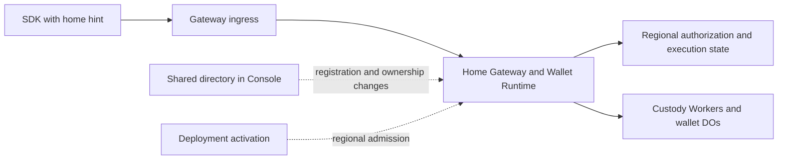

# Regional execution without routine Console calls

Status: regional OTP counters and wallet-counter relocation are implemented. Local regional, authorization-transfer, and browser OTP acceptance pass. The dedicated counter binding and allocation requirement are removed. No new database approval is required. Rebuilding the deployable candidate, coordinated staging rollout, and hosted measurements remain open.
Date: October 6, 2026. Updated: October 7, 2026.

## Objective

Remove synchronous Console calls from established-session signing and presignature
refill. Regional Gateways, Wallet Runtimes, and custody roles must enforce execution
authority using their admitted local state. Keep shared coordination for directory
changes, registration reservations, deployment changes, and relocation.

Reduce registration's Console dependency to operations that need shared ownership
or discovery coordination. Run registration continuations at the reserved home.
Console availability must not determine whether an already admitted wallet can
sign at its active home.

This is a separation of responsibilities within the existing deployment. It does
not require another Worker, database, signing secret, environment-variable family,
or configuration framework. It does not guarantee physical colocation of custody
Workers, DOs, Containers, and D1. Their remaining network hops are separate work.

## Approved OTP design — October 7, 2026

Regional Gateways own OTP spam limits. Use each home's existing signer D1 database.
Do not provision an OTP database, bind Console D1, or call Console to consume a
counter. No cross-region counter replication or globally exact spam limit is required.
Ordinary signing with an admitted session does not consume OTP spam counters.

Wallet-specific limits follow the wallet's fixed home. Foreign ingress forwards
the request to that home before consuming its wallet counter. Persist explicit
wallet ownership so relocation can select unexpired counters without parsing keys.
Transfer those counters with the wallet, preserving counts and reset times.

IP, organization, recipient/subject, and provider limits that span wallets remain
regional. They also protect registration before a wallet exists. Do not copy them
when one wallet moves. A sender using several regions can receive several regional
allowances. This approximation is accepted for email-spam control. Once registration
has a reserved home, continue the wallet flow there using the existing reservation.

Retain existing local atomic counter operations where useful. Relaxing global
consistency does not require weaker local writes or an eventual-replication service.
Keep OTP expiry, per-challenge verification-attempt limits, single-use consumption,
and authorization checks separate and unchanged. Never issue an authentication
success because a spam counter permits the request.

The Console retains directory discovery, registration reservations and uniqueness
claims, deployment management, and relocation coordination. It has no OTP counter
responsibility. OTP latency has not been established as a material bottleneck.
This change simplifies ownership; measure its latency before claiming a gain.

This decision supersedes earlier shared-counter requirements and provisioning
instructions in the implementation history below. Existing frozen bundles contain
the superseded binding and must be rebuilt before deployment.

## Terms and boundaries

- **Shared directory:** cross-region records that identify a wallet's home and
  enforce existing identity, credential, and registration claims. Console hosts it today.
- **Regional execution:** authentication, operation admission, protocol execution,
  budget accounting, reservations, and durable completion at an admitted home.
- **Ownership generation:** a version identifying one period of wallet ownership
  at a home. Relocation installs a later generation. It is not a browser connection generation.
- **Fence:** durable state that prevents an inactive home or deployment from
  admitting or committing unauthorized work.
- **Routing hint:** a suggested region supplied by the client. It grants no authority.

The directory coordinates ownership changes. Local fences enforce execution.
A previously issued session or routing response cannot reopen a fenced home.

## Evidence and present coupling

The October 6 comparison measured roughly 90–100ms for the Gateway binding lookup
on ordinary APAC requests. Moving Console toward the Gateway increased Console
D1 reads by about 50ms and gave no signing improvement. That change was reverted.

The comparison used a frozen SDK that still made a separate status request.
Current SDK code already reconciles session authority from prepare. Preserve that
optimization and use matching current SDK/Gateway builds for the new comparison.
Do not count its earlier saving again or treat the binding span as a guaranteed
end-to-end saving. See [the call-path evidence](evidence/r155-call-path-20261006.json)
and [the R155 results](refactor-155-reusuable-DO.md).

Current calls do more than inspect dashboard configuration:

| Current responsibility | Owner today | Required destination |
| --- | --- | --- |
| Resolve active deployment and verify writer version/resource | Console, before Gateway dispatch | Regional deployment admission installed during activation |
| Resolve session locator to wallet home | Console on routine requests | Session routing metadata, with local authorization |
| Supply tenant identity to the Gateway | Console binding response | Validated regional deployment configuration |
| Reserve one registration allocation and home | Shared directory | Keep shared reservation; reuse it for continuations |
| Enforce cross-region identity and passkey claims | Shared directory | Keep existing uniqueness and ownership rules |
| Publish discovery and lifecycle locators | Shared directory | Keep at the lifecycle transitions that require them |
| Check session, revocation, policy, budget, and one-use material | Regional authorization and custody state | Keep fresh local enforcement |
| Coordinate relocation | Console plus regional participants | Keep coordination; require local fences before ownership changes |

Registration has no cryptographic requirement to call Console. Its current shared
reservation prevents the same registration from creating different wallets when
a lost response is retried through another region. Its identity and credential
claims prevent conflicting records in independent regional databases.
Retain those guarantees without putting directory reads before every continuation.

## Target request paths



Normal signing and refill must make zero Console requests, including internal
forwarding, background writes, alarms, and continuations. The first ingress may
use the existing regional service bindings to forward once. New public regional
hostnames are not required.

| Flow | Directory involvement in the target design |
| --- | --- |
| Established-session signing and refill | None on the normal path |
| OTP spam counters | None; wallet counters use the fixed home, broader counters use regional storage |
| Registration setup | Reserve the exact wallet, operation, and home |
| Registration continuations | None where persisted local reservation and authority are sufficient |
| Registration claims and completion | Commit shared claims and discovery at their required transitions |
| Unlock with a known home | Regional execution where existing factor/identity contracts permit it |
| New-device discovery or missing routing information | Explicit directory discovery |
| Stale route after relocation | Controlled rediscovery, separate from ordinary authorization failures |
| Deployment activation and retirement | Install or fence regional deployment authority |
| Wallet relocation | Coordinate source freeze, transfer, destination activation, and directory update |

## Design rules

1. Return home routing metadata with existing registration and authenticated
   session responses. Carry the ownership generation where the execution contract
   requires it. Reuse existing wallet, session, home, and generation types.
2. Treat client routing metadata as untrusted input. Parse a region from the
   configured catalog once. Authenticate the operation at the selected home and
   compare its authoritative local ownership state. Never accept a client URL,
   region, generation, or forwarding marker as execution authority.
3. Keep fresh regional session and policy checks. Preserve revocation, expiry,
   budget, material retirement, exclusive reservation, and terminal replay.
   Combine ownership/deployment predicates with existing admission transactions
   where possible. Avoid adding one separate D1 request per new check.
4. Install tenant identity and admitted deployment/resource identity through the
   existing deployment workflow. Regional state must reject an old writer after
   retirement. A cached Console response or static configuration alone cannot
   preserve immediate retirement semantics.
5. Use the existing registration reservation as the durable anchor for local
   continuations. Keep shared credential claims at the point their inputs become
   available. Do not assume every registration variant has all claims at setup.
6. Preserve explicit pending and terminal registration states across local and
   directory writes. A lost reply must resume the same operation. Registration
   success requires the ownership and discovery records needed for later access.
   Do not replace these records with an untracked background publication.
7. Reuse R153's ownership generations and local execution fences. Freeze source
   admission and settle or fence admitted work before activating the destination.
   A route refresh cannot make an inactive destination executable.
8. Directory discovery must be bounded. Ordinary 401 responses, exhausted budgets,
   and protocol failures must not trigger region probing or automatic rediscovery.
   Preserve operation identity on permitted retries, including uncertain finalize replies.
9. Keep the current shared uniqueness rules. Removing all directory coordination
   from registration is outside this plan. Moving a directory endpoint to another
   Worker would not by itself reduce coordination or latency.
10. Use one final implementation. Add no legacy routing flags, stale-authority
    fallback, alternate token scheme, or compatibility path for disposable test wallets.

## Change inventory

Paths below are repository-relative. Confirm moved files before editing. R153
work is active; listed local authority components are integration points, not a
claim that their full relocation contract is already complete.

| Repository and area | Existing sources | Required change |
| --- | --- | --- |
| Private Gateway entry | `packages/wallet-console-server-ts/src/router/cloudflare/d1GatewayWorker.ts` | Remove unconditional Console resolution from routine execution; use locally admitted deployment context |
| Private Console lookup | `walletPlacement/gatewaySession.ts`, `tenantDeployment/runtimeBinding.ts`, under the same package | Replace combined request-time lookup; retain only directory/control uses with real callers |
| Private regional routing | `walletPlacement/regionalDispatch.ts`, `authenticationDispatch.ts`, `sessionLocators.ts` | Route from bounded metadata; keep explicit discovery and remove obsolete session-locator reads/publications when no consumers remain |
| Private registration | `walletPlacement/registrationAdmission.ts`, `d1.ts`, `passkeyClaims.ts`, `identityService.ts`, registration offer client/service | Separate shared claims from local continuation admission and completion recovery |
| Private activation | `tenantDeployment/d1.ts`, `resourceVerification.ts`, `deployment/wallet-system/targets.json` and existing render/activation scripts | Install regional scope and writer admission; enforce retirement without per-request Console calls |
| Private relocation | `walletPlacement/executionAuthority.ts`, relocation coordinator and participant modules | Make directory observations control-plane inputs; preserve source and destination execution fences |
| Public runtime/auth | `packages/wallet-server/src/router/cloudflare/d1/registration/d1WalletExecutionAuthority.ts`, `d1WalletOperationStore.ts`, authorization stores/statements | Enforce admitted local generation and deployment at real operation boundaries |
| Public SDK/wire | Existing session responses, relayer clients, registration flow, signing and refill callers | Carry home routing metadata through owner, linked-device, restored, and step-up flows |
| Public custody | `crates/router-ab-cloudflare/src/` signing, pool, DO, and relocation modules | Preserve exact wallet/generation context across requests, deferred work, and terminal replay |
| Public specifications | `docs/intended-behaviours.md`, R153 and R155 plans | Specify Console-outage behavior and the new routing/authority contract |
| Private acceptance | `tests/e2e/regional-*`, `tests/relayer/wallet-relocation-directory.e2e.test.ts`, `tests/e2e/hosted-product/` | Verify composed routing, outages, relocation, registration retries, and hosted timings |

## Phase 1 — Freeze the authority and call inventory

- [ ] Trace owner and linked-device ECDSA, Ed25519, step-up signing, and refill.
  Include internal dispatch, alarms, continuations, completion, and error paths.
- [ ] Inventory every Console read/write on those paths. Identify its data,
  enforcement guarantee, existing local equivalent, and replacement owner.
- [ ] Trace passkey and Google/email registration separately. Classify each
  directory call as reservation, global claim, discovery publication, or repeated read.
- [ ] Pin the R153 generation/fence contract and the deployment retirement contract.
  Record whether each required local enforcement path is implemented and verified.
- [ ] Define typed outcomes for local execution, discovery required, relocation
  paused, retired authority, and ordinary auth failure. Keep routing separate from authorization.

Exit: each removed call has an explicit replacement or evidence that it is redundant.

## Phase 2 — Install and enforce regional execution authority

- [x] Extend the existing activation workflow to install required local tenant,
  resource, and writer admission before enabling regional traffic.
- [ ] Reuse local wallet-generation state. Keep identity fields required and
  represent admission/retirement states with exhaustive domain types.
- [ ] Enforce current authority at operation admission and durable side effects.
  A read performed before a freeze is insufficient to authorize a later write.
- [x] Define deployment cutover failure handling. Do not complete retirement
  while an old regional writer remains authorized. Rollback must not revive a
  retired wallet generation or discard terminal operation history.
- [ ] Preserve valid terminal replay while rejecting new execution under retired
  authority. Use existing replay and relocation rules rather than parallel logic.

Exit: regional enforcement provides the safety previously supplied by Console
lookups, including concurrent cutover and relocation. Console-independent signing
must not be enabled before this gate passes.

## Phase 3 — Route sessions and remove routine Console calls

- [x] Add region metadata to existing registration/session issuance and restore
  boundaries. Update shared types, SDK persistence, transport, and response parsers together.
- [x] Forward through existing regional bindings using catalog-validated hints.
  Preserve the public entrypoint and enforce a bounded forwarding path.
- [ ] Authenticate locally and reject wrong wallet, tenant, resource, generation,
  revoked session, and frozen-home combinations.
- [ ] Remove the unconditional combined Console lookup from signing and refill,
  including forwarded destination requests and internal/deferred execution.
- [x] Keep explicit discovery for missing/stale routing. Avoid treating all
  signing failures as routing failures. Bound rediscovery and preserve retry identity.
- [ ] Preserve prepare-based session reconciliation. Do not reintroduce the
  separate session-status request or increase routine D1 round trips accidentally.

Exit: ordinary signing/refill and their background work make zero Console calls.

## Phase 3A — Regional OTP ownership and counter cleanup

- [x] Inventory challenge issuance, resend, verification, grant, recovery, and
  registration counter consumers. Classify each key as wallet-owned or regional.
  Keep authentication attempt enforcement distinct from email-spam limits.
- [x] Replace the shared binding with the admitted Gateway's existing signer D1.
  Reuse existing scope and counter helpers. Require wallet identity for wallet
  counters. Represent regional counters separately; do not infer ownership from
  optional fields or encoded counter keys.
- [x] Route wallet counter writes through the current home and existing deployment
  and ownership fences. Use regional recipient/IP limits before a wallet exists.
  Preserve those broader regional limits after home assignment without copying
  them into wallet-owned state.
- [x] Add exact tenant-and-wallet selectors for unexpired wallet counters to the
  relocation inventory. Cover snapshot, import, activation, retry, and source
  cleanup. Preserve count and reset time. Frozen sources must reject new wallet
  counter writes; unrelated wallets and regional counters must remain usable.
- [x] Remove `emailOtpRateLimitD1`, `EMAIL_OTP_RATE_LIMIT_DB`, dedicated-counter
  migrations, allocation gates, fixtures, and obsolete shared-counter wrappers.
  Keep the deleted Console rate-limit RPC deleted. Update renderers, readiness
  checks, examples, and deployment documentation to use existing regional D1.
- [x] Update composed E2E acceptance: register before wallet creation, issue OTPs
  through foreign ingress, exhaust a wallet limit, relocate, and verify the same
  unexpired allowance at the destination. Include lost replies, wrong-home writes,
  tenant isolation, expiry, and OTP step-up for NEAR and ECDSA during Console outage.
  Verify independent regional spam allowances are expected behavior. Produce a
  repeatable artifact. Do not retain tests requiring one globally exact counter.
- [x] Replace the previous counter cutover instructions. Never deploy the frozen
  shared-counter candidate. Stop serving old counter consumers before removing the
  obsolete Console table. Approximate spam counters need no exact global-history
  transfer. Preserve authentication records and their existing safety checks.
  Keep historical migrations only where the migration boundary requires them.
- [ ] Rerun relevant checks, rebuild matching bundles, and record OTP counter time,
  request counts, and Console calls separately from email-provider delivery time.
  No latency target or new infrastructure is required for this phase.

Exit: Gateways enforce regional spam limits without Console or another database.
Wallet counters survive relocation. Authentication guarantees remain intact.

## Phase 4 — Reduce registration coordination

- [ ] Reserve the wallet, home, and stable operation identities through the
  existing directory authority. Retries through another ingress reuse the reservation.
- [x] Persist local registration admission and route continuations from that state.
  Remove repeated directory checks whose guarantees now have local enforcement.
- [ ] Retain global identity and credential claims. Batch related statements
  within their owning database when that preserves their existing semantics.
- [ ] Make completion recoverable across regional and directory writes. Verify
  lost replies, cancellation, conflicting retries, and cleanup of incomplete attempts.
- [ ] Publish required discovery information before registration success. Return
  the admitted home with the initial session and preserve early presign preparation.

Exit: each remaining registration Console call changes or discovers shared state
for a documented reason. Protocol continuations use their reserved regional authority.

## Phase 5 — Verify behavior and Console independence

Extend existing E2E scenarios and type fixtures. Add no unit-test suite or source
text guards. Update the intended-behavior specification with the implementation.
Classify existing outage assertions before changing them: a deliberate contract
change does not make unrelated authentication failures obsolete.

- [x] Establish a session, make Console unavailable, and verify ready signing and
  a three-signature sequence that forces refill. Assert zero attempted Console calls.
- [ ] Repeat for owner and linked-device signing, relevant ECDSA/Ed25519 paths,
  session restore, and step-up paths with otherwise available prerequisites.
- [x] Verify shared-budget exhaustion followed by fresh passkey step-up for both
  NEAR and ECDSA through remote ingress with zero Console calls.
- [ ] During the outage, verify revocation, budget exhaustion, material retirement,
  wrong-region hints, malformed metadata, and concurrent double-use rejection.
- [ ] Restart Gateways/DOs and verify authority survives without in-memory Console
  caches. Check deferred refill, alarms, and background completion explicitly.
- [ ] Race signing/refill with R153 source freeze and destination activation.
  Verify no two homes execute the same ownership generation and no late write escapes a fence.
- [ ] Exercise stale routing and an uncertain finalize reply across relocation.
  Preserve exact replay rules and prevent duplicate budget or material consumption.
- [ ] Retry registration through two regions with lost setup/completion replies.
  Verify one allocation, one home, stable identities, and discoverable completion.
- [ ] Race conflicting identity/credential claims across regions. Verify existing
  uniqueness rules and cancellation cleanup remain intact.
- [ ] Exercise partial deployment activation, old-writer traffic, retirement, and
  rollback. Verify denied writers cannot regain execution through stale local state.
- [ ] Produce repeatable artifacts with request counts, state transitions, and
  independently verified signatures. Exclude secrets and credential bodies.

Exit: the composed E2E evidence proves the new dependency boundary and retained guarantees.

## Phase 6 — Controlled staging comparison

- [ ] Freeze matching SDK, Gateway, Runtime, Console, and custody candidates.
  Record source revisions, deployment versions, actual D1 regions, and placement settings.
- [ ] Capture a fresh control with the current prepare-based session validation.
  Hold protocol, pool target, prewarm, client location, and workload constant.
- [ ] Compare ready signing, immediate registration-to-sign, and three consecutive
  signatures. Record medians, maxima, refill waits, HTTP requests, D1 calls, and
  attempted Console calls. Keep confirmation and test automation timing separate.
- [ ] Verify all four regional routes and same-wallet travel. Run a bounded
  Console-outage acceptance scenario without disturbing concurrent experiments.
- [ ] Repeat the control/candidate comparison before claiming a latency gain.
  Record failures and rejected candidates alongside successful measurements.
- [ ] Use existing staging resources within the **$25 total Cloudflare budget**.
  Add no keepalive or new infrastructure. Preserve exact restoration instructions
  for deployment versions and non-versioned settings. Production deployment and npm publication are outside this plan.

Exit: publish measured results and limitations. Zero routine Console calls is a
required result; a particular millisecond saving is not promised in advance.

## Phase 6A — Reduce NEAR setup and first-sign latency

Status: root-store consolidation, SDK request reduction, and authenticated initial
placement are implemented. The latest staging setup median is 6.173 seconds on a
newer candidate. The earlier controlled result was 5.414 seconds. These runs do not
establish a controlled regression. Phase 6B below owns the remaining setup work and
the unmet two-second target. SDK planning uses one status read and one owner-lane read.

### Baseline and scope

The October 7 hosted candidate used public source
`2bee39abb947a6524a42e8c74c6ff7b89c1a7acb`. Three new NEAR-only wallets recorded
Yao execute requests of 7.475, 6.400 and 5.752 seconds. Deriver A protocol spans
were 1.414, 0.353 and 0.184 seconds within those requests. Protocol spans include
peer I/O; they are not CPU-only measurements. Earlier local Router execution was
approximately 316 ms and is a separate environment.

The fastest hosted setup divides as follows:

| Stage | Duration |
| --- | ---: |
| Authorization and root admission | 946 ms |
| Prepare both parties, already parallel | 1,642 ms |
| Deriver A execution, including protocol | 2,319 ms |
| Signing-worker delivery | 627 ms |
| Remaining request overhead | 218 ms |

Funding is a separate user step and is outside the MPC optimization target.
NEAR provisioning at approximately 2–3 seconds is acceptable for this phase.
Continue to report both costs separately. Keep NEAR-only loading and measure SDK
completion before test cleanup. The 5.705-second unlock workflow includes a page
reload and 785 ms of signing automation cleanup in its median-total sample.
Its signing SDK call took 2.179 seconds. Do not label workflow time as SDK time.

Private hosted evidence and the complete diagnosis live in `seams-monorepo`:
`docs/r155b-near-hosted-benchmarks-20261007.md` and its two October 7 NEAR JSON
artifacts in `docs/evidence/`. Preserve their raw samples and frozen candidate.

### 6A.1 — Consolidate root admission and retrieval

Cause: `load_bound` composes `admit_bound`, an epoch reread and `load_active`.
Admission itself reads the epoch, inserts the admission conditionally and reads
it back. The active-epoch path makes five sequential D1 calls. Each party runs
it during preparation and again during execution: twenty calls across four loads.
Preparation decrypts the share and drops it; execution repeats the work.

- [x] Extract bound-root admission/retrieval along the existing store-module seam.
  Reuse `RoleSqlSessionV1::batch`; introduce no parallel persistence framework.
- [x] Preserve the initial authenticated row check. Batch conditional admission
  and dependent reads into one transaction with a coherent lifecycle outcome.
- [x] Target five to at most two remote D1 round trips per load, or twenty to
  eight across the four loads. Record SQL statement counts separately.
- [x] Preserve active-root uniqueness, exact binding checks, admitted access to
  retired epochs, cancellation, erased-share rejection and conflicting retries.
- [x] Remove redundant rereads and row decryption where the transaction snapshot
  supplies the same verified facts. Delete replaced helpers and fallback paths.
- [x] Keep secrets out of diagnostics. Do not add a global plaintext-share cache
  or extend authority lifetime to avoid fresh execution checks.

### 6A.2 — Reduce Worker-to-DO delay

Cause partly established: handlers perform D1 work, while substantial additional
latency occurs outside them. Deriver B preparation took 1,370 ms with a 622 ms
handler. Its later begin call took 542 ms with a 52 ms handler. Routing,
scheduling, startup and transport remain unresolved contributors. These gaps
alone do not prove cold starts or a Cloudflare fault.

- [ ] Extend existing spans with attempt correlation, constructor occurrence,
  handler duration, D1 calls/duration, and correctly scoped placement evidence.
- [x] Compare first, subsequent and post-idle commands on exact wallet objects.
  Separate new-object and warm-object samples; avoid absolute clock subtraction
  across machines.
- [x] Audit first-touch routing against the authenticated wallet home. Coordinate
  with R153 physical custody ownership; preserve its resource/generation identity.
- [ ] Compare supported initial location hints using fresh test objects where
  placement evidence warrants it. Hints do not move existing objects or guarantee
  an exact city. Regional D1 labels alone do not prove physical colocation.
- [ ] Eliminate repeated admission/status hops within one operation when verified
  results already supply the required authority. Keep durable claims before
  protocol messages and durable completion before returning success.
- [ ] If constructor evidence shows a material cost, start the exact wallet
  objects at the earliest authorized registration point. Use bounded preparation;
  add no permanent warm pool, keepalive or new infrastructure.

### 6A.3 — Reduce signing-worker delivery and signing preflight

- [ ] Split the observed 627–1,130 ms delivery span into transport, verification,
  combination, D1 and wallet-DO persistence. Batch dependent writes and remove
  repeated same-attempt reads. Preserve durable, idempotent delivery.
- [x] Trace and remove repeated same-operation session/lane resolution. Ordinary
  NEAR signing now uses one status read, one owner-lane read, prepare and finalize.
  Planning reuses authenticated preparation; fresh prepare enforcement remains.
  Hosted request counts and revocation/budget E2E evidence are recorded below.
- [x] Verify whether current SDK changes already remove any measured duplicates
  before adding another implementation. Freeze a matching candidate for comparison.

### 6A.4 — Verify correctness and hosted gains

- [x] Run existing custody integration/E2E scenarios for refresh during setup,
  cancellation, conflicting retries, exact replay after lost replies, and verified
  NEAR signing. Retain repeatable artifacts; add no source-text or unit-test suite.
- [x] Freeze matching release builds and preserve concurrent R153 edits. Run bloat
  and relevant build/type checks. Keep each completed change committed on `dev`.
- [x] Alternate baseline and candidate runs on existing staging resources, within
  the $25 Cloudflare budget. Change one optimization group at a time.
- [ ] Measure fresh registration setup, unlock to first signature, prepared signing
  and three consecutive signatures. Separate user funding, provisioning, test
  overhead and cold/warm cohorts. Record medians, ranges, maxima, errors, D1
  trips/statements, HTTP counts, preparation waits and Console calls.
- [ ] First target hosted Yao setup below two seconds median. Then pursue
  0.5–1 second. These are engineering targets; no saving is claimed until measured.
- [ ] Keep changes that improve the measured workload without weakening ownership
  or authorization. Record rejected candidates and unresolved bottlenecks.

Exit: repeatable hosted evidence shows the achieved latency and call-count changes,
correctness checks pass, and replaced code is removed. Mark any unmet target
explicitly. A faster local run alone does not complete this phase.

## Phase 7 — Remove obsolete paths and close the refactor

- [ ] Delete replaced session lookup adapters, remote admission wrappers, unused
  DTOs, dead exports, and redundant publications. Keep directory locators still
  needed by discovery, recovery, registration, or relocation.
- [ ] Remove old request shapes and disposable-test-state assumptions. Keep any
  unavoidable storage conversion at the persistence boundary, then retire it.
- [ ] Update public contracts, deployment documentation, examples, and R153
  integration notes. Name the remaining Console dependencies explicitly.
- [ ] Run relevant type fixtures, composed E2E checks, and the bloat gate. Review
  the final implementation for duplicate authority sources and hidden Console calls.
- [ ] Commit only owned changes on `dev` in each repository. Preserve concurrent
  R153 work. Record final evidence and any separate unfinished work honestly.

## Completion criteria

- Existing admitted sessions sign and refill during a Console outage.
- OTP counters use existing regional D1 without Console calls. Wallet counters
  transfer with the wallet; broader regional limits have accepted approximate totals.
- Regional checks enforce current authorization, deployment admission, ownership,
  budgets, and one-use material without relying on a stale directory snapshot.
- Registration retains cross-region retry and ownership guarantees with fewer
  repeated directory calls; discovery remains correct after completion.
- Relocation and deployment retirement cannot leave two active execution owners.
- All four regional routes pass acceptance, with measured latency and request counts.
- The old routine Console path is deleted. No compatibility switch or second
  authority mechanism remains beside its replacement.

Related plans: [R152](refactor-152-regional-D1.md),
[R153](refactor-153-wallet-region-selection.md),
[R155](refactor-155-reusuable-DO.md).

## Implementation history

The following entries record results at the time of each experiment. They are not
current deployment instructions. Phase 3A supersedes all dedicated/shared OTP
counter requirements, approval blockers, cutover procedures, and corresponding
acceptance claims. Preserve those results as historical evidence; rerun acceptance
for the regional design before marking Phase 3A complete.

## Implementation evidence — October 6, 2026

The first implementation slice separates `WalletExecutionAuthority` from
`WalletRegistrationReservationAuthority`. Recovery, export, and signer installation
now receive the D1 service's local execution authority. They cannot obtain ordinary
execution authority through the registration adapter.

The local query requires the exact tenant, wallet, and active ownership generation.
The existing registration wrapper retains completion reconciliation and generation
fences. The obsolete Console ordinary-admission adapter and standalone registration
receipt lookup are removed. Registration retries can still consult the shared directory.

Verification:

- Wallet server type check and wallet-state type fixtures pass. Type fixtures reject
  registration authority as execution authority, including object spreads.
- `node tests/e2e/authorization-storage-transfer.e2e.mjs` passes. Its repeatable artifact
  is `.artifacts/r153/authorization-storage-transfer/evidence.json`. It verifies
  registration completion retry, destination activation, source retirement, and tenant
  separation. The standalone local admission query is exercised against active and
  retired homes.
- Private Console server type check passes.
- Private `wallet-relocation-directory.e2e.test.ts` passes (1 test). Its directory
  assertions now call the shared directory client directly.
- `pnpm report:bloat --check` passes. No ratcheted measure grew.

This slice does not establish Console-independent signing. Local deployment writer
admission, cutover fencing, regional session routing, outage acceptance, and hosted
measurements remain open. No latency gain is claimed for this slice.

## Regional deployment implementation — October 6, 2026

Deployment activation now prepares every configured regional database before Console
commits activation. Preparation pauses prior admission. After Console commits, regional
activation installs the admitted binding and verified Gateway/Wallet Runtime versions.
The existing `reuse_active` operation completes a partially delivered activation.
Monotonic sequence guards reject delayed preparation or activation from an older deployment.
If preparation fails before the central commit, affected regions remain paused. A new
operator-authorized activation can replace that prepared proposal.

Gateway and Wallet Runtime deployment reads now use regional D1. Gateway session
discovery still calls Console and checks that the directory response matches the local
binding revision. Scheduled prewarm uses regional deployment admission. No new secret,
Worker, database, or environment variable is required. Migration `0066` installs the
admission table and its transactional writer guard. Apply it before activating these
Worker builds. Existing remote deployments were not changed during this implementation.

Each runtime D1 batch checks its exact admitted binding and writer in the same
transaction as its statements. Deferred work keeps that database adapter, so a request
admitted before cutover cannot write after preparation retires its writer. The guard
adds a local SQL statement to the existing batch. It does not add a network roundtrip.
Its latency and D1 charge impact remain unmeasured. Privileged deployment/relocation
control routes retain their separate control authority and use the underlying database.

Verification:

- Private server type check passes.
- Deployment binding and regional renewal E2E tests pass.
- Renewal covers lost central replies, interrupted regional activation, retry, old-writer
  rejection, delayed-write rejection, current-writer batches, stale command rejection,
  private control retries, and rejection of wrong-writer/public-origin control requests.
- The test emits `deployment-renewal-evidence.json` and its SHA-256. The retained copy is
  [regional admission evidence](evidence/r155b-regional-admission-20261006.json).
- Public bloat check passes.
- The broad private test type check remains non-green because of unrelated application
  aliases and stale fixtures. The changed files had no reported errors.

Remaining gates: complete session-home metadata and forwarding, remove routine directory
reads, verify all signing/refill paths during a Console outage, audit custody-side deferred
execution, reduce registration continuation lookups, and run the controlled hosted comparison.
No new signing-latency result is claimed.

## Local session routing — October 6, 2026

Gateway now checks the regional session tables before requesting Console discovery.
The lookup uses the exact tenant and credential digest. It returns the wallet identity
for the existing dispatcher scope checks. It uses the deployment-fenced database.

A matching record selects the local handler. The existing authorization service still
checks credential validity, revocation, budget, and execution generation. Retired records
also select local handling, so revocation cannot cause directory rediscovery. Unknown
credentials retain directory discovery. No new table, cache, secret, or SDK token is added.

Verification:

- Private server type check and deployment-binding E2E pass.
- `node tests/relayer/local-session-routing.e2e.mjs` passes against real Miniflare D1
  with production routing and authorization code.
- Known direct credentials make zero Console routing calls during a simulated outage.
  Hosted credentials and exchange codes resolve to the correct local wallet.
- Wrong-tenant lookup fails. Revoked credentials remain local and fail authorization.
  The initial three-use quota remains intact. Unknown credentials attempt discovery once.
- The runner emits a repeatable artifact with a production bundle digest. The retained
  copy is [local session evidence](evidence/r155b-local-session-routing-20261006.json).
- Public bloat check passes.

This adds one local D1 lookup and removes the Console discovery request for known local
sessions. End-to-end latency remains unmeasured. This test does not execute an MPC signature.
Cross-region discovery, complete Console-outage signing/refill acceptance, custody deferred
execution, registration continuation lookups, and hosted measurements remain open.

## Bounded forwarding and response metadata — October 6, 2026

Gateway accepts `X-Seams-Wallet-Region` only for US, WEUR, APAC, or OC. It resolves
the hint against the admitted resource catalog and forwards through existing service
bindings. A forwarding marker prevents a second hop. The destination still checks
local session and execution authority. The hint grants no authority.

A missing credential at a hinted or forwarded destination returns
`wallet_home_discovery_required` with HTTP 409. It does not contact Console or probe
other regions. Requests without a hint retain explicit directory discovery.
Local Gateway responses expose their serving region through the same header. CORS
allows the request header and exposes the response header to browser clients.

The local routing E2E verifies one-hop transport, destination-local credential lookup,
loop rejection, invalid-target rejection, explicit discovery on a route miss, and CORS
metadata. Server type checks and the existing deployment-binding E2E pass. Bloat checks
pass. Updated evidence remains in the local session routing artifact.

SDK ingestion and persistence of this metadata remain incomplete. No automatic client
routing or full MPC outage result is claimed. The next integration must retain the
home with each session across owner, linked-device, hosted exchange, and restore flows.

## Session home persistence — October 6, 2026

Primary and hosted credentials now carry required home metadata: a direct endpoint
or one configured regional home. Managed issuance reads the home from its existing
regional publisher. Standalone issuance uses the direct endpoint. No token format,
secret, or routing cache is added. Parsers reject missing or invalid metadata.

The SDK credential parser preserves the home in the existing authorization row.
Session status and ECDSA activation requests send the regional hint from that credential.
The hosted-session parser also retains it. Static fixtures reject missing home data,
mixed direct/regional states, and arbitrary target URLs.

The routing E2E verifies issuance, hosted exchange, serialization through the SDK
record writer/parser, and request-header construction. It does not simulate a browser
reload or perform an MPC signature. Public server, SDK, and private server type checks
pass; bloat checks pass. The retained local-session artifact records this boundary test.

Remaining SDK work includes normal-signing and refill credential projections, hosted
request consumers, exchange routing before redemption, and complete linked-device and
reload acceptance. Do not treat this checkpoint as full client routing completion.

## Signing, refill, and exchange propagation — October 6, 2026

The SDK now requires home metadata in both ECDSA and Ed25519 protocol credentials.
Owner, linked-device, login-prefill, recovery, restore, and step-up projections retain
that metadata. Prepare/finalize, presignature pool requests, and Ed25519 step-up use
the shared session-header builder. Existing prepare-based session reconciliation remains.

Hosted exchange issuance returns the home. Its response parser, iframe message, and
redemption request retain it. Both exchange minting and redemption send the regional hint.
Hosted credential inventory requests also retain the home. Linked-device encrypted
delivery now requires the canonical credential type instead of a handwritten subset.

Public server and SDK type checks, private server type checks, and the focused routing
E2E pass. The E2E also verifies home preservation across the exchange iframe payload.
Bloat checks pass. The intended browser registration/refresh and mixed ECDSA/Ed25519
signing cases are running against the local backend; no browser result is claimed yet.
This remains an implementation checkpoint, not full regional MPC outage acceptance.

Remaining gates include bounded stale-route rediscovery, registration continuation
admission, custody/deferred-path review, complete outage/concurrency acceptance, and
the hosted ECDSA/Ed25519 comparison. No new latency result is claimed.

## Completed-registration continuation admission — October 6, 2026

A continuation for an exact, locally completed registration now reads its active
execution generation without Console. The lookup requires tenant, wallet, registration
origin, and ceremony identity. Pending registrations retain the shared admission check;
cancellation and completion races must be resolved before that check can be removed.
This adds a local lookup before pending admission. Its latency impact is unmeasured.

The routing E2E verifies completed admission with the directory unavailable and rejects
a different ceremony. Regional hints also apply to requests without session tokens,
which allows bounded forwarding of registration continuations. Handler authorization
remains required. Server types, the focused routing E2E, and bloat checks pass.
Browser lifecycle and authorization-transfer verification are still running.

### Signing proxy ownership contract repair — October 6

The local Ed25519 browser contract exposed a production regression: the Gateway
proxy matched an obsolete owner-admission field list. The required
`ownership_generation` field prevented that match, so the proxy forwarded the
browser bearer token. The custody Router correctly rejected it. The proxy now
requires the current generation field and strips the token for owner admission.
The custody rejection remains unchanged. Server type-checking and the bloat
check pass. After rebuilding the server bundle, the immediate-signing/refresh
browser contract passed (one Chromium E2E, 34.3 seconds total test time).
It exercises registration, immediate NEAR signing, reload, and restored signing.
Command: `SEAMS_INTENDED_SKIP_BUILD=1 node scripts/run-wallet-intended-isolated.mjs
-- e2e/intended-behaviours/passkey.ed25519-yao-local.contract.test.ts --grep
"public Ed25519 Yao registration"` from `tests/`, after
`pnpm -C packages/wallet-server run build`. This is correctness evidence,
not a hosted latency measurement. The first attempted rerun used the old Worker
bundle and was stopped; it does not measure the fix.

The authorization-storage-transfer E2E passed. Its repeatable artifact is
`.artifacts/r153/authorization-storage-transfer/evidence.json`. It verifies
local execution admission with zero central ordinary reads before destination
activation and after cleanup, immutable generation, and one quota charge on
exact retry. This test does not execute MPC signing or prove a complete
Console-outage signing flow.

### Mixed-curve browser acceptance — October 6

The existing mixed-curve contract passed with the rebuilt server bundle: one
Chromium E2E, 38.6 seconds total test time. It registers an Ed25519 wallet,
adds ECDSA signing, signs NEAR/Tempo/Arc, unlocks and signs again, and injects
a lost finalize response. Use the same isolated command above with
`--grep "public ECDSA add-signer"` to repeat it. Both curve contracts now pass.
These local tests verify transport and lifecycle behavior. They do not establish
regional latency or Console-outage independence.

Registration coordination still needs local continuation routing and a durable
terminal decision. The current completion order calls the directory before
updating local execution state. A registering-state fast path alone could admit
work during that cancellation window. Close that window before removing the
pending-ceremony directory check.

### Durable registration terminal decision — October 6

Migration 0067 adds an immutable completion decision to the existing execution
generation row. Completion fixes the outcome before contacting Console. A
cancellation also retires local execution in that transaction. Establishment
activates local execution only after Console acknowledges completion. Exact
retries can republish the same decision; conflicting outcomes fail before any
Console request.

The real-D1 local-session-routing scenario passes for lost establishment and
cancellation replies, exact retry, conflicting outcomes, and ordinary admission
before/after completion. Server type-checking and the bloat gate pass. Pending
registration admission still uses Console until continuation routing and durable
write enforcement are verified. Authorization-transfer verification is running.

### Registration continuation routing and cancellation writes — October 6

Private commit `ceb98c3` routes a known ceremony from the exact tenant's regional
execution record. It preserves session-to-wallet matching and the handler's
authorization checks. Unknown ceremonies retain directory discovery.

Migration 0068 rejects inserts and updates of cancelled registration ceremony
and setup records. Cleanup deletes remain available. The real-D1 routing scenario
verifies late-write rejection after a lost cancellation reply, prevents recreation
after cleanup, and preserves exact completion retry. The bloat gate passes.
Custody and session-publication write coverage still needs verification before
pending registration admission can become fully local.

### Registration lifecycle and session cancellation guards — October 6

The shared transactional lifecycle guard now rejects cancelled registrations.
The custody state store and registration operation journal already include this
guard in their write batches. Migration 0069 also blocks Wallet Session insertion
for a cancelled registration, including issuance admitted before cancellation.
The real-D1 scenario verifies guard rejection, calls the production authorization
service after cancellation, and confirms no session row was persisted. Server
type-checking and the bloat gate pass. Pending registration still uses Console
admission; remote custody effects and completion reconciliation remain under review.

### Local pending registration admission — October 6

An exact local registration generation now admits pending continuations without
a Console read. Initial admission still establishes the reserved home through
Console. Completed local generations admit ordinary execution. Retired local
generations reject execution. A fixed establishment or cancellation decision
is republished on continuation retry after an uncertain completion reply.
The former directory-based activation recovery branch was removed.

The real-D1 scenario passes after recreating the authority object with the
directory configured to reject any second admission lookup. It also verifies
terminal reconciliation, conflicting completion, cancellation write guards,
and session publication refusal. Type-checking and the bloat gate pass.
Browser contracts and authorization-transfer verification are running. Full
hosted Console-outage acceptance and remote-effect cancellation remain unproven.

### Bounded explicit home discovery — October 6

Signing prepare/finalize and ECDSA refill transports now retry once without the
region hint when the Gateway explicitly returns `wallet_home_discovery_required`.
The same URL, body, bearer token, and abort signal are retained. Other errors
remain terminal. This does not add a routing cache or change the stored credential.
A moved session can require discovery again until its routing metadata is renewed.

The network scenario verifies successful discovery, no retry on HTTP 401, and
a maximum of two attempts when discovery is refused again. It checks exact body
and token preservation. The existing regional D1 routing scenario also passes.
SDK type-checking passes. Both browser contracts passed after local registration
admission; the discovery transport still needs composed browser acceptance.

### Composed Console-outage acceptance — October 6

Two regional browser contracts passed (1.5 minutes total suite time). Each
registers a real mixed-curve wallet, disables both Console services, and completes
three signatures. The ECDSA sequence records three prepare/finalize pairs plus
seven refill-init and 35 successful refill-step requests during the outage. The
Ed25519 sequence records three prepare/finalize pairs. Both record zero attempted
Console calls, including awaited background work.

Repeat from the private repository:
`SEAMS_WALLET_SERVER_CANDIDATE=/Users/pta/Dev/rust/seams-wallet/packages/wallet-server
SEAMS_INTENDED_SKIP_BUILD=1 node tests/scripts/run-regional-real.mjs
passkey.registration.contract.test.ts` after building the candidate runtime.
Evidence: `docs/evidence/r155b-console-outage-ecdsa.json` and
`docs/evidence/r155b-console-outage-ed25519.json`. The harness uses production
session resolution, regional dispatch, Gateway handlers, D1, and local custody
Workers. Deployment admission is fixture configuration. These results do not
prove physical regional latency, linked-device/step-up outage behavior, restart,
or relocation concurrency.

### Owner preflight routing repair — October 6

Travel acceptance exposed an Ed25519 production regression: owner execution-lane
preflight sent the token without its home. A remote Gateway therefore tried
Console discovery during the outage. Preflight now requires the canonical
operation credential and uses its home metadata and bounded discovery transport.
Both Ed25519 and ECDSA callers pass that credential.

After rebuilding the SDK, both owner browser cases complete signatures through
WEUR, APAC, and OC ingress for a US wallet with Console disabled. Type-checking
and the bloat gate pass. Linked-device cases are running. This tests regional
routing in local Workers, not physical travel latency.

### Linked-device installation generation repair — October 6

Both linked-device outage cases initially failed before the outage: their
source-preserving Ed25519 Router target omitted required `ownership_generation`.
The adapter now requires local established-home admission and sends that
generation in the target. It refuses retired ownership before remote execution.
Server type-checking and the bloat gate pass. Linked-device browser acceptance
is being repeated; no linked-device outage success is claimed yet.

### Linked-device Console-outage acceptance (2026-10-06)

The composed browser E2E now passes for linked ECDSA and Ed25519. Each case
registers an owner in US, installs a linked device through WEUR, disables both
Console transports, and completes three signatures. Each records three successful
home prepare/finalize pairs and zero attempted Console calls. ECDSA also completes
presignature refill steps during the outage.

The ECDSA test exposed a production regression: linked reusable sessions received
the operation-step-up reconciliation callback. Commit `69b17933` selects linked
session reconciliation instead. It checks the current selected authority, exact
session record, quota identity, remaining uses, and expiry against prepare's
response before client signing. It adds no session-status request.

Verification: SDK type-check, SDK build, bloat check, and both linked browser cases
pass. The first rerun stopped before tests because local Worker ports were occupied;
the same command passed after those ports became free.

Repeat from the private repository:

```sh
SEAMS_WALLET_SERVER_CANDIDATE=/Users/pta/Dev/rust/seams-wallet/packages/wallet-server SEAMS_INTENDED_SKIP_BUILD=1 node tests/scripts/run-regional-real.mjs passkey.registration.contract.test.ts --grep 'linked (ecdsa|ed25519)'
```

Evidence: [ECDSA](./evidence/r155b-console-outage-linked-ecdsa.json) and
[Ed25519](./evidence/r155b-console-outage-linked-ed25519.json). These are local
composition results. Hosted latency, restart, revocation, and relocation-race
acceptance remain separate gates.

### Console-outage process restart acceptance (2026-10-06)

Private commit `aa679a9` extends the existing process-restart harness. Both browser
cases pass: ECDSA and Ed25519 each complete three signatures through WEUR for a US
wallet after the Gateway and all five local role Workers restart. Console remains
unavailable. D1 and DO storage reopen in place; production in-memory state is not
copied. Only test observations and outage controls survive in memory.

Both cases record zero attempted Console calls and three successful home
prepare/finalize pairs. ECDSA also completes refill work. Process receipts verify
replacement PIDs and an incremented role-worker generation. These local results
verify restart recovery; they do not measure hosted latency or an in-flight crash.

An initial attempt found stale SDK output after the credential gained a required
ownership generation. Rebuilding the SDK resolved that candidate mismatch. Local
port collisions also stopped startup attempts before test execution. The final
matched run passed both cases in 1.7 minutes.

Repeat the linked-outage command above with `--grep 'role restart'`.
Evidence: [ECDSA requests](./evidence/r155b-console-outage-ecdsa-restart.json),
[ECDSA restart](./evidence/r155b-restart-evidence-ecdsa-restart.json),
[Ed25519 requests](./evidence/r155b-console-outage-ed25519-restart.json), and
[Ed25519 restart](./evidence/r155b-restart-evidence-ed25519-restart.json).

### Linked revocation during Console outage

Private commit `dc8f441` extends the linked-device browser acceptance cases.
Both pass: the linked device completes three signatures, the owner revokes it
while Console is unavailable, and both NEAR and ECDSA signing then fail.
The existing harness verifies that the owner no longer lists the revoked device.
Each case still has exactly three successful home prepare/finalize pairs and zero
attempted Console calls. The ECDSA case also records rejected refill and prepare
requests with HTTP 401 after revocation.

Run the same regional browser command with `--grep 'linked (ecdsa|ed25519)'`.
Evidence: [ECDSA-led](./evidence/r155b-revocation-outage-ecdsa.json) and
[Ed25519-led](./evidence/r155b-revocation-outage-ed25519.json). Both curves are tried
and rejected after revocation in each case. This verifies ordinary linked-device
revocation during an outage, not an in-flight revocation race.

NEAR prepare now returns the fresh session-status projection through the shared
Gateway response builder. Its SDK reconciles the exact selected authority before
creating a signature share for transaction and signature-only signing. The separate
status-read removal remains pending: signing planning must be isolated from export
and restoration readers before using local observations. Registration, local signing
measurements, and verification are recorded in
[the NEAR-only benchmark](./optimization-12-NEAR-only-20261006.md).

### Shared budget and passkey step-up during Console outage — 2026-10-07

Private commit `304f2d7` adds one mixed-curve browser scenario. A US wallet unlocks,
Console becomes unavailable, and WEUR ingress completes one NEAR signature plus
concurrent Tempo/Arc signatures. The independent home budget check confirms
exhaustion. APAC ingress then completes NEAR step-up. OC ingress completes ECDSA
step-up. All five signatures verify independently.

The scenario exposed three production gaps:

1. ECDSA step-up issuance omitted the session token and regional home. It now
   requires the canonical credential and uses the existing bounded home-discovery
   transport. Session-based export issuance uses that transport too. Fresh
   factor-proof exports remain explicit. The optional legacy-cookie transport and
   its nested fetch wrapper were removed.
2. The destination Gateway still queried Console for authenticated ECDSA step-up.
   It now uses the resolved local wallet and rejects a different request wallet.
   The operation handler still verifies the factor proof and material.
3. ECDSA step-up used an active-quota reader, which threw after exhaustion. It now
   uses the existing exact-operation context reader. It verifies live authority,
   expiry, material, and fresh evidence without granting reusable quota. The
   existing complete-session equality helper replaces a duplicate field comparison.

The passing artifact records zero Console attempts, three authorization-grant
operations, and two verified-step-up operations in US. WEUR, APAC, and OC contain
no operation records. All recorded requests avoid server errors. Awaited refill
work is included. Evidence: [step-up outage](./evidence/r155b-step-up-outage.json).

Reproduce from the private repository with the candidate server and frozen SDK
configured, using `tests/scripts/run-regional-real.mjs` and
`passkey.registration.contract.test.ts --grep 'shared budget exhaustion'`.
Private raw runs are `/tmp/r155b-stepup*.log`. Public build and verification logs
are `.artifacts/r155b-step-up/`. The first attempt's independent status request
bypassed the regional harness; that fixture was corrected before the production
failures above were diagnosed. A build attempt during the server edit failed on
an import and stale type uses; it is excluded from passing evidence.

This result covers passkey step-up and shared-budget exhaustion. Email OTP step-up,
material-retirement races, relocation/cutover races, deferred alarm acceptance,
registration conflicts, and the matched hosted comparison remain separate gates.

Verification also passes for the rebuilt candidate's public passkey unlock/export
and shared-budget lifecycle E2E (33.9 seconds), SDK and server type-checks/builds,
Wallet lifecycle type fixtures, private Console-server type-check, and the bloat
gate. No hosted deployment or npm publication was performed.

### NEAR status-read reuse — 2026-10-07

NEAR exact signing preparation now passes its freshly read authorization directly
to sealed-runtime binding. This removes the duplicate HTTP read at that boundary.
The three existing NEAR browser scenarios pass before and after the change.
Complete-scenario status calls fall 35→29, 29→25, and 32→27. Prepare/finalize counts
and changed-authority rejection remain unchanged. Other status-read removal is
still pending. No hosted latency reduction is claimed.

See [NEAR measurements](./optimization-12-NEAR-only-20261006.md#near-duplicate-status-read-removal--2026-10-07)
and [repeatable evidence](./evidence/near-status-reuse-20261007.json).

### Email OTP step-up routing and remaining shared limiter — 2026-10-07

The composed Email OTP outage scenario registers and unlocks a mixed wallet in US,
then exhausts its shared budget through WEUR ingress. NEAR step-up enters through
APAC. The intended final ECDSA step-up enters through OC.

Two routing defects were identified and corrected in the candidate:
- The signing challenge used the unauthenticated login request variant. Signing
  now requires an explicit operation-step-up variant with the exact unexpired
  session credential. Transaction challenge types reject the login/export variants.
- The OTP Worker sent only the bearer token. It now uses the existing regional
  header builder and bounded discovery transport. A locally matched session routes
  challenge/factor-release directly, with request-wallet equality enforced.

The scenario remains incomplete. Three reusable signatures verify and the shared
budget reaches zero. The next OTP challenge reaches the home handler but fails
closed because the shared rate limiter calls `/internal/wallet-placement/v1/rate-limit`
on the unavailable Console. The home returns 500; forwarding reports 503. The test
attaches the exact attempted Console paths. No OTP or credential bodies are published.
[Sanitized dependency evidence](./evidence/r155b-email-otp-dependency.json).

Historical decision, superseded by Phase 3A: this attempt required globally exact
spam counters and proposed a dedicated D1 database. The user subsequently accepted
regional limits and wallet-owned counter transfer. No dedicated database is needed.

The first attempt stopped before registration due to an expired Google test token.
The existing token-refresh script repaired that environment prerequisite. Later
failures exposed the routing defects and then the shared limiter dependency. These
are failed acceptance attempts, not evidence that Email OTP outage support is done.
Source snapshots, builds and logs are under `.artifacts/r155b-email-outage/`.

The normal Email OTP registration/unlock lifecycle E2E passes (47.7s), including
NEAR/ECDSA step-up, reload, and key export. SDK/private Console type checks, lifecycle
type fixtures, and the bloat gate pass. This does not close the outage gate.

### Regional routing rejection acceptance — 2026-10-07

The existing private regional browser suite now uses a real US wallet and its
captured NEAR signing request to verify three failures during Console outage:

| Mutation | Result |
| --- | --- |
| Malformed region metadata | 400 `invalid_wallet_region` |
| APAC home hint for the US session, entering through WEUR | 409 `wallet_home_discovery_required` |
| Different request wallet with the valid session credential | 403 `wallet_session_scope_mismatch` |

The first valid signature enters through WEUR. After the rejected requests,
APAC and OC ingress each complete another signature with the original reusable
budget. All three signatures verify. The verifier counts three successful home
prepare/finalize pairs and zero attempted Console calls. This proves the rejected
requests do not prevent those remaining budgeted operations. It does not establish
tenant/resource forgery rejection, concurrent double-use, hosted placement, or latency.

The case passes in 1.0 minute. Reproduce in `seams-monorepo`:
`tests/scripts/run-regional-real.mjs passkey.registration.contract.test.ts --grep 'regional routing rejects'`
with the existing candidate server and frozen SDK environment variables. The frozen
SDK is `.artifacts/r155b-email-outage/stepup-dist` in `seams-wallet`. The test writes
`rejections.json` and `console-outage.json` under the private
`.artifacts/r155b/console-outage/routing-rejections/` directory.
[Sanitized combined evidence](./evidence/r155b-routing-rejections.json).

### NEAR prepare-based planning consolidation — 2026-10-07

NEAR signing preparation now consumes existing local status observations and
requires fresh prepare reconciliation before creating a signature share. It
falls back to a fresh read when the full session projection differs. Cached
observations never overwrite persisted authority. Export/funding/restoration
readers remain fresh.

In matched browser scenarios, full-scenario status calls fall 29→19, 25→17, and
27→18. Actual SDK signing intervals in the transaction case fall 5→2, 5→2, and
9→5 status requests. Prepare/finalize counts remain unchanged. Both arms pass all
three NEAR cases. Linked revocation and shared-budget passkey step-up also pass
through regional ingress during Console outage. No hosted latency gain is claimed.
See [NEAR results](./optimization-12-NEAR-only-20261006.md#signing-preparation-uses-existing-observations--2026-10-07)
and [evidence](./evidence/near-signing-observation-20261007.json).

### Rejected NEAR lane-selection optimization — 2026-10-07

A diagnostic trace located one remaining status read in signing lane selection.
An experimental change reused the existing checked session observation there.
The three local NEAR contracts passed. Immediate signing status calls fell from
two to one; the reload signature fell from five to four.

The composed Console-outage acceptance rejected this candidate. Linked-device
revocation passed, but shared-budget exhaustion and step-up failed twice at
`/wallet/execution-lane/owner`. The home returned HTTP 503 with
`wallet_session_unavailable`. The previous frozen SDK passed that same budget
scenario against the current server. This is classified as a production regression.
The experimental source changes were reverted before commit.

The demonstrated boundary is lane selection followed by owner-lane preflight
during budget step-up. The exact server rejection cause still needs tracing.
Before removing this read, make preflight and prepare handle an exhausted
observation through the existing step-up path. Preserve fresh authority checks
before generating a client signature share. Do not weaken revocation or budget checks.

[Sanitized experimental request counts](./evidence/near-lane-observation-20261007.json).
These lower counts describe a rejected candidate, not shipped behavior or a
hosted latency improvement. Current immediate-signature status calls remain two.

### NEAR owner-lane preflight after budget exhaustion — 2026-10-07

The rejected lane-selection experiment exposed an owner-preflight defect. NEAR
preflight called the reader for a spendable session. An exhausted session made
that reader fail, producing HTTP 503 before signing could request step-up.

NEAR preflight now uses the existing exact-operation identity reader. It checks
the live authority, factor, expiry, signer family, and exact material activation.
It can return lane metadata after exhaustion. It grants no signing allowance.
Prepare and finalize retain their admission checks. ECDSA preflight keeps its
existing path. The redundant wallet-ID reparse was removed because both readers
already return a validated WalletId.

This server correction did not make the experimental client optimization ready.
With the status read removed, NEAR step-up progressed but the subsequent ECDSA
confirmation timed out. Narrowing the server change to NEAR and refreshing status
on a prepare-exhaustion response did not resolve that timeout. Both client changes
were reverted. The remaining client issue needs confirmation-flow tracing.
Immediate signing therefore still has two status calls in the accepted SDK.

One earlier run was invalidated by rebuilding watched server output during the
test. It is excluded from acceptance evidence. Later runs used fixed build inputs.

Final acceptance uses the accepted SDK and the NEAR-only server correction.
The composed test captures the unlocked session's NEAR owner-lane request,
consumes its three shared uses, and replays that metadata read through WEUR.
The read returns HTTP 200 from US. Fresh NEAR and ECDSA step-up then succeed.
The verifier records three reusable grants, two verified step-up operations,
and zero Console calls. Linked Ed25519 revocation also passes. Both final tests
passed in 1.7 minutes. Server type-check/build and the bloat check passed.

[Sanitized acceptance evidence](./evidence/near-preflight-exhaustion-20261007.json).
The executable composed scenario remains in the private repository at
`tests/e2e/regional-real/passkey.registration.contract.test.ts`.

### Deployment fences in composed signing acceptance — 2026-10-07

The composed browser harness previously exercised production regional dispatch
and authorization while supplying its deployment binding directly. It bypassed
`D1RegionalDeploymentAdmission` and `DeploymentFencedDatabase`. That gap is closed.
The harness now installs admission through the production store and resolves it
for each regional request. Routing, continuations, signing, and awaited background
work use the production transactional deployment fence. Restarts reuse persisted
admission instead of reinstalling it. Provider verification proofs remain fixtures.

Four browser contracts passed with the accepted SDK:

| Workload | Verified signatures | Attempted Console calls |
| --- | ---: | ---: |
| ECDSA through WEUR, APAC, and OC | 3 | 0 |
| NEAR through WEUR, APAC, and OC | 3 | 0 |
| ECDSA after Gateway and role-process restart | 3 | 0 |
| NEAR after Gateway and role-process restart | 3 | 0 |

The first pair passed in 1.5 minutes. The restart pair passed in 1.6 minutes.
These durations are test execution times, not signing latency measurements.
[Request evidence](./evidence/r155b-fenced-signing-20261007.json). Repeat the private
`tests/scripts/run-regional-real.mjs passkey.registration.contract.test.ts` runner
with `--grep 'signs through WEUR|signs after Gateway and role restart'`.

The deployment-renewal E2E also passed. It verifies six retired writers, a delayed
retired-writer write, partial regional activation recovery, and rejection of stale
admission restoration. It uses production Console services and local D1; provider
proofs and Router status are controlled. It does not execute a wallet signing race.
[Deployment evidence](./evidence/r155b-deployment-renewal-20261007.json). Repeat with
`playwright test -c tests/playwright.relayer.config.ts tenant-deployment-renewal.e2e.test.ts
--grep 'regional deployment renewal' --reporter=line`.

The authorization-transfer E2E passed against the current working checkout. Its
recorded bundle and runner hashes identify that source, including concurrent R153
work. It proves immutable D1 generations, refusal to reopen the retired source,
zero central ordinary-admission reads, and preserved terminal replay after transfer.
[Scoped D1 evidence](./evidence/r155b-authorization-fences-20261007.json). This does
not close the full MPC/DO relocation race or deferred-alarm acceptance gate.

Remaining enforcement acceptance must compose retirement/relocation with live
signing and custody effects. The tests above verify their individual boundaries
and ordinary signing with deployment fences; they do not establish that full race.

### Live signing versus deployment retirement — 2026-10-07

Both curve contracts now retire the US writer during a real browser prepare
request entering through WEUR. Retirement happens after the home has resolved
its active deployment and routed the request, before the production handler
accesses signing state. The request retains its original database fence.

Each case first verifies one valid signature. During Console outage, the next
prepare causes the fixture to activate newer writer proofs through the production
regional admission store. That in-flight request returns HTTP 503. It does not
retry, finalize, spend budget, or create/change an operation record. The artifact
contains matching before/after hashes of complete quota and operation rows.
No credential values or row bodies are published. Both final tests passed in
1.4 minutes; the bloat check also passed.

[Repeatable retirement evidence](./evidence/r155b-live-deployment-retirement-20261007.json).
The existing private regional browser runner selects these cases with
`--grep 'in-flight .* signing'`.

This closes the deployment-retirement race at the regional signing-handler
boundary for NEAR and ECDSA. It does not establish custody-effect fencing after
MPC execution starts, wallet-relocation races, or deferred alarm behavior.
Those broader Phase 2 and Phase 5 items remain open.

An initial ECDSA attempt did not inject retirement because the fixture still
matched the NEAR endpoint. It was classified as a test-fixture defect, corrected,
and rerun for both curves. A run started before that correction was applied was
stopped and is excluded. No production behavior was changed to satisfy this test.


### Deferred NEAR provisioning retry — October 7, 2026

The composed cross-region retry exposed two production defects:

- The mixed-wallet NEAR continuation sent its session token without its home hint.
  A foreign ingress therefore needed Console discovery. Registration and persisted
  NEAR recovery now use the existing session authorization header builder.
- The local execution authority contacted the directory again when registration
  was already active and its establishment was acknowledged. An exact established
  retry now uses that durable local state. Pending publication still reconciles
  through the directory. Conflicting cancellation still fails before a directory call.

The D1 routing scenario verifies lost publication replies, eventual reconciliation,
local established replay, conflicting terminal decisions, and cancellation fences.
Its session-publication assertion now expects the current early generation rejection;
the old assertion expected the later cancellation SQL error. It still requires zero
published sessions for a cancelled registration.

The browser acceptance discards a successful mixed-wallet NEAR provisioning response
at US, then replays the identical request through WEUR with Console unavailable.
The SDK receives only the replay. The test requires the same wallet and signer,
unchanged budget and operation records, and three valid NEAR signatures through
WEUR, APAC, and OC. The harness injects the retry; this does not prove automatic SDK
network retry or browser-reload recovery. NEAR-only registration without an existing
Wallet Session, lost initial setup, and post-MPC relocation races remain separate gates.

Evidence and final command results are recorded in
[the retry evidence](./evidence/r155b-registration-retry-20261007.json).


### NEAR-only setup home and lost-response recovery — October 7, 2026

Setup now returns a required `home` using the existing direct/regional routing
union. The value comes from the admitted Gateway's routing publisher. The SDK
parses it at the response boundary. Passkey and Email OTP NEAR-only respond,
activation and provisioning requests carry the home hint before a Wallet Session
exists. The hint grants no authority; normal setup and local-generation checks remain.

The composed passkey test discards the successful provisioning reply at US and
replays the unchanged request through WEUR with Console unavailable. An unauthenticated
NEAR-only replay correctly requires exact-method unlock; the replay never issues a
replacement operation credential. Testing exposed a separate startup recovery gap:
credential-free publication demanded a session that the lost response never delivered.
For that exact NEAR-only pending completion, missing-session recovery now atomically
publishes the committed identity and sealed material, creates a locked selection when
needed, and removes its completed journal. It installs no session or credential.
Existing selections remain unchanged. Corrupt/future session storage still rejects.
Mixed-wallet publication still requires its exact existing session.

The test then permits Console for the explicit fresh unlock and disables it again
for three NEAR signatures through WEUR, APAC and OC. This separates registration
recovery from the routine signing outage claim. The harness injects the lost-reply
retry; it does not prove automatic SDK network retries. Email OTP header propagation
is implemented, but this passkey test does not establish OTP outage support.

The final composed run passed both scenarios (1.4 minutes): six independently
verified NEAR signatures, with zero Console calls during replay and signing.
SDK/server types and builds, type fixtures, and bloat checks passed.

[Verification evidence](./evidence/r155b-near-only-home-20261007.json) records the
commands and scope. Yao admission/execution transport home hints, persisted pre-session
routing metadata, global OTP counters, relocation races and hosted acceptance remain
outside this slice and require their own completion evidence.

### NEAR registration protocol home — 2026-10-07

The SDK now supplies the setup home to Yao admission and execution for NEAR-only
and mixed registration. Deferred mixed work carries that home. Resumed work reads
it from the saved session credential. The shared transport requires either a known
home or explicit discovery; existing recovery, export and add-signer callers use
discovery when their inputs lack home metadata. No authorization check is removed.

The first composed acceptance attempt disabled Console during Yao admission. It
reached the US home through WEUR, then returned HTTP 503 (`admission_failed`).
The registration backend still resolves tenant-root context through Console.
This is a `valid_test_needs_update` failure: the outage assertion exceeded this
routing change and the plan permits registration control-plane dependencies.
The revised scenario keeps Console available during registration and disables it
for three subsequent NEAR signatures. It records the registration Console paths
separately. This change does not establish Console-free registration or a hosted
latency improvement.

The revised NEAR-only scenario passed. Admission entered WEUR and execution
entered APAC; both completed at the US home. Admission made one
`/internal/wallet-console/v1/tenant-root/active-lineage` request. Execution made
zero Console requests. Three subsequent signatures verified through WEUR, APAC
and OC while Console was unavailable. SDK type-check, the required-routing type
fixture, SDK build and bloat check passed. Mixed and Email OTP propagation compile
but are not additional behavioral claims from this NEAR-only scenario.

[Sanitized evidence](./evidence/r155b-yao-home-20261007.json). Repeat with the private
regional-real runner, `passkey.registration.contract.test.ts --grep
'NEAR-only Yao registration'`, and the exact SDK/server candidate. Local logs and
frozen SDK are under `.artifacts/r155b-yao-home/`; private request evidence is under
`.artifacts/r155b/console-outage/near-registration-protocol-home/`.

### Gateway retirement after custody execution — 2026-10-07

The composed browser scenario now retires the regional Gateway writer after a
successful custody response and before Gateway operation settlement. It tests
ECDSA and Ed25519 independently. The fault uses the production regional deployment
admission and fenced D1 wrapper. It does not mock signing or the quota store.

The scenario requires the old writer to fail settlement without changing quota
or operation records. It then installs the admitted replacement writer in the
test Gateway and retries the original browser request through WEUR. The custody
response must match the first response exactly. The replacement must settle the
same operation without spending another use. Console stays unavailable throughout
signing and retry.

An intermediate test replayed an internal request through ingress and received
HTTP 409. This was `valid_test_needs_update`: the request already contained the
forwarding marker. The test now captures and retries the original browser request.
The bounded-forwarding rejection remains unchanged.

This proof concerns Gateway D1 settlement after custody completion. It does not
prove a relocation freeze during custody writes, or deployment fencing inside
custody roles. Those acceptance requirements remain open.

Both scenarios passed (2 tests, 1.3 minutes). Old-writer settlement returned
HTTP 500 after custody returned HTTP 200. The admitted replacement returned
HTTP 200 with the same custody result. Quota hashes remained unchanged and
operation row counts remained one. The operation state changed only during
replacement settlement. No Console calls occurred. Bloat and diff checks passed.

[Sanitized evidence](./evidence/r155b-post-custody-retirement-20261007.json).
Repeat with the private regional-real runner:
`passkey.registration.contract.test.ts --grep 'retirement after custody'`.
Use the exact SDK/server candidate. Private artifacts are under
`.artifacts/r155b/console-outage/post-custody-retirement-{ecdsa,ed25519}/`.
The SDK was frozen at `.artifacts/r155b-yao-home/dist`.

### Registration setup reply recovery and obsolete retry removal — 2026-10-07

Removed the SDK retry branch for the retired `/wallets/register/prepare` route.
No current call to the private JSON transport uses that route. The obsolete
Wrangler error matcher, attempt loop and attempt-count diagnostic are deleted.
Current setup errors still reach the caller. The persisted registration operation
remains the recovery anchor when the caller retries.

The composed scenario loses a successful setup reply before client acceptance,
reloads the browser, and retries through APAC after the first request entered US.
It covers mixed and NEAR-only registration. It requires identical operation,
wallet and ceremony identities, one established US directory row, and three
verified signatures during a subsequent Console outage. This tests caller-driven
recovery after reload; it does not claim automatic network retries.

Both cases passed (2 tests, 1.5 minutes). Each reused the original operation,
wallet, ceremony and US home after reload and APAC retry. Each left exactly one
established directory row. Three ECDSA signatures and three NEAR signatures
verified with zero Console calls. SDK type-check, build, bloat and diff checks
passed. Google/email registration and conflicting claims remain separate gates.

[Sanitized evidence](./evidence/r155b-setup-retry-20261007.json). Repeat using the
private regional-real runner, `passkey.registration.contract.test.ts --grep
'setup reply loss'`. The exact frozen SDK is under
`.artifacts/r155b-setup-retry/dist`; private evidence is under
`.artifacts/r155b/console-outage/setup-retry-{mixed,near-only}/`.

### Relocation session retirement versus live signing — 2026-10-07

The composed ECDSA and Ed25519 scenarios call the production regional session
retirement participant after prepare has admitted an operation and before
finalize runs. Retirement must reject the pending operation atomically. Quota
and operation records must remain unchanged by the rejected retirement. The
original signature then completes and is cryptographically verified.

After settlement, retirement must succeed and an exact retirement retry must
return the same result. The local execution generation becomes retired. An exact
finalize replay using the retired session must fail without another quota or
operation mutation. Console remains unavailable during signing and retirement.

The first test assertion used the old session-only error name. This was
`valid_test_needs_update`: migration 0062 replaced it with the wallet-wide
`wallet_operations_unsettled` guard. The assertion now matches the current
contract. No production behavior was changed for that failure.

This verifies the regional participant's settlement boundary with real browser
signing. Directory orchestration, custody freeze, state transfer and destination
activation remain outside this scenario. It is not evidence for a complete move.

The corrected test exposed a production error-classification defect in NEAR.
The general session-admission reader passed retired rows to the live-session
parser. That parser threw, so the route returned `wallet_session_unavailable`
(HTTP 503). The ECDSA reader already rejected retired rows before parsing.
This is `production_regression`: retirement is an ordinary authorization denial,
not a storage failure. The general reader now uses the existing ECDSA retirement
check and returns no active session. Live-session parsing and all authorization
checks remain unchanged.

Both browser scenarios passed (2 tests, 1.4 minutes). Each rejected retirement
while a signature was pending, verified that signature, retired successfully
after settlement, and rejected the retired session's exact finalize replay with
HTTP 401. Neither case contacted Console or changed quota/operation records on
the rejected retirement or retired-session replay.

The local-session-routing acceptance also passed. Its old exception assertion
was updated to the corrected no-active-session result (`valid_test_needs_update`);
its local-routing and zero-Console checks remain. Server type-check, build, bloat
and diff checks passed. The intended-behavior contract now names both curves.

[Sanitized evidence](./evidence/r155b-relocation-settlement-20261007.json). Repeat
with the private regional-real runner, `passkey.registration.contract.test.ts
--grep 'relocation retirement waits'`, using the SDK frozen under
`.artifacts/r155b-setup-retry/dist` and the matching server candidate. Private
evidence is under `.artifacts/r155b/console-outage/relocation-signing-settlement-{ecdsa,ed25519}/`.

### Custody execution and relocation acceptance — 2026-10-07

Both existing native Worker acceptance scenarios passed with the current local
custody sources: `--ecdsa-wallet-do-pool` and `--do-pair-execution`. These exercise
production Rust Workers in Miniflare with the wallet-object harness enabled.

NEAR verified fresh signatures after transfer and after a return move. It rejected
stale generations and replayed prepare/finalize after object eviction. Deriver A
replayed its completed result without another Deriver B execution. Cross-wallet
and cross-tenant reads failed. Changed root receipts failed without writes.

ECDSA verified fresh signatures before and after source cleanup. It rejected
delayed owner refill and completed presignature publication under retired
authority, including after a return move. Exact prepare and terminal replay
survived object eviction. Delayed cleanup preserved the returned wallet.

The initial ECDSA attempt failed the build-freshness check. This was an
`environment_or_infrastructure_failure`. All five Worker roles were rebuilt
with the existing dev profile before the passing runs. No production fix was
required by these results.

The shared checkout contains concurrent R153 custody changes outside committed
`dev`. These results apply to the tested local binaries. They do not validate a
frozen deployment candidate. The evidence records each binary hash and build
stamp. Full product relocation, linked-device NEAR transfer, and hosted regional
acceptance remain separate gates. No Cloudflare resources were created or used.

[Acceptance evidence and repeat commands](./evidence/r155b-custody-acceptance-20261007.json).
Raw artifacts remain under `.artifacts/r150/`; logs are under
`.artifacts/r155b-custody-acceptance/`.

### Concurrent registration and competing wallet reservation — 2026-10-07

The composed browser scenario sends one NEAR-only SDK setup request concurrently
through US, APAC and OC. All three replies returned HTTP 200 with the same wallet,
ceremony and US home. Before releasing setup to the browser, the scenario submits
a different registration operation for that reserved wallet through WEUR and OC.
Both requests return HTTP 409 `wallet_conflict`.

The original registration then completes. The directory contains one established
wallet. Three NEAR signatures verify through WEUR, APAC and OC with Console
unavailable and zero attempted Console calls. The final scenario passed in
56.0 seconds. No production change was required.

An earlier extension used a UUID for the competing operation. The boundary
correctly returned HTTP 400 because registration operation IDs use the existing
`wreg_` format. This was `valid_test_needs_update`; the scenario now uses the
production ID builder. It does not weaken the parser.

This proves concurrent setup convergence and rejection of a different operation
against the reserved wallet. It does not prove competing passkey/provider claims
or cancellation cleanup. Those parts of the uniqueness checklist remain open.

[Sanitized evidence](./evidence/r155b-concurrent-setup-20261007.json). The private
scenario is committed as `57781b8`. Repeat with `tests/scripts/run-regional-real.mjs
passkey.registration.contract.test.ts --grep 'concurrent NEAR-only setup'`, using
the server candidate and the SDK under `.artifacts/r155b-setup-retry/dist`.

### Conflicting passkey claim and directory cancellation — 2026-10-07

The concurrent registration scenario now reserves a second wallet in APAC. After
the original wallet registers, its home client replays its passkey claim while
the APAC client claims the same credential for the second wallet. The production
directory accepts the owner replay and rejects the competing claim.

The APAC registration authority cancels the second directory reservation. The
original passkey claim remains unchanged. Another claim from the cancelled wallet
fails. The original wallet then verifies three NEAR signatures through foreign
ingress with Console unavailable and zero attempted Console calls.

The corrected scenario passed. An initial test omitted the ceremony ID required
by cancellation and received HTTP 400. This was `valid_test_needs_update`; the
helper now retains that ID from setup and uses the typed registration authority.
No production change was required.

This covers the production directory ownership/cancellation boundary within a
real browser registration/signing scenario. It does not simulate browser reuse
of a passkey, Google/provider identity conflicts, or regional cancellation
cleanup. The broader conflict-and-cleanup checklist therefore remains open.

[Sanitized evidence](./evidence/r155b-credential-conflict-20261007.json). Repeat the
`concurrent NEAR-only setup` scenario using the regional-real runner and the
SDK frozen under `.artifacts/r155b-setup-retry/dist`.

### Remove obsolete Console session lookup adapters — 2026-10-07

The old `resolveSessionHome` function had no production callers. Only older
regional test fixtures used it. Those fixtures now use the production
`resolveGatewayDeployment` path, which checks local session rows before explicit
discovery. The registration-only fixture uses its known application-auth state.

Removed the unused resolver, both `findSession` client adapters, and the
`find-session` Console endpoint. Explicit discovery remains through
`gateway-session`; session locator publication and authorization remain intact.

The older regional scenario also required current fixture contracts: an open
execution generation, a routing publisher with `home()`, and the deployment's
tenant identity. These were `valid_test_needs_update` failures. The fixes reuse
the existing generation helper, registration authority and shared factory.
Production enforcement was not changed to accommodate fixtures.

The regional session-routing scenario, local session-routing acceptance and
wallet-home-directory E2E all passed. The broad scenario covers production
regional routing and directory/authorization behavior, including shared identity,
passkey claims, linking, expiry and recovery. Its terminal protocol execution and
tenant writer admission are controlled. It does not prove browser signing or
hosted placement.

Private implementation commit: `a2c187c`.
[Sanitized evidence](./evidence/r155b-lookup-cleanup-20261007.json).

### Relocation integration gate review — 2026-10-07

The production relocation-directory scenario passed (1 test, 11.0 seconds) with
the current server candidate. It exercises competing moves, lost replies, restart
and handover ordering. Its participant receipts are synthetic; this result does
not prove custody transfer or source writer fencing.

The remaining Phase 5 integration gap is now explicit. The browser harness shares
one local native custody stack across its regional Gateways. The native Worker
transfer harness uses real Rust roles but substitutes directory replies through
`SourceDirectory`. The directory harness supplies synthetic participant receipts.
These separate passing checks cannot establish the complete relocation claim.

Closure requires the existing coordinator and Runtime paths to run against
independent regional custody stores in one scenario. Register and sign first,
move through the real journal, then verify destination signing, rejected delayed
source work and exact retry behavior. Use real custody receipts throughout.
No alternate relocation implementation or weaker acceptance criterion is needed.

[Coordinator evidence and repeat command](./evidence/r155b-relocation-coordinator-20261007.json).
No infrastructure was provisioned and no hosted latency was measured.

### Composed relocation custody setup — 2026-10-07

Added a private harness using the existing native Worker configuration builders.
Source and destination have separate Router, Deriver A, Deriver B, SigningWorker
wallet-object namespaces and presignature-session namespaces. SigningWorker D1
stores are separate. Tenant-root authority remains shared.

The harness creates real tenant-root state and completes NEAR registration
through the source Rust Workers. It verifies distinct object identities across
all five corresponding namespaces. The repeatable artifact explicitly records
that the directory coordinator and destination-signing checks remain unfinished.

The native script now permits importing its existing configuration and setup
functions without executing its CLI. Explicit module roots allow those Workers
to load from the private repository. Initial startup failures were environment
configuration failures; no protocol execution occurred in those failed attempts.

The new custody setup and existing `--do-pair-execution` acceptance passed. The
bloat check passed. Private harness commit: `eac9098`. The next implementation
step is to bind the real directory coordinator and Runtime handlers to these
Workers, then run the complete move.

[Setup evidence and repeat command](./evidence/r155b-composed-custody-20261007.json).
This uses current local custody sources, including concurrent R153 changes. It
does not establish hosted latency or a deployable committed-source candidate.

### Composed NEAR relocation and empty ECDSA inventory — 2026-10-07

The private composed acceptance now completes a WEUR-to-APAC move for a NEAR-only
wallet. It uses the production directory journal, Gateway authorization handlers,
Runtime handlers, migrated regional D1 stores, and separate native custody object
namespaces. The fixture acknowledges native registration and supplies a real
session and signed WebAuthn owner approval. The authority manifest uses the
registered NEAR public key and exact material activation.

The run exposed a production defect: presignature preparation required ECDSA
execution authority even when the NEAR-only wallet had no ECDSA material. The
preparation reader now applies the same empty-store condition as ECDSA freeze.
Missing authority still fails if snapshot records or an import activation exist.
Generation checks, relocation fences, cursor validation, and page limits remain.
This read creates no execution authority.

The final run completed source freeze, verified transfer, destination activation,
and source cleanup. A generation-2 NEAR signature verified at the destination.
The old generation was rejected. Prepare and finalize replay succeeded after
SigningWorker object eviction. The existing ECDSA pool acceptance also passed,
including delayed-refill rejection, terminal replay, and move/return checks.
All five native Worker roles were rebuilt. The bloat check passed.

This is local native composition evidence. It does not close hosted regional
comparison, full browser SDK relocation, in-flight signing races, or Email OTP
Console-outage acceptance. No Cloudflare deployment or spending occurred.

[Sanitized evidence and reproduction commands](./evidence/r155b-near-empty-presign-20261007.json).
Private acceptance commit: `ac66d14`. Current local custody sources include
concurrent R153 changes. Build hashes identify the tested binaries. A frozen,
fully committed deployment candidate remains a separate gate.


### NEAR signing during a composed relocation — 2026-10-07

The composed acceptance now prepares a generation-1 NEAR signature before move
admission. The real coordinator observes one pending round and remains in source
freeze. Finalization then commits through the native source Worker. The harness
drops that response and retries the exact request while the move still waits.
The retry returns the same verified signature.

After copying, activation, and source cleanup, the destination returns the exact
stored terminal result for that original request. This is the intended terminal
replay contract. A completed result can survive relocation without authorizing new
execution under its old generation. The destination rejects the same operation
with a changed generation. The cleaned source rejects the original finalization.
A fresh generation-2 signature also verifies, with prepare and finalize replay
after object eviction.

This check exercises native signing and the real private relocation coordinator.
It does not prove browser SDK session reconciliation after cutover. The injected
lost reply occurs after the source commits, and the first retry occurs before
cutover. Earlier session-retirement acceptance remains separate evidence for the
Gateway authorization boundary. No Cloudflare deployment or spending occurred.

[Sanitized signing-race evidence](./evidence/r155b-near-signing-move-20261007.json).
Private acceptance commit: `0e86252`. The final check verifies the rejection
reasons, not only non-200 statuses. The source retains its settlement fence.
The destination reports different request material for the changed retry.


### Browser session reconciliation after native relocation — 2026-10-07

The composed scenario now opens Chromium with real IndexedDB. It installs the
registered wallet authority and the actual issued source session through the SDK's
production persistence APIs. The browser passes actual coordinator responses
through the public move-status parser and SDK placement-session reconciliation.

While the move is paused, the SDK records the destination generation without
requesting a lock. Completion requests one lock. The supplied lock callback retires
the local session through the production repository. Repeating completion does not
request another lock. After browser reload, the repository rejects a late write of
the source-generation credential. Native move, source cleanup, lost-finalize-reply
recovery, destination terminal replay, and fresh destination signing also pass in
the same run.

This proves browser persistence and the SDK reconciliation callback contract.
Session installation is direct. It does not cover browser registration, iframe
transport, Gateway status HTTP routing, or fresh owner authentication after the
move. Hosted acceptance and Email OTP isolation remain open. No production behavior
changed, and no Cloudflare resources were deployed.

[Sanitized browser evidence](./evidence/r155b-browser-relocation-20261007.json).
Private acceptance commit: `d448976`.


### Shared OTP counters and browser step-up — 2026-10-07

The private Gateway now binds a dedicated shared OTP-counter D1 directly. It reuses
the existing atomic counter and tenant scope. The Console rate-limit RPC and client
adapter are removed. Every regional Gateway must bind the same counter database.
Counter storage failure rejects the OTP action; no regional fallback exists.
The staging example, readiness check, migration, and cutover notes are updated.

Regional local acceptance passed: 32 concurrent requests produced 12 approvals
and 20 limit rejections across four policy scopes. Independent project scopes,
Console outage, and real counter-storage failure checks passed. Package type-check
and the public bloat gate passed.

The composed Chromium check then completed two NEAR signatures, three ECDSA
signatures, and two Email OTP step-ups while Console stayed unavailable. It recorded
zero Console requests. All three authorization grants and both verified step-ups
remained in the US home. Signing entered through WEUR, APAC, and OC.

The first browser retry exposed a test-fixture dependency: its development OTP
outbox reader required Console discovery. The check now uses a local mailbox at
the production email-provider boundary. Only external email delivery is simulated.
OTP generation, verification, shared limits, regional routing, and MPC signing use
production code. This closes the local OTP outage blocker recorded above.

Private commits: `04f5071` (counter wiring), `7e73599` (browser acceptance).
[Sanitized evidence](./evidence/r155b-direct-otp-20261007.json).
Repeat the browser check with `tests/scripts/run-regional-real.mjs`,
`google-email-otp.recovery.contract.test.ts`, and
`--grep 'Email OTP budget exhaustion'` in the private repository. Set
`SEAMS_WALLET_SERVER_CANDIDATE` to the matching public wallet-server candidate.
The counter composition check is `tests/e2e/regional-session-routing.e2e.mjs`.

No live database was provisioned or deployed. Approval for the dedicated shared
counter database remains pending under the infrastructure constraint and $25 budget.
The old Console counter table must be removed after coordinated Gateway cutover.
This evidence uses local regional D1 stores and a shared local custody backend.
It does not prove hosted placement, regional latency, or the remaining R155B gates.


### Authority-path audit and remaining gates — 2026-10-07

This audit reads the current private entrypoints and public custody sources. It
separates a source inspection from executed acceptance. The local OTP outage gate
above is closed. The full refactor remains open.

| Execution path | Current authority and Console boundary | Evidence and remaining limit |
| --- | --- | --- |
| Gateway request, including forwarded requests | `d1GatewayWorker.ts` resolves `D1RegionalDeploymentAdmission` locally. `DeploymentFencedDatabase` keeps the admitted writer and binding and inserts a guard in the same D1 batch as each statement. | Composed writer-retirement and post-custody retirement checks cover rejection of stale Gateway writers. A matching hosted candidate remains unverified. |
| Known-session routing | `gatewaySession.ts` validates the catalog and regional hint, then reads the local session locator. Missing local state with a selected home returns `wallet_home_discovery_required`. | Wrong-home, malformed-region, wallet mismatch, owner, linked-device, and OTP outage evidence exists. An unhinted nonlocal session can still use explicit Console discovery. |
| Owner/linked signing and ECDSA refill | The bound Gateway supplies regional authorization storage and Router/SigningWorker service bindings. Shared OTP counters now use their isolated D1 binding. | Owner and linked-device evidence covers both curves during Console outage. OTP and passkey step-up evidence covers shared-budget exhaustion. This does not prove every relocation race in a full browser flow. |
| Gateway scheduled prewarm | `scheduled()` calls `resolveBoundTenantDeploymentRuntimeEnvironmentV1`, which reads local deployment admission and returns the fenced D1 wrapper. | Source inspection confirms no Console lookup here. Scheduled prewarm is not itself wallet signing or authorization. |
| ECDSA activation background warm-up | `lib.rs` starts `warm_owner_presign_host` only after activation commits. The task retains the wallet scope and material activation and addresses that exact material host. | `durable_object/worker_storage.rs` sends only the prewarm request. The prewarm handler creates no signing session or authority. This source inspection does not replace a hosted timing measurement. |
| NEAR Deriver B background protocol | `ed25519_yao_lifecycle.rs` captures the tenant-root context and pair binding in `wait_until`. Completion and failure commands return through the same wallet-pair scope. | Native pair execution and replay evidence exists. Complete-pair persistence checks the running record inside a transaction. The deployable candidate must retain these exact fences and feature choices. |
| Presignature expiry alarm | `durable_object/mod.rs::alarm` removes expired live sessions and calls `owner_presign_storage::expire_authorities`. Storage keys include expiry and a session-id digest. | Release authority records belong to the wallet DO. The reusable host alarm expires live protocol sessions. The mixed-wallet coordinator scenario now observes the production alarm during source freeze, rejects the expired refill, and verifies destination signing. See the alarm acceptance evidence below. |
| Private Runtime identity lookup | `d1WalletRuntimeWorker.ts` uses the Console directory for the explicit wallet-identities operation. Other ordinary runtime requests receive locally admitted deployment context. | This is an identity-discovery dependency. It is not a routine signing/refill dependency. Tenant-root control and relocation handlers remain separate control-plane operations. |
| Registration reservation and shared claims | `ConsoleRegistrationHomeAdmission` reserves a stable operation/home through `WalletHomeServiceClient`. Identity and credential claims remain shared. | Concurrent setup and lost-response evidence covers one operation/home and stable identities. Global claim/cancellation evidence remains separate from protocol continuation evidence. |
| Registration continuations | Gateway dispatch first calls `resolveLocalRegistrationContinuation`; protocol handlers use persisted regional admission. | NEAR-only and mixed-wallet lost provisioning/setup replies have local composed evidence. These results do not establish every Google registration failure path. |

The following gates are still required. They consolidate the unchecked work above;
they do not add a new refactor scope.

1. **Finish the enforcement inventory.** Direct alarm coverage is now recorded below. Review any
   uncovered internal completion paths. Use existing race scenarios; add no
   source-text guards or duplicate authority mechanism.
2. **Finish composed relocation acceptance.** Existing evidence joins the real
   coordinator, native custody, NEAR pending signing, terminal replay, and browser
   session invalidation. Full browser fresh authentication after the move and
   equivalent composed ECDSA/refill race evidence remain open. Native ECDSA
   relocation evidence is useful but has a narrower boundary.
3. **Freeze the deployment inputs.** Direct content comparison now confirms that
   all 3,549 public working files match committed `dev` at `1b3fbb895501077201ca69cc3a94cadcc1cc88e9`.
   The checkout branch/index difference caused the earlier integration warning.
   Optimized NEAR and ECDSA acceptance passed on those source contents, with the
   session-burn fault excluded from release. Preserve these source revisions and
   binary hashes when rendering the hosted candidate. SDK bundle and deployment
   version pinning still belong to Phase 6.
4. **Implement Phase 3A.** Replace the superseded dedicated-counter binding with
   regional counters and wallet-owned relocation records. Remove its allocation
   requirement, rerun composed acceptance, and rebuild the deployment candidate.
5. **Run Phase 6 on that candidate.** All four regions, same-wallet travel, ready
   signing, immediate registration-to-sign, and three-signature sequences need
   controlled hosted measurements. Record calls, refill waits, actual served
   regions, medians, maxima, and restoration evidence within the $25 budget.
6. **Close Phase 7 against those results.** Update contracts/examples where the
   final deployment changes them, remove obsolete paths, rerun relevant checks,
   and commit only owned work. Keep the completion criteria unchanged.

The referenced R153 chat is currently about a separate regional-replication
feasibility experiment. Its retained result is not evidence that the relocation
sources used here have been integrated or that R155B is ready to deploy.


### Standard wallet-object builds — 2026-10-07

The standard Worker build now selects wallet-object ownership for Router,
Deriver A, Deriver B, and SigningWorker. Dev and release use the same ownership
features. Release output uses the normal `build/<role>` directory. The
`ROUTER_AB_WALLET_DO_HARNESS` opt-in is removed from build and runtime-test scripts.

Deriver B and SigningWorker wallet-object bindings and SQLite migrations now live
in their standard Wrangler manifests, including staging and production-testnet.
The local configuration builder no longer injects a different custody topology.
All four role manifests passed binding/migration checks for each environment.
No live deployment or namespace provisioning occurred.

Local acceptance passed without the opt-in variable:

- The composed native NEAR relocation scenario verified pending-signature
  settlement, exact finalization replay, cleanup, destination signing, and browser
  session invalidation.
- The native ECDSA wallet-object pool scenario verified signing, replay after
  eviction, delayed refill rejection, transfer, return transfer, and cleanup.

Removed the old D1-only ECDSA storage-fault helper and the browser recovery test
that required signing and commit to occur in separate D1 steps. These are
`obsolete_test_or_fixture`: the active wallet-object path signs and commits inside
one object operation. Existing wallet-object interruption, replay, retirement,
and relocation scenarios remain. The old recovery hold helper is also removed.
Benchmark labels now identify the standard local wallet-object backend.

The composed browser OTP check also passed with the standard local wallet-object
backend: two NEAR signatures, three ECDSA signatures, two step-ups, and zero
Console requests. Its first run completed those checks but failed during teardown
when a late refill reached a disposed database. Waiting for browser route handlers
before disposal repaired that fixture failure; the repeat passed (1.2 minutes).

Syntax checks, patch checks, and the bloat gate pass. Optimized builds completed
for all five roles. The release binaries passed the composed NEAR relocation
scenario and the native ECDSA pool scenario, each with exit code zero. The evidence
records the build features, binary hashes, commands, and resulting artifact hashes.
These local checks establish behavior only. Hosted latency remains unmeasured for
this candidate. The ECDSA scenario still uses harness-selected Gateway routing;
the NEAR browser check covers session invalidation, rather than fresh authentication.
[Repeatable local evidence](./evidence/r155b-standard-wallet-objects-20261007.json).
The public checkout still contains relocation changes outside committed `dev`.
This change fixes the default build selection and manifest mismatch. It does not
close source integration, all composed relocation coverage, or hosted acceptance.


### Obsolete finalize-hold removal — 2026-10-07

Removed the unused `local-intended-signing-hold` Rust feature, D1 hold-table
implementation, internal route, and Gateway arm/read commands. Its retired browser
test depended on separate signing and commit operations. Standard wallet-object
execution commits them within one object operation. Capture, withhold, and exact
replay commands remain for the active recovery scenarios.

Validation passed: wallet-server TypeScript checking, SigningWorker WASM-target
`cargo check` with standard wallet-object features, and the bloat gate. This
cleanup changes no enabled production path. The preceding optimized-binary E2E
evidence predates this deletion; no new hosted or timing claim follows from it.


### Release fault isolation — 2026-10-07

Review found that the standard Deriver B release build selected
`wallet-do-b-completion-harness`. This feature enables the test-only
`R150_TEST_B_BURN_BEFORE_COMPLETE` fault. The fault deliberately burns a pair
before completion when its environment variable is enabled.

The build now selects that feature only for development. Release retains
`wallet-do-b-harness`, which provides wallet ownership and scoped persistence.
The release feature combination passed WASM-target `cargo check`. Shell syntax
and the bloat gate passed. Fresh optimized builds are running after this change
and the obsolete finalize-hold deletion. The earlier release hashes identify
the preceding candidate and must not be reused for deployment of this revision.

The remaining fresh-unlock acceptance needs a wallet created through the browser
registration harness. The existing composed relocation fixture installs an owner
authority and session directly; it does not establish the sealed custody data
required for a complete browser unlock. That gap remains open.


### Routing checklist verification — 2026-10-07

Repeated `node tests/relayer/local-session-routing.e2e.mjs` against the current
source. It passed and refreshed the [routing evidence](evidence/r155b-local-session-routing-20261006.json).
The scenario verifies bounded explicit discovery with the exact retry request,
zero Console calls for known local credentials and hinted travel, rejection of
forwarding loops, and preserved routing metadata after SDK restoration.

It also verifies persisted pending registration admission after restart, terminal
completion recovery, local continuation routing, and rejection of late lifecycle
writes after cancellation. These checks close the corresponding Phase 3 discovery
and Phase 4 local-continuation items. Broader authentication, custody relocation,
registration claims/completion, and hosted gates remain as listed.


### Counter deployment integration — 2026-10-07

The canonical deployment configuration and Gateway manifest renderer now include
`emailOtpRateLimitD1`. They reuse the existing allocated/pending resource model.
All four Gateways receive the same `EMAIL_OTP_RATE_LIMIT_DB` binding. Console and
Wallet Runtime manifests exclude it. Pending allocation prevents Gateway rendering.
The existing wallet-system migration command applies the shared counter schema
once through the ingress Gateway configuration. No remote migration ran.

The deployment E2E passed with nine rendered manifests. It also rejected missing
counter allocation and reuse of a Console, signer, or other-environment database.
Private commits: `3b94c24` and `3dea157`.
[Counter evidence](evidence/r155b-direct-otp-20261007.json) records these checks.
Canonical allocations remain pending. Provisioning approval, live cutover, and
old-counter cleanup remain open.


### Committed-source audit and clean release acceptance — 2026-10-07

The source-integration warning above is superseded. Direct Git blob hashing compared
every public `dev` file with its working copy. All 3,549 files matched revision
`1b3fbb895501077201ca69cc3a94cadcc1cc88e9`. No file was missing, changed, or extra.
The checkout remains on `codex/ml-dsa-experiments`; its index caused misleading
diffs against `dev`. No checkout, reset, or unrelated staging operation was needed.

All five optimized builds completed after the finalize-hold deletion and release
fault isolation. Composed NEAR relocation and native ECDSA pool acceptance passed
again, each with exit zero. [The evidence](evidence/r155b-standard-wallet-objects-20261007.json)
records current binary hashes, build features, artifact hashes, and source revisions.
Private source revision: `3dea157`. The separate regional routing scenario also
passed across all four regions, including shared counter and claim contention.

These results close the source-content mismatch concern. They do not establish
hosted timing, full browser reauthentication after relocation, or the remaining
composed ECDSA/coordinator race coverage. Live provisioning remains pending.


### Required wallet ownership at Worker entrypoints — 2026-10-07

Removed the four optional wallet-ownership Cargo features. Router, Deriver A,
Deriver B, and SigningWorker now select their wallet-object code through the
corresponding Worker entrypoint feature. A manual entrypoint build cannot omit
wallet ownership by forgetting a second flag. The standard build script no longer
adds those switches. Four unreachable Deriver A fallback routes are deleted.

WASM-target compilation passed for all five entrypoint configurations. Shell
syntax and the bloat gate passed. Fresh optimized builds are running; their
acceptance results remain pending. Earlier release evidence identifies the
preceding source revision. The development-only completion fault remains an
explicit test feature and stays excluded from release builds.


### Release activation-fault removal — 2026-10-07

Review found a test activation-fault route in the release SigningWorker wallet
object. Its normal initial-registration lookup also created/read the fault table.
The handler, request type, schema, and lookup now compile only with debug
assertions. Release execution omits the route and both fault-related SQL calls.
No new feature switch or environment variable was introduced.

Release WASM-target compilation and the bloat gate passed. Composed relocation
acceptance now probes the route directly in source and destination SigningWorker
objects and requires HTTP 404 in release. That behavioral check is pending the
new optimized builds. The preceding build loop was deliberately terminated after
this issue was identified; it is not release acceptance evidence.

### Mixed-wallet coordinator acceptance — 2026-10-07

All five optimized Worker builds completed. The composed relocation check passed
with NEAR and ECDSA registered under the exact same wallet scope. The real
directory coordinator drained a pending NEAR signature, moved custody, and
completed source cleanup. Both curves then signed at the destination. ECDSA
signatures were independently verified before and after the move. A completed
source refill could not publish after cleanup because its authority was removed.
The release activation-fault endpoint returned HTTP 404 in both namespaces.

Reproduce from `seams-monorepo` with `ROUTER_AB_WORKER_BUILD_PROFILE=release`,
`SEAMS_WALLET_SERVER_CANDIDATE` set to the local Wallet server package, and
`node tests/e2e/relocation-custody.e2e.mjs --with-ecdsa`. Evidence is written to
`.artifacts/r155b/composed-mixed-relocation/`, including `ecdsa-signing.json`,
`destination-signing.json`, `coordinator-bindings.json`, and `custody-topology.json`.

The initial fixture used different project-environment scopes for the two curves.
Correcting that fixture and the expected post-cleanup rejection required no
production changes. The standalone ECDSA pool scenario also passed with release
builds: `ROUTER_AB_WORKER_BUILD_PROFILE=release node scripts/test-private-d1.mjs
--ecdsa-wallet-do-pool` from `crates/router-ab-cloudflare`. Its embedded reproduction
hint still names the development profile; this run explicitly used release.
The bloat gate passed.

This is local composition evidence. It excludes browser ECDSA authorization,
an in-flight ECDSA finalize during freeze, and hosted latency. Dedicated shared
OTP-counter provisioning and hosted regional acceptance remain pending.


### Presignature expiry during source freeze — 2026-10-07

The release mixed-wallet coordinator scenario now starts an ECDSA refill before
relocation and pauses its protocol continuation past expiry. An unfinished NEAR
signature keeps source settlement open. A test-only wrapper observes the actual
compiled presign host alarm; it delegates requests and alarms to production code.
No production hook, configuration switch, or endpoint was added.

The alarm completed with HTTP 200 after source freeze began. The delayed refill
failed with `ExpiredLocalRequest`. No further alarm was scheduled. The pending
NEAR signature then settled, relocation completed, source cleanup finished, and
both NEAR and ECDSA signed at the destination. The complete scenario exited zero.

Reproduce with the release `--with-ecdsa` command in the preceding section.
Additional evidence is `.artifacts/r155b/composed-mixed-relocation/presign-expiry-alarm.json`
in the private repository. It records freeze/alarm timestamps, alarm status,
next-alarm state, and late-refill rejection. The test wrapper reports no authority
records or secret material. The bloat gate and syntax checks passed.

The initial assertion expected host-local authority keys. That was an obsolete
fixture assumption: release builds keep authority in the wallet DO. The corrected
check observes alarm execution and expiry rejection. It does not claim a direct
inspection of the Rust live-session map or any hosted latency result.


### Frozen browser candidate and authentication boundary — 2026-10-07

The SDK JavaScript build, Wallet server build, and SDK freshness check passed.
A direct Git blob audit matched all 3,549 tracked public files to committed `dev`
at `298ffc602aa6775b54ca0325d585b4a76e9c2c62`. The local snapshot under
`.artifacts/r155b-current-candidate` contains 5,668 hashed files: SDK distribution,
server distribution, and all five optimized custody roles. It includes the existing
client WASM binaries used by the SDK build. The source audit and complete hash
inventory remain beside those frozen artifacts.

Passkey unlock still uses shared challenge publication and route discovery, even
when the browser previously used the wallet. A new browser check initially required
that operation to succeed during Console outage and correctly received
`wallet_home_unavailable`. The existing factor contract requires that coordination.
This is outside the established-session signing outage guarantee. The check now
allows directory coordination during fresh unlock and measures signing separately.

The extended regional browser scenario preserves one signing operation during
Console outage, resets browser runtime state, unlocks through APAC with Console
available, then disables Console again for signing through APAC and OC. It records
unlock directory calls separately from signing calls. Both curve cases passed
(1.5 minutes): three verified signatures per curve and zero Console calls during
signing. Each fresh unlock made six recorded directory calls. This does not close fresh
browser authentication after custody relocation or establish hosted timing.

[Candidate hashes and current validation results](evidence/r155b-frozen-candidate-20261007.json).
Hosted deployment-version pinning, served-region measurement, and the controlled
control/candidate comparison remain open.


### Browser relocation and fresh authentication — 2026-10-07

Full browser acceptance exposed a production transfer omission. The coordinator
completed the move, but the destination lacked passkey bindings and encrypted
custody envelopes. Fresh unlock first failed with `unknown_credential`, then
with `custody_envelope_unavailable` after the binding fix.

The authorization snapshot now includes wallet and signer metadata, passkey
bindings, authenticator counters, and the exact wallet's passkey custody records.
The custody selection includes envelopes, recovery sets, backup acknowledgements,
and credential activity. It preserves encrypted contents, versions, and counters.
Console credential claims remain shared. Other versioned-JSON partitions are
outside this added selector; this change does not establish complete relocation
coverage for every lifecycle record in the ownership inventory.

Migration `0070_wallet_passkey_relocation.sql` fences writes to the added records.
Inactive destinations accept only the admitted import. Source cleanup removes the
transferred records after activation. The migration rejects existing relocation
snapshots/imports because their pinned schema must not change during an upgrade.
No compatibility path or manual record copying was added.

The composed Chromium check passed for ECDSA and NEAR: **2 passed (3.2m)**.
Each case registered a wallet, signed through foreign ingress during a Console
outage, reset the browser runtime, and performed a fresh passkey unlock. The real
browser passkey then approved a US-to-APAC move. The production coordinator
transferred custody between independent Router, Deriver A, Deriver B, and
SigningWorker wallet DO namespaces and completed source cleanup.

After the move, each wallet unlocked again and produced a verified signature
through WEUR ingress. Signing made **zero Console requests**. Unlock used the
existing directory coordination. Record hashes matched before and after transfer.
The selected source records were absent after cleanup. An attempted authenticator
counter update during source freeze failed at the database boundary.

Wallet-server type-checking, changed-file lint, and the public bloat gate passed.
Public implementation: `455857d620fb8fa5a6eb5de61fde9c5cda1ac4d1`.
Private acceptance: `90dd0f5`.
[Sanitized results and repeat command](evidence/r155b-browser-custody-relocation-20261007.json).

This is local acceptance. Both custody deployments share tenant-root D1/R2 state;
the wallet DO namespaces and regional authorization databases are independent.
The SDK uses the previously frozen current-candidate bundle. No live resources
were changed. Final ownership/enforcement review, the OTP database deployment
decision, and controlled hosted comparisons remain open.

### Final authorization audit and staging preflight — 2026-10-07

The authorization-storage-transfer E2E passed after the passkey inventory change.
Two stale test assumptions were corrected: retired admission returns `null`, and
passkey tables require their actual wallet selectors. Production behavior did not
change in this audit. The wallet-server build and bloat gate passed.
[Run identity and scope](evidence/r155b-final-authorization-audit-20261007.json).

A read-only staging check pinned the current Worker deployments and queried
`SELECT 1` in all four signer databases. D1 reported IAD (US), LHR (WEUR),
HKG (APAC), and SYD (OC). These observations establish database serving locations
for those queries. They do not establish Worker/DO colocation or signing latency.
Private raw evidence: `.artifacts/r155b/hosted-preflight/current-deployments.json`.
No deployment or database mutation occurred.

The isolated OTP counter database is absent. Direct access to the existing Console
database would grant Gateway code access to all its tables. The implemented
dedicated-counter binding avoids that broader access while preserving shared
limits. Provisioning remains pending authorization. Current candidate capture,
coordinated staging deployment, and controlled hosted comparisons remain open.

### Regional OTP counters implemented — October 7, 2026

Gateways now use their existing regional signer D1. Counter consumption requires an
explicit wallet-owned or regional branch. The shared counter adapter, public
injection option, dedicated database allocation, binding, migration directory,
readiness checks, and obsolete fixtures are removed. No replacement Console RPC
or configuration flag was added.

Signer migration `0071_regional_wallet_otp_counters.sql` adds explicit wallet-owned
counters and the existing relocation write fences. Snapshots select counters
unexpired at the persisted source freeze time. Destination imports preserve count
and reset time. The destination does not require a source freeze record. Cleanup
removes wallet counters while retaining unrelated wallets and regional counters.

The separate post-rollout script `scripts/remove-shared-otp-counters.sql` removes the old
counter table. Apply it only after old Gateway consumers stop serving. No live
migration or deployment ran in this change. Historical migrations remain intact.

Local acceptance covers independent regional spam allowances, tenant isolation,
Console outage, counter-storage failure, lost transfer acknowledgements, inactive
home rejection, expiry, and source cleanup. A separate Chromium scenario verifies
NEAR and ECDSA OTP step-up during Console outage. The transfer scenario uses real
authorization stores and relocation commands with fixture wallet authority. It is
separate from the browser signing scenario; neither establishes hosted latency.

[Evidence and repeat commands](evidence/r155b-regional-otp-20261007.json).
The earlier dedicated-counter bundles are superseded. Freeze rebuilt matching
inputs before Phase 6. The database-approval blocker no longer applies.


### October 7 review fixes

- Migrations 0070/0071 reject unfinished transfers and preserve completed receipts.
  Source snapshots require matching completed cleanup. Destination imports require activation.
- Console counter deletion is a separate post-rollout SQL script in the private
  package. Ordinary schema migration no longer deletes the old table.
- Forwarded registration preserves the destination region response header.
- OTP counters use one D1 batch. A successful four-counter request needs one
  database roundtrip. SQLite `changes()` prevents later counter updates after the
  first exhausted allowance. Rejected requests read that counter for retry timing.

Server build, package type checks, lint, bloat, authorization-transfer acceptance,
and four-region routing acceptance passed. Upgrade acceptance verifies rejection
of importing/closed destinations and retention of activated receipts. Counter
acceptance verifies one batch and no later updates after exhaustion. These are
local results; hosted latency remains unmeasured. See
[evidence](evidence/r155b-review-fixes-20261007.json).


### October 7 — preserve Email-OTP authentication across relocation

Authorization transfer now includes `email_otp_wallet_enrollments` and
`email_otp_auth_states`. Exact tenant/wallet selection preserves the sealed factor,
provider identity, failure count, and lockout deadline. Migration
`0074_email_otp_relocation.sql` adds source freeze, exact destination import,
inactive-write, immutable-owner, and admitted-cleanup fences using the existing
relocation contract. Completed relocation receipts remain intact during upgrade.

The authorization-transfer scenario seeds enrollment and lockout state before the
move. It checks source/destination write rejection, exact copied values, a fresh
OTP challenge after lockout expiry, successful verification, replay rejection,
source cleanup, and isolation from another wallet. Email delivery and encrypted
factor bytes use fixtures. This scenario does not prove complete browser seed
unsealing or MPC signing after an Email-OTP relocation.

Authorization-transfer acceptance passed with migration 0074. Server type checks
and bloat checks passed. See [evidence](evidence/r155b-email-relocation-fix-20261007.json).


### Phase 6A root-store result — 2026-10-07

The accepted custody implementation batches admission and bound-root reads into
one transaction after the initial authenticated row read. Four loads per setup
now use **8 remote D1 trips instead of 20**. SQL statements remain **20**.
Hosted diagnostics confirm 24 trips and 60 statements across three registrations.
Each load opens two encrypted rows instead of three. The replaced reread and
retirement fallback paths are deleted. Fresh execution admission remains enforced.

| Controlled arm | Wallets | Yao execute median | Range / maximum |
| --- | ---: | ---: | ---: |
| Original source before | 3 | 6.316 s | 5.314–6.638 s |
| Batching only | 3 | 6.457 s | 5.834–6.460 s |
| Final custody candidate | 3 | **5.414 s** | **5.278–5.653 s** |
| Original source after | 3 | 6.165 s | 5.279–7.012 s |

The observed reduction is 0.75–0.90 seconds, approximately 12–14%.
Ranges overlap and samples are small. The two-second setup target remains unmet.
Yao execute excludes funding and NEAR provisioning. The final candidate also
includes reduced decryption, diagnostics and lifecycle error mapping. The full
latency change cannot be assigned to one subchange.

Admission-race E2E exposed a retryable lifecycle refusal lost at the Deriver A
DO boundary. The implementation now preserves the existing typed role failure.
Admission races, replay after erasure, DO admission settlement and ECDSA across
refresh pass with release builds. A development-only claimed-recovery fault
cannot run in those release builds and is excluded from acceptance evidence.
[Custody correctness and source hashes](./evidence/r155b-root-admission-20261007.json).
Implementation commits on `dev`: `9d4e3388`, `3690a15d`.

The final candidate verified 21 signatures. All four controlled arms plus a
separate idle comparison verified 93 signatures. Final SDK signing medians were
2.726 seconds for six warm signatures, 1.645 seconds for three unlock-first
signatures, and 1.979 seconds for nine consecutive signatures. Routine signing
was unchanged except diagnostics. These differences are not attributed to root batching.
Every ordinary signature still used six Gateway POSTs. Gateway D1 and Console
counts were unavailable in the current response headers.

The post-idle comparison reused one wallet with a fresh grant. After 65 seconds,
the signing DO was reconstructed. Its first handler took 46 ms, versus 44 ms warm.
The SDK call increased from 1.721 to 2.617 seconds. The HTTP timeline only partly
attributes that increase. This evidence does not justify keepalive or a warm pool.

The signing-worker delivery already performs one wallet-DO transaction and no
D1 write sequence. Deriver B sends its sealed durable completion over the existing
WebSocket. It does not perform an extra completion-status fetch. Further reductions
must preserve durable claims and completion. Caller/handler gaps remain unresolved;
use Cloudflare wall/CPU measurements alongside Worker-clock spans.

All original staging WASM bundles and bindings were restored and verified after
the comparison. No resource, permanent warm pool or keepalive was created.
The private report and sanitized evidence are `seams-monorepo/docs/`
`r155b-near-hosted-benchmarks-20261007.md` and
`evidence/r155b-near-phase6a-20261007.json`. Frozen sources, protected raw tails,
comparison samples and restoration checks remain in each repository's
`.artifacts/r155b-near-phase6a/` directory.


### Phase 6A first-touch routing audit — 2026-10-07

Deriver A and B create stubs with `get_by_name`. Their call boundaries carry
custody identity and ownership generation, with no authenticated region hint.
R153 is changing physical object lookup to include ownership generation while
keeping the logical identity stable. Preserve that distinction.

An initial-location comparison still needs an authenticated home-to-custody-resource
mapping at these boundaries. A tenant identifier or a D1 label cannot supply it.
Adding an unsigned caller hint would create a second placement authority.
The current experiment therefore leaves initial routing unchanged. No exact-city
colocation or placement improvement is claimed. Integrate that mapping with R153
before testing hints on fresh objects. Existing objects cannot be moved with hints.


### Phase 6A same-operation NEAR material reuse — 2026-10-07

Transaction planning now passes its existing material preparation and executor
into execution. This deletes the repeated material preparation before confirmation.
Fresh prepare authority reconciliation still runs before the client produces its
signature share. Finalization and both current status reads remain unchanged.
The prepared material belongs to one transaction. No shared authority cache is added.

One hosted wallet verified seven signatures. Ordinary signing used **five Gateway
POSTs instead of six**: two status reads, one owner-lane read, prepare and finalize.
Warm signatures took 2.056 and 2.232 seconds. Three consecutive signatures took
1.690, 1.772 and 1.964 seconds. First signing after unlock took 1.895 seconds.
Custody deployments were already restored for this SDK run. These samples establish
the request reduction, with no controlled latency improvement claimed.

Composed acceptance passed linked Ed25519 revocation and shared-budget exhaustion
with NEAR and ECDSA step-up during Console outage. Three focused public contracts
passed in 43.8 seconds: signing after reload, message verification across reload,
and rejection of changed prepare authority followed by a valid signature.
The isolated SDK build and bloat check passed. Test-environment failures before
SDK execution are recorded separately and excluded from acceptance evidence.
[Source hash, request counts and test artifact hashes](./evidence/near-material-reuse-20261007.json).

The follow-up below closes duplicate session-status reads. Remaining Phase 6A
work is authenticated initial placement and the unresolved caller/DO delay.
The two-second Yao setup target is still unmet.


### Phase 6A single-status NEAR planning — 2026-10-07

NEAR transaction planning now uses readiness from that operation's authenticated
material preparation. Lane selection keeps its fresh status read. Server prepare
still checks current authority before the client produces its signature share.
Budget, expiry, revocation and changed-prepare handling remain enforced. This change
adds no cross-operation status cache. It deletes the second status-reader path,
its unused helpers and its forwarded metadata: 318 lines removed, 14 added.

Six new hosted wallets verified 42 signatures, split equally between the previous
SDK and the candidate. Every warm and consecutive signature used **four Gateway
POSTs instead of five**: status, owner lane, prepare and finalize. With the preceding
material-reuse change, ordinary requests have fallen from six to four.

| SDK signing workload | Samples per arm | Previous SDK median / range | Candidate median / range |
| --- | ---: | --- | --- |
| Warm | 6 | 2.772s / 2.193–3.084s | 2.551s / 2.161–3.472s |
| Three-signature sequences | 9 | 2.138s / 1.575–3.635s | 1.952s / 1.503–3.071s |
| First after unlock | 3 | 1.721s / 1.694–2.493s | 2.177s / 1.344–2.558s |
| First after registration | 3 | 7.293s / 6.909–8.048s | 8.047s / 7.672–8.323s |

These values measure the SDK signing call. Registration, funding, unlock, and test
cleanup are separate workflow costs. The first-sign rows do not measure Yao setup.
The evidence file also preserves workflow totals.

The request reduction is established. A general latency improvement is not.
The candidate ran before the control, and local correctness tests overlapped part
of its run. Backend version snapshots were not captured. Ranges overlap, and both
first-sign medians increased. Keep these limitations with the timing figures.
No deployment or infrastructure resources changed during this SDK comparison.
Gateway D1 and backend Console counts remain unavailable; browser Console calls
were zero in both arms.

The final SDK passes linked-device revocation and shared-budget exhaustion with
NEAR and ECDSA step-up. Public contracts cover transaction and message signing after
reload, plus changed prepare authority rejected before finalize and a later valid
operation. Type checking, the SDK build, and the bloat check pass.
[Samples, request paths, source hashes and verification artifacts](./evidence/near-single-status-20261007.json).

The next placement change has a concrete authority source: the private Gateway's
`ConsoleRegistrationHomeAdmission.home()` identifies the configured regional D1
resource. Regional dispatch and local execution admission already check the wallet
against that resource. Propagate that trusted home through the authenticated custody
request, then apply it when creating the generation-specific A, B and signing-worker
objects. Preserve R153's logical identity and physical ownership-generation mapping.
Do not accept a client-selected placement header or derive home from a tenant id.
Validate fresh objects in each region before claiming a placement gain.

The remaining DO gap still needs attribution. The existing delivery path already
uses one DO transaction, and Deriver B returns durable completion on its WebSocket.
Neither finding supports deleting another durability boundary. Initial placement
is not implemented in this change. The controlled Yao setup median remains 5.414s;
its two-second target remains open.


### Phase 6A authenticated initial placement — 2026-10-07

The regional Gateway now supplies the wallet home after regional dispatch and local
execution admission. It obtains that home from the admitted D1 resource catalog.
The Runtime uses the same resource lookup for relocation control and pending
registration replay. Neither path adds a directory request or an environment variable.

`WalletHomeCustodyBinding` overwrites the private custody header. The Router checks
its existing Gateway credential before parsing the required home. Client hints,
missing homes, and invalid region spellings cannot select a wallet object's home.

The typed home follows Router admission, A/B preparation, status and burn lookups,
execution, deferred B work, and signing-worker delivery. Historical finalization
lookups also receive it. All initial Yao wallet-object lookups request these hints:

| Admitted home | Requested Cloudflare hint |
| --- | --- |
| US | `enam` |
| WEUR | `weur` |
| APAC | `apac` |
| OC | `oc` |

Logical wallet identity and R153 ownership-generation names remain unchanged.
Custom Cloudflare hosts must wrap custody bindings with their admitted home too.
Gateway and custody packages must deploy together. The local fixture declares US.
No compatibility fallback infers a home from an untrusted header or tenant identifier.

Verification is recorded in `docs/evidence/near-authenticated-home-placement-20261007.json`.
Use the four-region `wallet-home-placement-evidence.mjs` scenario to reproduce it.
The scenario checks status-before-preparation, successful Yao setup, a discarded
completed reply, exact retry replay, caller-header overwrite, and rejected requests.

All four region scenarios pass. Browser registration through foreign Gateways
passes, followed by three verified NEAR signatures during a Console outage.
Existing lost-reply/eviction and custody-relocation scenarios also pass, including
fresh signatures after relocation and return. All five release Workers build.
The server package build, integrated Rust checks, and bloat check pass.

The private type check has six pre-existing API integration errors. Its output
is identical before and after this patch. The additional historical-replay fault
harness cannot complete against release binaries because its development-only
fault endpoint is absent. No production endpoint was added to satisfy that harness.

This change requests initial placement. It does not relocate existing objects,
guarantee one Cloudflare data centre, or establish a hosted latency improvement.
R153's independent snapshot/import placement remains outside this Yao setup change.
The latest controlled hosted Yao median remains **5.414s**. The **2s** setup target
remains open until a fresh-wallet hosted comparison measures the deployed change.


## Phase 6B — Remove NEAR custody setup overhead

Status: A validation consolidation and B execution in the wallet DO are implemented.
Release builds and custody E2E pass. Hosted acceptance remains open while R153
uses the shared staging deployment. The two-second setup target remains unmet.
This phase owns the unresolved setup work from Phase 6A. Do not duplicate its
placement or warm-object experiments without new evidence.

### Objective and baseline

Reduce the complete hosted Yao registration execute request below **2 seconds median**.
This is an engineering target. Keep funding, NEAR provisioning, and first signing
as separate measurements. The user's local 250–400 ms observation is a reference
until the same release WASM and request scope are measured locally and hosted.

The latest uninstrumented staging run used custody source
`7d9956879187ae410518d9ec02de96fb5056a52b` and three fresh NEAR-only wallets.

| Measurement | Observed median | Meaning |
| --- | ---: | --- |
| Yao registration execute HTTP request | 6.173 s | Complete browser-observed setup request. range 5.514–6.692 s |
| A DO execute CPU / wall time | 545 / 2,503 ms | Provider measurements for the whole invocation |
| B Worker execution CPU / wall time | 832 / 1,927 ms | Provider measurements for the whole invocation |
| Bound-root database work | 8 trips / 20 statements | Four loads per pair across A/B preparation and execution |
| B DO begin CPU / wall time | 10 / 56 ms | Same live object as preparation |
| B DO complete CPU / wall time | 12 / 58 ms | Same live object as preparation |

Application clocks freeze between I/O events in deployed Workers. The 285 ms A
protocol span cannot establish CPU parity with the local baseline. The 659 ms B
begin caller span cannot isolate network delay. Do not sum overlapping spans or
subtract application timestamps across contexts to estimate transport latency.
Use provider CPU/wall telemetry and complete client request timers.

The two complete placement samples observed HKG across A execution, A DO,
B execution, and B DO. A runs inside its DO. B currently runs outside its DO.
These outbound observations do not prove physical colocation. Repeated cold starts
were absent from the captured B begin/complete calls. Both bundles used release builds.

Private empirical records are in `seams-monorepo/docs/`:
`r155b-custody-location-20261007.md`,
`r155b-custody-latency-diagnosis-20261007.md`, and their `evidence/` JSON files.
The 6.173-second result is a newer candidate measurement. It is not a controlled
regression comparison against the historical 5.414-second result.

### Changes and expected effects

| Order | Proposal | Structural target | Expected benefit and uncertainty |
| --- | --- | --- | --- |
| 1 | Validate once within each trust boundary | One readiness verification per receipt in A's execute invocation | Less CPU. individual verification cost remains unmeasured |
| 2 | Consolidate bound-root admission and retrieval | Two database trips to one per load, if atomic checks permit | Eight trips to four across four loads. end-to-end saving remains unmeasured |
| 3 | Execute B's protocol in its existing wallet DO | Local begin/complete transitions replace two remote command exchanges | Less dispatch, serialization, and payload copying. durable writes remain |
| 4, conditional | Reuse exact-pair prepared material | Avoid repeated root decryption and reconstruction | Requires cancellation and retirement correctness. no saving assumed |

A/B preparation already runs in parallel. Keep that behavior. These proposals add
no infrastructure, environment variables, permanent warm pools, or keepalive traffic.
Keep the existing A/B trust separation and WebSocket transport over private service bindings.

### 6B.1 — Validate once and reduce repeated CPU work

Implementation sites: `ed25519_yao_lifecycle.rs`,
`durable_object/deriver_a_pair.rs`, and existing runtime configuration parsers.

- [x] Replace the repeated readiness verification between `execute_work` and
  `execute_deriver_a_role` with one validated execution context. Keep construction
  private to the existing boundary validation path. Core execution requires that context.
- [x] Retain independent verification at separate Worker/DO trust boundaries.
  Keep current ownership, expiry, root metadata, and lifecycle checks at transitions.
- [x] Identify repeated immutable key/configuration parsing inside the same invocation.
  Reuse the parsed values there. Use instance-level reuse only where configuration
  lifetime and rotation behavior are explicit. Do not cache authorization or plaintext root shares globally.
- [x] Profile the same release WASM locally before proposing further cryptographic
  changes. Record visible verification, encryption, serialization, and Yao stacks.
  Inlining and async boundaries prevent complete attribution; see the acceptance record.
- [x] Verify malformed or changed receipts fail before reservation or protocol output.
  Use existing custody E2E scenarios and compiler-enforced construction boundaries.

Exit: duplicated internal verification is removed. Provider CPU and hosted setup
measurements show the effect. No parallel raw/validated execution path remains.

### 6B.2 — Reduce bound-root database round trips

Implementation site: `tenant_root_role_d1/bound_share.rs` and its existing SQL definitions.

- [x] Inventory every pre-read check in `load_bound`. Map each check to authenticated
  request data, an atomic SQL predicate, or verification of the coherent returned row.
- [x] Resolve the one-batch proposal through the safe fallback below. Keep the exact
  identity, role, epoch, lineage, binding, attempt, and physical-object checks.
  Retain rejection of cancelled, expired, erased, or conflicting attempts. The
  preliminary encrypted-row verification must precede root-use admission.
- [x] Remove the preliminary remote read only after the combined transaction enforces
  those conditions. If the encrypted-row checks cannot move safely, keep two trips
  and record that limit. Do not weaken authorization to reach a call-count target.
- [x] Run the existing custody E2E for admission racing retirement/cancellation,
  conflicting retries, and erased-share rejection. Save repeatable evidence.
- [x] Measure trips and statements separately: eight trips and twenty statements
  across four successful loads. The four-trip target was not achieved safely.

Exit: coherent semantics pass the race scenarios. Record the achieved call count
and latency. Delete superseded loader paths in the same change.

### 6B.3 — Execute B beside its existing durable state

Implementation sites: `durable_object/deriver_b_pair.rs`,
`ed25519_yao_lifecycle.rs`, `ed25519_yao_websocket.rs`, and their current session engine.

- [x] Route B's authenticated pair WebSocket to its existing generation-specific wallet DO.
  Preserve the wallet home supplied by authenticated custody admission.
- [x] Run B's protocol in that object. Perform begin and complete through the existing
  local state engine. Remove Worker-to-DO serialization of the prepared execution payload.
- [x] Persist the winning execution claim before protocol output. Persist completion
  before sending the existing sealed completion response. Keep the readiness exchange.
- [x] Preserve per-pair serialization without locking the whole object across peer network waits.
  Competing execution, cancellation, and relocation must observe the same state machine.
- [x] Keep deferred work bound to the exact wallet, home, ownership generation, pair,
  root epoch, and execution identity. Preserve its ownership accounting for R153.
- [x] Verify peer disconnect, lost completion reply, exact retry, conflicting execution,
  object eviction, cancellation, and relocation/retirement races with existing custody E2E.
- [x] Delete the replaced Worker protocol runner and unused begin/complete transport
  adapters. Retain status, cancellation, and reconciliation entrypoints that still have callers.
  Add no feature switch, compatibility runner, or shared A/B object.

Exit: a successful pair has no separate remote B begin/complete exchanges.
Durability, isolation, retries, and ownership checks pass. Hosted results determine
whether the architectural change improves the measured request.

### 6B.4 — Conditional reuse of prepared material

**Deferred.** Cross-step reuse requires an invalidation contract for cancellation,
fencing, root retirement, ownership changes, and eviction. No broad cache or extra
persisted secret copy was added. This optional proposal does not block acceptance.

### 6B.5 — Controlled acceptance and cleanup

- [x] Freeze matching SDK, Gateway, Runtime, Console, and custody revisions after relevant
  concurrent R153 integration. Record deployed versions and release bundle hashes.
- [x] Reuse the completed baseline if the candidate and harness still match it.
  Otherwise collect a new control. Do not compare different code cohorts as a placement regression.
- [x] Use the existing NEAR-only hosted scenario. Compare three fresh wallets per arm
  for each optimization group. Alternate control/candidate order where practical.
  Separate fresh-object and warm samples. Run timing arms without diagnostic probe fetches.
- [x] Record setup HTTP median, range, maximum, errors, and independently verified signatures.
  Also record provider CPU/wall, database trips/statements, Worker/DO requests, constructor
  counts, and payload sizes where available. Mark missing telemetry as unavailable.
- [x] Verify unlock, prepared signing, and three consecutive signatures still work.
  Keep funding, provisioning, browser automation, and chain confirmation separate from setup.
- [x] Reuse existing E2E for concurrent wallets and the lifecycle races above. Add no unit
  or source-text test suite. Run relevant builds, type checks, and the bloat check.
- [x] Use existing staging resources within the **$25 total Cloudflare budget**.
  Restore exact versions and changed settings after each diagnostic comparison, including failure.
- [x] Commit completed changes separately on `dev`. Remove obsolete helpers, symbols,
  and branches before closing the phase. Preserve concurrent edits.
- [x] Record measured improvements and rejected candidates. Mark the two-second target
  met only with supporting hosted evidence. If it remains unmet, report the measured costs and unresolved attribution.

Production rollout, npm publication, relocation redesign, and cryptographic protocol
replacement are outside this phase. The acceptance record below establishes the measured setup improvement.


### Phase 6B implementation record — 2026-10-07

Custody implementation is committed on `dev` as
`2ee2b6960e04ebfcc67085eb33d741ca1b8e5282`.
Hosted acceptance is complete. Setup improved in the controlled comparison below;
the two-second target remains unmet.

A now verifies its two readiness receipts once within the execute invocation.
Previously, the boundary, reserve, protocol, and claim paths each verified them.
The new private validated context removes six repeated signature verifications.
Reservation and claim reuse the parsed runtime and pair cipher. Their expiry,
identity, ownership, and state-transition checks remain. The claim still verifies
B's signed start acceptance. Exact completed retries retain their early replay path.
The obsolete serialized reserve and claim commands were deleted.

B's authenticated WebSocket now terminates in the existing wallet DO. Its begin,
complete, and failure transitions call the existing local state engine. The
protocol no longer sends the prepared execution payload back to a separate Worker.
The state engine still serializes a local response; no claim is made that all JSON
copies are removed. A and B remain separate roles and separate wallet objects.
The existing role-store build remains supported; no runtime compatibility flag was added.

B persists the execution claim before protocol output. It persists completion
before the sealed completion response. DO-owned deferred execution retains the
exact home, ownership generation, root identity, pair, and execution identity.
Relocation and cancellation fences still guard its state transitions.

**Database decision:** retain the current two-trip loader. The preliminary read
opens an encrypted record and verifies its role commitment and activation binding.
Those authenticated fields are absent from the SQL projection used by admission.
A single batch cannot establish that guarantee before its write with the current
schema. This resolves 6B.2 through its explicit safe fallback. The subsystem still
uses four loads, eight round trips, and twenty statements per successful pair.

| Loader check | Existing enforcement | Decision |
| --- | --- | --- |
| Identity, lineage, epoch and role | Exact SQL selection plus authenticated decrypted row | Retain both checks |
| Role share commitment and activation binding | `verify_bound_row` checks decrypted state against the custody binding | Keep the preliminary read before admission |
| Active lifecycle at admission | Conditional SQL insert | Retain atomic predicate |
| Attempt, epoch, receipt and physical object | Coherent admission result and returned row | Retain conflict rejection |
| Cancellation, retirement, erasure and active uniqueness | Coherent batch result plus lifecycle resolution | Retain current rejection and replay rules |

**Conditional material reuse:** deferred under 6B.4. Reusing plaintext across
preparation and execution would need an additional invalidation contract for
cancellation, relocation fencing, retirement and eviction. No global root cache,
extra secret copy, environment variable, resource, warm pool or keepalive was added.

The four-region placement scenario passes for US, WEUR, APAC and OC. It injects a
forged readiness signature before valid execution, discards a completed Router
reply, and requires exact replay. B has one WebSocket invocation and zero separate
remote begin/complete exchanges. Lost-reply and admission-settlement scenarios also
pass, including object eviction, cancellation, retirement and lost acknowledgement.
These local results prove behavior and request structure, not physical placement
or hosted latency. The first failed launch was a Miniflare request-adapter error;
the adapter now uses the supported URL/init form.

The local release-WASM sampling profile is recorded below. No cryptographic
algorithm or protocol was changed. Provider CPU and whole-request timers remain
the hosted measurement sources; application clock subtraction remains unsuitable.

The listed local scenarios cover lost replies, conflicting execution, eviction,
cancellation, and relocation/retirement races. The dedicated WebSocket disconnect
scenario also passes. It interrupts B’s second message, requires both roles to
persist a burned pair, rejects exact retry without reconnecting, and completes
an independent wallet afterward. The obsolete direct-reservation fixture was deleted.

All five final release builds pass. The frozen Rust sources and build scripts
match the implementation commit. The final execution scenario verifies two
wallets, concurrent execution, exact replay after eviction, root-version stability,
cross-wallet rejection, relocation snapshot/import/activation, and a fresh
signature after return. The admission-race and replay-after-erasure scenarios pass.
The bloat check passes. Hosted acceptance temporarily changed A and B deployments;
the exact original versions were restored. No resources were created.

[Repeatable local evidence and commands](evidence/near-custody-setup-optimization-20261007.json).
The private runner at `.artifacts/r155b-phase6b-hosted/run.py` completed the
control → A-only → A-and-B → restored control comparison. It froze browser assets,
the harness, and release bundles. All other deployed versions stayed fixed.

### Phase 6B controlled acceptance — 2026-10-07

Each arm used three fresh NEAR-only wallets and verified 21 signatures. The four
arms completed **12 wallets and 84 verified signatures**, with no test failures.
Only the NEAR signer was loaded. No location-probe fetches ran during timing.
Each wallet used fresh objects; Worker process cold starts were not independently controlled.

| Setup HTTP workload | Median | Minimum–maximum |
| --- | ---: | ---: |
| Control before | 5.808 s | 5.649–6.768 s |
| A validation consolidation only | 5.723 s | 5.658–6.691 s |
| A validation plus B execution inside its DO | **4.929 s** | **4.924–5.204 s** |
| Restored control after | 6.423 s | 5.006–6.720 s |

The full candidate reduced the observed median by **15.1%** against the preceding
control and **23.3%** against the following control. A-only changed the median by
1.5%, with overlapping ranges. These small sequential cohorts do not establish a
percentile or guarantee. The historical 6.173-second run is a separate cohort.
**The two-second setup target remains unmet.**

| Whole invocation, provider medians | Control before | A-only | Full candidate | Control after |
| --- | ---: | ---: | ---: | ---: |
| A DO CPU / wall | 605 / 2,604 ms | 547 / 2,570 ms | 519 / 2,104 ms | 895 / 3,289 ms |
| B protocol CPU / wall | 707 / 1,957 ms | 857 / 2,051 ms | 331 / 1,010 ms | 1,009 / 2,486 ms |

B protocol metrics describe a Worker invocation in the controls and a DO WebSocket
invocation in the full candidate. The new scope includes local begin and complete.
The old scope excludes their separate DO CPU. These are whole-invocation values;
they do not isolate Yao computation. A/B intervals overlap and must not be added.

Every arm retained **eight bound-root D1 trips and twenty SQL statements per pair**.
The successful candidate removes B's remote begin/complete exchanges. It retains
durable claims and completion writes. Whole-system D1 counts, backend Console calls,
internal payload sizes, and exact dispatch/storage wait attribution are unavailable.

| SDK signing workload | Control before median | Full candidate median (range) | Control after median |
| --- | ---: | ---: | ---: |
| First signature after registration | 9.384 s | 8.106 s (6.166–9.236 s) | 6.187 s |
| Warm signing | 2.765 s | 2.318 s (2.165–3.160 s) | 2.373 s |
| First signature after unlock | 2.884 s | 1.916 s (1.506–1.958 s) | 2.398 s |
| Three consecutive signatures, per signature | 2.219 s | 2.013 s (1.465–2.293 s) | 1.889 s |

These SDK timers exclude chain confirmation. They are distinct from the setup HTTP
request and the complete registration/unlock workflows. The evidence JSON records
both timers, all four arms, and their ranges. Routine-signing improvement is not
established: the restored control had a lower consecutive-signing median.
Warm and consecutive signatures each used four browser Gateway requests. The
unlock workflow used nine; registration-to-first-signature used fourteen or fifteen.

**Local CPU profile:** the same release WASM completed the local Router setup span
in 380 ms, with A's protocol span at 155 ms. This was one diagnostic sample after
an interrupted wallet warmed the processes. Local D1 and hardware differ from hosted
Workers. It is not a matched local-versus-hosted benchmark.

The sampled stacks expose Yao protocol, Curve25519 arithmetic, software AES, SHA-256,
verification, encryption, and JSON work. Visible Yao-stack sample weights were about
128 ms for A and 66 ms for B. Visible signature-verification weights were about
10 ms and 3 ms. These overlapping sampled categories are incomplete because of
inlining and async boundaries. They are not provider CPU measurements. The evidence
includes top frames, profile hashes, sampling method, and attribution limitations.
No cryptographic change is justified by this one profile alone.

The result narrows the remaining investigation. Hosted A/B execution still has
substantial CPU and elapsed time. The local protocol stays within the historical
250–400 ms range in this sample. The precise share of dispatch, persistence,
queueing, and hosted CPU slowdown remains unresolved. Do not label that entire gap
as network latency or infer it by subtracting application clocks.

The runner restored A to `eaa0b80f-47bf-44a9-b9b5-4f73a70abcd0` and B to
`c700bbc1-b87f-4182-9f64-ff2bf33eead8`. It verified all thirteen tracked deployments.
No new resources, keepalive traffic, or production changes were made. Detailed
versions, frozen asset hashes, release bundle hashes, and sanitized provider evidence
are in `seams-monorepo/docs/evidence/r155b-custody-phase6b-20261007.json`.

### Phase 6C — Remove completion acknowledgements from the response path

Baseline: Phase 6B full candidate, 4.929 s median setup. Preserve its evidence.

1. Schedule A/B root-use settlement with the owning DO's `wait_until` after durable
   completion. Retain the exact environment, session, and physical object generation.
   Failed or lost acknowledgements remain recoverable through retirement reconciliation.
   The D1 call count stays unchanged; two serial waits leave the success response path.
2. Verify admission settlement, interruption, lost replies, eviction, and relocation.
   Include a generation above one. A previously selected the generation-one name
   for settlement, which could leave a later generation's admission unsettled.
3. Compare the Phase 6B candidate against this candidate using the same hosted NEAR
   harness and frozen assets. Restore original staging versions after comparison.
4. Evaluate overlap between A root loading and B connection setup separately.
   A currently authenticates its root before starting B. Preserve that ordering
   until an E2E proves early peer startup handles cancellation and load failure.

No cache, new resource, or weaker durability barrier is required. The numerical
saving remains unmeasured until hosted acceptance finishes.

Cloudflare documents that [`DurableObjectState.waitUntil`](https://developers.cloudflare.com/durable-objects/api/state/#waituntil)
does not delay the request's completion. This change still relies on durable
completion and existing reconciliation if a background acknowledgement is lost.
The background update uses the same role database and exact physical object name.
It cannot authorize new work or change another generation's admission.

### Phase 6C result — 2026-10-07

Implementation commit: `ace09a0249433304eff94ad41c3283e8edacdaca`.
All five release roles build. Five local E2E scenarios pass: four-region placement
with exact-object settlement, interrupted protocol, lost reply, admission
reconciliation, and concurrent execution with eviction and relocation.
The regional cases use generation one. Existing relocation cases exercise later
object generations, but this change adds no fresh custody ceremony after relocation.

| Setup HTTP request | Median | Minimum–maximum |
| --- | ---: | ---: |
| Phase 6B control before | 6.540 s | 5.898–7.294 s |
| Background-settlement candidate | **5.898 s** | **5.583–6.626 s** |
| Phase 6B control after | 5.950 s | 5.834–6.283 s |

The candidate median was 642 ms below the preceding control and 52 ms below the
following control. All ranges overlap. **A stable latency gain is not established.**
The earlier 4.929 s result remains a separate historical cohort. Do not describe
this run as a measured regression from that historical sample or a new 4.9 s guarantee.
The two-second target remains unmet.

All nine wallets completed and **63 signatures verified**. Bound-root work remains
four loads, eight D1 trips, and twenty statements per pair. Warm and consecutive
signing still use four browser Gateway requests per signature. Background settlement
keeps the two acknowledgement writes; it changes response dependencies.

A DO CPU/wall medians were 582/2,429 ms before, 597/2,058 ms for the candidate,
and 561/2,330 ms after. B DO CPU/wall medians were 423/1,262 ms, 558/1,324 ms,
and 336/1,284 ms respectively. Candidate invocation wall time can include background
settlement after the response. These figures cannot isolate transport savings.

The candidate SDK signing medians were 2.531 s warm, 2.366 s after unlock, and
2.088 s per consecutive signature. These figures exclude blockchain confirmation.
They do not establish a general signing improvement. All arm ranges and workflow
measurements are in [the evidence](evidence/near-custody-background-settlement-20261007.json).
The runner restored all thirteen tracked deployments. No new resources or keepalive
traffic were introduced. The exact source comparison found only the two intended Rust changes.

### Phase 6D — Overlap independent setup work

A previously finished its root read and proof preparation before connecting to B.
The candidate starts A's root read and B's connection together. B can load its root
while A waits for D1. Both operations finish before A checks its root metadata,
prepares its proof, verifies B's signed acceptance, and claims execution.
The existing reads, signatures, expiry checks, and durable claims remain.

The connection owns socket cleanup through the complete A execution. Malformed
upgrade headers also close the received socket. Normal protocol completion keeps
its existing close. Failed execution keeps the existing pair burn and reconciliation
path. No cache, schema change, extra Worker, or keepalive traffic is introduced.

- Await both started operations. Do not abandon a peer connection when the local read fails.
- If either operation fails, close any opened socket and preserve the existing pair burn/reconciliation path.
- Confirm B's acceptance and A's durable claim before A sends protocol material.
- Verify cancellation during root loading, connection failure, conflicting execution,
  and exact retry through E2E before hosted comparison.
- Compare this independently against the accepted candidate. Do not combine a cache,
  database schema redesign, or cryptographic algorithm change into this experiment.

A refused connection leaves B in its existing `Prepared` state because B never
started. A is burned and cannot restart that pair. The new E2E checks this state
explicitly. If B started, both roles must be burned after failure. Cancellation,
malformed acceptance, forged acceptance, and mid-protocol failure must close both
sides of every opened connection. Each fault run then completes a separate wallet.

Also retain Router claim/finish dispatch as a separate measurement target. Those
remote object calls remain on registration's response path. Their individual
contribution is not yet established by the available provider traces.

### Phase 6D result — 2026-10-07

Public `dev` commit `3152581198bafe21291cb3a29e6d28eaaac04a0c` implements the overlap
and connection cleanup. All five strict release builds and the bloat check passed.
Nine E2E checks passed: five peer-failure scenarios, four-region placement, admission
settlement/retirement, concurrent execution with relocation, and lost-reply replay.
The fault scenarios include cancelled root admission, refused upgrade, missing
acceptance, forged acceptance, and mid-protocol disconnect. Each scenario verifies
that an independent wallet can complete after the failure.

The controlled staging comparison used three fresh NEAR-only wallets per arm.
The control is Phase 6C before and after the candidate. All 167 browser assets and
the harness stayed fixed. Only the A/B custody deployments changed.

| Registration Yao execute request | Median | Observed range |
|---|---:|---:|
| Phase 6C control before | 5.856 s | 5.460–7.447 s |
| Overlapped-setup candidate | **5.416 s** | **5.118–6.492 s** |
| Phase 6C control after | 5.731 s | 4.959–5.798 s |

The observed median reduction was **315–440 ms (5.5–7.5%)**. The ranges overlap,
and each arm has only three samples. A stable gain remains unproven.
The two-second setup target remains unmet. These timings cover the registration
Yao execute request, excluding funding and blockchain confirmation.

All nine wallets completed and **63 signatures verified**. Each pair still has
four bound-root loads, eight D1 trips, and twenty statements in that subsystem.
This change overlaps waits and does not remove these database operations.
Warm and consecutive signing still use four browser Gateway requests per signature.
Candidate SDK signing medians were 2.684 s warm, 2.058 s after unlock, and 2.086 s
per consecutive signature. The later control was faster on warm signing, so these
samples do not establish a routine-signing improvement.

The runner restored and verified all thirteen original deployment versions.
Current role settings matched the deployment configurations before the experiment.
No new resources or keepalive traffic were introduced. The source comparison found
only the two intended Rust changes. Full timings, ranges, request counts, build hashes,
and repeatable local fault artifacts are in
[the evidence](evidence/near-custody-overlapped-setup-20261007.json).

Next, measure the Router claim/finish object calls separately before changing their
execution boundary. Durable admission and completion must remain on the required
success path. No latency saving for that follow-up is claimed yet.

### Phase 6E — Measure Router wallet dispatch

Separate the Router's registration claim and finish calls before changing their
execution boundary. Add an exhaustive command label at the caller and the wallet
object. Record caller elapsed time through response decoding. Correlate each object
invocation with Cloudflare CPU and wall time. Include consumption as a separate
measurement because it follows setup during registration finalization.

The diagnostic logs contain operation names, home regions, durations, and outcomes.
They contain no request bodies, wallet identifiers, credentials, or key material.
The existing four-region lost-reply E2E verifies two claims and one finish across
an original completion and its exact replay.

- Build all strict release roles and run the relevant lifecycle E2E checks.
- Use two rounds of three fresh NEAR-only wallets on existing staging resources.
- Keep Phase 6D A/B, browser assets, and the browser harness fixed.
- Record claim, finish, and consume separately. Record the paired claim-plus-finish
  duration per registration; do not add independent medians.
- Restore every changed deployment and commit sanitized evidence.
- Choose the next optimization from the measured critical path.

Caller clocks follow the Workers runtime and can omit CPU time. Provider wall time
covers the whole object invocation. Neither measurement independently proves physical
placement. Subtracting these measurements does not isolate network latency exactly.

### Phase 6E result — 2026-10-07

Diagnostic implementation `c09a7a89c8d9202588206507327339e864911bdf` labels Router
wallet operations and records caller dispatch time. It preserves registration behavior.
All five strict release builds, the bloat check, and three lifecycle E2E checks passed.
The tests cover four-region placement, lost-reply replay, concurrent execution,
eviction, and relocation. A stale capture assertion was updated in separate commit
`24439587b786c5c0589a269baea38a9c69525ad1`. The test still interrupts capture inside
its DO before the production transport advances several steps in one request.

Two staging rounds completed six fresh NEAR-only wallets and **42 verified signatures**.
Phase 6D A/B, the harness, and all 167 browser assets stayed fixed. All thirteen
original deployment versions were restored and verified. No resources were added.

| Router wallet operation | Caller median | Caller range | DO wall median | DO CPU median |
|---|---:|---:|---:|---:|
| Registration claim | **776 ms** | 596–1,101 ms | 75 ms | 22.5 ms |
| Registration finish | **56 ms** | 53–62 ms | 44 ms | 2.5 ms |
| Registration consume | **399 ms** | 59–537 ms | 51 ms | 10 ms |

Each row contains six samples. Claim plus finish, paired within each registration,
measured **832 ms median**, with a **649–1,154 ms** range. Consumption belongs to
subsequent registration finalization and is excluded from that total.

The browser Yao execute request measured **5.449 s median** across all six wallets
(range **4.808–7.463 s**). The two round medians were 5.200 s and 5.597 s.
This diagnostic run does not establish a new speedup. The two-second target remains unmet.

The existing Router spans measured 1.444 s median for parallel A/B preparation,
2.191 s for A execution, and 792 ms for Signing Worker delivery. Parse/authorization
measured 859 ms and includes the claim. These spans overlap or nest; their separate
medians must not be added into an end-to-end result. A zero clock span for receipt
verification does not mean zero CPU work.

**Finding:** claim dispatch is material. The caller/DO timing gap points toward
waiting outside the handler, including dispatch, placement, or startup. The clocks
do not separate these causes. The later consume call also has a substantial gap.
The current label cannot prove whether its live object instance survived between calls.

[Sanitized measurements and repeatable local evidence](evidence/near-router-dispatch-20261007.json)
include every range, request count, build hash, and the paired aggregate.

### Phase 6F — Test earlier startup of the exact Router wallet object

The existing `/internal/prewarm` fan-out touches Workers. It does not address the
wallet's Router DO. Test one bounded wake-up after registration has a validated
reservation, canonical wallet identity, fixed home, and ownership generation.
It must overlap independent registration work to reduce user-visible waiting.

- Use the existing authenticated Gateway-to-Router binding and home routing.
  Add no new infrastructure, configuration flag, cron, or continuous keepalive.
- Address the same generation-specific object that the later claim uses.
  The wake-up must grant no authority, claim no registration, and consume no budget.
- Start once for newly admitted work through the existing background-work mechanism.
  Preserve normal claim and finish checks when startup fails or signing starts immediately.
- Record the object instance's first-command marker. Separate cold and already-running
  instances before attributing a result to startup.
- E2E must cover wrong home, rejected admission, lost warm-up reply, immediate execution,
  and concurrent exact registration retries.
- Repeat control/candidate/control measurements. Record total registration-to-first-signature
  time as well as claim latency, so a shifted wait cannot appear as an improvement.

The observed 832 ms includes required state work and transport. It is not a promised
saving. Evaluate this bounded change before moving the whole coordinator into the DO.

#### Implementation and local verification — 2026-10-08

The Gateway schedules one background startup request after it persists a newly
verified registration intent. Exact retries do not schedule another request.
The request uses the existing Gateway credential and authenticated home binding.
It addresses the same wallet and ownership generation used by the registration claim.
The Router DO returns without reading or writing storage. Startup has a three-second
caller timeout and cannot authorize execution or reserve a registration.

Router commands now report their ordinal within a live object instance. The first
command after construction is explicit; elapsed dispatch time alone does not prove
a cold start. The diagnostics do not affect lifecycle decisions.

All five release Workers build. Server type checking, package build, and bloat checks
pass. The four-home E2E verifies rejected credentials and homes before object access,
caller-home overwrite, a discarded startup reply, immediate execution during startup,
reuse of the same live object, and exact replay after a discarded completed reply.
The existing lost-reply/eviction and concurrent-execution/relocation E2Es also pass.

The hosted control completed three fresh NEAR-only wallets and 21 verified signatures.
Yao setup measured **5.317 seconds median**, with a **4.998–5.332 second** range.
Registration through the first verified signature measured **21.481 seconds median**.
These are different request boundaries.

The local four-home E2E measured Router execution at **420–427 ms**. This covers the
Router request through its completed response body and excludes the browser and Gateway.
It verifies correctness and the local execution cost. It does not establish hosted savings.

The first candidate attempt produced no hosted samples. New Gateway versions require tenant activation.
A successful activation's registration canary left two unfinished US ceremony records
for the same wallet. They were unexpired during the next semantic-readiness rejection.
Earlier checks missed US. All four regions must be checked before another activation.
After those records expired, GitHub workflow dispatch returned HTTP 500. No new run appeared.
All 13 original Worker versions were restored and verified. Gateway health and the
public tenant projection returned HTTP 200.

The completed comparison below keeps one admitted Gateway fixed and changes only the
Router startup implementation. Cleanup waits for genuinely unfinished ceremonies,
rather than every completed registration's TTL. The complete setup target remains
**1–2 seconds** and is **unmet**.
[Sanitized control and local measurements](evidence/near-router-startup-20261008.json)
record the boundaries, ranges, and deployment limitations.

#### Controlled Router startup result — 2026-10-08

Both tenant activation and restoration succeeded. Nine fresh NEAR-only wallets
completed **63 verified signatures**. A/B, Signing Worker, Gateway, SDK assets, and
the browser harness stayed fixed. Only the Router changed between arms.

| Arm | Browser Yao setup median | Range | Router claim median |
|---|---:|---:|---:|
| Control before | 4.893 s | 4.337–5.210 s | 660 ms |
| Exact Router startup | 4.644 s | 4.237–4.756 s | 455 ms |
| Control after, two matching wallets | 4.148 s | 4.060–4.236 s | 611 ms |

All three candidate claims used an already-started object instance. Router claim
dispatch improved by 156–205 ms against the two controls. The later control had
faster complete setup, so this run establishes **no overall setup speedup**.
All thirteen original Worker versions were restored and verified. The evidence
retains the earlier failed deployment attempts separately from this comparison.
The first final-control wallet served the preceding Router DO version during rollout.
It completed successfully and is excluded from the version-matched timing comparison.

### Phase 6G — Start all exact registration objects in parallel

Implementation: `cf2c270628482f2bf38a129af9265969a5a2b967`.

- [x] Extend the existing bounded startup request to Router, A, B, and Signing Worker.
- [x] Use each role's existing wallet and ownership-generation object name.
- [x] Preserve authentication, fixed-home routing, and normal lifecycle admission.
  Startup performs no storage mutation and grants no authority.
- [x] Verify all four roles receive startup and subsequently execute on the same
  live instance. Verify lost startup replies, immediate execution, and exact replay.
- [x] Build all five strict release Workers and pass the bloat check.
- [x] Compare hosted Router-only startup with parallel startup, then repeat controls.
- [x] Separate Signing Worker delivery from object startup using its own tail.

### Phase 6H — Test narrower APAC placement

- [x] Freeze a separate candidate that changes only the APAC DO hint to `apac-ne`.
- [x] Build all five release Workers and pass the four-home placement E2E.
- [x] Measure fresh wallets with fixed SDK, Gateway, and startup behavior.
- [x] Repeat the broad-APAC control. Keep the existing hint because the narrower hint
  did not improve this comparison.

The hint applies to new object placement. It does not move existing objects or
guarantee physical colocation. No extra resources or keepalive traffic are required.

#### Parallel startup and placement results — 2026-10-08

Fourteen fresh wallets completed **98 verified NEAR signatures**. A fifteenth wallet
completed Yao, then failed during first-sign funding with an upstream RPC 408.
Its complete browser timing sample is unavailable. The final control has two browser
samples and three server traces; the evidence keeps those counts separate.

| Arm | Complete browser samples | Yao setup median | Range |
|---|---:|---:|---:|
| Router-only startup, control before | 3 | 3.965 s | 3.563–5.375 s |
| Parallel startup, broad APAC | 3 | 2.455 s | 2.266–3.837 s |
| Parallel startup, `apac-ne` | 3 | 4.083 s | 4.018–4.847 s |
| Parallel startup, repeated broad APAC | 2 | 3.852 s | 3.847–3.857 s |
| Router-only startup, control after | 2 | 4.239 s | 4.205–4.273 s |

The first repeated broad-APAC wallet served the preceding B DO version during rollout.
It completed successfully and is excluded from the table and aggregate below.
The evidence retains its raw measurements. Deployment API state alone did not
establish which code served the request; the audit uses invocation version IDs.

Pooling the two broad-APAC parallel arms gives **3.837 s median** across five samples.
Pooling the Router-only controls gives **4.205 s** across five samples: an observed
**8.7% median reduction**. The sample is small and sequential. The first 2.455 s
median was not stable across the repeat. The **1–2 s target remains unmet**.

Startup reached the exact Router, A, B, and Signing Worker objects before required
work in all nine parallel-startup wallets, including the placement arm. Every role's
first required command reused an already-started instance. The repeated broad-APAC
arm still had substantial caller delay, so cold construction cannot explain all of it.

| Coordinator stage | Router-only control before | Parallel first arm |
|---|---:|---:|
| A/B preparation | 1,269 ms | 344 ms |
| A execution | 1,450 ms | 1,511 ms |
| Signing Worker delivery | 701 ms | 137 ms |

These stage timers overlap or nest and must not be added. Signing Worker's first
required object call used 24 ms median CPU and 120 ms median wall time in
the first parallel arm. The larger caller times point to work or waiting
outside that handler; these clocks do not isolate exact network latency.

Keep parallel startup and the existing broad `apac` hint. The narrower candidate
remains an experiment artifact and is absent from production sources. Moving the
whole coordinator into the Router DO would retain the initial dispatch. It could
remove the approximately 50 ms finish dispatch; larger placement benefits remain
unmeasured. This comparison does not justify that larger rewrite.

All thirteen original Worker versions were restored and verified through normal
tenant activation. No resources or continuous keepalive traffic were added.
[Sanitized measurements](evidence/near-parallel-startup-20261008.json) include every
arm, stage range, request count, build hash, failure, and sample limitation.

### Phase 6I — Reuse prepared root-use admission during execution

Preparation already admits each exact pair and verifies its root share. Execution
must read that admission and the current root snapshot coherently. It need not
repeat the preliminary root read or try admission again.

- [x] Execute one read-only batch for the admission, epoch, and active-root snapshot.
- [x] Preserve cancellation, retirement, erasure, object binding, uniqueness, and
  authenticated decryption checks. Refuse a missing prepared admission.
- [x] Verify normal execution, missing/cancelled admission, refresh races, lost replies,
  and completed replay after erasure through the existing end-to-end scenarios.
- [x] Measure bound-root calls and complete hosted setup against a fixed control.

The expected bound-root reduction is **8 → 6 D1 round trips** and **20 → 16 SQL
statements per A/B setup**. These counts exclude other stores and are not a latency
promise. This change adds no secret cache or invalidation protocol.

Implementation `fa9efc2897221ead980e69f95f8abdc654220861` passes all five release builds,
the bloat check, and seven E2E scenarios. Two local execution attempts each recorded
four loads, **six round trips**, and **sixteen statements**. Each had two admission
loads and two reads of the prepared admissions. Execution keeps the existing fresh
`first-primary` session. Its first read therefore uses current primary state; the
batch reads one coherent transaction. See [Cloudflare's D1 session and batch semantics](https://developers.cloudflare.com/d1/worker-api/d1-database/).

#### Prepared-admission hosted result — 2026-10-08

Nine fresh wallets completed **63 verified signatures**. This isolated comparison
kept the original Gateway, Router, Signing Worker, SDK, and broad APAC hint fixed.
That Gateway did not invoke early startup. Only A/B root loading changed.

| Arm | Wallets with matching versions | Yao setup median | Range |
|---|---:|---:|---:|
| Control before | 3 | 4.735 s | 4.597–4.985 s |
| Read the prepared admission | 2 | 4.196 s | 4.039–4.353 s |
| Control after | 3 | 4.351 s | 4.030–4.383 s |

The first candidate wallet served new A and preceding B during rollout. Its 4.178 s
setup completed successfully, but is excluded from the comparison. The two matching
candidate wallets each recorded **6 bound-root round trips and 16 statements**.
Every control wallet recorded **8 and 20**. The mixed wallet recorded **7 and 18**.
Execution could not recreate a missing admission in the local fault scenario.

The candidate was faster than both control medians, with overlapping ranges and
only two eligible samples. The reduction in database work is confirmed. A stable
latency saving is not established. The combined startup and read-only implementation
passes local E2E verification; its combined hosted latency has not been measured.
Do not add the gains from these separate comparisons. The **1–2 s target remains unmet**.

All thirteen original Worker versions were restored and verified. No Gateway
activation or new resource was needed for this comparison.
[Sanitized evidence](evidence/near-prepared-root-admission-20261008.json) includes
all raw arms, actual serving versions, exclusions, D1 counts, and repeatable E2E commands.

### Phase 6J — Measure combined startup and prepared-admission reads

- [x] Use the frozen parallel-startup Router and read-admitted A/B builds together.
- [x] Keep the SDK, broad APAC hint, and existing staging resources fixed.
- [x] Verify actual invocation versions before accepting timing samples.
- [x] Restore the original deployments and record the complete evidence.

Three fresh NEAR-only wallets completed 21 verified signatures. Browser Yao setup
measured **3.466 s median**, with a **2.276–3.802 s** range. All captured role and
Gateway versions matched the candidate. Every role reused its already-started
wallet object. This is the combined baseline, without a concurrent control arm.
The two-second setup target remains unmet.

All thirteen original deployments were restored. Tenant activation and restoration
both passed. [Sanitized evidence](evidence/near-combined-startup-admission-20261008.json)
records the complete timing boundaries, counts, version audit, and limitations.

### Phase 6K — Continuous preparation experiment: rejected

The hosted comparison did not establish a repeatable latency gain. The continuous
ceremony candidate was reverted. The code retains the combined startup and
prepared-admission baseline from Phase 6J. The two-second setup target remains unmet.

The candidate sent both sealed inputs to A's wallet object. It prepared A and B
in parallel, verified both readiness receipts, and executed within the same A
request. B retained its independent store and protocol connection. This removed
one entry into A's object. B preparation then depended on the initial A dispatch.

- [x] Build the candidate with one continuous A ceremony request.
- [x] Reject changed inputs before peer preparation and completed-result replay.
- [x] Verify replay after root erasure, cancellation, retirement, relocation
  fences, readiness signatures, durable claims, and durable completion.
- [x] Pass all five release builds and twelve local E2E scenarios. Cover lost
  replies, concurrency, forged messages, peer failures, and four wallet homes.
- [x] Compare three fresh wallets per arm with the same SDK, site, and APAC hints.
- [x] Audit actual serving versions and verify all 63 NEAR signatures.
- [x] Assess Signing Worker delivery and coordinator placement from the traces.
- [x] Revert the unproven candidate. Restore all thirteen original deployments
  and pass tenant activation after restoration.

Measured on 2026-10-08. These timings cover the browser's Yao execute request.
Funding and NEAR account provisioning are separate steps.

| Arm | Fresh wallets | Median Yao setup | Observed range |
| --- | ---: | ---: | ---: |
| Combined baseline, before | 3 | **3.548 s** | 3.217–4.854 s |
| Continuous A ceremony | 3 | **3.379 s** | 3.208–3.986 s |
| Combined baseline, after | 3 | **3.354 s** | 2.788–3.802 s |

The candidate was 169 ms faster than the first control and 25 ms slower than the
second. The ranges overlap substantially. These small samples do not establish a
latency improvement or a population percentile. Every role reused its already-started
wallet object in all three arms. Bound-root work remained six D1 round trips and
sixteen statements per setup. These counts exclude other system D1 operations.

Signing Worker delivery medians were **572 / 553 / 529 ms** in arm order. Its first
object-work medians were **123 / 99 / 129 ms** wall time. The outer package handler's
CPU medians were **5 / 2 / 3 ms**, with one 77 ms control outlier. The trace does not
identify a serialization change that would remove the larger delay around the
object call. These overlapping clocks cannot isolate network time by subtraction.

Router finish-dispatch medians were **49 / 54 / 52 ms**. Moving orchestration would
remove that separate finish dispatch. A larger benefit from coordinator placement
remains unmeasured. This result does not justify another coordinator rewrite or
new regional resources. Both conditional changes remain unapplied.

The rejected candidate is reproducible at commit
`3cdcce98cc1316eb6f1a2f0cb93b5dbabc253c1f`. The frozen source and raw hosted artifacts
remain available locally. [Sanitized evidence](evidence/near-continuous-ceremony-20261008.json)
records all workloads, request counts, stage timings, serving versions, build
hashes, local E2E commands, limitations, and restoration checks.

### Phase 6L — Isolate the repeated object-dispatch delay

Warm object calls can remain fast across separate incoming requests. Creating a
fresh handle, supplying an APAC hint, and looking up the object by name did not
produce the repeated half-second delay seen in real setup. These results do not
justify a global handle cache or a coordinator rewrite. The retained Yao baseline
remains **3.354–3.548 s across the two Phase 6K control medians**.

- [x] Probe six existing staging wallet objects through the existing Router and
  Signing Worker. Preserve their original compiled modules and bindings.
- [x] Compare one reused handle with a fresh handle for each call. Repeat across
  separate incoming requests to the same object.
- [x] Repeat with APAC hints and then the named lookup used by production.
- [x] Verify three local E2E runs, hosted access checks, object instance counters,
  and captured serving versions. Record repeatable artifacts.
- [x] Restore all thirteen original deployments after each comparison. Keep
  experimental wrappers outside production source.

Measured on 2026-10-08. Each arm sent 36 authenticated probe requests and 108
sequential object calls. Each request made three calls. The complete experiment
made **324 read-only object calls** across the same six objects. Signing Worker
requests used the existing Router service binding. Each object retained one
instance and answered consecutive calls 1–18 within each arm.

The table shows the median first call in an incoming request, after the object's
first probe in that arm. Reused handles have six samples per cell. Fresh handles
have nine. A handle is the local reference used to call a remote object.

| Lookup | Router: reused / fresh handle | Signing Worker: reused / fresh handle |
| --- | ---: | ---: |
| Object ID | **56 / 56 ms** | **55.5 / 57 ms** |
| Object ID with APAC hint | **55.5 / 55 ms** | **53.5 / 56 ms** |
| Object name with APAC hint | **56.5 / 54 ms** | **56 / 55 ms** |

All these warm first calls ranged from **51–67 ms**. Later calls in each request
had medians of **51–56.5 ms**. In the first arm, each object's first probe cost
**471–655 ms**. First probes in the later arms cost **140–196 ms**. The arms reused
existing objects and may retain provider routing caches. They cannot separate
object reconstruction, routing lookup, and other provider startup costs.

The no-op handlers performed no protocol, storage, or cryptographic work. Their
captured object CPU median was zero milliseconds at the provider's resolution.
Application spans include fetch and response-body reading. They do not isolate
network time. Captured invocation versions matched, but object tails were
incomplete. Returned counters verify all successful calls.

The next measurement must use actual startup, claim, and package-delivery requests
for the same wallet. Correlate execution-location observations separately from
latency samples. Measure encoded payload sizes and response-header/body-read
boundaries. This will distinguish real protocol work and call placement from the
low overhead shown here. Apply a change only when that measurement identifies a
removable cost. The **1–2 s setup target remains unmet**.

[Sanitized evidence](evidence/near-object-dispatch-probe-20261008.json) includes
every probe duration, instance-counter checks, source hashes, serving versions,
local E2E results, reproduction commands, and restoration evidence. No new
infrastructure, production deployment, or npm release was required.

### Phase 6M — reuse verified roots and simplify B startup (2026-10-08)

**Implemented and verified. Observed preparation CPU fell. The hosted setup
samples do not establish a repeatable end-to-end latency improvement.**
Implementation commit: `c80586cdbe7e7bd8dc40658ee9fe045531b4f3ac` on `dev`.

- [x] Reuse the verified root plaintext within its admission request when the
  fresh database row matches every field, including ciphertext and revision.
  An active root also requires exactly one identical active row. Changed rows
  follow the full decryption and verification path. Cancellation remains fresh.
- [x] Verify A and B readiness signatures once at B's start-command boundary.
  Return the start result only after the revision-checked state write succeeds.
  Remove repeated parsing of the stored preparation and running records.
  Preserve expiry, ownership, relocation fences, and exact execution identity.
- [x] Keep A and B preparation parallel. Preserve A's overlap between its fresh
  root read and B's connection. These existing overlaps remain unchanged.
- [x] Measure service-request bytes, time to response headers, response bytes,
  body-read time, and decode spans. Add separate B start and upgrade spans.
- [x] Pass five release Worker builds, twelve local E2E scenarios, and the
  exact-tree bloat check. The new forged-peer-receipt scenario proves B stays
  prepared, sends no protocol data, and rejects the forged handoff.
- [x] Complete three hosted arms: nine fresh NEAR-only wallets and 63 verified
  signatures. All captured serving versions match. Restore all thirteen original
  staging versions and pass the final activation workflow.

| Complete Yao setup request | Median | Observed range |
| --- | ---: | ---: |
| Control before | 3.194 s | 2.295–4.238 s |
| Candidate | 3.584 s | 2.817–4.165 s |
| Control after | 4.171 s | 3.456–4.262 s |

Each arm contains three fresh wallets. These figures cover the Gateway's complete
Yao setup HTTP request. Funding, NEAR account provisioning, and the first signature
are separate work. Registration-to-first-signature medians were 18.092, 18.322,
and 16.975 seconds respectively. The evidence retains all signing workloads.

| Provider CPU measurement | Control before | Candidate | Control after |
| --- | ---: | ---: | ---: |
| A preparation DO invocation | 144 ms | 84 ms | 172 ms |
| B preparation DO invocation | 146 ms | 110 ms | 202 ms |
| B duplex DO invocation, including protocol continuation | 273 ms | 251 ms | 397 ms |

All first required DO commands reused instances observed during startup. Provider
CPU measurements describe whole invocations. They cannot isolate individual
cryptographic operations. Conditions varied across the sequential arms. The first
control also ran while the local release build finished. Candidate and final
control measurements ran after all builds and local tests completed.

The candidate's Signing Worker delivery request contained 5,535–5,588 bytes.
Its response contained 866–883 bytes. Median time to response headers was 537 ms,
and median body-read time was 4 ms. A's execution response contained 8,438–8,516
bytes and took a median 2 ms to read. These observations do not justify a new
payload format or streaming implementation. Time to headers includes receiver
processing, storage completion, and transport. It is not a pure network timer.

B's local start and upgrade spans report zero milliseconds because the application
clock does not advance during CPU work. They do not prove that admission is free.
A's measured B-connection median remained 796 ms. Actual execution locations were
not measured. Keep the existing authenticated placement hints.

**Round trips remain unchanged: six D1 calls and sixteen SQL statements per
setup for bound-root loading alone.** Each role uses two preparation calls and
one execution call. The first preparation call verifies the encrypted row before
admission. The second call atomically reads admission and root state. Execution
reads fresh cancellation state. Root creation, other D1 work, local DO SQL, and
Worker dispatches are outside this count. The proposed six-to-four reduction did
not have a safe implementation under these admission rules, so it was not applied.

The follow-up candidate was one open A connection for preparation and execution,
with B preparation still starting independently. Phase 6K put B preparation behind
the initial A dispatch, although A and B then prepared in parallel. Phase 6N below
tests independent dispatch and records the rejection of connection reuse.

Retain the simpler start path and request-local root reuse for their lower observed
CPU cost. Do not advertise a setup speedup from this comparison. The **1–2 second
hosted setup target remains unmet**. [Sanitized evidence](evidence/near-bound-root-start-20261008.json)
contains samples, request counts, payload sizes, source and build hashes, local
checks, serving-version audits, limitations, and restoration evidence.


### Phase 6N — one A connection: measured and rejected (2026-10-08)

The candidate showed no repeatable end-to-end improvement. It is removed from
active `dev` sources. Keep the Phase 6M baseline. The **1–2 second hosted Yao setup
target remains unmet**.

The candidate kept preparation and execution on one authenticated A connection.
B preparation started independently at the Router. A checked the wallet's signed
home before object placement. It retained fresh cancellation reads, signed peer
receipts, the single execution claim, relocation fences, and completion before
success. Connections and messages had explicit bounds.

- [x] Build all five strict release roles and check the other Workers host.
- [x] Pass twelve local E2E scenarios. Cover cancellation, forged peer messages,
  disconnects, concurrent claims, lost replies, root erasure, and relocation state.
- [x] Verify all four homes. Hold A dispatch until B finishes preparation to prove
  that B does not depend on A dispatch.
- [x] Finish local builds and checks before running any hosted arm.
- [x] Compare three fresh NEAR-only wallets per arm with the same SDK, Gateway,
  runtime, role keys, and authenticated APAC hints.
- [x] Verify 63 signatures and audit every captured serving version.
- [x] Remove the candidate and its test adapters. Restore the exact baseline tree.
- [x] Restore all thirteen original staging versions and pass activation in
  [run 37718977503](https://github.com/seams-tech/seams-monorepo/actions/runs/37718977503).

These timings cover the browser's Yao execute request. They exclude funding and
NEAR account provisioning. Each arm verified 21 signatures.

| Arm | Fresh wallets | Median Yao setup | Range |
| --- | ---: | ---: | ---: |
| Baseline before | 3 | **4.136 s** | 4.057–5.026 s |
| One A connection | 3 | **3.932 s** | 3.445–3.987 s |
| Baseline after | 3 | **3.589 s** | 3.043–3.934 s |

The candidate was 205 ms faster than the first control and 343 ms slower than the
second. The controls moved by 548 ms. These small sequential samples do not
establish a saving or a regression. They do not justify the added connection code.

| Measured stage | Baseline before | Candidate | Baseline after |
| --- | ---: | ---: | ---: |
| Parallel preparation | 1,153 ms | 988 ms | 843 ms |
| Router's A execution stage | 1,567 ms | 1,431 ms | 1,733 ms |
| A's connection to B | 665 ms | 720 ms | 808 ms |
| Signing Worker delivery | 582 ms | 595 ms | 494 ms |

These are stage medians from different requests. Do not add them to reconstruct
whole-request latency. The spans include processing, storage completion, and
transport. Application clocks freeze during CPU work. The candidate's A invocation
covers preparation and execution together, so its CPU cannot be compared with the
baseline preparation invocation alone.

The candidate reduced Router-to-A HTTP requests from two to one. It also reduced
A Worker-to-object requests from two to one. **Logical exchanges remained:** the
Router still waited for both readiness receipts before sending the start message.
Connection reuse did not remove that dependency or the A-to-B protocol exchange.
Bound-root work remained **six D1 calls and sixteen SQL statements per setup**.
These counts exclude other D1 work and local DO SQL. Browser signing counts stayed
at four Gateway requests per warm or consecutive signature, and nine for unlock
through the first verified signature.

All first required object calls reused the instances observed during startup.
Physical Worker and DO locations remain unmeasured. The test added no live
resources. The candidate is reproducible at
`9eab3375e10d33477ac793ce108c219efedecfce`. Revert
`9d808eb233a5928b6c7728f9eeba63d7ea07d2f3` restores the exact pre-experiment tree.

[Sanitized evidence](evidence/near-ceremony-connection-20261008.json) retains all
samples, request counts, bounded D1 counts, build hashes, local checks, serving
versions, and restoration evidence. A future optimization must remove measured
work or a required interaction. This experiment does not support another
connection-reuse rewrite.

### Phase 6O — overlap target preparation and reuse runtimes (2026-10-08)

**Implemented and verified. The hosted comparison did not establish a setup
speedup.** The candidate median exceeded both controls. The **1–2 second hosted
Yao setup target remains unmet**.

Implementation: `ff2c4aecb864bea39ea5b35615ba336b4733cdc7` on `dev`.

- [x] Reuse the parsed Signing Worker runtime for package combination and
  activation construction within one request. Update recovery and linked-device
  callers to use the same explicit runtime input.
- [x] Reuse B's parsed runtime through its command and continuation handlers.
  Preserve fresh cancellation reads, signed readiness checks, the durable
  execution claim, and relocation checks. Add no cross-request secret cache.
- [x] Prepare and encrypt A's target proof while B's connection opens. Previously,
  only the root read overlapped the connection. Send the proof only after signed
  acceptance verification and the durable execution claim succeed.
- [x] Evaluate combining the target proof with the opening request. Keep the
  required exchange. A must read the fresh root before constructing its proof.
  Including that proof in the opening request would delay B's connection.
  Both parties still need the proof exchange to derive their server contribution.
- [x] Pass five strict release builds, the other Workers host check, thirteen
  local E2E scenarios, and the exact-tree bloat check.
- [x] Run three latency arms, each with three fresh NEAR-only wallets and
  twenty-one verified signatures. Run a separate placement arm with one wallet
  and seven verified signatures. Finish all builds and local checks first.
- [x] Correlate actual execution locations through Cloudflare analytics. Check
  D1 primary locations separately. Audit all captured serving versions.
- [x] Restore all thirteen original staging versions and pass tenant activation.

The new delayed-acceptance E2E proves that A prepares its target before the delayed
B connection returns. A then rejects a forged acceptance signature. It sends zero
protocol messages, closes both connections, and burns both pair states. An exact
retry does not restart execution. A separate wallet still completes.

These timings cover the browser's complete Yao execute HTTP request. Funding,
NEAR provisioning, and the first signature are separate work. Each row contains
three fresh wallets. The placement arm contains outbound probes and is excluded.

| Arm | Median Yao setup | Observed range |
| --- | ---: | ---: |
| Control before | **3.863 s** | 3.141–4.760 s |
| Candidate | **4.206 s** | 2.523–4.233 s |
| Control after | **3.728 s** | 2.653–4.290 s |

| Stage median | Control before | Candidate | Control after |
| --- | ---: | ---: | ---: |
| Parallel preparation | 909 ms | 887 ms | 725 ms |
| A execution request | 2,021 ms | 1,656 ms | 1,784 ms |
| A connection to B | 744 ms | 755 ms | 386 ms |
| Signing Worker delivery | 581 ms | 539 ms | 606 ms |

The candidate's A execution stage was shorter in this sample. Its complete setup
request was slower by median. These small sequential samples do not establish a
repeatable improvement or regression. Stage medians describe different requests
and cannot be added. Provider CPU covers whole invocations. Application clocks
freeze during CPU work. A zero target-preparation span does not mean zero cost.

HTTP and logical protocol exchanges remain unchanged. Bound-root loading still
uses **six D1 calls and sixteen SQL statements per setup**. This excludes root
creation, other D1 work, and local DO SQL. Warm and consecutive signing each use
four Gateway requests. Unlock through the first verified signature uses nine.
Registration through the first signature uses fourteen or fifteen. The extra
request is a session-status poll. Candidate samples contain five status polls.
Controls contain four or five. The evidence retains every workload and sample.

The placement measurement resolves part of the earlier uncertainty:

| Component | Observed execution location |
| --- | --- |
| A, B, Signing Worker, and Router wallet objects | HKG for all 40 matched object IDs |
| Critical Worker requests | HKG in 51 matched second-level buckets, 9 unavailable |
| A private D1 primary | APAC, KIX |
| B private D1 primary | APAC, SIN |
| Signing Worker private D1 primary | APAC, ICN |

Object IDs match provider analytics exactly. Worker requests match script version
and second-level time buckets. Adaptive sampling can omit requests. These data
do not establish a general placement success rate. Other registration and
management requests appeared in FRA within the broader measurement windows.

The D1 observations came from separate read-only `SELECT 1` API queries before
the benchmark. All three databases reported primary execution with replication
disabled. These are placement snapshots, rather than location traces for every
setup query. Cloudflare defines `served_by_colo` as the site that handled the
query. Thus, the APAC label does not establish same-site D1 placement.
[D1 metadata definition](https://developers.cloudflare.com/api/resources/d1/subresources/database/methods/raw/).

Retain the direct runtime cleanup and verified scheduling overlap. Do not claim
a hosted setup speedup. No new live resources, production deployment, or npm
release was required. All 70 signatures verified. Restoration activation passed
in [run 37724107697](https://github.com/seams-tech/seams-monorepo/actions/runs/37724107697).

[Sanitized evidence](evidence/near-overlapped-target-20261008.json) records source
and build hashes, all samples, request counts, E2E results, placement correlations,
serving-version audits, limitations, and restoration evidence.

### Phase 6P — initialize role storage during wallet startup (2026-10-08)

**Implemented and verified. The hosted results do not establish a repeatable
setup gain.** The candidate median was **3.679 s**. The **1–2 second hosted Yao
setup target remains unmet**.

Implementation: `b517d64d35716b8c1153648528ab88b42128b06b` on `dev`.

Previously, A, B, and the Signing Worker returned from startup before creating
their SQLite tables. The first required operation created them. Startup now
initializes those existing schemas. Normal commands retain their initialization
path for wallets that receive no startup request. No cached flag or new state is
required.

Cloudflare holds outbound messages until preceding storage writes complete.
Earlier table creation can move this initial write away from required Yao work.
This mechanism does not guarantee a lower complete setup time.
[Cloudflare output gates](https://developers.cloudflare.com/durable-objects/best-practices/rules-of-durable-objects/).

- [x] Initialize A and B schemas before returning the startup response.
- [x] Share Signing Worker schema initialization between startup and valid commands.
- [x] Verify initialized, empty role stores in the four-home E2E.
- [x] Preserve concurrent execution, lost replies, and forged-receipt checks.
- [x] Pass five strict release builds, the other Workers host check, thirteen
  local E2Es, and the exact-tree bloat check.
- [x] Run the hosted comparison with fixed SDK, Gateway, runtime, role keys,
  and APAC hints. Preserve the failed control attempt and its diagnosis.
- [x] Record all results, audit serving versions, and restore staging after
  the comparison. Verify that the cancelled optional retry made no live change.

The old binaries fail the new storage-readiness check: all three startup handlers
return with zero application tables. The candidate initializes **5 A tables,
5 B tables, and 24 Signing Worker tables**. All tables contain zero rows after
startup. The test verifies this in US, WEUR, APAC, and OC. It then discards startup
and execution replies, repeats the requests, and verifies exact replay.
Local inspection wrappers are absent from the hosted production binaries.

Each successful fresh wallet produces seven verified NEAR signatures. These
setup timings cover the browser's Yao execute HTTP request. They exclude funding,
NEAR account provisioning, and the first signature.

| Arm | Successful wallets / attempts | Median Yao setup | Observed range |
| --- | ---: | ---: | ---: |
| Control before | 3 / 3 | **3.908 s** | 3.871–4.881 s |
| Candidate | 3 / 3 | **3.679 s** | 3.065–4.161 s |
| Control after | 2 / 3 | **4.428 s** | 4.324–4.532 s |

The failed control encountered `D1Error: Network connection lost` while A loaded
its bound role share during preparation. The Gateway returned a retryable HTTP
503, and the browser surfaced the error. This is an infrastructure failure on
the baseline version. It remains in the evidence. The final control timings include
its two successful wallets. Its server-stage statistics also include work from
the failed attempt.

The candidate median was 229 ms below the first control. The small sequential
samples and variable controls do not establish a repeatable saving. In the first
control and candidate, startup medians were **850 / 1,117 ms**. Signing Worker
delivery medians were **519 / 444 ms**. Startup does more work earlier, but these
stage timings do not prove which part caused the observed complete-request change.
Application clocks freeze during CPU work. Provider CPU covers whole invocations.
Do not add stage medians from different requests.

Successful setups retain **six bound-root D1 calls and sixteen SQL statements**.
These counts exclude other D1 work and local DO SQL. HTTP and logical protocol
exchanges are unchanged. Warm and consecutive signatures use four Gateway
requests each. Unlock through the first signature uses nine. Registration through
the first signature uses fourteen or fifteen, depending on session-status polling.
Authority, cancellation, execution claims, and relocation checks remain unchanged.

Eight of nine attempted wallets completed, and **56 signatures verified**.
All three candidate wallets passed. All captured serving versions matched.
All thirteen original staging versions were restored. Activation passed in
[run 37727820202](https://github.com/seams-tech/seams-monorepo/actions/runs/37727820202).
The final version audit passed after refreshing the local Cloudflare login.
An optional replacement control was cancelled before any live change because new
unfinished registration records remained after restoration. Those records were
preserved. No extra resources, production deployment, or npm release was required.

Retain the small startup correction without claiming a proven hosted speedup.
The next candidates are duplicate session-status reads and sequential D1 waits
that can be removed while preserving admission. No further connection-reuse
rewrite is justified by these results.

[Sanitized evidence](evidence/near-storage-startup-20261008.json) contains all nine
attempts, the failed-control diagnosis, the cancelled retry, raw sample hashes,
request counts, local checks, build hashes, serving-version audits, and restoration.

### Phase 6Q — remove redundant NEAR lane-selection status reads

The hosted warm path uses four Gateway calls: session status, owner lane,
prepare, and finalize. Prepare already returns fresh session authority. NEAR
signing has a local-observation reader, but lane discovery still uses the exact
remote reader. Use the existing candidate reader for signing discovery.

- [x] Reuse identity-matched session observations in NEAR lane discovery.
- [x] Keep fresh reads when observations are missing or no longer match.
- [x] Verify consecutive signing, exhausted-budget step-up, page refresh, and
  rejection of changed prepare authority with the real browser lifecycle.
- [x] Compare the frozen SDKs against the same hosted backend. Record request
  counts and measured timings without attributing unrelated Yao setup variation.
- [x] Record evidence, review the change, and commit on `dev`.

#### Result — 2026-10-08

The SDK now uses the existing signing-candidate reader for NEAR lane discovery.
That reader matches the credential, session, quota, and selected authority.
It uses a fresh status read when an observation is missing or no longer matches.
Prepare still returns fresh authority and quota. The SDK checks both before it
creates a client signature share. Export retains its exact authorization reader.
This change adds no cache, backend path, configuration flag, or protocol message.

All **63 hosted signatures verified across nine fresh wallets**. The experiment
used baseline/candidate/baseline SDK assets with three wallets per arm. All
thirteen staging Worker versions stayed unchanged. Captured serving versions
matched the expected versions. No deployment, activation, or new resource was
required. Only the test browser received the candidate SDK assets.

| SDK signing, per signature | Control before: median (range) | Candidate: median (range) | Control after: median (range) |
| --- | --- | --- | --- |
| Warm, 6 signatures per arm | 3.165 s (2.473–4.022) | **2.423 s (1.963–2.901)** | 3.132 s (2.338–3.595) |
| Three-signature sequences, 9 signatures per arm | 2.189 s (1.487–2.457) | **2.130 s (1.399–2.693)** | 2.168 s (1.604–2.815) |
| Both repeated workloads, 15 signatures per arm | 2.355 s (1.487–4.022) | **2.195 s (1.399–2.901)** | 2.384 s (1.604–3.595) |

These SDK timings include automated confirmation and required nonce/RPC work.
They end at signed output and exclude blockchain submission and confirmation.
They also exclude the browser harness's later verification overhead. Each
three-signature value measures one signature, rather than the sum of the sequence.

Every repeated signature used **three Gateway calls**, compared with four in both
controls: owner lane, prepare, and finalize. The session authorization probe fell
from **199.8 / 198.1 ms** in the controls to **3.5 ms** in the candidate. The removed
status request had a median of **195.1 / 192.2 ms**. This isolates the eliminated
wait. Whole-signing medians also include network and automated confirmation
variation, so this sample does not establish a guaranteed saving or percentile.

| Lifecycle through verified signature | Control before: median (range) | Candidate: median (range) | Control after: median (range) |
| --- | --- | --- | --- |
| Registration, 3 wallets per arm | 19.122 s (18.489–23.124) | 20.685 s (20.659–22.230) | 20.523 s (19.298–20.687) |
| Unlock, 3 wallets per arm | 5.710 s (5.668–6.487) | 5.006 s (5.000–5.704) | 5.717 s (4.968–5.747) |

Lifecycle timings include browser automation and verification. Registration also
includes funding, provisioning, and Yao setup. This SDK change does not optimize
those stages. Registration used thirteen Gateway calls in the candidate, compared
with fourteen or fifteen in the controls. Unlock used eight, compared with nine.
These counts include background requests that overlap each workload window.
D1 and Gateway-to-Console counts remain unavailable. Browser-to-Console calls
were zero. The **1–2 second Yao setup target remains unmet**.

Wallet and intended-test type checks, both SDK builds, and two local browser
E2Es passed. The E2Es verify repeated signing, exhausted-quota step-up, fresh
status after reload, rejection of changed prepare authority, and valid signing
after rejection. They save request and authority evidence. The exact-tree bloat
check passed. Review found no additional issue in the changed path.

[Sanitized evidence](evidence/near-signing-observation-20261008.json) retains all
63 timings, request counts, raw hashes, local artifacts, and version checks.

#### Next optimization ideas

1. Evaluate reuse of the exact owner-lane projection during repeated signing.
   Its candidate request median was **167 ms**, with a **147–358 ms** range.
   Bind reuse to the credential and material activation. Keep fresh prepare
   enforcement for relocation, revocation, admission, and expiry.
2. Investigate durable nonce-lease recovery on consecutive signatures. The
   candidate waited **0 ms median**, but up to **345 ms** after confirmation.
   Avoid repeated reconciliation only when the coordinator already has a resolved
   lease. Preserve concurrent-tab safety and crash recovery.
3. Trace the remaining prepare/finalize waits before changing their D1 work.
   Candidate medians were **427 / 519 ms**, with maxima of **952 / 1,245 ms**.
   These spans include server execution, storage, and transport. Complete D1
   accounting is needed before attributing their delay to the database.

### Phase 6R — remove NEAR owner-lane preflight

The separate owner-lane request costs **167 ms median** in the preceding candidate.
Prepare and finalize already resolve current session authority and active signer
material. Step-up also performs owner-lane admission. The SDK checks the admitted
prepare response before creating a signature share. Remove the duplicate browser
request. Keep the local identity, sealed-authority, and material checks.

- [x] Remove the NEAR preflight call and unused projection hydration.
- [x] Remove the unused NEAR endpoint branch. Retain the ECDSA path and its checks.
- [x] Verify signing, quota step-up, reload, changed prepare authority, and a
  session retired before prepare. Verify fresh unlock after retirement.
- [x] Keep the composed regional budget/step-up test, and remove its retired
  preflight assertion. Verify the retained ECDSA path with the browser lifecycle.
- [x] Compare baseline/candidate/baseline SDKs against fixed staging versions.
  Record request counts, medians, ranges, maximums, and relevant waits.
- [x] Review, record evidence, run the bloat check, and commit on `dev`.

This approach adds no cache or invalidation policy. Next candidates remain
nonce-lease recovery and measured prepare/finalize work. Yao setup is unchanged.

#### Measured result — 2026-10-08

Repeated NEAR signing now makes **two Gateway POST requests: prepare and finalize**.
Both controls made three. All **63 signatures verified across nine fresh wallets**.
Each arm used three wallets and loaded only the NEAR signer. All thirteen staging
Worker versions stayed unchanged. Every captured serving version matched.

| SDK signing, per signature | Control before: median (range) | Candidate: median (range) | Control after: median (range) |
| --- | --- | --- | --- |
| Warm, 6 signatures per arm | 2.698 s (2.396–3.270) | **2.626 s (1.960–3.102)** | 2.824 s (1.796–3.500) |
| Three-signature sequences, 9 signatures per arm | 2.145 s (1.613–2.448) | **1.829 s (1.328–2.367)** | 2.321 s (1.700–3.010) |
| Both repeated workloads, 15 signatures per arm | 2.357 s (1.613–3.270) | **2.063 s (1.328–3.102)** | 2.417 s (1.700–3.500) |

SDK timing includes automated confirmation and required nonce/RPC work. It ends
at signed output, before blockchain submission or confirmation. The table excludes
the harness's later verification overhead. Each range ends at the observed maximum.

The lane-preparation stage fell from **214.4 / 206.0 ms** in the controls to
**3.5 ms**, with a candidate maximum of **7.6 ms**. The removed HTTP request
accounts for most of that stage. Combined signing medians fell by **12.5–14.6%**.
These sequential samples establish the request reduction and observed timings.
They do not establish a percentile or guaranteed whole-flow saving.

Candidate prepare and finalize measured **507.0 / 530.1 ms median**, with maxima
of **1,128.7 / 1,032.2 ms**. Prepare, client share creation, and finalize together
measured **1.178 s median**, range **0.929–1.955 s**. Approval through signed output
measured **1.305 s median**, range **0.931–1.957 s**. Durable nonce-lease recovery
wait remained **0 ms median**, with a **339.1 ms maximum**. Material-resolution
wait was at most **0.1 ms**. Stage medians must not be added.

Candidate registration through verified signature measured **19.289 s median**,
range **19.155–21.418 s**. Unlock through verified signature measured **5.728 s**,
range **5.028–5.752 s**. These lifecycle values include browser automation.
Registration also includes funding, provisioning, and Yao setup. Registration used
thirteen Gateway calls. Unlock used seven, compared with eight in both controls.
Lifecycle counts include overlapping background requests. D1 and Gateway-to-Console
counts were unavailable. Browser-to-Console requests were zero.

Four local browser scenarios passed with the matching candidate SDK and Gateway.
They verify quota step-up, reload, changed prepare authority, session retirement,
fresh unlock, transaction/message signing, and the retained ECDSA path across a
lost add-signer finalize reply. Retirement returned HTTP 401 and caused zero
finalize requests. Step-up using the retired credential also failed. Fresh unlock
then produced a verified signature. Wallet, server, and intended-test type checks
passed. Review found no additional issue in the changed production path.

The composed regional budget test completed NEAR step-up, then timed out during
ECDSA confirmation. Two candidate runs and the unchanged baseline reproduce that
failure. It remains an independent verification limitation. The retired NEAR
preflight assertion was removed from that test. No production behavior was changed
to accommodate the timeout.

The hosted comparison changed only browser SDK assets. The Gateway endpoint
removal was verified locally. No deployment, activation, new resource, or package
publication occurred. Yao setup and its unmet **1–2 second target** are unchanged.

Next, trace the remaining prepare/finalize storage and transport waits. Then
investigate nonce-lease recovery outliers while retaining concurrent-tab and
reload safety. Recovery already overlaps confirmation, so additional overlap
alone would not address that wait.

[Sanitized evidence](evidence/near-direct-prepare-20261008.json) preserves the
samples, request counts, build hashes, retirement result, version audits, and
baseline-reproduced regional failure.

### Phase 6S — share NEAR nonce recovery reads within each pass

Recovery currently repeats the same access-key RPC for every saved reservation.
Consecutive signing adds reservations, so recovery can add serial network waits.
Use one fresh chain observation per exact wallet/key lane in each recovery pass.
A failed read retains unexpired reservations. Later passes retry the chain read.
The map lasts only for that pass. Existing lane locks and expiry rules remain.

- [x] Replace per-reservation NEAR chain reads with one read per lane per pass.
- [x] Verify distinct signed nonces through reload and a transient RPC failure.
- [x] Compare frozen SDKs against unchanged staging backends. Record access-key
  RPC counts, signature times, recovery waits, ranges, and maximums.
- [x] Review the change, record evidence, run the bloat check, and commit.

The next server candidate is the duplicate authorized-operation read in finalize.
Authorization reads by operation ID, then the route reads it by fingerprint.
Carry the already validated operation through that boundary while preserving live
authority, material, replay, quota, and transactional admission checks. This phase
does not change that path or Yao setup.

#### Measured result — 2026-10-08

All **63 signatures verified across nine fresh NEAR-only wallets**. Each arm used
three wallets and twenty-one signatures. Baseline/candidate/baseline browser SDKs
used the same thirteen staging Worker versions. Every captured serving version
matched. No live resource, deployment, activation, or package release changed.

Recovery now makes **one access-key RPC per exact wallet/key lane per pass**.
Fresh transaction context can make another RPC. The third signature in each tested
session used **two access-key calls**, compared with three in both controls.
Across fifteen repeated signatures, the candidate made **28 calls**, versus
**33 in each control**: **15% fewer observed calls**. These are NEAR blockchain
RPC calls, not D1 calls. Counts include fresh transaction context and overlapping
browser RPC work. The change adds no cache between recovery passes.

| SDK signing, per signature | Control before: median (range) | Candidate: median (range) | Control after: median (range) |
| --- | --- | --- | --- |
| Warm, 6 signatures per arm | 2.384 s (2.134–3.609) | **2.385 s (1.704–2.635)** | 1.885 s (1.702–2.331) |
| Three-signature sequences, 9 signatures per arm | 1.676 s (1.217–2.790) | **1.636 s (1.280–2.480)** | 1.819 s (1.598–2.516) |
| Both repeated workloads, 15 signatures per arm | 2.249 s (1.217–3.609) | **1.829 s (1.280–2.635)** | 1.885 s (1.598–2.516) |

SDK timing includes automated confirmation, nonce/RPC work, and MPC. It ends at
signed output, before blockchain submission or confirmation. Each range ends at
the observed maximum. Independent signature verification runs after this timer.

The maximum wait for durable recovery after confirmation fell from **353.8 ms**
and **330.8 ms** in the controls to **0 ms** across all fifteen candidate repeated
signatures. All three arms already had a **0 ms median**. Recovery already overlaps
confirmation; this change reduces its serial RPC work. It does not add overlap.

Keep the request reduction. The run does **not** establish a consistent warm-signing
latency gain: the candidate matched the first control and was slower than the last.
Combined medians were 3–19% lower, but these sequential samples include transport
and confirmation variation. They do not establish a percentile or guaranteed saving.

Candidate prepare and finalize measured **432.2 / 692.5 ms median**, with maxima
of **952.5 / 976.2 ms**. Prepare, client share creation, and finalize together measured
**1.204 s median**, range **0.782–1.902 s**. Approval through signed output measured
**1.207 s median**, range **0.787–1.905 s**. Client share creation was **1.3 ms median**.
Material-resolution wait was **0 ms**. Stage medians must not be added.

Registration through verified signature measured **20.583 s median**, range
**18.273–23.096 s**. Unlock through verified signature measured **4.921 s**, range
**4.230–5.746 s**. These lifecycle values include browser automation; registration
also includes funding and provisioning. No registration or Yao setup gain is claimed.
The **1–2 second Yao setup target remains unmet**.

Every repeated signature retained two Gateway POST calls: prepare and finalize.
Status and owner-lane preflight calls remained zero. Registration used twelve or
thirteen Gateway calls; unlock used seven. D1 and Gateway-to-Console counters were
unavailable. Browser-to-Console requests were zero. Only the NEAR signer loaded.

The local browser scenario verified signatures with nonces **2, 3, 4** across one
injected HTTP 503 and page reload, within **1.985 s**. The post-reload pass made a
fresh chain query and retained distinct nonces. Wallet and intended-test type checks
passed. The exact implementation tree passed the bloat check. Review confirmed
that lane locks, expiry, chain-consumption checks, and EVM behavior remain unchanged.
The observation map is local to one pass. A stale observation can retain extra
reservations; it cannot free a nonce above the observed chain nonce.

Verification scope: this scenario preserves one unlocked session across reload.
The existing lock path clears durable reservations. An exploratory lock/unlock
scenario reused nonce 2 after non-broadcast signatures 2–5. The test harness calls
`auth.lock()` before unlock. Step-up authorizes one operation and does not refill
the reusable budget. This phase changes neither lifecycle rule. Concurrent tabs
were not newly exercised. The independent ECDSA confirmation timeout recorded in
Phase 6R also remains outside this NEAR change.

Next optimization: remove the second authorized-operation read in finalize. Keep
its live authority, material, replay, quota, and transactional admission checks.
A later candidate can investigate sharing the fresh recovery observation with
transaction-context acquisition; it must preserve freshness and exact key scope.
Both proposals need their own measurements. No saving is assumed.

[Sanitized evidence](evidence/near-nonce-recovery-20261008.json) preserves all
samples, RPC counts, waits, maxima, build hashes, the local failure/reload artifact,
and serving-version audits. Implementation commit: `fa0648d8` on `dev`.

### Phase 6T — consolidate NEAR finalize authorization reads

Finalize previously read the same operation by ID during session authorization,
then by fingerprint before execution. These are now one ID lookup at
the execution boundary. All receipt comparisons and the fresh transactional
admission check remain. This removes a read without adding a cache or carrying duplicate
operation state through the session-authorization result.

- [x] Remove the duplicate lookup and its obsolete helper and inputs.
- [x] Keep receipt identity, fingerprint, operation-kind and digest comparisons.
- [x] Verify discarded replies, exact replay at exhausted quota, missing/changed
  receipts, and session retirement through the browser and real local Gateway.
- [x] Build frozen baseline/candidate Gateways. Compare on existing staging
  resources with one SDK and fixed custody/runtime versions. Restore deployment
  versions after the comparison. Record latency and available D1 counts.
- [x] Review, record results, run the bloat check, and commit on `dev`.

The next client candidate is sharing a fresh chain observation between nonce
recovery and transaction-context acquisition. Measure that separately.

#### Measured result — 2026-10-08

The Gateway now uses one standalone lookup for a reusable session's prepared
operation before transactional revalidation.
The old path read it by ID, then read it again by fingerprint. The remaining ID
lookup checks identity, fingerprint, operation kind and all digests. Fresh
transactional admission still checks active authority, material, replay and quota.
The obsolete lookup helper and its inputs were deleted. The unchanged transactional
revalidation moved to a focused module; the main route is now below 2,000 lines.
Implementation: `a3a2bd2c` on public `dev`.

This removes **one D1 batch per normal reusable-session finalize**. In the hosted
Gateway, that batch contains the deployment-writer check and the operation SELECT.
This is a source-level count. Hosted D1 counters remain unavailable. Prepare and
step-up behavior remain unchanged. Browser signing still uses **two Gateway POSTs**.

The baseline/candidate comparison verified **42 signatures across six
fresh NEAR-only wallets**. One frozen SDK, private Gateway source, and custody/runtime
versions served all arms. Only the existing APAC Gateway deployment changed.
All thirteen original Worker versions and tenant activation were restored afterward.
No resource, migration, keepalive or package release was added.

| Workload / stage | Baseline before: median (range) | Candidate: median (range) |
| --- | --- | --- |
| Warm, 6 per arm | 2.567 s (1.944–3.654) | 2.200 s (1.559–2.979) |
| Three-signature sequences, 9 per arm | 1.585 s (1.284–2.095) | 1.700 s (1.208–2.088) |
| Combined, 15 per arm | 1.603 s (1.284–3.654) | 1.974 s (1.208–2.979) |
| Prepare stage, 15 per arm | 0.443 s (0.375–1.099) | 0.556 s (0.376–1.123) |
| Finalize stage, 15 per arm | 0.514 s (0.409–1.326) | 0.477 s (0.398–0.904) |
| Prepare + client share + finalize, 15 per arm | 0.966 s (0.849–2.244) | 1.045 s (0.836–2.030) |

SDK signing includes automated confirmation and nonce/RPC work. It excludes
blockchain submission and confirmation. Protocol stage timings use the existing
SDK events; stage medians must not be added. The range includes each maximum.
These sequential samples do not establish a percentile or a guaranteed latency gain.

Candidate registration through independently verified signature measured
**22.739 s (22.046–23.669)**. Unlock through verified signature measured **5.102 s (4.981–5.723)**.
Those lifecycle timings include automation; registration also includes funding
and account provisioning. This change does not optimize Yao setup. Its two-second
setup target remains unmet.

Four local browser scenarios passed. They cover transaction/message signing,
reload, changed prepare authority, budget exhaustion, fresh unlock, missing and
altered receipts, and session retirement. The lost-reply scenario discarded a
successful finalize reply, then verified the exact retry at zero remaining uses.
It retained one operation claim and one audit event. A later retry after retirement
returned HTTP 401. Missing and altered receipts returned 409 and 400. The final
scenario passed again after a test-adapter type correction. Server builds,
intended-test type checking, and the exact implementation bloat check passed.

The first candidate activation failed with `readiness_invalid`. One unfinished
US registration, stored in two records, existed before the benchmark started.
The admitted baseline was restored while those records expired normally.
Activation then passed. The failed activation supplied no candidate samples.
A later unfinished US registration blocked the next activation window. The return-baseline
arm was omitted. These interruptions and the missing return baseline limit latency
attribution. Finalize improved by 37.3 ms at the median (7.3%), while full SDK signing
did not improve consistently. This establishes a smaller request path, with no
guaranteed whole-flow latency improvement.
Browser-to-Console calls were zero. Backend Console and D1 counters remain unknown.
The separate ECDSA confirmation timeout recorded in Phase 6R remains outside this change.

Next candidates:

1. Share a fresh access-key observation between nonce recovery and transaction
   preparation for the exact wallet/key lane. Keep chain freshness, reload and
   nonce-reservation checks. Measure any removed RPC separately.
2. Profile remaining session/material queries in prepare and finalize. Combine
   queries only where one database batch preserves the existing deployment,
   authorization and material checks. No further latency saving is assumed.

[Sanitized samples, source hashes, replay evidence and deployment audits](evidence/near-finalize-read-20261008.json).
