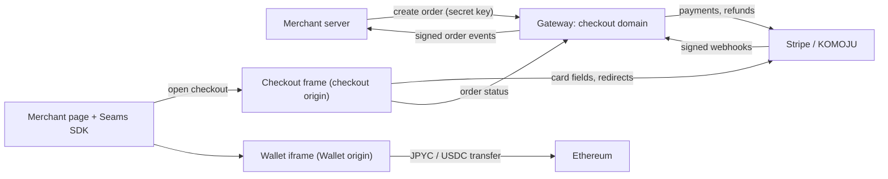
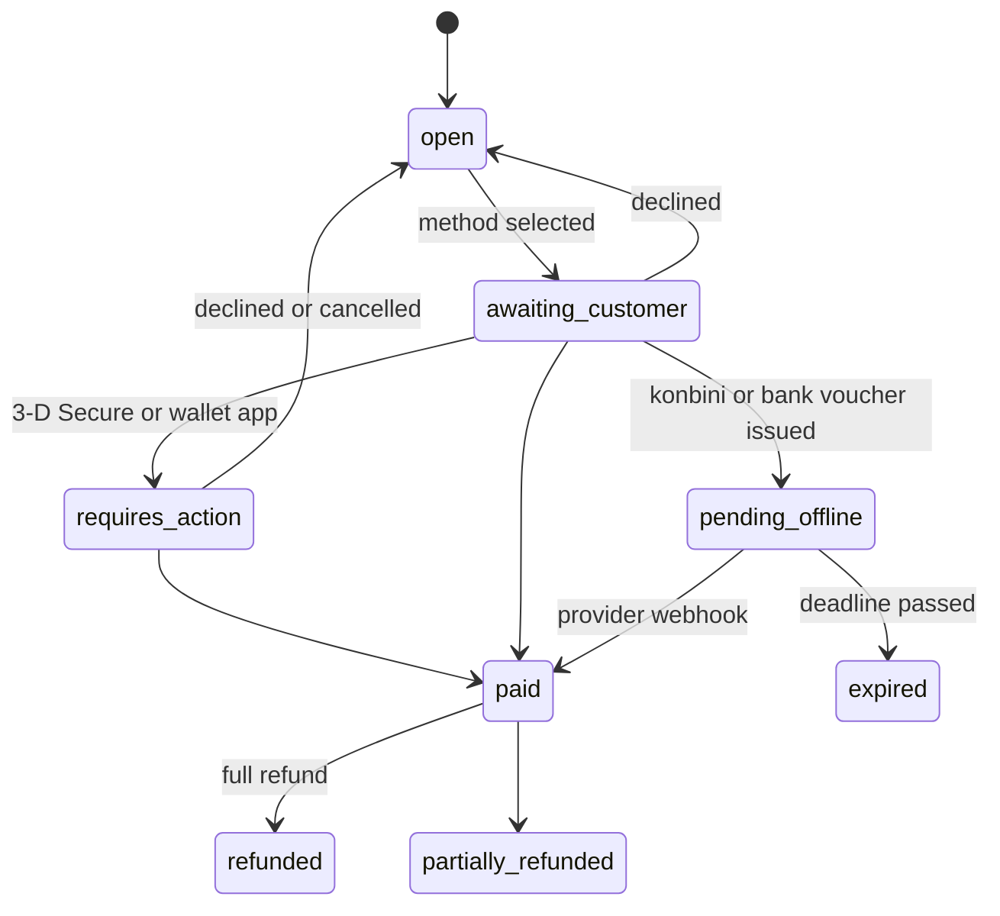

# Refactor 234: Seams Checkout with Stripe and KOMOJU

Status: 2026-11-18. Plan only. Nothing is built.

The owner's request (2026-11-17 and 2026-11-18): turn the Wallet into a checkout library for
online shops. It must accept credit cards and Japanese payment methods. It must use Stripe and
KOMOJU in one checkout page: Stripe for its customizable card form, KOMOJU for its extra
Japanese methods and lower fees. A developer chooses how the page looks, and chooses Stripe,
KOMOJU or both.

## Result

- **One checkout page, two providers behind it.** Seams draws the list of payment methods.
  The server sends each method to one provider. A developer can send cards to Stripe and
  PayPay to KOMOJU in the same order.
- **Seams draws almost everything.** Only three parts stay with the provider or the issuer:
  the card number fields, the 3-D Secure challenge and the approval screen of a QR wallet
  (PayPay and similar). Konbini vouchers, bank transfer details, receipts and errors are
  Seams screens.
- **The provider code runs in its own origin.** A new checkout origin holds the Stripe and
  KOMOJU scripts. The Wallet origin never loads them, and the checkout origin holds no
  wallet secret.
- **A developer chooses the presentation.** Three modes: a Seams modal, a Seams form inside
  the developer's page, or headless (the developer draws the list and the vouchers, and
  mounts only the card frame).
- **One order state machine for every method.** Card, konbini, bank transfer, QR wallets,
  JPYC and USDC end in the same states. Provider webhooks and onchain receipts decide the
  final state, not the browser.
- **Seams is never the acquirer and never holds the money.** Each merchant uses its own
  Stripe and KOMOJU accounts. Card numbers go only to the provider.

## How one page uses two providers

The checkout page shows the methods that the merchant's routing table enables. When the
customer selects a method, the page mounts that method's part:

| Method | Provider (example routing) | What the page mounts | Who draws the next step |
| --- | --- | --- | --- |
| Card | Stripe | Stripe Payment Element, card only | Issuer (3-D Secure), then Seams receipt |
| Card (cheaper routing) | KOMOJU | `<komoju-fields>` with a Seams theme CSS | Issuer, then Seams receipt |
| Konbini | KOMOJU | Nothing (one button) | Seams voucher from provider data |
| Bank transfer | KOMOJU or Stripe | Nothing | Seams account details |
| PayPay, Rakuten Pay, Merpay, au PAY, d払い | KOMOJU | Nothing | The wallet app, then Seams status |
| Paidy, Pay-easy | KOMOJU | Nothing | Paidy or the bank, then Seams status |
| Apple Pay, Google Pay | Stripe | Stripe Express Checkout Element | The device sheet |
| JPYC, USDC | None | Nothing | Wallet confirmer and passkey |

KOMOJU's weak styling matters only for cards. Its extra methods are a button, a redirect or a
voucher, and Seams draws those. So the strong mix is: cards on Stripe, the other Japanese
methods on KOMOJU. The cost of this mix is the card fee: 3.6% on Stripe against 3.25% on
KOMOJU (Fact F9). A merchant that wants the lowest fees routes cards to KOMOJU too.

Limits of the mix:

- **A card belongs to one provider.** The provider that collects the card number is the
  provider that charges it. A declined card cannot move to the other provider without new
  entry. A saved card can be charged only through the provider that saved it.
- **Two accounts, two reviews, two payouts.** The merchant passes KYC at both providers,
  gets two payout streams and makes refunds through the provider that took the payment.
- **One provider per method per merchant.** The routing table has one entry for each method.
  This keeps reconciliation simple and avoids a second contract for the same method.

## Decisions for the owner

- **D1. Account model.** Recommended: each merchant connects its own Stripe and KOMOJU
  accounts. A Stripe Connect platform with application fees comes later, after legal advice
  (Section 9).
- **D2. Routing on the server.** Recommended: the merchant's routing table lives on the
  server. The browser can choose the order and a subset of the enabled methods, never the
  provider. The provider decides which account takes the money.
- **D3. A separate checkout origin.** Recommended: yes. It keeps third-party scripts out of
  the Wallet origin (Fact F4) and makes the payment page a Seams document with a strict
  script list (Fact F12).
- **D4. Package.** Recommended: checkout is part of `@seams/wallet` (`seams.checkout`) and
  `@seams/wallet-server`, with no new package. Refactor 232 removed a package for the same
  reason.
- **D5. Stripe card form.** Recommended: the Payment Element in card-only mode, styled with
  the Appearance API. Stripe marks the split card fields as legacy (Fact F10).
- **D6. Open adapters.** Recommended: the provider adapters live in the public
  `@seams/wallet-server`, so a self-hosted operator can run checkout with its own keys. The
  Console screens for the hosted service live in `seams-monorepo`. This differs from Spec 8,
  which keeps its agent-payment adapters private.

## Facts this plan builds on

Repository facts, checked on 2026-11-18:

- **F1.** The app-side overlay has a review slot on the app's document
  (`getTransactionReviewSlot`,
  `packages/wallet/src/SeamsWeb/walletIframe/client/overlay/overlay-controller.ts`). The React
  `TransactionReviewHost` renders an app card there and hands off to the Wallet iframe in the
  same modal. The homepage showcase checkout uses this.
- **F2.** The Wallet iframe `allow` attribute lists passkeys, clipboard and microphone. It does
  not list `payment`
  ([iframe-transport-dom.ts](../packages/wallet/src/SeamsWeb/walletIframe/client/transport/iframe-transport-dom.ts)).
- **F3.** The Wallet document sends no `Cross-Origin-Embedder-Policy`
  (`packages/wallet/scripts/build/emit-static-wallet-assets.mjs`). A cross-origin frame can
  load inside the overlay.
- **F4.** Refactor 232 decision D1: code in the Wallet origin comes only from the Wallet
  operator. The Wallet origin runs the Yao client WASM on its main thread
  ([Browser workers](browser-workers.md)).
- **F5.** Spec 8 already defines integer minor units, explicit currencies, one execution per
  proposal, persisted operation identity and reconciliation by provider events
  ([Spec 8](spec-8-agent-authority-spending-and-payment-rails.md)).
- **F6.** The server has one folder per domain in
  `packages/wallet-server/src/router/domains/` and D1 migrations in
  `packages/wallet-server/migrations/`.
- **F7.** The Wallet lists JPYC on Ethereum (0.73.0) and sends ERC-20 transfers through the
  EVM capability.
- **F8.** `examples/wallet-console-lite/src/PurchaseReviewExample.tsx` already shows an app
  purchase card before the Wallet confirmer.

Provider facts, from the providers' pages on 2026-11-17 and 2026-11-18. **F9** is the list
prices in Japan:

| Item | Stripe | KOMOJU |
| --- | --- | --- |
| Cards, Apple Pay | 3.6% (+2% for currency conversion) | 3.25% |
| Konbini | 3.6%, minimum ¥120 | 2.75% |
| Bank transfer | 1.5% | 1.4% |
| PayPay | 3.98% (digital goods 9.48%) | 3.5% and up |
| Merpay, d払い, au PAY | Not offered | 3.5% and up |
| Rakuten Pay | Not offered | 4.4% and up |
| Paidy | Not offered | 3.5% and up |
| Pay-easy | Not offered | 2.75% |
| Konbini or bank refund | ¥250 + tax | Not stated |
| Dispute | ¥1,500 | Not stated |
| Monthly or setup fee | None | None |

Neither page says whether the rates include consumption tax.

- **F10.** Stripe recommends the Payment Element for cards. It marks the Card Element and the
  split card fields as legacy, with maintenance only.
- **F11.** The Stripe Appearance API sets themes, about 80 variables and rules on public
  classes (`.Input`, `.Label`, `.Error`, `.Tab` and others) with a list of allowed CSS
  properties. It cannot change the DOM. KOMOJU Hosted Fields load a theme CSS file from a
  URL. KOMOJU supports only color changes officially. Layout changes are at the developer's
  risk.
- **F12.** PCI DSS 4.0.1 SAQ A asks the merchant to confirm that scripts cannot attack its
  payment page. The merchant can rely on written confirmation from its vendor.
- **F13.** Japanese rules: online merchants must not let card numbers pass through their
  servers (非通過型). EMV 3-D Secure is required in principle for online merchants since the
  end of March 2025. A company that signs merchants for card acceptance must register with
  METI.
- **F14.** Stripe konbini, bank transfer and PayPay need a Japan-based Stripe account. KOMOJU
  smartphone wallets need a Japanese legal entity.
- **F15.** Apple Pay in a cross-origin frame needs Safari 17 or later, `allow="payment"` on
  every frame in the chain, and a registered domain.
- **F16.** Secondary reports say KOMOJU had unauthorized access in October 2026 that leaked
  about 4,100 personal records and some merchant API credentials. KOMOJU says no card data
  leaked.

## Unknowns to check first (Slice 0)

- **U1.** Does KOMOJU return konbini and bank transfer details as data (payment number,
  stores, deadline), or only an instructions URL? If only a URL, the Seams voucher shows the
  amount and deadline and links to KOMOJU's page.
- **U2.** Can a KOMOJU session be paid from the server for redirect methods (PayPay, Rakuten
  Pay, Merpay), so that Seams needs no KOMOJU UI for them?
- **U3.** What events does `<komoju-fields>` send (change, error, complete)? Without them the
  Seams pay button cannot show field errors before submit.
- **U4.** How does KOMOJU sign webhooks, and does its API accept an idempotency key?
- **U5.** Does KOMOJU support Apple Pay inside a cross-origin frame?
- **U6.** Which consumption tax applies to each fee, and what are the JCB and foreign card
  rates on Stripe?
- **U7.** Read KOMOJU's own notice about the October 2026 incident before the owner signs
  with KOMOJU.

## 1. Parts and where they run



- **Merchant server.** Creates the order with the cart lines, the amount and the currency.
  The browser never sets the amount. It receives the final result from a signed Seams
  webhook.
- **Gateway, checkout domain.** A new folder `router/domains/checkout/`. It stores orders and
  payments, calls the providers with the merchant's secret keys, checks provider webhooks and
  sends order events to the merchant.
- **Checkout frame.** A new Seams document on a new origin (`checkoutOrigin` in the public
  configuration). It draws the method list, loads Stripe.js or KOMOJU Fields only when a
  method needs them, and draws vouchers, waits and errors. It holds no wallet secret and
  opens no wallet worker.
- **Wallet iframe.** Unchanged in role. It runs the passkey approval and the JPYC or USDC
  transfer. The overlay moves from the checkout frame to the Wallet confirmer in the same
  modal, as the review slot does today (Fact F1).

The checkout frame is a sibling of the Wallet iframe inside the overlay. It is not nested in
the Wallet iframe. So the Wallet iframe does not need `payment` (Fact F2). The checkout frame
gets `allow="payment"` for Apple Pay and Google Pay.

## 2. The developer API

Server (`@seams/wallet-server`, or the Gateway route with the project secret key):

```ts
const order = await checkout.createOrder({
  reference: 'order-1042',
  currency: 'JPY',
  lines: [
    { name: 'Plain baumkuchen', unitAmount: 1800, quantity: 1 },
    { name: 'Matcha baumkuchen', unitAmount: 2200, quantity: 1 },
  ],
  shipping: { amount: 600 },
  customerEmail: 'buyer@example.com',
});
// order.id and order.clientToken go to the browser.
```

Routing and accounts are project configuration, not order fields:

```ts
checkoutConfig = {
  providers: { stripe: { accountRef }, komoju: { accountRef } },
  routing: {
    card: 'stripe',
    konbini: 'komoju',
    bank_transfer: 'komoju',
    paypay: 'komoju',
    rakuten_pay: 'komoju',
    apple_pay: 'stripe',
    jpyc: 'onchain',
  },
};
```

A method with no route does not appear. A merchant with only Stripe sets only Stripe routes.

Browser (`@seams/wallet`):

```ts
const result = await seams.checkout.open({
  clientToken: order.clientToken,
  presentation: 'modal',            // 'modal' | 'inline' | 'headless'
  layout: 'list',                   // 'list' | 'accordion' | 'tabs'
  methods: ['card', 'paypay', 'konbini', 'jpyc'], // order and subset, optional
  theme: { accent: '#2b7a52', radius: 12, buttonHeight: 48, fontFamily: 'Noto Sans JP' },
  locale: 'ja',
});
// result.kind: 'paid' | 'pending' | 'cancelled' | 'failed'
// 'pending' is a konbini or bank transfer voucher. The webhook decides the end.
```

- **`modal`.** The Seams overlay opens with the checkout frame.
- **`inline`.** The checkout frame mounts into an element of the developer's page
  (`seams.checkout.mount(element, options)`).
- **`headless`.** The developer reads `checkout.methods`, draws its own list, vouchers and
  status, and calls `checkout.select(method)` and `checkout.pay()`. For a card, it mounts the
  small Seams card frame (`checkout.mountCardFrame(element)`), which holds only the provider's
  card fields. The provider's script still never runs on the developer's page.

One theme object maps to both providers: the checkout frame turns it into a Stripe
`appearance` object and serves a generated KOMOJU theme CSS file from the checkout origin.
React gets `<CheckoutHost>` beside `TransactionReviewHost`.

## 3. Order and payment states

One order has one or more payment attempts. Only one attempt can be active.



- Amounts are integer minor units with an explicit currency (Fact F5). JPY has no minor unit.
- Before a provider call, the Gateway stores the attempt's operation identity. A retry uses
  the provider's idempotency key, or looks up the provider payment by the Seams reference
  (Unknown U4).
- Only a verified provider webhook, or a confirmed onchain receipt for JPYC and USDC, moves an
  attempt to `paid`. A browser result is a hint. A closed window proves nothing (Spec 7).
- A konbini or bank order keeps its stock reservation until `expired`. The merchant chooses
  the deadline within the provider's limits.
- Each state change sends one signed event to the merchant: `order.paid`, `order.pending`,
  `order.expired`, `order.refunded`. Delivery retries until the merchant answers 2xx.

## 4. Provider adapters

Both providers implement one interface in
`packages/wallet-server/src/router/domains/checkout/providers/`:

```ts
type CheckoutProvider = {
  readonly kind: 'stripe' | 'komoju';
  readonly methods: ReadonlySet<CheckoutMethod>;
  startPayment(attempt: PaymentAttempt): Promise<ProviderStart>;
  readPayment(ref: ProviderPaymentRef): Promise<ProviderPaymentState>;
  verifyWebhook(request: Request): Promise<ProviderEvent>;
  refund(ref: ProviderPaymentRef, amount: MinorUnits): Promise<ProviderRefund>;
};
```

`ProviderStart` is a union named with `Variant`: client data for a card form (Stripe client
secret or KOMOJU session), a redirect URL, a voucher, or bank account details. The checkout
frame switches on the variant, not on the provider. A third provider adds one file and no
frame change.

- **Plain `fetch` clients.** The Gateway runs on Cloudflare Workers. Each adapter calls the
  provider's REST API through one shared HTTP helper that sets the idempotency header,
  timeouts and error mapping. No provider SDK enters the server bundle.
- **Webhooks.** One route per provider (`/checkout/webhooks/stripe`,
  `/checkout/webhooks/komoju`). Each checks the signature with WebCrypto before it reads the
  body. Duplicate and late events converge, as in Spec 8.
- **Secret keys.** The merchant's provider keys stay on the server, encrypted at rest. The
  browser gets only a publishable key and a per-payment client secret or session ID.

## 5. The checkout frame

- **Origin.** A new static document `checkout-service/index.html`, built with the Wallet
  assets and served from `checkoutOrigin`. A local run serves it on its own port.
- **CSP.** `script-src` allows only the checkout origin, Stripe.js and KOMOJU Fields.
  `frame-src` and `connect-src` allow only the providers' hosts. `frame-ancestors` lists the
  project's allowed origins. No analytics and no other third-party script. This is the basis
  of the written PCI statement for merchants (Fact F12).
- **Lazy provider scripts.** Stripe.js loads only when a Stripe method is selected or Apple
  Pay is enabled. KOMOJU Fields load only for a KOMOJU card. A redirect method loads no
  provider script.
- **Apple Pay and Google Pay.** The overlay sets `allow="payment"` on the checkout frame. The
  Console registers the merchant's domains and the checkout origin with Stripe (Fact F15).
- **Messages.** The checkout frame and the SDK use the same checks as the Wallet iframe:
  expected origin, window, request and live surface instance (Spec 7). The checkout frame
  talks to the Wallet iframe only through the SDK on the app page.
- **Accessibility and language.** Labels, errors and vouchers are Seams text in English and
  Japanese. The Stripe and KOMOJU fields get the same `locale`.

## 6. Slices

Each slice ships alone and keeps the invariants of Section 7.

- **Slice 0: checks and accounts.** Answer U1 to U7. Open Stripe (Japan) and KOMOJU test
  accounts. Get the owner's D1 to D6. No code.
- **Slice 1: orders and cards on the server.** The checkout domain, the order and attempt
  tables (one D1 migration), the provider interface, the Stripe and KOMOJU adapters for
  cards, both webhook routes and the merchant events. Tests use provider fakes. A sandbox
  test runs one real test payment at each provider.
- **Slice 2: the checkout frame with cards.** `checkoutOrigin`, the frame document, its CSP,
  `seams.checkout.open` in `modal` and `inline`, the Seams method list, the Stripe Payment
  Element (card only) and KOMOJU Fields, the theme mapping, 3-D Secure, and the receipt. A new
  example shop in `examples/` shows both providers in one page.
- **Slice 3: konbini, bank transfer and PayPay.** The voucher and bank screens, the
  `pending_offline` state, deadlines, expiry and stock release. PayPay through both providers,
  so that a merchant can route it either way.
- **Slice 4: JPYC and USDC.** The order moves from the checkout frame to the Wallet confirmer
  for an ERC-20 transfer to the merchant's address. The Gateway marks the order `paid` after
  a confirmed receipt of the exact amount and token. No Seams custody of funds.
- **Slice 5: the other KOMOJU methods.** Rakuten Pay, Merpay, au PAY, d払い, Paidy and
  Pay-easy as redirect methods (Unknown U2).
- **Slice 6: Apple Pay and Google Pay.** The Stripe Express Checkout Element in the frame,
  domain registration and the `allow="payment"` chain.
- **Slice 7: headless mode and refunds.** `checkout.methods`, `select`, `pay`,
  `mountCardFrame`, and server refunds (full and partial) through the provider of the payment.
- **Slice 8: Console (seams-monorepo).** Connect the provider accounts, edit the routing
  table and the theme, set the merchant webhook URL, view orders and refund.

## 7. Invariants

- No card number, CVC or expiry date reaches a Seams server, a Seams log or a Seams frame's
  JavaScript. Only provider frames hold them.
- No provider script runs in the Wallet origin or on the merchant's page.
- The checkout origin holds no wallet secret, opens no wallet worker and reads no Wallet
  storage. [Browser workers](browser-workers.md) stays unchanged.
- The amount, currency and provider of a payment come from the server. The browser cannot
  change them.
- One active attempt per order. One provider payment per attempt.
- A paid state needs a verified provider webhook or a confirmed onchain receipt.
- Seams never holds the merchant's money and never decides which merchant may accept cards.

## 8. Tests

- Intended behaviours: one journey per method and per provider, in
  [Intended Behaviours](intended-behaviours.md): card success, card decline, 3-D Secure,
  konbini issued then paid, konbini expired, bank transfer, PayPay approve and cancel, JPYC
  paid, and a mixed routing order (card on Stripe, konbini on KOMOJU).
- Browser tests in Chromium, Firefox and WebKit for the frame, the theme mapping, the overlay
  move to the Wallet confirmer, and keyboard and screen reader use.
- A CSP test that fails if the checkout document allows another script host.
- A test that fails if a provider script URL appears in a Wallet origin document.
- Webhook tests for bad signatures, duplicates and reordered events.

## 9. Not in this plan

- **A Stripe Connect platform with Seams fees.** It needs Japanese legal advice first,
  direct charges (the merchant stays the merchant of record) and the per-account konbini and
  PayPay reviews. KOMOJU has no confirmed platform product.
- **Saved cards across merchants with a passkey.** It needs the Connect platform
  (platform customers and copied payment methods). It works only for Stripe cards.
- **Agent checkout.** Stripe Shared Payment Tokens with the agent grants of Spec 8. Japanese
  availability is not confirmed.
- **Provider fallback for a declined card.** A card cannot move between providers without new
  entry.

## Documents to update when the slices land

- [Spec 7](spec-7-hosted-surfaces-and-provider-boundaries.md): the checkout origin, its
  messages and its CSP.
- [Spec 8](spec-8-agent-authority-spending-and-payment-rails.md): the shared payment states,
  and why checkout adapters are public (D6).
- [Intended Behaviours](intended-behaviours.md) and the public docs in `apps/docs`.
