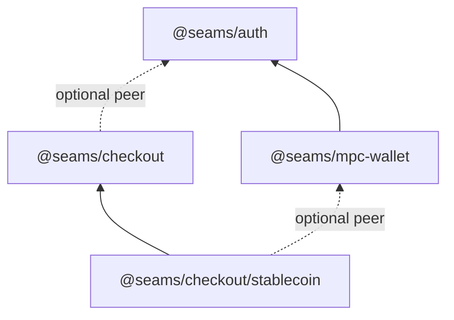
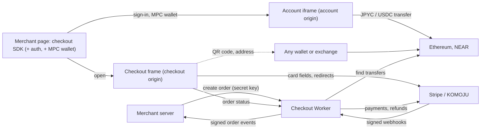
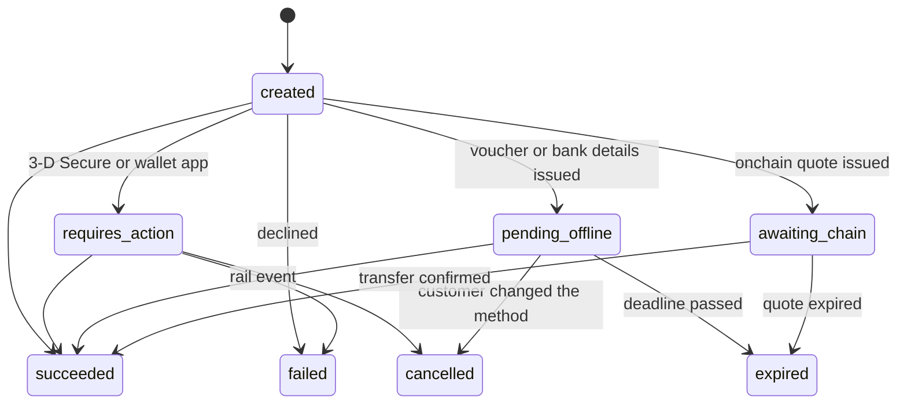
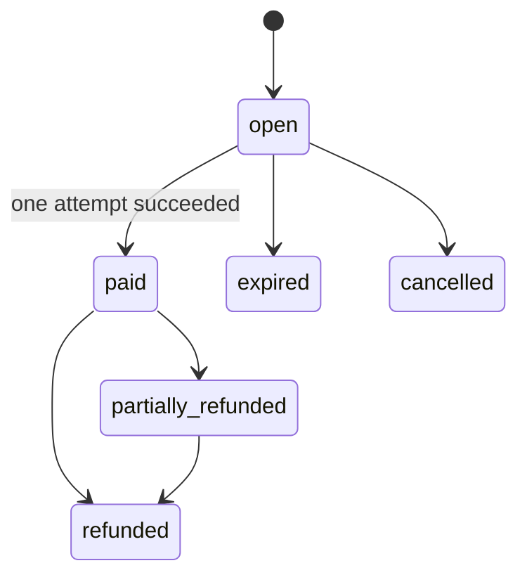

# Refactor 250: Seams Checkout, with stablecoin payments by address

Status: 2026-11-18. Plan only. Nothing is built. Revised on 2026-11-18 after a review of the
architecture. This plan builds on
[Refactor 251](refactor-251-auth-wallet-checkout-modules.md), which separates auth, the
MPC wallet and the checkout, and renames `@seams/wallet` to
`@seams/mpc-wallet`.

The owner's requests (2026-11-17 and 2026-11-18):

- Make a checkout library for online shops. It accepts credit cards and Japanese payment
  methods.
- Use Stripe and KOMOJU in one checkout page: Stripe for its customizable card form, KOMOJU
  for its extra Japanese methods and lower fees. A developer chooses how the page looks, and
  chooses Stripe, KOMOJU or both.
- The checkout is a standalone library. It is written from scratch in new folders,
  `packages/checkout` and `packages/checkout-server`, with no file copied from the wallet.
- Customers can pay with stablecoins. USDC and JPYC are the main ones.
- **Stablecoins by address (2026-11-18).** The checkout shows a QR code and an address, and
  the customer sends the tokens from any wallet. So the checkout integrates no wallet
  connector. The MPC wallet stays as an optional plugin: a persistent wallet that the customer
  funds once and then pays from in one tap, as Stripe Link does for cards.
- **Review changes.** The owner accepted these changes after the review:
  - auth is an optional peer of the checkout, behind a small identity interface (D4)
  - one payment rail interface for Stripe, KOMOJU and stablecoins (D10)
  - the server finds a stablecoin transfer on the chain itself (D11)
  - separate states for an order and for a payment attempt, and one state for each payment
    that nobody expected (D12)
  - the server is its own package, `@seams/checkout-server` (D6)

## Result

- **A standalone package of new code.** `@seams/checkout` lives in `packages/checkout` and
  follows the new-code rules of Refactor 251 (its Section 2). It has no required Seams
  dependency. Auth and the MPC wallet are optional peers.
- **Guests can pay.** A guest pays with an email address only. A signed-in customer gets saved
  methods, order history and one-tap payment with a passkey.
- **A shop can use its own login.** The checkout needs only a small identity interface. Seams
  Auth satisfies it, and a shop's own login can satisfy it too.
- **One checkout page, several payment rails behind it.** Seams draws the list of payment
  methods. A routing table on the server sends each method to one rail: Stripe, KOMOJU or the
  stablecoin rail. One order can send a card to Stripe and PayPay to KOMOJU.
- **Stablecoins are one more rail.** The checkout shows JPYC for a JPY order and USDC for a USD
  order, with a QR code and an address. The customer sends the tokens from any wallet or
  exchange. The checkout server finds the transfer on the chain. Seams holds no funds.
- **One-tap payment from the MPC wallet.** With the optional plugin, a signed-in customer pays
  from a Seams wallet that already holds tokens, with one passkey approval.
- **Seams draws almost everything.** Only three parts stay with the provider or the issuer:
  the card number fields, the 3-D Secure challenge and the approval screen of a QR wallet
  (PayPay and similar).
- **Separated by the secrets they hold.** The checkout has its own origin, its own Worker and
  its own database. It holds the merchants' provider keys and no account or wallet secret.
- **A developer chooses the presentation.** Three modes: a Seams modal, a Seams form inside the
  developer's page, or headless (the developer draws the list and the vouchers, and mounts only
  the card frame).
- **Two state machines.** A payment attempt has the states of its rail. An order has few
  states, and they come from its attempts and refunds. Rail events decide the final state, not
  the browser.
- **Seams is never the acquirer and never holds the money.** Each merchant uses its own Stripe
  and KOMOJU accounts. Card numbers go only to the provider.

## Decisions

Decided by the owner on 2026-11-18:

- **D4. A separate package, with optional peers.** The checkout is `@seams/checkout`. It uses
  auth through an identity interface (Section 2), and `@seams/auth` is an optional peer. The
  MPC wallet is optional too. The first choice was a required dependency on auth. The review
  changed it, because a guest checkout calls no auth code.
- **D7. Moved.** The rename and the module split are decisions of Refactor 251.
- **D10. One rail interface.** Stripe, KOMOJU and stablecoins are three rails of one interface.
  A rail has a server half, and it can have a part on the app page (Section 3). This replaces the
  provider interface and the separate method plugin interface of the first plan.
- **D11. The server finds the transfer.** The checkout Worker searches the chain for the
  stablecoin transfer of a quote. A transaction hash from the browser is only a hint.
- **D12. Order states and attempt states are separate.** A payment that arrives when its order
  does not wait for it becomes an `unexpected_payment` (Section 5).
- **D15. Stablecoins by address.** The checkout shows a QR code and an address. It integrates
  no wallet connector, and it does not know the payer. The MPC wallet is the one optional
  plugin, for one-tap payment (Section 4).

Open, with a recommendation:

- **D1. Account model.** Recommended: each merchant connects its own Stripe and KOMOJU
  accounts. A Stripe Connect platform with Seams fees comes later, after legal advice
  (Section 11).
- **D2. Routing on the server.** Recommended: the routing table lives on the server. The
  browser can choose the order and a subset of the enabled methods, never the rail.
- **D3. A separate checkout origin.** Recommended: yes. It keeps third-party scripts out of the
  account origin (Fact F4) and makes the payment page a Seams document with a short script list
  (Fact F12).
- **D5. Stripe card form.** Recommended: the Payment Element in card-only mode, styled with the
  Appearance API. Stripe marks the split card fields as legacy (Fact F10).
- **D6. The checkout server.** Recommended: its own package, `@seams/checkout-server`, as auth
  has `@seams/auth-server`. It deploys as its own Worker with its own D1 database. It is
  public, so that a self-hosted operator can run checkout with its own keys. The Console
  screens for the hosted service live in `seams-monorepo`.
- **D8. Stablecoin currency.** Recommended: the token matches the order currency. A JPY order
  takes JPYC, and a USD order takes USDC. There is no conversion, so Seams quotes no exchange
  rate.
- **D9. Guest checkout.** Recommended: yes. Sign-in is an offer to the customer, not a step
  before payment. A shop that forces an account before payment loses sales.
- **D13. Merchant keys.** Recommended: the checkout accepts only a Stripe restricted key with
  the permissions for payments, refunds and webhooks. A leaked key then cannot pay out or read
  other data (Fact F16). Unknown U12 asks the same for KOMOJU.
- **D14. Gas for a payment from the MPC wallet.** A customer who pays by QR code pays the gas
  from the customer's own wallet. For the MPC wallet, decide after Unknowns U8 and U9.
  Recommended: if both tokens support signed transfer authorizations, a relayer pays the gas,
  so that the customer needs only the stablecoin. If not, the checkout offers the MPC wallet
  only on chains where the gas is small against the order.
- **D16. How a transfer names its order.** The checkout does not know the payer, so the
  transfer must name the order itself. Recommended: a unique amount. The quote adds a small
  mark, below one minor unit of the currency, so that no two open quotes of one receiver have
  the same amount. It needs no contract and no key. The other choice is one deposit address
  for each order, from a forwarder contract that can send only to the merchant. It matches
  every amount, but it needs an audited contract and gas for each order.

## How one page uses two providers

The checkout page shows the methods that the merchant's routing table enables. When the
customer selects a method, the page mounts that method's part:

| Method | Provider (example routing) | What the page mounts | Who draws the next step |
| --- | --- | --- | --- |
| Card | Stripe | Stripe Payment Element, card only | Issuer (3-D Secure), then Seams receipt |
| Card (cheaper routing) | KOMOJU | `<komoju-fields>` with a Seams theme CSS | Issuer, then Seams receipt |
| Konbini | KOMOJU | Nothing (one button) | Seams voucher from provider data |
| Bank transfer | KOMOJU or Stripe | Nothing | Seams account details |
| PayPay, Rakuten Pay, Merpay, au PAY, d払い | KOMOJU | Nothing | The wallet app, then Seams status |
| Paidy, Pay-easy | KOMOJU | Nothing | Paidy or the bank, then Seams status |
| Apple Pay, Google Pay | Stripe | Stripe Express Checkout Element | The device sheet |
| JPYC, USDC | Stablecoin rail | A QR code and an address | The customer's own wallet, or the MPC wallet confirmer |

KOMOJU's weak styling matters only for cards. Its extra methods are a button, a redirect or a
voucher, and Seams draws those. So the strong mix is cards on Stripe and the other Japanese
methods on KOMOJU. The cost of this mix is the card fee: 3.6% on Stripe against 3.25% on
KOMOJU (Fact F9). A merchant that wants the lowest fees routes cards to KOMOJU too.

Limits of the mix:

- **A card belongs to one provider.** The provider that collects the card number is the
  provider that charges it. A declined card cannot move to the other provider without new
  entry. A saved card can be charged only through the provider that saved it.
- **Two accounts, two reviews, two payouts.** The merchant passes KYC at both providers, gets
  two payout streams and makes refunds through the provider that took the payment.
- **One provider per method per merchant.** The routing table has one entry for each method.

## Facts this plan builds on

Repository facts, checked on 2026-11-18. Paths are the paths before the rename of Refactor 251.

- **F1.** The app-side overlay has a review slot on the app's document
  (`getTransactionReviewSlot` in
  `packages/wallet/src/SeamsWeb/walletIframe/client/overlay/overlay-controller.ts`, 1,125
  lines). The React `TransactionReviewHost` renders an app card there and hands off to the
  Wallet iframe in the same modal. The homepage showcase checkout uses this.
- **F2.** The Wallet iframe `allow` attribute lists passkeys, clipboard and microphone. It does
  not list `payment`
  ([iframe-transport-dom.ts](../packages/wallet/src/SeamsWeb/walletIframe/client/transport/iframe-transport-dom.ts)).
- **F3.** The Wallet document sends no `Cross-Origin-Embedder-Policy`
  (`packages/wallet/scripts/build/emit-static-wallet-assets.mjs`). A cross-origin frame can
  load beside it.
- **F4.** Refactor 232 decision D1: code in the Wallet origin comes only from the Wallet
  operator. The Wallet origin runs the Yao client WASM on its main thread
  ([Browser workers](browser-workers.md)). Refactor 251 renames this origin the account origin
  and keeps the rule.
- **F5.** Spec 8 already defines integer minor units, explicit currencies, one execution per
  proposal, persisted operation identity and reconciliation by provider events
  ([Spec 8](spec-8-agent-authority-spending-and-payment-rails.md)).
- **F6.** The Gateway is one Worker that builds every wallet domain
  (`packages/wallet-server/src/hosted-wallet-gateway.ts`), with one folder per domain in
  `packages/wallet-server/src/router/domains/`.
- **F7.** The wallet's asset list has USDC on NEAR and Ethereum, and JPYC on Ethereum. Base is
  reviewed but is not a configurable network (`packages/wallet/src/core/assets/assetList.ts`).
- **F8.** `examples/wallet-console-lite/src/PurchaseReviewExample.tsx` already shows an app
  purchase card before the Wallet confirmer.
- **F18.** `@seams/voiceid` lists `@seams/wallet` as a peer dependency. This is the pattern for
  an optional link between packages.
- **F19.** `@seams-internal/shared-ts` is private. Each published package bundles the parts it
  uses.
- **F20.** The external EVM connector discovers wallets by EIP-6963, so MetaMask, Rabby and
  others that announce themselves appear. A NEAR connector for Intear also exists. Neither
  creates a Seams session (Spec 7).

Provider facts, from the providers' pages on 2026-11-17 and 2026-11-18. **F9** is the list
prices in Japan:

| Item | Stripe | KOMOJU |
| --- | --- | --- |
| Cards, Apple Pay | 3.6% (+2% for currency conversion) | 3.25% |
| Konbini | 3.6%, minimum ¥120 | 2.75% |
| Bank transfer | 1.5% | 1.4% |
| PayPay | 3.98% (digital goods 9.48%) | 3.5% and up |
| Merpay, d払い, au PAY | Not offered | 3.5% and up |
| Rakuten Pay | Not offered | 4.4% and up |
| Paidy | Not offered | 3.5% and up |
| Pay-easy | Not offered | 2.75% |
| Konbini or bank refund | ¥250 + tax | Not stated |
| Dispute | ¥1,500 | Not stated |
| Monthly or setup fee | None | None |

Neither page says whether the rates include consumption tax.

- **F10.** Stripe recommends the Payment Element for cards. It marks the Card Element and the
  split card fields as legacy, with maintenance only.
- **F11.** The Stripe Appearance API sets themes, about 80 variables and rules on public
  classes (`.Input`, `.Label`, `.Error`, `.Tab` and others) with a list of allowed CSS
  properties. It cannot change the DOM. KOMOJU Hosted Fields load a theme CSS file from a URL.
  KOMOJU supports only color changes officially. Layout changes are at the developer's risk.
- **F12.** PCI DSS 4.0.1 SAQ A asks the merchant to confirm that scripts cannot attack its
  payment page. The merchant can rely on written confirmation from its vendor.
- **F13.** Japanese rules: online merchants must not let card numbers pass through their
  servers (非通過型). EMV 3-D Secure is required in principle for online merchants since the
  end of March 2025. A company that signs merchants for card acceptance must register with
  METI.
- **F14.** Stripe konbini, bank transfer and PayPay need a Japan-based Stripe account. KOMOJU
  smartphone wallets need a Japanese legal entity.
- **F15.** Apple Pay in a cross-origin frame needs Safari 17 or later, `allow="payment"` on
  every frame in the chain, and a registered domain.
- **F16.** Secondary reports say KOMOJU had unauthorized access in October 2026 that leaked
  about 4,100 personal records and some merchant API credentials. KOMOJU says no card data
  leaked.

## Unknowns to check first (Slice 0)

- **U1.** Does KOMOJU return konbini and bank transfer details as data (payment number, stores,
  deadline), or only an instructions URL? If only a URL, the Seams voucher shows the amount and
  deadline and links to KOMOJU's page.
- **U2.** Can a KOMOJU session be paid from the server for redirect methods (PayPay, Rakuten
  Pay, Merpay), so that Seams needs no KOMOJU UI for them?
- **U3.** What events does `<komoju-fields>` send (change, error, complete)? Without them the
  Seams pay button cannot show field errors before submit.
- **U4.** How does KOMOJU sign webhooks, and does its API accept an idempotency key?
- **U5.** Does KOMOJU support Apple Pay inside a cross-origin frame?
- **U6.** Which consumption tax applies to each fee, and what are the JCB and foreign card rates
  on Stripe?
- **U7.** Read KOMOJU's own notice about the October 2026 incident before the owner signs with
  KOMOJU.
- **U8.** Do JPYC and USDC support signed transfer authorizations (EIP-3009
  `transferWithAuthorization`) on each chain that the checkout uses? With them, a relayer can
  pay the gas of a payment from the MPC wallet (D14).
- **U9.** On which chains is JPYC issued, and what does a transfer cost on each? The wallet's
  asset list has JPYC only on Ethereum (Fact F7), where the gas can cost more than a small
  order.
- **U10.** Does the hosted model need legal review too? Seams hosts the payment page and stores
  the merchants' provider keys. Check the PCI DSS duties of a service provider and the
  Installment Sales Act, not only for the Connect platform of Section 11.
- **U11.** Can a konbini or bank voucher be cancelled at each provider when the customer changes
  the method?
- **U12.** Does KOMOJU offer restricted keys (D13)?
- **U13.** Can the checkout Worker find a NEAR token transfer without the transaction hash?
  Plain NEAR RPC has no log search. If not, the NEAR path needs an indexer. A NEAR transfer has
  a memo field, which can carry the order reference.
- **U14.** Which wallets and exchanges read a payment QR code with the token and the amount
  (EIP-681)? Where a wallet does not, the customer copies the address and the amount by hand.

## 1. Modules and where they run

| Module | Package | Runs in | Holds |
| --- | --- | --- | --- |
| Checkout, browser | `@seams/checkout` (`.`, `./react`) | App page (SDK) and checkout origin (frame) | No secret. Provider client secrets for one payment |
| Checkout, server | `@seams/checkout-server` | Checkout Worker, own D1 database | Merchant provider keys (encrypted), orders |
| MPC wallet payment (plugin) | `@seams/checkout/stablecoin` | App page | Nothing. It calls the MPC wallet's public API |
| Stablecoin rail, server half | `@seams/checkout-server/stablecoin` | Checkout Worker | Chain RPC endpoints |
| Auth | `@seams/auth` (Refactor 251) | App page and account origin | Login session |
| MPC wallet | `@seams/mpc-wallet` (Refactor 251) | Account origin plugin | Custody material |
| Frame kit | `@seams-internal/frame-kit` (Refactor 251) | Bundled into each browser package | Nothing |



Rules of the dependency direction:

- `@seams/checkout` has no required Seams dependency. It lists `@seams/auth` as an optional
  peer (Fact F18).
- Only `@seams/checkout/stablecoin` imports `@seams/mpc-wallet`. It lists it as an optional
  peer dependency.
- The base entries of `@seams/checkout` import nothing from auth or the wallet. A shop that
  takes stablecoins only by QR code ships no wallet code. A shop with its own login ships no
  Seams Auth code.
- Auth and the wallet import nothing from the checkout.
- The plugin uses only the MPC wallet's public API. So the peer dependency range is
  the only version contract. Every Seams package has one version (Refactor 251, D16).

Runtime parts:



- **Merchant server.** Creates the order with the cart lines, the amount and the currency. The
  browser never sets the amount. It receives the final result from a signed Seams webhook.
- **Checkout Worker.** Stores orders and attempts, calls the rails with the merchant's secret
  keys, checks rail events and sends order events to the merchant. It checks a customer's login
  token against the JWKS of the configured identity when a token is present. It has no binding
  to the wallet's router roles.
- **Checkout frame.** A Seams document on the checkout origin (`checkoutOrigin` in the public
  configuration). It draws the method list, loads Stripe.js or KOMOJU Fields only when a method
  needs them, and draws vouchers, waits and errors.
- **Account iframe.** The auth core of Refactor 251. It signs a returning customer in. With the
  MPC wallet plugin, it runs the passkey approval and the token transfer.

## 2. The developer API

Server (`@seams/checkout-server`, or the checkout route with the project secret key):

```ts
const order = await checkout.createOrder({
  reference: 'order-1042',
  currency: 'JPY',
  lines: [
    { name: 'Plain baumkuchen', unitAmount: 1800, quantity: 1 },
    { name: 'Matcha baumkuchen', unitAmount: 2200, quantity: 1 },
  ],
  shipping: { amount: 600 },
  customerEmail: 'buyer@example.com', // a guest, or the signed-in account's email
});
// order.id and order.clientToken go to the browser.
```

Routing, accounts, receiving addresses and the identity are project configuration, not order
fields:

```ts
checkoutConfig = {
  rails: { stripe: { accountRef }, komoju: { accountRef }, stablecoin: {} },
  routing: {
    card: 'stripe',
    konbini: 'komoju',
    bank_transfer: 'komoju',
    paypay: 'komoju',
    rakuten_pay: 'komoju',
    apple_pay: 'stripe',
    jpyc: 'stablecoin',
    usdc: 'stablecoin',
  },
  stablecoins: {
    JPYC: { chains: ['ethereum'], receiver: '0x…' },
    USDC: { chains: ['ethereum', 'near'], receiver: { ethereum: '0x…', near: 'shop.near' } },
  },
  identity: { issuer, jwksUrl }, // optional. Seams Auth, or the shop's own login
};
```

A method with no route does not appear. A merchant with only Stripe sets only Stripe routes.
A stablecoin method needs no code in the app. The checkout frame draws the QR code.

Browser, without stablecoins:

```ts
import { createSeamsAuth } from '@seams/auth';
import { createCheckout } from '@seams/checkout';

const auth = createSeamsAuth({ accountOrigin, publishableKey });
const checkout = createCheckout({ identity: auth, checkoutOrigin, publishableKey });
const result = await checkout.open({
  clientToken: order.clientToken,
  presentation: 'modal',            // 'modal' | 'inline' | 'headless'
  layout: 'list',                   // 'list' | 'accordion' | 'tabs'
  methods: ['card', 'paypay', 'konbini'], // order and subset, optional
  signIn: 'offer',                  // 'offer' | 'off'. A guest can always pay (D9)
  theme: { accent: '#2b7a52', radius: 12, buttonHeight: 48, fontFamily: 'Noto Sans JP' },
  locale: 'ja',
});
// result.kind: 'paid' | 'pending' | 'cancelled' | 'failed'
// 'pending' is a konbini or bank transfer voucher. The webhook decides the end.
```

The identity interface belongs to the checkout:

```ts
type CheckoutIdentity = {
  token(): Promise<string | null>;                  // a login token, or null for a guest
  signIn(stage: StageHost): Promise<string | null>; // sign-in as a stage of the checkout dialog
  prove?(request: { audience: 'checkout'; challenge: string }): Promise<IdentityProof>;
};
```

- **No identity.** `createCheckout({ checkoutOrigin, publishableKey })` is a guest-only
  checkout.
- **Seams Auth.** The object from `createSeamsAuth` satisfies the interface. A type test in the
  checkout proves this, so neither package imports the other.
- **The shop's own login.** The shop gives its own object, and its own `issuer` and `jwksUrl`
  on the server. Saved methods and order history then belong to the subject of that token.
- **One-tap payment needs `prove`.** The checkout Worker puts the order ID into a challenge.
  The customer approves with a passkey for the audience `checkout` (Refactor 251, its
  Section 4). Only Seams Auth gives `prove` now.

Browser, with one-tap payment from the MPC wallet:

```ts
import { createMpcWallet } from '@seams/mpc-wallet';
import { stablecoinPayments } from '@seams/checkout/stablecoin';

const mpcWallet = createMpcWallet({ auth, chains: ['ethereum', 'near'] });
const checkout = createCheckout({
  identity: auth,
  checkoutOrigin,
  publishableKey,
  rails: [stablecoinPayments({ mpcWallet })],
});
```

Without this plugin, a stablecoin method still works: the customer pays by QR code or address.
With it, a signed-in customer also sees "Pay with Seams wallet".

- **`modal`.** The checkout dialog opens with the checkout frame.
- **`inline`.** The checkout frame mounts into an element of the developer's page
  (`checkout.mount(element, options)`).
- **`headless`.** The developer reads `checkout.methods`, draws its own list, vouchers and
  status, and calls `checkout.select(method)` and `checkout.pay()`. For a card, it mounts the
  small Seams card frame (`checkout.mountCardFrame(element)`), which holds only the provider's
  card fields. The provider's script still never runs on the developer's page.

One theme object maps to both providers: the checkout frame turns it into a Stripe `appearance`
object and serves a generated KOMOJU theme CSS file from the checkout origin. React gets
`<CheckoutHost>` from `@seams/checkout/react`.

## 3. Payment rails

A rail is one way to move money: Stripe, KOMOJU or a stablecoin transfer. Each rail implements
one server interface in `@seams/checkout-server`:

```ts
type PaymentRail = {
  readonly id: string; // 'stripe', 'komoju', 'stablecoin'
  readonly methods: ReadonlySet<CheckoutMethod>;
  readonly events: RailEvents; // a signed webhook, or a poll of `read`
  start(attempt: PaymentAttempt): Promise<RailStart>;
  read(ref: RailPaymentRef): Promise<RailPaymentState>;
  cancel(ref: RailPaymentRef): Promise<RailCancel>;
  refund(ref: RailPaymentRef, amount: MinorUnits): Promise<RailRefund>;
};
```

- **`RailStart` is a union named with `Variant`:** `card_form` (a Stripe client secret or a
  KOMOJU session), `redirect`, `voucher`, `bank_details` and `onchain_quote`. The browser
  switches on the variant, not on the rail. A new rail that uses these variants adds one file
  and no frame change.
- **`RailEvents` is a union of two members.** A webhook rail gives `verify(request)`. A poll
  rail gives an interval, and the Worker calls `read` for each active attempt on a schedule.
  Stripe and KOMOJU are webhook rails. The stablecoin rail is a poll rail.
- **`cancel` and `refund` say what the rail cannot do.** A rail that cannot cancel a voucher
  answers `not_supported` (Unknown U11). The stablecoin rail answers `manual` for a refund: the
  merchant sends the tokens back itself.
- **The rails are a list, not a closed type.** The Worker's configuration names the rails that
  it loads. A deployment without stablecoins loads no chain code.

A variant needs a part in the browser that can run it:

| Variant | The browser part | Where it runs |
| --- | --- | --- |
| `card_form` | The provider's card fields | Checkout frame (built in) |
| `redirect` | A redirect and a status screen | Checkout frame (built in) |
| `voucher`, `bank_details` | A Seams screen from the rail's data | Checkout frame (built in) |
| `onchain_quote` | A QR code, an address and a status screen | Checkout frame (built in) |

A rail can also have a part on the app page, for a step that needs another SDK. The stablecoin
rail has one: the payment from the MPC wallet.

```ts
type RailClient = {
  readonly rail: string;
  options(order: CheckoutOrderView): Promise<readonly RailClientOption[]>; // "Pay with Seams wallet"
  run(start: RailStart, stage: StageHost): Promise<RailHint | null>;       // ask the wallet to pay
};
```

- An option appears beside the built-in part of the variant, not in place of it.
- `run` returns a hint or nothing. The checkout never needs the hint (Section 4).

Server details for every rail:

- **Plain `fetch` clients.** The checkout Worker runs on Cloudflare Workers. Each rail calls
  its provider's REST API through one shared HTTP helper that sets the idempotency header,
  timeouts and error mapping. No provider SDK enters the server bundle.
- **Webhooks.** One route for each webhook rail (`/checkout/webhooks/stripe`,
  `/checkout/webhooks/komoju`). Each checks the signature with WebCrypto before it reads the
  body. Duplicate and late events converge, as in Spec 8.
- **Secret keys.** The merchant's provider keys stay in the checkout Worker, encrypted at rest.
  The checkout accepts only restricted keys where the provider has them (D13). The browser gets
  only a publishable key and a per-payment client secret or session ID.
- **Chain reads.** The stablecoin rail reads the chain through the RPC endpoints of its own
  configuration. It shares no endpoint secret with the wallet servers.

## 4. The stablecoin rail

A stablecoin payment by address:

1. The customer selects JPYC (JPY order) or USDC (USD order), and a chain. A token that does
   not match the order currency does not appear (D8).
2. The server half issues an onchain quote (`start`): chain, token contract, receiver, the
   amount in token units, the block of the quote and the expiry.
3. The checkout frame shows the quote: a QR code, the address, the amount, copy buttons and the
   time that is left. On a phone, a link opens the customer's wallet app (Unknown U14).
4. The customer sends the tokens from any wallet or exchange. The checkout does not connect to
   that wallet and does not know the payer.
5. The checkout Worker finds the transfer (D11). On each poll it searches the token's transfer
   events from the block of the quote for the receiver and the amount of the quote.
6. The Worker accepts the transfer after the required confirmations. The frame shows the
   status. The order becomes `paid` also when the frame is closed.

How a transfer names its order (D16, recommended: a unique amount):

- The quote amount is the order amount plus a small mark. The mark is below one minor unit of
  the currency: below 1 yen for JPYC, below 1 cent for USDC.
- The Worker selects the mark so that no two open quotes of one receiver, token and chain have
  the same amount. So one transfer matches one quote.
- The receipt shows the order amount and the amount that was sent.
- **The weak point is a wrong amount.** A transfer with a different amount matches no quote,
  and the checkout cannot see its order. The frame tells the customer to send the exact amount,
  and the QR code carries it. The Console lists each transfer to the receiver that matched no
  quote, so that the merchant can refund it.
- With a deposit address for each order, the amount is the order amount, and every transfer to
  that address belongs to the order. This is the other choice of D16.

One-tap payment from the MPC wallet (the optional plugin):

- This is for a customer who keeps tokens in a Seams wallet, as Stripe Link keeps a card. The
  customer funds the wallet once, at its address, and then pays each order in one tap.
- A signed-in customer with a wallet sees "Pay with Seams wallet" and the balance, above the QR
  code.
- The dialog moves from the checkout frame to the Wallet confirmer in the same modal
  (Section 6). The customer approves with a passkey. The wallet sends the amount of the same
  quote to the same receiver.
- The Worker finds this transfer by the same search. The plugin's hint only makes the first
  poll faster.
- If the balance is too low, the button is off. The customer pays by QR code, or funds the
  wallet first.
- Gas is decision D14.

Rules for both paths:

- **A closed browser changes nothing.** The Worker finds the transfer without the browser.
- **A transfer after the expiry** is an `unexpected_payment` (Section 5). The merchant refunds
  it or accepts it by hand.
- **NEAR.** The search needs an indexer (Unknown U13).

## 5. Order and attempt states

One order has one or more payment attempts. Only one attempt can be active. The two have
separate states.

A payment attempt:



An order:



- **The order state comes from the attempts and the refunds.** One function computes it. No
  other code sets it.
- **Amounts** are integer minor units with an explicit currency (Fact F5). JPY has no minor
  unit. Token amounts are integer token units with the token's decimals.
- **Before a rail call,** the checkout Worker stores the attempt's operation identity. A retry
  uses the provider's idempotency key, or looks up the provider payment by the Seams reference
  (Unknown U4).
- **Only a rail event moves an attempt to `succeeded`:** a verified webhook or a confirmed
  transfer. A browser result is a hint. A closed window proves nothing (Spec 7).
- **A change of method cancels the old attempt.** The Worker calls the rail's `cancel`. A
  voucher that the rail cannot cancel stays payable.
- **An unexpected payment.** Money can arrive when the order does not wait for it:
  - a konbini voucher is paid after the customer paid by card
  - a transfer is confirmed after its quote expired
  - a bank transfer has the wrong amount
  - a payment arrives for an expired or cancelled order

  The Worker records the payment, sets the order's `needs_review` mark and sends
  `order.unexpected_payment`. The merchant refunds it or accepts it. No such payment is lost,
  and none changes the order state alone.
- **A dispute** from a rail sets the order's `disputed` mark and sends `order.disputed`.
- A konbini or bank order keeps its stock reservation until `expired`. The merchant chooses the
  deadline within the provider's limits.
- Each state change sends one signed event to the merchant: `order.paid`, `order.pending`,
  `order.expired`, `order.cancelled`, `order.refunded`, `order.unexpected_payment`,
  `order.disputed`. Delivery retries until the merchant answers 2xx.

## 6. Shared code: the stage dialog

Today the wallet owns the overlay that moves from the app's review card to the Wallet iframe in
one modal (Fact F1). The checkout needs the same dialog, the auth core of Refactor 251 needs it
for sign-in, and the stablecoin rail needs the checkout and the Wallet confirmer in one
modal. The repo rules allow one copy of that code.

- Refactor 251 (its Slice 3) writes a new stage dialog in `@seams-internal/frame-kit`, with the
  frame transport and the message checks (expected origin, window, request and surface
  instance). A stage is one frame or one app element. The dialog moves between stages.
- The new auth core and the checkout use it. The checkout adds no dialog of its own. The
  wallet's old overlay goes away in the audit of Refactor 251.
- The dialog is a `StageHost`. The account iframe can show a stage in a `StageHost` that the
  caller gives. The checkout passes its dialog. So the checkout frame moves to sign-in or to
  the Wallet confirmer in the same modal.
- The checkout frame gets `allow="payment"` for Apple Pay and Google Pay. The account iframe
  does not need it (Fact F2), because no provider runs in the account origin.

## 7. The checkout frame

- **Origin.** A static document `checkout-service/index.html` in the `@seams/checkout` build,
  served from `checkoutOrigin`. A local run serves it on its own port.
- **CSP.** `script-src` allows only the checkout origin, Stripe.js and KOMOJU Fields.
  `frame-src` and `connect-src` allow only the providers' hosts and the checkout Worker.
  `frame-ancestors` lists the project's allowed origins. No analytics and no other third-party
  script. This is the basis of the written PCI statement for merchants (Fact F12).
- **Lazy provider scripts.** Stripe.js loads only when a Stripe method is selected or Apple Pay
  is enabled. KOMOJU Fields load only for a KOMOJU card. A redirect method or a stablecoin
  loads no provider script.
- **Apple Pay and Google Pay.** The Console registers the merchant's domains and the checkout
  origin with Stripe (Fact F15).
- **Accessibility and language.** Labels, errors and vouchers are Seams text in English and
  Japanese. The Stripe and KOMOJU fields get the same `locale`.

## 8. Slices

Each slice ships alone and keeps the invariants of Section 9.

- **Slice 0: checks and accounts.** Answer U1 to U14. Open Stripe (Japan) and KOMOJU test
  accounts. Get the open decisions. No code.
- **Slice 1: the stage dialog.** Built as Refactor 251 Slice 3 (Section 6). The checkout starts
  after it.
- **Slice 2: the checkout packages and server.** `packages/checkout`,
  `packages/checkout-server`, the checkout Worker, its D1 database and migrations, the order
  and attempt tables with the one function that computes the order state, the rail interface,
  the Stripe and KOMOJU rails for cards, both webhook routes and the merchant events. Tests use
  rail fakes. A sandbox test runs one real test payment at each provider.
- **Slice 3: the checkout frame with cards, for guests.** `checkoutOrigin`, the frame document,
  its CSP, `checkout.open` in `modal` and `inline`, the Seams method list, the Stripe Payment
  Element (card only), KOMOJU Fields, the theme mapping, 3-D Secure and the receipt. A new
  example shop in `examples/` shows both providers in one page.
- **Slice 4: konbini, bank transfer and PayPay.** The voucher and bank screens, the
  `pending_offline` state, deadlines, expiry and stock release, the cancel on a change of
  method and the unexpected payment. PayPay through both providers, so that a merchant can
  route it either way.
- **Slice 5: returning customers.** The identity interface, `signIn: 'offer'`, the JWKS check
  in the checkout Worker, order history, saved methods per provider and one-tap payment with
  `prove`. Needs the login token of Refactor 251 (its Slices 5 and 6).
- **Slice 6: stablecoins by address.** The server half of the stablecoin rail and the QR screen
  in the frame: the onchain quote, the unique amount (D16), the transfer search, the poll and
  the list of unmatched transfers. JPYC and USDC on the chains that Slice 0 selects (Fact F7,
  Unknown U9). It needs no account and no wallet code, so it does not wait for Refactor 251.
- **Slice 7: one-tap payment from the MPC wallet.** `@seams/checkout/stablecoin`: the button,
  the balance, the move to the Wallet confirmer and the gas path of D14. Build it against the
  API of Refactor 251 Release B, so that it needs no second change.
- **Slice 8: the other KOMOJU methods.** Rakuten Pay, Merpay, au PAY, d払い, Paidy and Pay-easy
  as redirect methods (Unknown U2).
- **Slice 9: Apple Pay and Google Pay.** The Stripe Express Checkout Element in the frame,
  domain registration and the `allow="payment"` chain.
- **Slice 10: headless mode, refunds and disputes.** `checkout.methods`, `select`, `pay`,
  `mountCardFrame`, server refunds (full and partial) through the rail of the payment, and the
  dispute event.
- **Slice 11: Console and deployment (seams-monorepo).** Deploy the checkout Worker and origin.
  Connect the provider accounts, set the receiving addresses, edit the routing table and the
  theme, set the merchant webhook URL, view orders, review unexpected payments and unmatched
  transfers, and refund.

Slices 2 to 4 and Slice 6 wait only for the stage dialog, because they need no account. Slice
5 waits for the login token of Refactor 251. Slice 7 waits for Release B of Refactor 251.

## 9. Invariants

- No card number, CVC or expiry date reaches a Seams server, a Seams log or a Seams frame's
  JavaScript. Only provider frames hold them.
- No provider script runs in the account origin or on the merchant's page.
- `@seams/checkout` has no required Seams dependency. Only `@seams/checkout/stablecoin` imports
  `@seams/mpc-wallet`. Auth and the MPC wallet import nothing from the checkout.
- The checkout origin and the checkout Worker hold no account or wallet secret, open no wallet
  worker, read no account-origin storage and have no binding to the wallet's router roles.
  [Browser workers](browser-workers.md) stays unchanged.
- The wallet servers and the Auth Worker hold no provider key.
- A guest can pay without an account (D9).
- The amount, currency, rail and stablecoin receiver of a payment come from the server.
  The browser cannot change them.
- One active attempt per order. One provider payment per attempt. One transfer pays one order.
- No two open quotes of one receiver, token and chain have the same amount.
- The checkout integrates no wallet connector and does not need the payer's address.
- Only a rail event moves an attempt to `succeeded`: a verified webhook or a confirmed
  transfer. A hint from the browser is never needed and never enough.
- One function computes the order state from the attempts and the refunds.
- Each payment that arrives is recorded. A payment that nobody expected never changes the
  order state alone.
- Seams never holds the merchant's money and never decides which merchant may accept cards.
- No file in `packages/checkout` or `packages/checkout-server` is a copy of a file in the
  wallet packages.

## 10. Tests

- Intended behaviours: one journey per method and per rail, in
  [Intended Behaviours](intended-behaviours.md): card success, card decline, 3-D Secure,
  konbini issued then paid, konbini expired, bank transfer, PayPay approve and cancel, a guest
  order, a returning customer's order, a one-tap payment, JPYC paid by QR code, USDC paid from
  the MPC wallet in one tap, and a mixed routing order (card on Stripe, konbini on KOMOJU).
- Unexpected payments: a voucher paid after a card payment, a transfer after the quote expired,
  and a bank transfer with the wrong amount.
- Two open orders with the same price get different quote amounts. A transfer with a wrong
  amount appears in the list of unmatched transfers.
- A checkout with stablecoins by QR code loads no wallet code.
- A stablecoin payment completes when the browser closes before the transfer confirms and
  sends no hint.
- A guest-only checkout and a checkout with a shop's own identity load no Seams Auth code.
- Browser tests in Chromium, Firefox and WebKit for the frame, the theme mapping, the move to
  sign-in and to the Wallet confirmer, and keyboard and screen reader use.
- A packed-package test that fails if the base entries of `@seams/checkout` import auth or the
  MPC wallet, or if one of those imports the checkout.
  `tests/scripts/check-packed-wallet-boundaries.mjs` is the model.
- A type test that the object of `createSeamsAuth` satisfies `CheckoutIdentity`.
- A CSP test that fails if the checkout document allows another script host.
- Webhook tests for bad signatures, duplicates and reordered events.

## 11. Not in this plan

- **A Stripe Connect platform with Seams fees.** It needs Japanese legal advice first, direct
  charges (the merchant stays the merchant of record) and the per-account konbini and PayPay
  reviews. KOMOJU has no confirmed platform product.
- **Saved cards across merchants with a passkey.** It needs the Connect platform (platform
  customers and copied payment methods). It works only for Stripe cards.
- **Authorization now and capture later.** Every card payment is captured at once.
- **Wallet connectors in the checkout.** The customer sends to the address from any wallet
  (D15). A connect button for MetaMask or Rabby can come later.
- **Conversion between currencies.** A JPY order cannot be paid in USDC (D8).
- **Agent checkout.** Stripe Shared Payment Tokens with the agent grants of Spec 8. Japanese
  availability is not confirmed.
- **Provider fallback for a declined card.** A card cannot move between providers without new
  entry.
- **The module split and the rename.** See
  [Refactor 251](refactor-251-auth-wallet-checkout-modules.md).

## Documents to update when the slices land

- [Spec 7](spec-7-hosted-surfaces-and-provider-boundaries.md): the checkout origin, the stage
  dialog, the messages and the CSP.
- [Spec 8](spec-8-agent-authority-spending-and-payment-rails.md): the shared payment states, and
  why the checkout rails are public (D6).
- [Intended Behaviours](intended-behaviours.md), the README, the doc index and the public docs
  in `apps/docs`.
