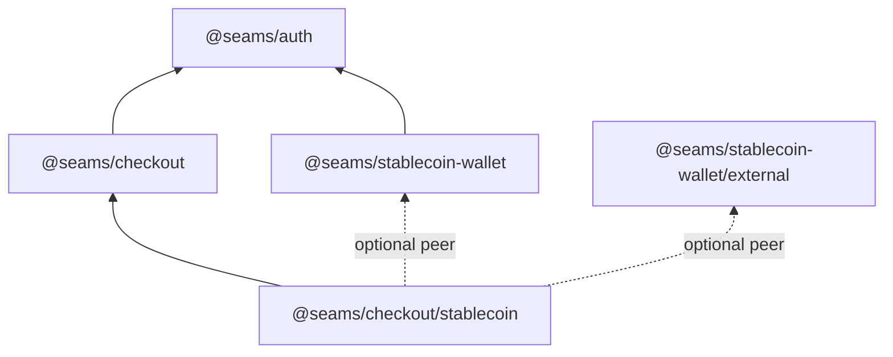
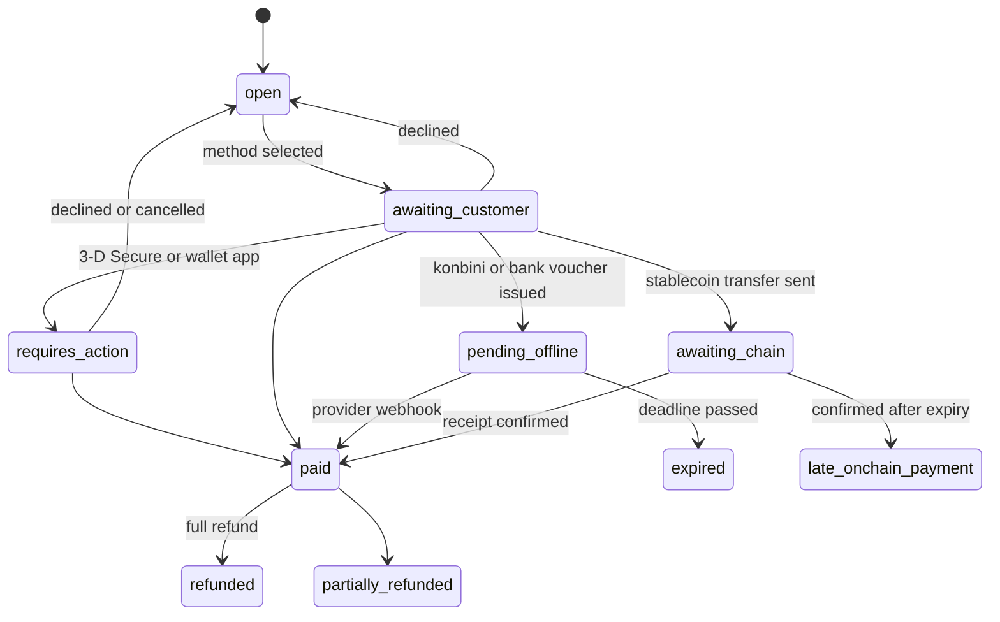

# Refactor 250: Seams Checkout, with the Stablecoin Wallet as a plugin

Status: 2026-11-18. Plan only. Nothing is built. This plan builds on
[Refactor 251](refactor-251-auth-wallet-checkout-modules.md), which separates auth, the
stablecoin wallet and the checkout, and renames `@seams/wallet` to `@seams/stablecoin-wallet`.

The owner's requests (2026-11-17 and 2026-11-18):

- Make a checkout library for online shops. It accepts credit cards and Japanese payment
  methods.
- Use Stripe and KOMOJU in one checkout page: Stripe for its customizable card form, KOMOJU
  for its extra Japanese methods and lower fees. A developer chooses how the page looks, and
  chooses Stripe, KOMOJU or both.
- The checkout is a standalone library. It requires auth. It is written from scratch in a new
  folder, `packages/checkout`, with no file copied from the wallet.
- The stablecoin wallet is an optional plugin of the checkout, so that customers can pay with
  stablecoins. USDC and JPYC are the main ones.

## Result

- **A standalone package of new code.** `@seams/checkout` lives in `packages/checkout` and
  follows the new-code rules of Refactor 251 (its Section 2). It depends on `@seams/auth`. Only
  its `./stablecoin` entry uses the stablecoin wallet, and only as an optional peer.
- **Guests can pay.** A signed-in customer gets saved methods, order history and one-tap
  payment with a passkey. A guest pays with an email address only.
- **One checkout page, two providers behind it.** Seams draws the list of payment methods. A
  routing table on the server sends each method to Stripe or KOMOJU. One order can send a card
  to Stripe and PayPay to KOMOJU.
- **Stablecoins through the plugin.** With the plugin, the checkout shows JPYC for a JPY order
  and USDC for a USD order. The customer pays from the embedded wallet (passkey) or from an
  external wallet such as MetaMask or Rabby. The checkout server checks the transfer onchain.
  Seams holds no funds.
- **Seams draws almost everything.** Only three parts stay with the provider or the issuer:
  the card number fields, the 3-D Secure challenge and the approval screen of a QR wallet
  (PayPay and similar).
- **Separated by the secrets they hold.** The checkout has its own origin, its own Worker and
  its own database. It holds the merchants' provider keys and no account or wallet secret.
- **A developer chooses the presentation.** Three modes: a Seams modal, a Seams form inside the
  developer's page, or headless (the developer draws the list and the vouchers, and mounts only
  the card frame).
- **One order state machine for every method.** Card, konbini, bank transfer, QR wallets and
  stablecoins end in the same states. Provider webhooks and onchain receipts decide the final
  state, not the browser.
- **Seams is never the acquirer and never holds the money.** Each merchant uses its own Stripe
  and KOMOJU accounts. Card numbers go only to the provider.

## Decisions

Decided by the owner on 2026-11-18:

- **D4. A separate package.** The checkout is `@seams/checkout`. It requires `@seams/auth`. The
  stablecoin wallet is its optional plugin.
- **D7. Moved.** The rename and the module split are decisions of Refactor 251.

Open, with a recommendation:

- **D1. Account model.** Recommended: each merchant connects its own Stripe and KOMOJU
  accounts. A Stripe Connect platform with Seams fees comes later, after legal advice
  (Section 11).
- **D2. Routing on the server.** Recommended: the routing table lives on the server. The
  browser can choose the order and a subset of the enabled methods, never the provider.
- **D3. A separate checkout origin.** Recommended: yes. It keeps third-party scripts out of the
  account origin (Fact F4) and makes the payment page a Seams document with a short script list
  (Fact F12).
- **D5. Stripe card form.** Recommended: the Payment Element in card-only mode, styled with the
  Appearance API. Stripe marks the split card fields as legacy (Fact F10).
- **D6. The checkout server.** Recommended: `@seams/checkout/server`, deployed as its own
  Worker with its own D1 database. It is public, so that a self-hosted operator can run
  checkout with its own keys. The Console screens for the hosted service live in
  `seams-monorepo`.
- **D8. Stablecoin currency.** Recommended: the token matches the order currency. A JPY order
  takes JPYC, and a USD order takes USDC. There is no conversion, so Seams quotes no exchange
  rate.
- **D9. Guest checkout.** Recommended: yes. "Requires auth" is a package dependency. Sign-in is
  an offer to the customer, not a step before payment. A shop that forces an account before
  payment loses sales.

## How one page uses two providers

The checkout page shows the methods that the merchant's routing table enables, and the methods
of its plugins. When the customer selects a method, the page mounts that method's part:

| Method | Provider (example routing) | What the page mounts | Who draws the next step |
| --- | --- | --- | --- |
| Card | Stripe | Stripe Payment Element, card only | Issuer (3-D Secure), then Seams receipt |
| Card (cheaper routing) | KOMOJU | `<komoju-fields>` with a Seams theme CSS | Issuer, then Seams receipt |
| Konbini | KOMOJU | Nothing (one button) | Seams voucher from provider data |
| Bank transfer | KOMOJU or Stripe | Nothing | Seams account details |
| PayPay, Rakuten Pay, Merpay, au PAY, d払い | KOMOJU | Nothing | The wallet app, then Seams status |
| Paidy, Pay-easy | KOMOJU | Nothing | Paidy or the bank, then Seams status |
| Apple Pay, Google Pay | Stripe | Stripe Express Checkout Element | The device sheet |
| JPYC, USDC | Stablecoin plugin | Nothing | Embedded wallet confirmer, or the external wallet |

KOMOJU's weak styling matters only for cards. Its extra methods are a button, a redirect or a
voucher, and Seams draws those. So the strong mix is cards on Stripe and the other Japanese
methods on KOMOJU. The cost of this mix is the card fee: 3.6% on Stripe against 3.25% on
KOMOJU (Fact F9). A merchant that wants the lowest fees routes cards to KOMOJU too.

Limits of the mix:

- **A card belongs to one provider.** The provider that collects the card number is the
  provider that charges it. A declined card cannot move to the other provider without new
  entry. A saved card can be charged only through the provider that saved it.
- **Two accounts, two reviews, two payouts.** The merchant passes KYC at both providers, gets
  two payout streams and makes refunds through the provider that took the payment.
- **One provider per method per merchant.** The routing table has one entry for each method.

## Facts this plan builds on

Repository facts, checked on 2026-11-18. Paths are the paths before the rename of Refactor 251.

- **F1.** The app-side overlay has a review slot on the app's document
  (`getTransactionReviewSlot` in
  `packages/wallet/src/SeamsWeb/walletIframe/client/overlay/overlay-controller.ts`, 1,125
  lines). The React `TransactionReviewHost` renders an app card there and hands off to the
  Wallet iframe in the same modal. The homepage showcase checkout uses this.
- **F2.** The Wallet iframe `allow` attribute lists passkeys, clipboard and microphone. It does
  not list `payment`
  ([iframe-transport-dom.ts](../packages/wallet/src/SeamsWeb/walletIframe/client/transport/iframe-transport-dom.ts)).
- **F3.** The Wallet document sends no `Cross-Origin-Embedder-Policy`
  (`packages/wallet/scripts/build/emit-static-wallet-assets.mjs`). A cross-origin frame can
  load beside it.
- **F4.** Refactor 232 decision D1: code in the Wallet origin comes only from the Wallet
  operator. The Wallet origin runs the Yao client WASM on its main thread
  ([Browser workers](browser-workers.md)). Refactor 251 renames this origin the account origin
  and keeps the rule.
- **F5.** Spec 8 already defines integer minor units, explicit currencies, one execution per
  proposal, persisted operation identity and reconciliation by provider events
  ([Spec 8](spec-8-agent-authority-spending-and-payment-rails.md)).
- **F6.** The Gateway is one Worker that builds every wallet domain
  (`packages/wallet-server/src/hosted-wallet-gateway.ts`), with one folder per domain in
  `packages/wallet-server/src/router/domains/`.
- **F7.** The wallet's asset list has USDC on NEAR and Ethereum, and JPYC on Ethereum. Base is
  reviewed but is not a configurable network (`packages/wallet/src/core/assets/assetList.ts`).
- **F8.** `examples/wallet-console-lite/src/PurchaseReviewExample.tsx` already shows an app
  purchase card before the Wallet confirmer.
- **F18.** `@seams/voiceid` lists `@seams/wallet` as a peer dependency. This is the pattern for
  an optional link between packages.
- **F19.** `@seams-internal/shared-ts` is private. Each published package bundles the parts it
  uses.
- **F20.** The external EVM connector discovers wallets by EIP-6963, so MetaMask, Rabby and
  others that announce themselves appear. A NEAR connector for Intear also exists. Neither
  creates a Seams session (Spec 7).

Provider facts, from the providers' pages on 2026-11-17 and 2026-11-18. **F9** is the list
prices in Japan:

| Item | Stripe | KOMOJU |
| --- | --- | --- |
| Cards, Apple Pay | 3.6% (+2% for currency conversion) | 3.25% |
| Konbini | 3.6%, minimum ¥120 | 2.75% |
| Bank transfer | 1.5% | 1.4% |
| PayPay | 3.98% (digital goods 9.48%) | 3.5% and up |
| Merpay, d払い, au PAY | Not offered | 3.5% and up |
| Rakuten Pay | Not offered | 4.4% and up |
| Paidy | Not offered | 3.5% and up |
| Pay-easy | Not offered | 2.75% |
| Konbini or bank refund | ¥250 + tax | Not stated |
| Dispute | ¥1,500 | Not stated |
| Monthly or setup fee | None | None |

Neither page says whether the rates include consumption tax.

- **F10.** Stripe recommends the Payment Element for cards. It marks the Card Element and the
  split card fields as legacy, with maintenance only.
- **F11.** The Stripe Appearance API sets themes, about 80 variables and rules on public
  classes (`.Input`, `.Label`, `.Error`, `.Tab` and others) with a list of allowed CSS
  properties. It cannot change the DOM. KOMOJU Hosted Fields load a theme CSS file from a URL.
  KOMOJU supports only color changes officially. Layout changes are at the developer's risk.
- **F12.** PCI DSS 4.0.1 SAQ A asks the merchant to confirm that scripts cannot attack its
  payment page. The merchant can rely on written confirmation from its vendor.
- **F13.** Japanese rules: online merchants must not let card numbers pass through their
  servers (非通過型). EMV 3-D Secure is required in principle for online merchants since the
  end of March 2025. A company that signs merchants for card acceptance must register with
  METI.
- **F14.** Stripe konbini, bank transfer and PayPay need a Japan-based Stripe account. KOMOJU
  smartphone wallets need a Japanese legal entity.
- **F15.** Apple Pay in a cross-origin frame needs Safari 17 or later, `allow="payment"` on
  every frame in the chain, and a registered domain.
- **F16.** Secondary reports say KOMOJU had unauthorized access in October 2026 that leaked
  about 4,100 personal records and some merchant API credentials. KOMOJU says no card data
  leaked.

## Unknowns to check first (Slice 0)

- **U1.** Does KOMOJU return konbini and bank transfer details as data (payment number, stores,
  deadline), or only an instructions URL? If only a URL, the Seams voucher shows the amount and
  deadline and links to KOMOJU's page.
- **U2.** Can a KOMOJU session be paid from the server for redirect methods (PayPay, Rakuten
  Pay, Merpay), so that Seams needs no KOMOJU UI for them?
- **U3.** What events does `<komoju-fields>` send (change, error, complete)? Without them the
  Seams pay button cannot show field errors before submit.
- **U4.** How does KOMOJU sign webhooks, and does its API accept an idempotency key?
- **U5.** Does KOMOJU support Apple Pay inside a cross-origin frame?
- **U6.** Which consumption tax applies to each fee, and what are the JCB and foreign card rates
  on Stripe?
- **U7.** Read KOMOJU's own notice about the October 2026 incident before the owner signs with
  KOMOJU.

## 1. Modules and where they run

| Module | Package | Runs in | Holds |
| --- | --- | --- | --- |
| Checkout, browser | `@seams/checkout` (`.`, `./react`) | App page (SDK) and checkout origin (frame) | No secret. Provider client secrets for one payment |
| Checkout, server | `@seams/checkout/server` | Checkout Worker, own D1 database | Merchant provider keys (encrypted), orders |
| Stablecoin plugin | `@seams/checkout/stablecoin` | App page | Nothing. It calls the wallet's public API |
| Auth | `@seams/auth` (Refactor 251) | App page and account origin | Login session |
| Stablecoin Wallet | `@seams/stablecoin-wallet` (Refactor 251) | Account origin plugin, or external wallets on the app page | Custody material (embedded only) |
| Shared code | `@seams-internal/shared-ts` | Bundled into each package | Nothing |



Rules of the dependency direction:

- `@seams/checkout` lists `@seams/auth` as a peer dependency.
- Only `@seams/checkout/stablecoin` imports the stablecoin wallet. It lists it as an optional
  peer dependency (Fact F18).
- The base entries of `@seams/checkout` import nothing from the wallet. A shop without
  stablecoins ships no wallet code.
- The wallet imports nothing from the checkout.
- The plugin uses only the wallet's public API. So the peer dependency range is the only
  version contract. There is no second host API version.

Runtime parts:


- **Merchant server.** Creates the order with the cart lines, the amount and the currency. The
  browser never sets the amount. It receives the final result from a signed Seams webhook.
- **Checkout Worker.** Stores orders and payments, calls the providers with the merchant's
  secret keys, checks provider webhooks, reads onchain receipts and sends order events to the
  merchant. It checks a customer's login token with `@seams/auth-server` when one is present.
  It has no binding to the wallet's router roles.
- **Checkout frame.** A Seams document on the checkout origin (`checkoutOrigin` in the public
  configuration). It draws the method list, loads Stripe.js or KOMOJU Fields only when a method
  needs them, and draws vouchers, waits and errors.
- **Account iframe.** The auth core of Refactor 251. It signs a returning customer in. With the
  embedded wallet plugin, it runs the passkey approval and the token transfer.

## 2. The developer API

Server (`@seams/checkout/server`, or the checkout route with the project secret key):

```ts
const order = await checkout.createOrder({
  reference: 'order-1042',
  currency: 'JPY',
  lines: [
    { name: 'Plain baumkuchen', unitAmount: 1800, quantity: 1 },
    { name: 'Matcha baumkuchen', unitAmount: 2200, quantity: 1 },
  ],
  shipping: { amount: 600 },
  customerEmail: 'buyer@example.com', // a guest, or the signed-in account's email
});
// order.id and order.clientToken go to the browser.
```

Routing, accounts and receiving addresses are project configuration, not order fields:

```ts
checkoutConfig = {
  providers: { stripe: { accountRef }, komoju: { accountRef } },
  routing: {
    card: 'stripe',
    konbini: 'komoju',
    bank_transfer: 'komoju',
    paypay: 'komoju',
    rakuten_pay: 'komoju',
    apple_pay: 'stripe',
  },
  stablecoins: {
    JPYC: { chains: ['ethereum'], receiver: '0x…' },
    USDC: { chains: ['ethereum', 'near'], receiver: { ethereum: '0x…', near: 'shop.near' } },
  },
};
```

A method with no route does not appear. A merchant with only Stripe sets only Stripe routes.
The stablecoin entries appear only when the app also installs the plugin.

Browser, without stablecoins:

```ts
import { createSeamsAuth } from '@seams/auth';
import { createCheckout } from '@seams/checkout';

const auth = createSeamsAuth({ accountOrigin, publishableKey });
const checkout = createCheckout({ auth, checkoutOrigin, publishableKey });
const result = await checkout.open({
  clientToken: order.clientToken,
  presentation: 'modal',            // 'modal' | 'inline' | 'headless'
  layout: 'list',                   // 'list' | 'accordion' | 'tabs'
  methods: ['card', 'paypay', 'konbini'], // order and subset, optional
  signIn: 'offer',                  // 'offer' | 'off'. A guest can always pay (D9)
  theme: { accent: '#2b7a52', radius: 12, buttonHeight: 48, fontFamily: 'Noto Sans JP' },
  locale: 'ja',
});
// result.kind: 'paid' | 'pending' | 'cancelled' | 'failed'
// 'pending' is a konbini or bank transfer voucher. The webhook decides the end.
```

Browser, with stablecoins:

```ts
import { createStablecoinWallet } from '@seams/stablecoin-wallet';
import { stablecoinPayments } from '@seams/checkout/stablecoin';

const wallet = createStablecoinWallet(auth, { chains: ['ethereum', 'near'] });
const checkout = createCheckout({
  auth,
  checkoutOrigin,
  publishableKey,
  plugins: [stablecoinPayments({ wallet, external: true, tokens: ['JPYC', 'USDC'] })],
});
```

A shop that wants only external wallets omits `wallet`. Then the app loads no MPC code.

- **`modal`.** The checkout dialog opens with the checkout frame.
- **`inline`.** The checkout frame mounts into an element of the developer's page
  (`checkout.mount(element, options)`).
- **`headless`.** The developer reads `checkout.methods`, draws its own list, vouchers and
  status, and calls `checkout.select(method)` and `checkout.pay()`. For a card, it mounts the
  small Seams card frame (`checkout.mountCardFrame(element)`), which holds only the provider's
  card fields. The provider's script still never runs on the developer's page.

One theme object maps to both providers: the checkout frame turns it into a Stripe `appearance`
object and serves a generated KOMOJU theme CSS file from the checkout origin. React gets
`<CheckoutHost>` from `@seams/checkout/react`.

## 3. The stablecoin plugin

The plugin implements the checkout's method plugin interface:

```ts
type CheckoutMethodPlugin = {
  readonly id: string;
  methods(order: CheckoutOrderView): readonly PluginMethod[];
  pay(input: PluginPayInput): Promise<PluginPaymentHint>;
  resume(order: CheckoutOrderView): Promise<PluginPaymentHint | null>;
};
```

The interface is generic. The stablecoin plugin is its first and only user now.

A stablecoin payment:

1. The customer selects JPYC (JPY order) or USDC (USD order). A token that does not match the
   order currency does not appear (D8).
2. The customer chooses the embedded wallet or an external wallet (Fact F20). The plugin reads
   the payer address on the chosen chain. The checkout Worker issues an onchain quote: chain,
   token contract, receiver, exact amount in token units, payer address and expiry.
3. The customer confirms the transfer:
   - **Embedded wallet.** The dialog moves from the checkout frame to the Wallet confirmer in
     the same modal (Section 5). The customer confirms with a passkey.
   - **External wallet.** The external wallet opens its own window. The checkout frame shows a
     wait until the wallet returns a transaction hash or a refusal.
4. The plugin sends the transaction hash to the checkout Worker as a hint.
5. The checkout Worker reads the receipt. It accepts the payment only if the token contract,
   receiver, amount and payer match the quote, the block is after the quote, and the required
   confirmations have passed.
6. One transaction hash pays one order. A second use is refused.

If the browser closes after the transfer, `resume` sends the hash again from the embedded
wallet's record of submitted transactions. An external wallet keeps no such record for Seams,
so the checkout frame keeps the hash in session storage until the Worker confirms it. A
transfer that arrives after the quote expires puts the order in `late_onchain_payment`. The
merchant then refunds or accepts it by hand.

## 4. Order and payment states

One order has one or more payment attempts. Only one attempt can be active.



- Amounts are integer minor units with an explicit currency (Fact F5). JPY has no minor unit.
  Token amounts are integer token units with the token's decimals.
- Before a provider call, the checkout Worker stores the attempt's operation identity. A retry
  uses the provider's idempotency key, or looks up the provider payment by the Seams reference
  (Unknown U4).
- Only a verified provider webhook or a confirmed onchain receipt moves an attempt to `paid`. A
  browser result is a hint. A closed window proves nothing (Spec 7).
- A konbini or bank order keeps its stock reservation until `expired`. The merchant chooses the
  deadline within the provider's limits.
- Each state change sends one signed event to the merchant: `order.paid`, `order.pending`,
  `order.expired`, `order.refunded`, `order.late_onchain_payment`. Delivery retries until the
  merchant answers 2xx.

## 5. Shared code: the stage dialog

Today the wallet owns the overlay that moves from the app's review card to the Wallet iframe in
one modal (Fact F1). The checkout needs the same dialog, the auth core of Refactor 251 needs it
for sign-in, and the stablecoin plugin needs the checkout and the Wallet confirmer in one
modal. The repo rules allow one copy of that code.

- Refactor 251 (its Slice 1) writes a new stage dialog in `@seams-internal/shared-ts`, with the
  frame transport and the message checks (expected origin, window, request and surface
  instance). A stage is one frame or one app element. The dialog moves between stages.
- The new auth core and the checkout use it. The checkout adds no dialog of its own. The
  wallet's old overlay goes away in the audit of Refactor 251.
- The account iframe can show a stage in a dialog that the caller gives. The checkout passes
  its dialog. So the checkout frame moves to sign-in or to the Wallet confirmer in the same
  modal.
- The checkout frame gets `allow="payment"` for Apple Pay and Google Pay. The account iframe
  does not need it (Fact F2), because no provider runs in the account origin.

## 6. Provider adapters

Both providers implement one interface in `@seams/checkout/server`:

```ts
type CheckoutProvider = {
  readonly kind: 'stripe' | 'komoju';
  readonly methods: ReadonlySet<CheckoutMethod>;
  startPayment(attempt: PaymentAttempt): Promise<ProviderStart>;
  readPayment(ref: ProviderPaymentRef): Promise<ProviderPaymentState>;
  verifyWebhook(request: Request): Promise<ProviderEvent>;
  refund(ref: ProviderPaymentRef, amount: MinorUnits): Promise<ProviderRefund>;
};
```

`ProviderStart` is a union named with `Variant`: client data for a card form (Stripe client
secret or KOMOJU session), a redirect URL, a voucher, or bank account details. The checkout
frame switches on the variant, not on the provider. A third provider adds one file and no frame
change.

- **Plain `fetch` clients.** The checkout Worker runs on Cloudflare Workers. Each adapter calls
  the provider's REST API through one shared HTTP helper that sets the idempotency header,
  timeouts and error mapping. No provider SDK enters the server bundle.
- **Webhooks.** One route per provider (`/checkout/webhooks/stripe`,
  `/checkout/webhooks/komoju`). Each checks the signature with WebCrypto before it reads the
  body. Duplicate and late events converge, as in Spec 8.
- **Secret keys.** The merchant's provider keys stay in the checkout Worker, encrypted at rest.
  The browser gets only a publishable key and a per-payment client secret or session ID.
- **Chain reads.** The checkout Worker reads receipts through the RPC endpoints of its own
  configuration. It shares no endpoint secret with the wallet servers.

## 7. The checkout frame

- **Origin.** A static document `checkout-service/index.html` in the `@seams/checkout` build,
  served from `checkoutOrigin`. A local run serves it on its own port.
- **CSP.** `script-src` allows only the checkout origin, Stripe.js and KOMOJU Fields.
  `frame-src` and `connect-src` allow only the providers' hosts and the checkout Worker.
  `frame-ancestors` lists the project's allowed origins. No analytics and no other third-party
  script. This is the basis of the written PCI statement for merchants (Fact F12).
- **Lazy provider scripts.** Stripe.js loads only when a Stripe method is selected or Apple Pay
  is enabled. KOMOJU Fields load only for a KOMOJU card. A redirect method or a stablecoin
  loads no provider script.
- **Apple Pay and Google Pay.** The Console registers the merchant's domains and the checkout
  origin with Stripe (Fact F15).
- **Accessibility and language.** Labels, errors and vouchers are Seams text in English and
  Japanese. The Stripe and KOMOJU fields get the same `locale`.

## 8. Slices

Each slice ships alone and keeps the invariants of Section 9.

- **Slice 0: checks and accounts.** Answer U1 to U7. Open Stripe (Japan) and KOMOJU test
  accounts. Get the owner's D1 to D9. No code.
- **Slice 1: the stage dialog.** Built as Refactor 251 Slice 1 (Section 5). The checkout starts
  after it.
- **Slice 2: the checkout package and server.** `packages/checkout`, the checkout Worker, its D1
  database and migrations, the order and attempt tables, the provider interface, the Stripe and
  KOMOJU adapters for cards, both webhook routes and the merchant events. Tests use provider
  fakes. A sandbox test runs one real test payment at each provider.
- **Slice 3: the checkout frame with cards, for guests.** `checkoutOrigin`, the frame document,
  its CSP, `checkout.open` in `modal` and `inline`, the Seams method list, the Stripe Payment
  Element (card only), KOMOJU Fields, the theme mapping, 3-D Secure and the receipt. A new
  example shop in `examples/` shows both providers in one page.
- **Slice 4: konbini, bank transfer and PayPay.** The voucher and bank screens, the
  `pending_offline` state, deadlines, expiry and stock release. PayPay through both providers,
  so that a merchant can route it either way.
- **Slice 5: returning customers.** `signIn: 'offer'`, the login token check in the checkout
  Worker, order history and saved methods per provider. Needs the login token of Refactor 251
  (its Slice 3).
- **Slice 6: the stablecoin plugin.** `@seams/checkout/stablecoin` with the embedded and the
  external wallets, the onchain quote, the move to the Wallet confirmer, receipt checks in the
  checkout Worker, `resume` and the `late_onchain_payment` state. JPYC on Ethereum and USDC on
  Ethereum and NEAR (Fact F7). Build it against the API of the Refactor 251 release, so that it
  needs no second change.
- **Slice 7: the other KOMOJU methods.** Rakuten Pay, Merpay, au PAY, d払い, Paidy and Pay-easy
  as redirect methods (Unknown U2).
- **Slice 8: Apple Pay and Google Pay.** The Stripe Express Checkout Element in the frame,
  domain registration and the `allow="payment"` chain.
- **Slice 9: headless mode and refunds.** `checkout.methods`, `select`, `pay`,
  `mountCardFrame`, and server refunds (full and partial) through the provider of the payment.
- **Slice 10: Console and deployment (seams-monorepo).** Deploy the checkout Worker and origin.
  Connect the provider accounts, set the receiving addresses, edit the routing table and the
  theme, set the merchant webhook URL, view orders and refund.

Slices 2 to 4 wait only for the stage dialog, because a guest checkout needs no account. Slice
5 waits for the login token of Refactor 251. Slice 6 waits for the Refactor 251 release.

## 9. Invariants

- No card number, CVC or expiry date reaches a Seams server, a Seams log or a Seams frame's
  JavaScript. Only provider frames hold them.
- No provider script runs in the account origin or on the merchant's page.
- Only `@seams/checkout/stablecoin` imports the stablecoin wallet. The wallet imports nothing
  from the checkout.
- The checkout origin and the checkout Worker hold no account or wallet secret, open no wallet
  worker, read no account-origin storage and have no binding to the wallet's router roles.
  [Browser workers](browser-workers.md) stays unchanged.
- The wallet servers and the Auth Worker hold no provider key.
- A guest can pay without an account (D9).
- The amount, currency, provider and stablecoin receiver of a payment come from the server.
  The browser cannot change them.
- One active attempt per order. One provider payment per attempt. One transaction hash per
  order.
- A paid state needs a verified provider webhook or a confirmed onchain receipt.
- Seams never holds the merchant's money and never decides which merchant may accept cards.
- No file in `packages/checkout` is a copy of a file in the wallet packages.

## 10. Tests

- Intended behaviours: one journey per method and per provider, in
  [Intended Behaviours](intended-behaviours.md): card success, card decline, 3-D Secure,
  konbini issued then paid, konbini expired, bank transfer, PayPay approve and cancel, a guest
  order, a returning customer's order, JPYC paid from the embedded wallet, USDC paid from an
  external wallet, a reused transaction hash, a late transfer, and a mixed routing order (card
  on Stripe, konbini on KOMOJU).
- Browser tests in Chromium, Firefox and WebKit for the frame, the theme mapping, the move to
  sign-in and to the Wallet confirmer, and keyboard and screen reader use.
- A packed-package test that fails if the base entries of `@seams/checkout` import the wallet,
  or if the wallet imports the checkout. `tests/scripts/check-packed-wallet-boundaries.mjs` is
  the model.
- A CSP test that fails if the checkout document allows another script host.
- Webhook tests for bad signatures, duplicates and reordered events.

## 11. Not in this plan

- **A Stripe Connect platform with Seams fees.** It needs Japanese legal advice first, direct
  charges (the merchant stays the merchant of record) and the per-account konbini and PayPay
  reviews. KOMOJU has no confirmed platform product.
- **Saved cards across merchants with a passkey.** It needs the Connect platform (platform
  customers and copied payment methods). It works only for Stripe cards.
- **Conversion between currencies.** A JPY order cannot be paid in USDC (D8).
- **Agent checkout.** Stripe Shared Payment Tokens with the agent grants of Spec 8. Japanese
  availability is not confirmed.
- **Provider fallback for a declined card.** A card cannot move between providers without new
  entry.
- **The module split and the rename.** See
  [Refactor 251](refactor-251-auth-wallet-checkout-modules.md).

## Documents to update when the slices land

- [Spec 7](spec-7-hosted-surfaces-and-provider-boundaries.md): the checkout origin, the stage
  dialog, the messages and the CSP.
- [Spec 8](spec-8-agent-authority-spending-and-payment-rails.md): the shared payment states, and
  why the checkout adapters are public (D6).
- [Intended Behaviours](intended-behaviours.md), the README, the doc index and the public docs
  in `apps/docs`.
