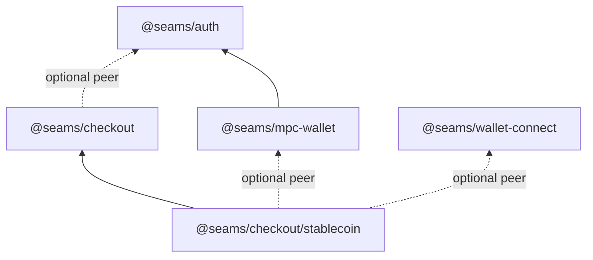
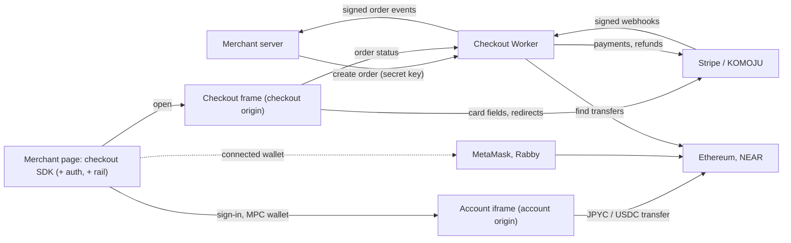
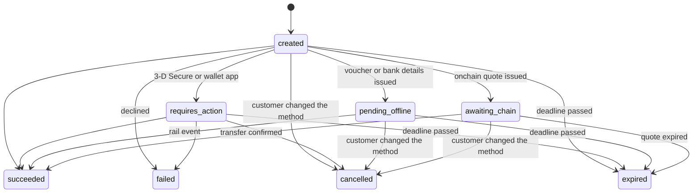
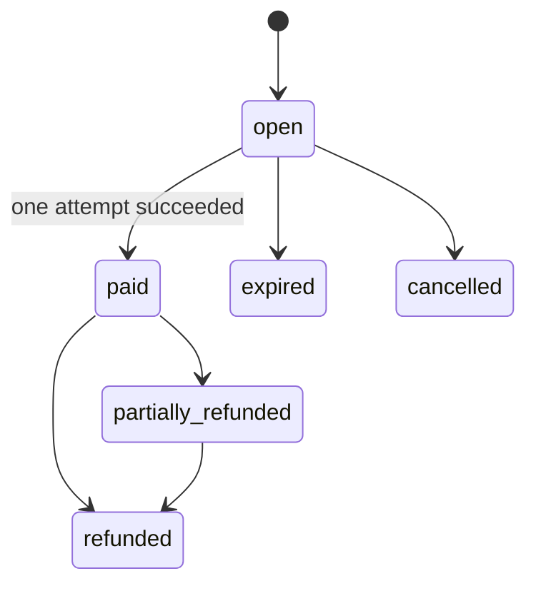

# Refactor 250: Seams Checkout, with stablecoin payments as a plugin

Status: 2026-11-28. Slices 2 to 4 and 7 are built on `dev`: the checkout Worker, the Stripe and
KOMOJU rails (cards, konbini, bank transfer, PayPay and KOMOJU's other Japanese methods), the
merchant's server client, the page
SDK, the checkout frame and an example shop. Section 8 has the result of each slice and what each open slice waits
for. The plan was revised on 2026-11-18 after a review of the architecture. The Slice 0
unknowns have answers from public documentation (2026-11-18). With
them, D1, D13 and D14 changed, and D2, D3, D5 and D8 got new facts. Tasks T1 to T19 finish
Slice 0. This plan builds on
[Refactor 251](refactor-251-auth-wallet-checkout-modules.md), which separates auth, the
MPC wallet, the wallet connectors and the checkout, and renames `@seams/wallet` to
`@seams/mpc-wallet`. The Seams names in this plan are final: the wallet keeps the Seams brand
(Refactor 251, D22).

The owner's requests (2026-11-17 and 2026-11-18):

- Make a checkout library for online shops. It accepts credit cards and Japanese payment
  methods.
- Use Stripe and KOMOJU in one checkout page: Stripe for its customizable card form, KOMOJU
  for its extra Japanese methods and lower fees. A developer chooses how the page looks, and
  chooses Stripe, KOMOJU or both.
- The checkout is a standalone library. It is written from scratch in a new folder,
  `packages/checkout`, with no file copied from the wallet.
- The wallets are an optional plugin of the checkout, so that customers can pay with
  stablecoins. USDC and JPYC are the main ones.
- **How a customer pays with stablecoins (2026-11-18).** The customer pays from a connected
  wallet (MetaMask, Rabby) or from the MPC wallet. The MPC wallet is a persistent wallet that
  the customer funds once and then pays from in one tap, as Stripe Link does for cards. The
  owner considered payment to a bare address or QR code and rejected it: without a connected
  wallet the checkout does not know the payer, and the owner does not want a unique amount for
  each order.
- **Review changes.** The owner accepted these changes after the review:
  - auth is an optional peer of the checkout, behind a small identity interface (D4)
  - one payment rail interface for Stripe, KOMOJU and stablecoins (D10)
  - the server finds a stablecoin transfer on the chain itself (D11)
  - separate states for an order and for a payment attempt, and one state for each payment
    that nobody expected (D12)
  - one package with `/client` and `/server` paths, and the checkout Worker in the services
    package (D6, from Refactor 251 D24)

## Result

- **A standalone package of new code.** `@seams/checkout` lives in `packages/checkout` and
  follows the new-code rules of Refactor 251 (its Section 2). Its paths are `/client`, `/react`,
  `/stablecoin` and `/server`. It has no required Seams dependency. Auth and the wallet packages
  are optional peers.
- **Guests can pay.** A guest pays with an email address only. A signed-in customer gets saved
  methods, order history and one-tap payment with a passkey.
- **A shop can use its own login.** The checkout needs only a small identity interface. Seams
  Auth satisfies it, and a shop's own login can satisfy it too.
- **One checkout page, several payment rails behind it.** Seams draws the list of payment
  methods. A routing table on the server sends each method to one rail: Stripe, KOMOJU or the
  stablecoin rail. One order can send a card to Stripe and PayPay to KOMOJU.
- **Stablecoins are one more rail.** With the rail's browser half, the checkout shows JPYC for a
  JPY order and USDC for a USD order. The customer pays from the MPC wallet (passkey) or from a
  connected wallet such as MetaMask or Rabby. The checkout server finds the transfer on the
  chain. Seams holds no funds.
- **The MPC wallet is the fast path.** A signed-in customer with a funded Seams wallet sees the
  balance and pays in one tap, with one passkey approval.
- **Seams draws almost everything.** Only three parts stay with the provider or the issuer:
  the card number fields, the 3-D Secure challenge and the approval screen of a QR wallet
  (PayPay and similar).
- **Separated by the secrets they hold.** The checkout has its own origin, its own Worker and
  its own database. It holds the merchants' provider keys and no account or wallet secret.
- **A developer chooses the presentation.** Three modes: a Seams modal, a Seams form inside the
  developer's page, or headless (the developer draws the list and the vouchers, and mounts only
  the card frame).
- **Two state machines.** A payment attempt has the states of its rail. An order has few
  states, and they come from its attempts and refunds. Rail events decide the final state, not
  the browser.
- **Seams is never the acquirer and never holds the money.** Each merchant uses its own Stripe
  and KOMOJU accounts. Card numbers go only to the provider.

## Decisions

Decided by the owner on 2026-11-18:

- **D4. A separate package, with optional peers.** The checkout is `@seams/checkout`. It uses
  auth through an identity interface (Section 2), and `@seams/auth` is an optional peer. The
  wallets are optional too. The first choice was a required dependency on auth. The review
  changed it, because a guest checkout calls no auth code.
- **D7. Moved.** The rename and the module split are decisions of Refactor 251.
- **D10. One rail interface.** Stripe, KOMOJU and stablecoins are three rails of one interface.
  A rail has a server half, and it can have a browser half (Section 3). This replaces the
  provider interface and the separate method plugin interface of the first plan.
- **D11. The server finds the transfer.** The checkout Worker searches the chain for the
  stablecoin transfer of a quote. A transaction hash from the browser is only a hint.
- **D12. Order states and attempt states are separate.** A payment that arrives when its order
  does not wait for it becomes an `unexpected_payment` (Section 5).
- **D15. The payer's address names the transfer.** The customer connects a wallet or uses the
  MPC wallet, so the checkout knows the payer before it issues the quote. The quote has the
  exact order amount. There is no unique amount, and no payment to a bare address or QR code
  (Section 11).
- **D6. The checkout server.** Decided with Refactor 251 D24. The merchant's backend uses
  `@seams/checkout/server` (`createOrder`, merchant event checks). The checkout Worker, with
  its own D1 database, is a service of `@seams/host`, so that a self-hosted operator can run
  checkout with its own keys. Its code lives in `packages/checkout`. The Console screens for
  the hosted service live in `seams-monorepo`.

Open, with a recommendation:

- **D1. Account model.** Recommended: each merchant connects its own Stripe and KOMOJU
  accounts. A Stripe Connect platform with Seams fees comes later, after legal advice
  (Section 11). Changed on 2026-11-18: the hosted model needs that review too. The sources name
  PCI DSS duties for a provider that can affect a payment page, and the Japanese guideline
  names duties for a provider of an EC payment system (U10). A lawyer and a PCI QSA review the
  U10 list before a live merchant uses the hosted checkout.
- **D2. Routing on the server.** Recommended: the routing table lives on the server. The
  browser can choose the order and a subset of the enabled methods, never the rail. U2
  confirms that the server can start each KOMOJU redirect method without a KOMOJU page.
- **D3. A separate checkout origin.** Recommended: yes. It keeps third-party scripts out of the
  account origin (Fact F4) and makes the payment page a Seams document with a short script list
  (Fact F12). U10 adds a reason: for SAQ A, a merchant relies on written confirmation from
  Seams about the frame's scripts. A short, fixed script list makes that confirmation easy to
  check.
- **D5. Stripe card form.** Recommended: the Payment Element in card-only mode, styled with the
  Appearance API. Stripe calls the Card Element a legacy integration (Fact F10).
- **D8. Stablecoin currency.** Recommended: the token matches the order currency. A JPY order
  takes JPYC, and a USD order takes USDC. There is no conversion, so Seams quotes no exchange
  rate. JPYC is on Ethereum, Polygon, Avalanche and Kaia, not on Base or NEAR (U9). So a
  merchant that receives only on Base or NEAR gets no JPYC option. The checkout names a token
  by its contract address, because the old prepaid JPYC has the same name and symbol (U8).
- **D9. Guest checkout.** Recommended: yes. Sign-in is an offer to the customer, not a step
  before payment. A shop that forces an account before payment loses sales.
- **D13. Merchant keys.** Recommended: the checkout accepts only a Stripe restricted key with
  the permissions for payments, refunds and webhooks. A leaked key then cannot pay out or read
  other data (Fact F16). Changed on 2026-11-18: KOMOJU has no restricted key (U12). Its secret
  key reaches all API resources, and KOMOJU's own incident exposed some merchants' secret keys
  (U7). So the checkout encrypts the KOMOJU secret key with a separate encryption key, uses it
  only in the KOMOJU rail and never logs it. The Console shows the merchant that this key has full
  access and lets the merchant replace it. Seams asks KOMOJU for scoped keys or an IP allowlist
  before a live merchant connects KOMOJU.
- **D14. Gas for a stablecoin payment.** Changed on 2026-11-18 after U8 and U9. Recommended: a
  relayer pays the gas for the MPC wallet, so that the customer needs only the stablecoin.
  - JPYC on its four chains and USDC on Ethereum, Base and the other checked chains support
    EIP-3009 (U8). The MPC wallet signs a `transferWithAuthorization` with one passkey
    approval. Its nonce comes from the quote ID, and its `validBefore` is the quote expiry. The
    relayer sends it.
  - On NEAR, the relayer sends a NEP-366 delegate action that the MPC wallet signed, and the
    `ft_transfer` memo carries the quote ID.
  - A customer who pays from a connected wallet pays the gas there. A connected wallet can sign
    the same authorization as EIP-712 typed data, so the relayer can serve it later. JPYC takes
    no ERC-1271 signature, so a smart contract wallet always sends a plain transfer.
  - A transfer costs ¥3 or less on each chain today (U9). The relayer refuses a payment when the
    gas is above a cap against the order amount. Then the customer pays from a connected
    wallet.
  - The relayer holds only the gas token of each chain, never a customer's or a merchant's
    money. Open: who funds the relayer, Seams or the merchant.

## How one page uses two providers

The checkout page shows the methods that the merchant's routing table enables. When the
customer selects a method, the page mounts that method's part:

| Method | Provider (example routing) | What the page mounts | Who draws the next step |
| --- | --- | --- | --- |
| Card | Stripe | Stripe Payment Element, card only | Issuer (3-D Secure), then Seams receipt |
| Card (cheaper routing) | KOMOJU | `<komoju-fields>` with a Seams theme CSS | Issuer, then Seams receipt |
| Konbini | KOMOJU | Nothing (one button) | Seams voucher from provider data |
| Bank transfer | KOMOJU or Stripe | Nothing | Seams account details |
| PayPay, Rakuten Pay, Merpay, au PAY, d払い | KOMOJU | Nothing | The wallet app, then Seams status |
| Paidy, Pay-easy | KOMOJU | Nothing | Paidy or the bank, then Seams status |
| Apple Pay, Google Pay | Stripe | Stripe Express Checkout Element | The device sheet |
| JPYC, USDC | Stablecoin rail | Nothing | MPC wallet confirmer, or the connected wallet |

KOMOJU's weak styling matters only for cards. Its extra methods are a button, a redirect or a
voucher, and Seams draws those. So the strong mix is cards on Stripe and the other Japanese
methods on KOMOJU. The cost of this mix is the card fee: 3.6% on Stripe against 3.25% on
KOMOJU (Fact F9). A merchant that wants the lowest fees routes cards to KOMOJU too.

Limits of the mix:

- **A card belongs to one provider.** The provider that collects the card number is the
  provider that charges it. A declined card cannot move to the other provider without new
  entry. A saved card can be charged only through the provider that saved it.
- **Two accounts, two reviews, two payouts.** The merchant passes KYC at both providers, gets
  two payout streams and makes refunds through the provider that took the payment.
- **One provider per method per merchant.** The routing table has one entry for each method.

## Facts this plan builds on

Repository facts, checked on 2026-11-18. Paths are the paths before the rename of Refactor 251.

- **F1.** The app-side overlay has a review slot on the app's document
  (`getTransactionReviewSlot` in
  `packages/wallet/src/SeamsWeb/walletIframe/client/overlay/overlay-controller.ts`, 1,125
  lines). The React `TransactionReviewHost` renders an app card there and hands off to the
  Wallet iframe in the same modal. The homepage showcase checkout uses this.
- **F2.** The Wallet iframe `allow` attribute lists passkeys, clipboard and microphone. It does
  not list `payment`
  ([iframe-transport-dom.ts](../packages/wallet/src/SeamsWeb/walletIframe/client/transport/iframe-transport-dom.ts)).
- **F3.** The Wallet document sends no `Cross-Origin-Embedder-Policy`
  (`packages/wallet/scripts/build/emit-static-wallet-assets.mjs`). A cross-origin frame can
  load beside it.
- **F4.** Refactor 232 decision D1: code in the Wallet origin comes only from the Wallet
  operator. The Wallet origin runs the Yao client WASM on its main thread
  ([Browser workers](browser-workers.md)). Refactor 251 renames this origin the account origin
  and keeps the rule.
- **F5.** Spec 8 already defines integer minor units, explicit currencies, one execution per
  proposal, persisted operation identity and reconciliation by provider events
  ([Spec 8](spec-8-agent-authority-spending-and-payment-rails.md)).
- **F6.** The Gateway is one Worker that builds every wallet domain
  (`packages/wallet-server/src/hosted-wallet-gateway.ts`), with one folder per domain in
  `packages/wallet-server/src/router/domains/`.
- **F7.** The wallet's asset list has USDC on NEAR and Ethereum, and JPYC on Ethereum. Base is
  reviewed but is not a configurable network (`packages/wallet/src/core/assets/assetList.ts`).
  The JPYC entry (`0xe7c3…3c29`) is the current JPYC, not the old prepaid token (U8).
- **F8.** `examples/wallet-console-lite/src/PurchaseReviewExample.tsx` already shows an app
  purchase card before the Wallet confirmer.
- **F18.** `@seams/voiceid` lists `@seams/wallet` as a peer dependency. This is the pattern for
  an optional link between packages.
- **F19.** `@seams-internal/shared-ts` is private. Each published package bundles the parts it
  uses.
- **F20.** The external EVM connector discovers wallets by EIP-6963, so MetaMask, Rabby and
  others that announce themselves appear. A NEAR connector for Intear also exists. Neither
  creates a Seams session (Spec 7).

Provider facts, from the providers' pages on 2026-11-17 and 2026-11-18. **F9** is the list
prices in Japan:

| Item | Stripe | KOMOJU |
| --- | --- | --- |
| Cards, Apple Pay | 3.6% for each brand, JCB included (+2% for currency conversion) | 3.25% |
| Konbini | 3.6%, minimum ¥120 | 2.75% |
| Bank transfer | 1.5% | 1.4% |
| PayPay | 3.98% (digital goods 9.48%) | 3.5% and up (digital goods 9%) |
| Merpay, d払い, au PAY | Not offered | 3.5% and up |
| Rakuten Pay | Not offered | 4.4% and up |
| Paidy | Not offered | 3.5% and up |
| Pay-easy | Not offered | 2.75% |
| Konbini or bank refund | ¥250 + tax | ¥300 including tax (Pay-easy too) |
| Other refund | No fee. The payment fee is not returned | The payment fee is not returned |
| Dispute | ¥1,500 | No fee |
| Monthly or setup fee | None | None |

Consumption tax comes on top of these rates at both providers (U6). Stripe lists which of its
fees are taxable. KOMOJU charges no consumption tax to a merchant registered outside Japan. A
special agreement with KOMOJU takes priority over its list prices.

- **F10.** Stripe recommends the Payment Element for cards. Its comparison page calls the Card
  Element a legacy integration. That page does not name the split card fields
  (https://docs.stripe.com/payments/payment-card-element-comparison, read 2026-11-18).
- **F11.** The Stripe Appearance API sets themes, about 80 variables and rules on public
  classes (`.Input`, `.Label`, `.Error`, `.Tab` and others) with a list of allowed CSS
  properties. It cannot change the DOM. KOMOJU Hosted Fields load a theme CSS file from a URL.
  KOMOJU supports only color changes officially. Layout changes are at the developer's risk.
- **F12.** PCI DSS 4.0.1 SAQ A asks the merchant to confirm that scripts cannot attack its
  payment page. The merchant can rely on written confirmation from its vendor.
- **F13.** Japanese rules: online merchants must not let card numbers pass through their
  servers (非通過型). EMV 3-D Secure is required in principle for online merchants since the
  end of March 2025. A company that signs merchants for card acceptance must register with
  METI.
- **F14.** Stripe konbini, bank transfer and PayPay need a Japan-based Stripe account. KOMOJU
  smartphone wallets need a Japanese legal entity.
- **F15.** Apple Pay in a cross-origin frame needs Safari 17 or later, `allow="payment"` on
  every frame in the chain, and a registered domain.
- **F16.** KOMOJU's own final report (2026-11-13) says that a third party entered its systems
  through a pre-release environment from 2026-10-13. The attacker saw about 4,100 consumer
  records, the API secret keys of some merchants and KOMOJU's credentials for its payment method
  providers. No card data leaked (U7).

## Unknowns to check first (Slice 0)

Answered on 2026-11-18 from public documentation only. Nobody opened an account or entered data
at a provider. Each answer names its sources, all read on 2026-11-18. A **next check** is the
test or the question to the provider that closes what the documentation leaves open.
"Remaining Slice 0 tasks" below lists each one as a task.

- **U1.** Does KOMOJU return konbini and bank transfer details as data (payment number, stores,
  deadline), or only an instructions URL? If only a URL, the Seams voucher shows the amount and
  deadline and links to KOMOJU's page.
  - **Answer: as data, with one exception.** A konbini payment has `payment_details.store`,
    `receipt`, `confirmation_code` and `instructions_url`. The deadline is the payment's
    `payment_deadline`. Only some chains send `confirmation_code`, and the docs do not name them.
  - **The exception is 7-Eleven.** Its `receipt` is deprecated, and KOMOJU says to show
    `instructions_url`. `GET /barcodes/{payment_id}` returns a barcode image that is valid for
    about 10 minutes.
  - A bank transfer has `bank_name`, `account_branch_name`, `account_number`, `account_type`,
    `account_name`, `payment_deadline` and `instructions_url`. The docs show no bank code and no
    branch code.
  - So the Seams voucher draws the data. For 7-Eleven, it shows the barcode or links to
    KOMOJU's page.
  - Sources:
    - https://docs.komoju.com/en/api-reference
    - https://docs.komoju.com/en/docs/integration-guides/direct-integrations/payments-api/overview
  - **Next check:** create one test konbini payment for each chain and one bank transfer. Record
    the fields that come back.
- **U2.** Can a KOMOJU session be paid from the server for redirect methods (PayPay, Rakuten
  Pay, Merpay), so that Seams needs no KOMOJU UI for them?
  - **Answer: yes.** `POST /api/v1/sessions/{id}/pay` accepts the secret key. For PayPay,
    Merpay, Rakuten Pay, au PAY and d払い, `payment_details` needs only `type`. The response has
    `status` and `redirect_url`, and sometimes `app_url`. `POST /api/v1/payments` also returns
    `payment_details.redirect_url`. No page says that these methods need the KOMOJU hosted page.
  - Paidy also needs `customer_name`. Pay-easy is asynchronous, as konbini is.
  - This supports D2: the server starts each KOMOJU redirect method itself.
  - Sources:
    - https://docs.komoju.com/en/api-reference
    - https://docs.komoju.com/en/docs/integration-guides/direct-integrations/payments-api/overview
  - **Next check:** see whether `redirect_url` goes straight to the wallet provider or to a
    KOMOJU page first. Confirm the `type` value for d払い (probably `docomo`).
- **U3.** What events does `<komoju-fields>` send (change, error, complete)? Without them the
  Seams pay button cannot show field errors before submit.
  - **Answer: one documented event.** The docs name only `komoju-error`
    (`event.detail.error`). `preventDefault()` on it hides KOMOJU's own message. The script
    `fields.js` also sends `komoju-invalid` when `submit()` fails validation, and
    `komoju-session-change`. The docs do not name these two. There is no ready, change or
    complete event, and no way to read the field state before submit.
  - `fields.submit()` or a form submit sends the card. In token mode, it returns a token, and the
    server uses `token.id`. The `theme` attribute takes a CSS URL, and only color changes are
    supported (Fact F11).
  - **Effect on the plan.** For a KOMOJU card, the Seams pay button stays on. Field errors show
    after the customer selects pay.
  - Sources:
    - https://docs.komoju.com/en/docs/integration-guides/hosted-fields-handling-errors.md
    - https://docs.komoju.com/en/docs/integration-guides/hosted-fields-custom-styling.md
    - https://multipay.komoju.com/fields.js (the code, for the two other events)
  - **Next check:** ask KOMOJU whether `komoju-invalid` and `komoju-session-change` are stable.
- **U4.** How does KOMOJU sign webhooks, and does its API accept an idempotency key?
  - **Signature.** The `X-Komoju-Signature` header is the HMAC-SHA256 of the raw body. The key
    is the secret token of the webhook in the dashboard. No timestamp is signed, so the
    signature does not stop a replay. KOMOJU retries a failed delivery 25 times over about 25
    days.
  - **Idempotency.** The `X-KOMOJU-IDEMPOTENCY` header works on `POST` requests, with at most
    100 ASCII characters. A key is valid for 24 hours. A retry must send the same body. A
    concurrent retry gets 409.
  - **Lookup.** `GET /api/v1/payments?external_order_num=…` finds a payment by the Seams
    reference, which must be unique. A session sets it as `payment_data[external_order_num]`.
  - **Effect on the plan (Section 3).** The KOMOJU webhook route reads the payment from the API
    before it changes an attempt, so a replayed event cannot set a state that the payment does
    not have. A retry after 24 hours uses the lookup, not the idempotency key.
  - Sources:
    - https://docs.komoju.com/en/docs/introduction/core-concepts/webhooks
    - https://docs.komoju.com/en/docs/introduction/core-concepts/idempotent-requests
    - https://docs.komoju.com/en/api-reference
- **U5.** Does KOMOJU support Apple Pay inside a cross-origin frame?
  - **Answer: Apple Pay yes. The frame case is not documented.** KOMOJU offers Apple Pay through
    its hosted page, Hosted Fields and the API: JPY only, Visa and Mastercard only, for
    corporations only. Hosted Fields and the API need the Apple domain file and each domain
    registered in the dashboard. The API flow calls `POST /api/v1/apple_pay/validate_merchant`.
  - The docs say nothing about a cross-origin frame or a Safari version. The frame that
    `fields.js` makes has `allow="payment *"`.
  - Google Pay: the eligibility page names only the hosted page and WooCommerce. A changelog of
    2026-08-31 names Hosted Fields too.
  - **No change to the plan.** Apple Pay and Google Pay stay on Stripe (Fact F15).
  - Sources:
    - https://docs.komoju.com/en/docs/integration-guides/apple-pay/using-apple-pay
    - https://docs.komoju.com/en/docs/integration-guides/apple-pay/using-apple-pay-api
    - https://docs.komoju.com/en/docs/integration-guides/google-pay/eligibility-criteria.md
  - **Next check:** ask KOMOJU which domain to register when its fields run in a frame on another
    origin, and whether Google Pay works in Hosted Fields.
- **U6.** Which consumption tax applies to each fee, and what are the JCB and foreign card rates
  on Stripe?
  - These are the published rates and statements only. They are not tax advice.
  - **Stripe card rates.** Stripe Japan lists one rate, 3.6%, for all card brands, JCB
    included. It lists no surcharge for a card from outside Japan. A payment that needs currency
    conversion costs 2% more.
  - **Stripe tax.** Stripe adds Japanese consumption tax to its fees. Its list of taxable fees
    names JCB, American Express, Diners, Discover, konbini, PayPay, bank transfer, disputes and
    software services. Visa and Mastercard fees are taxable from 2026-04-01, and currency
    conversion from 2025-10-31. Apple Pay, Google Pay and Link follow the card behind them.
    Stripe sends a qualified invoice (適格請求書) each month.
  - **KOMOJU tax.** KOMOJU's help center says that consumption tax is added to the rates. Its
    example: a ¥5,000 konbini payment at 2.75% costs ¥138 + ¥14 tax. A merchant registered
    outside Japan pays no consumption tax on the fees. The refund fee for bank transfer, konbini
    and Pay-easy is ¥300 including tax.
  - Fact F9 now has these facts.
  - Sources:
    - https://stripe.com/jp/pricing
    - https://stripe.com/jp/pricing/local-payment-methods
    - https://support.stripe.com/questions/taxes-on-stripe-fees-for-businesses-in-japan
    - https://ja.komoju.com/pricing/
    - https://help.komoju.com/hc/ja/articles/4747472702622
    - https://help.komoju.com/hc/ja/articles/5726428923422
    - https://help.komoju.com/hc/ja/articles/4747518260254
  - **Next check:** in Stripe test mode, charge a test card from outside Japan and read
    `balance_transaction.fee_details`. Ask Stripe Japan to confirm in writing that there is no
    cross-border surcharge.
- **U7.** Read KOMOJU's own notice about the October 2026 incident before the owner signs with
  KOMOJU.
  - **What happened.** From the evening of 2026-10-13, a third party used a fault in the
    authentication settings of a pre-release environment. That environment tests code before a
    production deploy. It connects to the production database and is reachable from the
    internet. The attacker entered the staff admin screen and some systems, and used a stored
    CRM API key to read inquiry records. KOMOJU detected the access early on 2026-10-14 and
    blocked it the same morning.
  - **What the attacker saw.**
    - Payment system: about 4,100 records of consumers of some merchants (email, and for some,
      name and phone).
    - Payment system: the API secret keys of some merchants, and KOMOJU's credentials for its
      payment method providers.
    - CRM: about 12,400 inquiry records of merchant staff, partner staff and consumers. Some
      have an address, a birth date, a bank account or an ID document.
    - No card data. KOMOJU found no fraudulent payment or refund and no change to a settlement
      account.
  - **What KOMOJU changed.** It closed the access path and disabled the related accounts,
    sessions and the settings that the attacker made. It changed or restricted the viewed
    credentials and renewed the CRM API key. It changes the provider credentials one provider at
    a time. It reported to the Personal Information Protection Commission and told each
    affected person. It names the cause as the authentication setting, plus gaps in access
    control, credential management, the development process and detection. It fixed the
    setting. It says that it will check all systems for the same fault and make access control
    and detection stronger. An outside specialist helped the investigation.
  - **Side effects.** The credential changes broke a KOMOJU payment app for Shopify on 10-16 and
    some 7-Eleven barcodes on 10-19.
  - **What merchants must do.** A merchant that KOMOJU did not contact needs to do nothing.
    KOMOJU suggests a new dashboard password and two-factor authentication.
  - This replaces the secondary reports in Fact F16, and it is a reason for D13.
  - Sources (the reports are PDFs linked from the notices):
    - https://ja.komoju.com/news/1022-notice/ (first report)
    - https://ja.komoju.com/news/1026-notice/ (second report)
    - https://ja.komoju.com/news/1113-notice/ (final report, 2026-11-13)
    - https://help.komoju.com/hc/ja/articles/5744672965150
    - https://help.komoju.com/hc/ja/articles/5744669041822
- **U8.** Do JPYC and USDC support signed transfer authorizations (EIP-3009
  `transferWithAuthorization`) on each chain that the checkout uses? With them, the nonce can
  name the order and a relayer can pay the gas (D14).
  - **Answer: yes on every EVM chain that the checkout considers.**
  - **JPYC.** The current JPYC is the electronic payment instrument (電子決済手段) of JPYC Inc.
    It has one address on all its chains: `0xE7C3D8C9a439feDe00D2600032D5dB0Be71C3c29`. This is
    an ERC-1967 proxy. On each chain it points to the verified `FiatTokenV1` at
    `0xafAC17FC3936A29CA2D2787cEd3c5d1c52007d2e`. That contract has
    `transferWithAuthorization`, `receiveWithAuthorization`, `cancelAuthorization`, `permit`,
    and the event `AuthorizationUsed` with the authorizer and the nonce as indexed topics.
  - It takes only the `v, r, s` signature form. So an EOA and the MPC wallet can sign, but a
    smart contract wallet (ERC-1271) cannot. The EIP-712 domain is "JPY Coin", version "1".
  - **The wallet's JPYC entry is the current JPYC** (Fact F7). The old prepaid JPYC v2
    (`0x431D5dfF03120AFA4bDf332c61A6e1766eF37BDB`) has the same name and symbol. So the checkout
    names a token only by its address.
  - **USDC.** Circle's FiatToken is compatible with EIP-3009 and EIP-2612. On Ethereum, Base,
    Polygon, Avalanche, Arbitrum and OP, the code has the `v, r, s` form and the ERC-1271 form.
    The EIP-712 domain on Ethereum and Base is "USD Coin", version "2". Circle lists 38 chains.
    Nobody checked the others.
  - **The relayer uses `transferWithAuthorization`.** `receiveWithAuthorization` requires the
    caller to be the payee, and the relayer is not the merchant. A third party that sends the
    signed authorization first only pays the gas: the transfer stays the same.
  - **USDC on NEAR** is a NEP-141 token, so it has no EIP-3009. NEP-366 meta transactions let a
    relayer send a transaction that the user signed and pay its gas. `ft_transfer` has an
    optional `memo`, and the NEP-141 `ft_transfer` event can carry it. So a memo can name the
    order.
  - The selectors were read from the implementation bytecode with `cast` through public RPC.
  - Sources:
    - https://github.com/jpycoin/.github/blob/main/profile/README.md
    - https://etherscan.io/address/0xafAC17FC3936A29CA2D2787cEd3c5d1c52007d2e#code
    - https://github.com/circlefin/stablecoin-evm/blob/master/doc/tokendesign.md
    - https://developers.circle.com/stablecoins/usdc-contract-addresses
    - https://eips.ethereum.org/EIPS/eip-3009
    - https://github.com/near/NEPs/blob/master/neps/nep-0366.md
    - https://github.com/near/NEPs/blob/master/neps/nep-0141.md
  - **Next check:** on NEAR testnet, send one USDC `ft_transfer` with a memo and read its logs
    with `EXPERIMENTAL_tx_status`. This shows whether Circle's contract logs the memo. A
    receiver also needs a storage deposit at the USDC contract before its first transfer.
  - **T11 result (2026-11-28, measured on mainnet, no transaction sent).** The check read
    existing transactions of the mainnet USDC contract (`17208628…33a1`) with
    `EXPERIMENTAL_tx_status` on `free.rpc.fastnear.com`.
    - The contract copies the `memo` into the NEP-141 `ft_transfer` event, for `ft_transfer`
      and for `ft_transfer_call`. Example: transaction
      `3mEA3iBjiUh5sfa8JqRTzZ7aWi86NW9cGe76E3MZiBFm`, block 226615599, whose event has
      `"memo":"nekoonnear:swap:v1:ref:t-square.near:site:nearswaps"`.
    - With no memo, or `memo: null`, the event has no `memo` key.
    - One receipt can have more than one event. A reader matches each event, not each receipt.
    - `storage_balance_bounds` is 0.00125 NEAR (minimum and maximum) on mainnet and testnet.
      So a receiver needs that deposit before its first transfer (inferred from NEP-145; a
      failed transfer was not read).
    - Not measured: a testnet transfer, the memo length limit, and a transfer to a receiver
      with no storage deposit. Circle can upgrade the contract.
  - **T12 result (2026-11-28, measured with `eth_call`, no transaction sent).** A new
    secp256k1 key signed `transferWithAuthorization` as EIP-712 typed data (viem 2.46.0). The
    nonce was `keccak256` of a sample quote ID. RPC: `ethereum-rpc.publicnode.com` and
    `polygon-bor-rpc.publicnode.com`, one source for each chain.
    - JPYC and USDC accept the signature on Ethereum and Polygon, with value 0 and with value
      1,000,000 units under a balance state override.
    - USDC: the domain `{ "USD Coin", "2", chainId, contract }` hashes to the contract's
      `DOMAIN_SEPARATOR()` on both chains. USDC on Polygon is `0x3c499c…3359`.
    - JPYC has no `version()`, `DOMAIN_SEPARATOR()` or `eip712Domain()`. The domain
      `{ "JPY Coin", "1" }` is confirmed only by behaviour: the contract accepts it and refuses
      another version. A later upgrade can change it with no getter to show it.
    - Each control reverts with a clear reason: a wrong domain version and another key give
      `invalid signature`; a past `validBefore` gives `authorization is expired`; a future
      `validAfter` gives `authorization is not yet valid`.
    - `eth_estimateGas` for a transfer to a new holder: JPYC 100,257 (Ethereum) and 129,903
      (Polygon); USDC 104,893 and 127,675.
    - Not measured: a real transfer, a second use of a nonce, `cancelAuthorization`, the
      blocklist and pause, and an ERC-1271 signer.
- **U9.** On which chains is JPYC issued, and what does a transfer cost on each? The wallet's
  asset list has JPYC only on Ethereum (Fact F7), where the gas can cost more than a small
  order.
  - **Chains.** JPYC is on Ethereum (1), Polygon (137), Avalanche C-Chain (43114) and Kaia
    (8217). It is not on Base and not on NEAR.
  - **Cost, measured on 2026-11-18.** Gas prices change, so this is one sample. Prices: ETH
    $1,809, POL $0.082, AVAX $7.14, KAIA $0.030, and ¥159 for each US dollar.

    | Chain | Gas price | Plain transfer (46k–63k gas) | EIP-3009 transfer (about 110k gas) |
    | --- | --- | --- | --- |
    | Ethereum | 0.105 gwei | ¥1.4–1.9 | About ¥3.3 |
    | Polygon | 273.5 gwei | ¥0.16–0.23 | ¥0.39 |
    | Avalanche | 8.2 nAVAX | ¥0.4–0.6 | About ¥1.0 |
    | Kaia | 27.5 gkei | Less than ¥0.02 | Less than ¥0.02 |
    | Base (USDC only) | 0.005 gwei | ¥0.07–0.11 | ¥0.25 |
    | NEAR (USDC only) | Not applicable | ¥0.14 (0.000266 NEAR) | Not applicable |

  - A JPYC `transfer` used 46,072 gas to a holder and about 63,170 to a new holder. A JPYC
    `transferWithAuthorization` on Polygon used 109,854. A USDC `transferWithAuthorization` on
    Base used 86,486. The "about" cells are estimates at 110,000 gas.
  - **The premise of U9 does not hold at today's gas price.** A transfer on Ethereum costs
    about ¥2. Gas can rise again, so D14 keeps a cap.
  - **JPYC terms.** JPYC Inc. can restrict transfers from or to an address when it suspects a
    crime (Art. 10(5)), and the contract has `blocklist` and `pause`. Art. 17 allows a payment
    in JPYC when the counterparty agrees. For a redemption, JPYC counts a transfer as complete
    after 32 blocks on Ethereum, 256 on Polygon, 12 on Avalanche and 12 on Kaia. The checkout
    can use the same counts (Section 4, step 6).
  - Sources (gas used comes from recent transfers on each explorer; Kaia's gas price from its
    public RPC):
    - https://github.com/jpycoin/.github/blob/main/profile/README.md
    - https://jpyc.co.jp/legal/terms.pdf
    - https://etherscan.io/gastracker
    - https://polygonscan.com/gastracker
    - https://snowtrace.io/gastracker
    - https://basescan.org/gastracker
- **U10.** Does the hosted model need legal review too? Seams hosts the payment page and stores
  the merchants' provider keys. Check the PCI DSS duties of a service provider and the
  Installment Sales Act, not only for the Connect platform of Section 11.
  - **This needs a lawyer.** The list below names the duties that the sources describe. It is
    not a legal conclusion. A lawyer, a PCI QSA and the merchants' acquirers must decide how
    each duty applies to Seams.
  - **PCI DSS.**
    - The glossary: a service provider handles card data for another entity, or gives a service
      that could affect the security of that data. Hosting providers are an example.
    - FAQ 1579: PCI DSS applies to a provider that can affect account data, also when it never
      stores, processes or transmits that data.
    - FAQ 1580: such a provider is assessed on its whole service, with a Report on Compliance
      (ROC) or SAQ D for Service Providers.
    - FAQ 1576 and requirements 12.9.1 and 12.9.2: the provider gives its Attestation of
      Compliance (AOC) or other evidence to its customers, and states which requirements it
      owns.
    - SAQ A: each element of the merchant's payment page must come only and directly from a
      PCI DSS compliant service provider or processor. FAQ 1588: for the script criterion, the
      merchant can rely on written confirmation from that provider (Fact F12).
    - FAQ 1604 (June 2026): ASV scans also apply to a page with an iframe that holds another
      provider's iframe. A checkout frame in the merchant's page is that case.
    - Requirement 12.8: the merchant keeps a written agreement with each provider and checks it
      each year. This comes from secondary sources only.
    - No PCI SSC FAQ was found about a provider that holds merchants' API keys.
  - **Card brand levels for service providers.**
    - Visa: level 1 is 300,000 or more Visa transactions a year and needs a yearly AOC signed
      by a QSA. Level 2 is fewer and needs a yearly AOC for SAQ D. Visa asks third-party agents
      that store, process, transmit or access card data to register.
    - Mastercard: level 1 is every third-party processor, and data storage entities and payment
      facilitators above 300,000 transactions a year. Level 1 needs a yearly ROC by a QSA.
      Level 2 needs a yearly SAQ D for Service Providers.
  - **Installment Sales Act (割賦販売法).**
    - Art. 35-16(1): seven types of クレジットカード番号等取扱業者 must manage card numbers
      properly. Type 7 is a type that the ordinance names.
    - Art. 35-16(3): a handler that outsources the work supervises its contractor
      (クレジットカード番号等取扱受託業者).
    - Art. 35-17-2: a company that signs merchant contracts registers as a
      クレジットカード番号等取扱契約締結事業者 (Fact F13).
    - Art. 35-17-15: merchants take measures against fraudulent use.
    - Ordinance Art. 132-2, item 7: a business that, for specific merchants, gives card numbers
      to an acquirer, directly or through others.
  - **Security guideline 6.1 (March 2026).** The Act treats the guideline's measures as the
    necessary measures. Online merchants: 非保持化 (no card data in their own systems) or PCI
    DSS, vulnerability measures, EMV 3-D Secure on each payment as a rule, and measures against
    fraudulent login. Payment agencies (決済代行業者等): PCI DSS compliance. An EC system
    provider, which runs a payment system for EC merchants as ASP or SaaS: PCI DSS compliance
    and a system with the measures built in.
  - **For the lawyer.** The checkout origin and the Worker seem to match the PCI "could affect"
    wording and the guideline's EC system provider. Whether a frame-only flow "gives card
    numbers" under the ordinance is a legal question.
  - **Effect on the plan.** D1 and D3 now say that the hosted model needs this review.
  - Sources:
    - https://www.pcisecuritystandards.org/glossary/service-provider/
    - https://www.pcisecuritystandards.org/faqs/1579/
    - https://www.pcisecuritystandards.org/faqs/1580/
    - https://www.pcisecuritystandards.org/faqs/1576/
    - https://www.pcisecuritystandards.org/faqs/1588/
    - https://www.pcisecuritystandards.org/faqs/1604
    - https://corporate.visa.com/en/resources/security-compliance.html
    - https://laws.e-gov.go.jp/law/336AC0000000159 (the Act)
    - https://laws.e-gov.go.jp/law/336M50000400095 (the ordinance)
    - https://www.j-credit.or.jp/security/pdf/Creditcardsecurityguidelines_6.1_published.pdf
    - Visa's service provider PDF (2017) and Mastercard's Site Data Protection FAQ (June 2024),
      read only through search excerpts. SAQ A was read through a quote in Adyen's docs.
  - **Next check:** read SAQ A and PCI DSS v4.0.1 in the PCI SSC document library, and the two
    brand PDFs. Then give this list to a lawyer.
- **U11.** Can a konbini or bank voucher be cancelled at each provider when the customer changes
  the method?
  - **Answer: yes at both providers, with limits.**
  - **Stripe konbini.** The PaymentIntent can be cancelled after confirmation and before
    `next_action.konbini_display_details.expires_at`. The cancel fails while the customer pays
    at the store. After a cancel, the payment instructions are invalid. `expires_after_days`
    takes 1 to 60 days (default 3, until 23:59:59 JST), or `expires_at` takes a time. A slip
    from before the deadline can still be paid in a short period after it.
  - **Stripe bank transfer.** The PaymentIntent can be cancelled while it waits for funds
    (`requires_action`). Money that matches no open payment goes to the customer's cash
    balance. The merchant applies it to a payment or refunds it. After 75 days, Stripe tries
    to return unreconciled money, and after 90 days it moves the money to the merchant's
    balance. This method has no expiry setting on the PaymentIntent.
  - **KOMOJU.** `POST /api/v1/payments/{id}/cancel` works on a `pending` or `authorized`
    payment. An unpaid konbini, bank transfer or Pay-easy payment is `authorized`.
    `payment_details[expiry_days]` sets the deadline of each payment. The API docs give no
    limits. The docs do not say what happens when a customer pays after a cancel.
  - **Effect on the plan.** Both rails can cancel an unpaid voucher (Section 3). A Stripe bank
    transfer after a cancel arrives as cash balance, not as a payment. The Stripe rail reports
    it as an `unexpected_payment` (Section 5).
  - Sources:
    - https://docs.stripe.com/payments/konbini/accept-a-payment
    - https://docs.stripe.com/api/payment_intents/cancel
    - https://docs.stripe.com/payments/bank-transfers/accept-a-payment
    - https://docs.stripe.com/payments/customer-balance/reconciliation
    - https://docs.komoju.com/en/api-reference
    - https://docs.komoju.com/en/docs/introduction/core-concepts/payments
  - **Next checks:** cancel a KOMOJU test konbini payment, then simulate the store payment. In
    Stripe test mode, cancel a bank transfer PaymentIntent, then fund the cash balance with the
    test helper. Ask Stripe what the store shows after a konbini cancel, and whether a return
    of cash balance costs the ¥250 refund fee.
- **U12.** Does KOMOJU offer restricted keys (D13)?
  - **Answer: no, as documented.** KOMOJU has a secret key and a publishable key, each in a
    live and a test pair. The secret key "grants access to all API resources". The publishable
    key can only create tokens and pay sessions. The docs name no restricted key, no scope and
    no IP allowlist.
  - **Effect on the plan.** D13 changes.
  - Source: https://docs.komoju.com/en/docs/introduction/core-concepts/authentication
  - **Next check:** ask KOMOJU whether it has, or plans, scoped keys or an IP allowlist.
- **U13.** Can the checkout Worker find a NEAR token transfer without the transaction hash?
  Plain NEAR RPC has no log search. If not, the NEAR path needs an indexer, or it needs the
  hint.
  - **Answer: plain RPC cannot do it in practice.**
    - No RPC method searches transactions, receipts, logs or events by account. `tx` and
      `EXPERIMENTAL_tx_status` need the transaction hash and the sender.
      `EXPERIMENTAL_receipt` needs a receipt ID.
    - `chunk` returns transactions and receipts, but no outcomes and no logs. The logs, with
      the NEP-141 events, come only from `tx` and `EXPERIMENTAL_tx_status`.
    - `EXPERIMENTAL_changes` with `data_changes` returns the storage changes of one block under
      a key prefix, and each change names the receipt that caused it. A server could watch the
      receiver's balance key in the USDC contract. But it must ask for each block, and the key
      layout depends on the contract code (not checked).
    - A block comes every 600 ms, about 144,000 a day. The public RPC allows 30 requests a
      minute since 2025-08-01, and nearcore accepts no batch requests. A regular node keeps
      about 36 hours of history. So a block scan works only on an own node.
  - **Indexer options.**
    - Intear transfers API: `transfers.query` and `transfers.subscribe`, with sender, receiver
      and token filters, updated after each block. Free in beta, and the terms can change. It
      documents no memo field.
    - FastNEAR neardata: one JSON file for each block, with receipt outcomes and logs, and no
      key. The FastNEAR Transfers API gives NEAR and token transfers by account (mainnet only,
      with a key).
    - NearBlocks API: `/v3/accounts/{account}/ft-txns`, with a key. Versions 1 and 2 stop on
      2026-11-22.
    - Pikespeak: event history of an account, with a key.
    - Goldsky: hosted pipelines with NEAR receipts and outcomes.
    - NEAR Indexer: self-run on an own node. It streams each block.
    - Not usable: NEAR Lake stopped indexing on 2026-03-24. The Graph does not list NEAR, and
      Substreams support for NEAR is still "upcoming".
  - **Effect on the plan (Section 4).** While a NEAR quote is open, the Worker reads each final
    block from an indexer and filters the USDC `ft_transfer` events. Then it confirms the match
    with `EXPERIMENTAL_tx_status` on RPC. The indexer result is a hint, as the browser hint is
    (D11).
  - Sources:
    - https://docs.near.org/api/rpc/transactions
    - https://docs.near.org/api/rpc/block-chunk
    - https://docs.near.org/api/rpc/contracts
    - https://github.com/near/nearcore/blob/master/core/primitives/src/views.rs
    - https://docs.near.org/integrations/nodes
    - https://near.org/blog/deprecation-of-near-org-and-pagoda-co-rpc-endpoints
    - https://docs.near.org/data-infrastructure/what-is
    - https://docs.near.org/data-infrastructure/lake-framework/near-lake
    - https://docs.fastnear.com/neardata
    - https://docs.fastnear.com/transfers
    - https://docs.intear.tech/api/reference/transfers.md
    - https://api.nearblocks.io/api-docs/migration
    - https://goldsky.com/chains/near
  - **Next check:** measure the time a Worker takes to read one neardata block. Ask FastNEAR
    about rate limits and Intear about the terms after the beta.
  - **T13 result (2026-11-28, measured).** 30 consecutive final blocks from
    `mainnet.neardata.xyz`, with no key.
    - **The keyless service allows 30 blocks each minute** for one client address (HTTP 429
      "rate-limit exceeded of 30 blocks per minute"). A read of each block needs 100 each
      minute. So the NEAR path needs a paid FastNEAR plan or another source (T19).
    - One block read from Node on the development computer: median 121 ms, p90 258 ms. One
      block is 85 to 239 kB compressed and 257 to 737 kB of JSON. The parse and the filter of
      the USDC receipts take less than 5 ms.
    - In a local `workerd` (Miniflare, not a deployed Worker): median 96 ms for a block, and
      about 190 ms for `last_block/final`, which redirects.
    - **Estimate:** 100 reads and 17 MB compressed each minute; 1,500 reads for a 15-minute
      quote; 144,000 reads and 24.5 GB each day. One reader for all open quotes keeps the
      reads constant. A cron trigger cannot read each 600 ms, so the reader needs a loop, for
      example a Durable Object with alarms.
    - Not measured: a deployed Worker, the delay between finality and neardata, and the
      limits of a paid plan.
    - **Effect on the plan (Section 4).** The NEAR transfer search needs one shared block
      reader and a paid indexer plan. This is one more cost of USDC on NEAR.

## Remaining Slice 0 tasks

Slice 0 ends when each task below is done, or when the owner drops it. Record each result
under its unknown or decision, with the date. A task marked **owner** needs the owner's
accounts, signature or decision. T6 to T10 can run as soon as the test accounts exist. T11 to
T13 need no provider account. No test moves real money. The handoff
[refactor-250-slice-0.md](handoffs/refactor-250-slice-0.md) says how to continue.

Accounts, decisions and review (owner):

- **T1.** Open a Stripe (Japan) test account and a KOMOJU test account. T6 to T10 need them.
- **T2.** Decide D1, D2, D3, D5, D8, D9, D13 and D14. Each has a recommendation. Asked on
  2026-11-28. The code is built on the recommendations. A different decision changes these
  slices:

  | Decision | Slice that it blocks |
  | --- | --- |
  | D2 (routing on the server), D13 (merchant keys) | 2, and the Console screens of 10 |
  | D3 (checkout origin), D5 (Stripe card form), D9 (guest checkout) | 3 |
  | D8 (stablecoin currency), D14 (gas) | 6 |
  | D1 (account model) | 10, and each live merchant |
- **T3.** Decide who funds the gas relayer, Seams or the merchant, and the gas cap against the
  order amount (D14).
- **T4.** Give the U10 duty list to a lawyer and a PCI QSA. Their answer comes before a live
  merchant uses the hosted checkout (D1).
- **T5.** Open SAQ A and PCI DSS v4.0.1 in the PCI SSC document library, which asks the reader
  to accept a licence. Read the Visa and Mastercard service provider PDFs. Correct the U10 list
  where these texts differ from the excerpts.

Tests in the KOMOJU test account:

- **T6.** U1: create one konbini payment for each chain and one bank transfer. Record the
  fields that come back for each.
- **T7.** U2: pay a session from the server for PayPay, Merpay, Rakuten Pay, au PAY and d払い.
  Record where each `redirect_url` goes, and the `type` value for d払い.
- **T8.** U11: cancel an unpaid konbini payment, then simulate the store payment. Record the
  payment state and the webhook that comes.

Tests in the Stripe test account:

- **T9.** U6: charge a test card from outside Japan, with and without currency conversion.
  Read `balance_transaction.fee_details`.
- **T10.** U11: cancel a bank transfer PaymentIntent, then fund the customer's cash balance
  with the test helper. Record where the money goes and which events come.

Chain checks (no real money):

- **T11.** Done on 2026-11-28, on mainnet and with no transaction (result under U8): the
  contract puts the memo into the `ft_transfer` event. The check read existing transfers, which
  answers the question for the contract that the checkout uses. A testnet transfer was not
  sent.
- **T12.** Done on 2026-11-28 (result under U8): both tokens accept the signature and the
  domain on Ethereum and Polygon.
- **T13.** Done on 2026-11-28 (result under U13): about 120 ms for one block, and the keyless
  service allows 30 blocks each minute, less than the 100 that a read of each block needs.

Questions to the providers. The text of each question is in
[refactor-250-provider-questions.md](handoffs/refactor-250-provider-questions.md), ready for
the owner to send. Nobody sent one.

- **T14.** KOMOJU (U12, D13): does KOMOJU have, or plan, scoped keys or an IP allowlist?
- **T15.** KOMOJU (U3): are the events `komoju-invalid` and `komoju-session-change` stable?
- **T16.** KOMOJU (U5): which domain must be registered for Apple Pay when the fields run in a
  frame on another origin? Does Google Pay work in Hosted Fields?
- **T17.** Stripe (U6): confirm in writing that a card from outside Japan has no surcharge
  other than currency conversion.
- **T18.** Stripe (U11): what does the store show after a konbini cancel? Does a return of
  cash balance cost the ¥250 refund fee?
- **T19.** FastNEAR and Intear (U13): the rate limits of neardata, and Intear's terms after
  its beta.

## 1. Modules and where they run

| Module | Package | Runs in | Holds |
| --- | --- | --- | --- |
| Checkout, browser | `@seams/checkout/client`, `/react` | App page (SDK) and checkout origin (frame) | No secret. Provider client secrets for one payment |
| Checkout, merchant backend | `@seams/checkout/server` | The merchant's server | The merchant's Seams secret key |
| Checkout Worker | `packages/checkout`, deployed by `@seams/host` | Checkout Worker, own D1 database | Merchant provider keys (encrypted), orders |
| Stablecoin rail, browser half | `@seams/checkout/stablecoin` | App page | Nothing. It calls the wallet's public API |
| Stablecoin rail, server half | Part of the checkout Worker | Checkout Worker | Chain RPC endpoints |
| Auth | `@seams/auth/client` (Refactor 251) | App page and account origin | Login session |
| MPC wallet | `@seams/mpc-wallet/client` (Refactor 251) | Account origin plugin | Custody material |
| Wallet connectors | `@seams/wallet-connect/client` (Refactor 251) | App page | Nothing |
| Frame kit | `@seams-internal/frame-kit` (Refactor 251) | Bundled into each browser package | Nothing |



Rules of the dependency direction:

- `@seams/checkout` has no required Seams dependency. It lists `@seams/auth` as an optional
  peer (Fact F18).
- Only `@seams/checkout/stablecoin` imports the wallet packages. It lists each as an optional
  peer dependency.
- `@seams/checkout/client`, `/react` and `/server` import nothing from auth or the wallet. A
  shop without stablecoins ships no wallet code. A shop with its own login ships no Seams Auth
  code.
- Auth and the wallet import nothing from the checkout.
- The rail's browser half uses only the wallet's public API. So the peer dependency range is
  the only version contract. Every Seams package has one version (Refactor 251, D16).

Runtime parts:



- **Merchant server.** Creates the order with the cart lines, the amount and the currency. The
  browser never sets the amount. It receives the final result from a signed Seams webhook.
- **Checkout Worker.** Stores orders and attempts, calls the rails with the merchant's secret
  keys, checks rail events and sends order events to the merchant. It checks a customer's login
  token against the JWKS of the configured identity when a token is present. It has no binding
  to the wallet's router roles.
- **Checkout frame.** A Seams document on the checkout origin (`checkoutOrigin` in the public
  configuration). It draws the method list, loads Stripe.js or KOMOJU Fields only when a method
  needs them, and draws vouchers, waits and errors.
- **Account iframe.** The auth core of Refactor 251. It signs a returning customer in. With the
  MPC wallet plugin, it runs the passkey approval and the token transfer.

## 2. The developer API

Server (`@seams/checkout/server`, or the checkout route with the project secret key):

```ts
const order = await checkout.createOrder({
  reference: 'order-1042',
  currency: 'JPY',
  lines: [
    { name: 'Plain baumkuchen', unitAmount: 1800, quantity: 1 },
    { name: 'Matcha baumkuchen', unitAmount: 2200, quantity: 1 },
  ],
  shipping: { amount: 600 },
  customerEmail: 'buyer@example.com', // a guest, or the signed-in account's email
});
// order.id and order.clientToken go to the browser.
```

Routing, accounts, receiving addresses and the identity are project configuration, not order
fields:

```ts
checkoutConfig = {
  rails: { stripe: { accountRef }, komoju: { accountRef }, stablecoin: {} },
  routing: {
    card: 'stripe',
    konbini: 'komoju',
    bank_transfer: 'komoju',
    paypay: 'komoju',
    rakuten_pay: 'komoju',
    apple_pay: 'stripe',
    jpyc: 'stablecoin',
    usdc: 'stablecoin',
  },
  stablecoins: {
    JPYC: { chains: ['ethereum'], receiver: '0x…' },
    USDC: { chains: ['ethereum', 'near'], receiver: { ethereum: '0x…', near: 'shop.near' } },
  },
  identity: { issuer, jwksUrl }, // optional. Seams Auth, or the shop's own login
};
```

A method with no route does not appear. A merchant with only Stripe sets only Stripe routes.
A stablecoin method appears only when the app also installs the rail's browser half.

Browser, without stablecoins:

```ts
import { createSeamsAuth } from '@seams/auth/client';
import { createCheckout } from '@seams/checkout/client';

const auth = createSeamsAuth({ accountOrigin, publishableKey });
const checkout = createCheckout({ identity: auth, checkoutOrigin, publishableKey });
const result = await checkout.open({
  clientToken: order.clientToken,
  layout: 'list',                   // 'list' | 'accordion' | 'tabs'
  methods: ['card', 'paypay', 'konbini'], // order and subset, optional
  signIn: 'offer',                  // 'offer' | 'off'. A guest can always pay (D9)
  theme: { accent: '#2b7a52', radius: 12, buttonHeight: 48, fontFamily: 'Noto Sans JP' },
  locale: 'ja',
});
// result.kind: 'paid' | 'pending' | 'cancelled' | 'failed'
// 'pending' is a konbini or bank transfer voucher. The webhook decides the end.
```

The identity interface belongs to the checkout:

```ts
type CheckoutIdentity = {
  token(): Promise<string | null>;                  // a login token, or null for a guest
  signIn(stage: StageHost): Promise<string | null>; // sign-in as a stage of the checkout dialog
  prove?(request: { audience: 'checkout'; challenge: string }): Promise<IdentityProof>;
};
```

- **No identity.** `createCheckout({ checkoutOrigin, publishableKey })` is a guest-only
  checkout.
- **Seams Auth.** The object from `createSeamsAuth` satisfies the interface. A type test in the
  checkout proves this, so neither package imports the other.
- **The shop's own login.** The shop gives its own object, and its own `issuer` and `jwksUrl`
  on the server. Saved methods and order history then belong to the subject of that token.
- **One-tap payment needs `prove`.** The checkout Worker puts the order ID into a challenge.
  The customer approves with a passkey for the audience `checkout` (Refactor 251, its
  Section 4). Only Seams Auth gives `prove` now.

Browser, with stablecoins:

```ts
import { createMpcWallet } from '@seams/mpc-wallet/client';
import { walletConnect } from '@seams/wallet-connect/client';
import { stablecoinPayments } from '@seams/checkout/stablecoin';

const mpcWallet = createMpcWallet({ auth, chains: ['ethereum', 'near'] });
const checkout = createCheckout({
  identity: auth,
  checkoutOrigin,
  publishableKey,
  rails: [
    stablecoinPayments({ mpcWallet, connectors: walletConnect(), tokens: ['JPYC', 'USDC'] }),
  ],
});
```

A shop that wants only existing wallets omits `mpcWallet` and installs only
`@seams/wallet-connect`. Then the app loads no MPC code. A shop that wants only the MPC wallet
omits `connectors`.

- **`modal`.** The checkout dialog opens with the checkout frame.
- **`inline`.** The checkout frame mounts into an element of the developer's page
  (`checkout.mount(element, options)`).
- **`headless`.** The developer reads `checkout.methods`, draws its own list, vouchers and
  status, and calls `checkout.select(method)` and `checkout.pay()`. For a card, it mounts the
  small Seams card frame (`checkout.mountCardFrame(element)`), which holds only the provider's
  card fields. The provider's script still never runs on the developer's page.

One theme object maps to both providers: the checkout frame turns it into a Stripe `appearance`
object and serves a generated KOMOJU theme CSS file from the checkout origin. React gets
`<CheckoutHost>` from `@seams/checkout/react`.

## 3. Payment rails

A rail is one way to move money: Stripe, KOMOJU or a stablecoin transfer. Each rail implements
one server interface in the checkout Worker:

```ts
type PaymentRail = {
  readonly id: string; // 'stripe', 'komoju', 'stablecoin'
  readonly methods: ReadonlySet<CheckoutMethod>;
  readonly events: RailEvents; // a signed webhook, or a poll of `read`
  start(attempt: PaymentAttempt): Promise<RailStart>;
  read(ref: RailPaymentRef): Promise<RailPaymentState>;
  cancel(ref: RailPaymentRef): Promise<RailCancel>;
  refund(ref: RailPaymentRef, amount: MinorUnits): Promise<RailRefund>;
};
```

- **`RailStart` is a union named with `Variant`:** `card_form` (a Stripe client secret or a
  KOMOJU session), `redirect`, `voucher`, `bank_details` and `onchain_quote`. The browser
  switches on the variant, not on the rail. A new rail that uses these variants adds one file
  and no frame change.
- **`RailEvents` is a union of two members.** A webhook rail gives `verify(request)`. A poll
  rail gives an interval, and the Worker calls `read` for each active attempt on a schedule.
  Stripe and KOMOJU are webhook rails. The stablecoin rail is a poll rail.
- **`cancel` and `refund` say what the rail cannot do.** Stripe and KOMOJU can cancel an
  unpaid voucher (U11). A later rail that cannot answers `not_supported`. The stablecoin rail
  answers `manual` for a refund: the merchant sends the tokens back itself.
- **The rails are a list, not a closed type.** The Worker's configuration names the rails that
  it loads. A deployment without stablecoins loads no chain code.

A variant needs a part in the browser that can run it:

| Variant | The browser part | Where it runs |
| --- | --- | --- |
| `card_form` | The provider's card fields | Checkout frame (built in) |
| `redirect` | A redirect and a status screen | Checkout frame (built in) |
| `voucher`, `bank_details` | A Seams screen from the rail's data | Checkout frame (built in) |
| `onchain_quote` | The stablecoin rail's browser half | App page, because it calls the wallet SDKs |

A rail's browser half implements one small interface:

```ts
type RailClient = {
  readonly rail: string;
  options(order: CheckoutOrderView): Promise<readonly RailClientOption[]>; // "Seams wallet", "MetaMask"
  prepare(option: RailClientOption): Promise<RailClientInput>;             // the payer address and chain
  run(start: RailStart, stage: StageHost): Promise<RailHint | null>;       // ask the wallet to pay
};
```

- A method whose variant has no browser part on this page does not appear.
- `prepare` gives the rail the input that it needs before `start`. The server half checks it.
- `run` returns a hint or nothing. The checkout never needs the hint (Section 4).

Server details for every rail:

- **Plain `fetch` clients.** The checkout Worker runs on Cloudflare Workers. Each rail calls
  its provider's REST API through one shared HTTP helper that sets the idempotency header,
  timeouts and error mapping. No provider SDK enters the server bundle.
- **Webhooks.** One route for each webhook rail (`/checkout/webhooks/stripe`,
  `/checkout/webhooks/komoju`). Each checks the signature with WebCrypto before it reads the
  body. Duplicate and late events converge, as in Spec 8. KOMOJU signs no timestamp (U4), so
  the KOMOJU route reads the payment from the API before it changes an attempt.
- **Secret keys.** The merchant's provider keys stay in the checkout Worker, encrypted at rest.
  The checkout accepts only restricted keys where the provider has them (D13). The browser gets
  only a publishable key and a per-payment client secret or session ID.
- **Chain reads.** The stablecoin rail reads the chain through the RPC endpoints of its own
  configuration. It shares no endpoint secret with the wallet servers.

## 4. The stablecoin rail

A stablecoin payment:

1. The customer selects JPYC (JPY order) or USDC (USD order). A token that does not match the
   order currency does not appear (D8).
2. The customer chooses the MPC wallet or a connected wallet such as MetaMask or Rabby (Fact
   F20). The browser half reads the payer address on the chosen chain (`prepare`).
3. The server half issues an onchain quote (`start`): chain, token contract, receiver, exact
   amount in token units, payer address, the block of the quote and the expiry.
4. The customer confirms the transfer (`run`):
   - **MPC wallet.** The dialog moves from the checkout frame to the Wallet confirmer in
     the same modal (Section 6). The customer confirms with a passkey.
   - **Connected wallet.** The connected wallet opens its own window. The checkout frame shows a
     wait.
5. The checkout Worker finds the transfer (D11). On each poll it searches the token's transfer
   events from the block of the quote for the payer, the receiver and the exact amount. For a
   signed authorization (D14), it searches the `AuthorizationUsed` event by the quote's nonce.
   With a hint, it reads that transaction first.
6. The Worker accepts the transfer after the required confirmations. JPYC's own counts are a
   start: 32 blocks on Ethereum, 256 on Polygon, 12 on Avalanche and 12 on Kaia (U9).
7. One transfer pays one order. If two open quotes match one transfer, the oldest quote gets
   it. A second use is refused.

- **A closed browser changes nothing.** The Worker finds the transfer without the browser.
  There is no resume step and no stored hash. When the customer returns, the frame reads the
  order status.
- **A transfer after the expiry** is an `unexpected_payment` (Section 5). The merchant refunds
  it or accepts it by hand.
- **NEAR.** Plain RPC cannot search by account (U13). While a NEAR quote is open, the Worker
  reads each final block from an indexer and filters the USDC `ft_transfer` events for the
  payer, the receiver and the amount. It confirms a match with `EXPERIMENTAL_tx_status` on RPC.
- **Signed authorizations (D14).** Both tokens support them on their EVM chains (U8). The
  customer signs an authorization whose nonce comes from the quote ID. Then the transfer names
  its order, the match of step 5 is exact, and a relayer can pay the gas. The authorization
  cannot run after the quote expires.

The MPC wallet as a funded wallet:

- It is for a customer who keeps tokens in a Seams wallet, as Stripe Link keeps a card. The
  customer funds the wallet once, at its address, and then pays each order in one tap.
- A signed-in customer with a wallet sees "Pay with Seams wallet" and the balance first in the
  list of wallets.
- If the balance is too low, that option is off. The customer connects another wallet, or
  funds the Seams wallet first.

## 5. Order and attempt states

One order has one or more payment attempts. Only one attempt can be active. The two have
separate states.

A payment attempt:



Slice 2 added four moves to the first diagram: a `created` attempt and an `awaiting_chain`
attempt can be `cancelled`, and a `created` or a `requires_action` attempt can be `expired`.
Without them, a change of method or a deadline leaves an attempt active for ever.

- **A declined card does not end a Stripe or KOMOJU card attempt.** Both providers let the
  customer try again in the same PaymentIntent or session. The attempt stays `created` and
  keeps the refusal. It becomes `failed` when the rail call itself fails, or when the amount
  paid is not the order amount.
- **Each attempt has a deadline.** A card attempt ends 15 minutes after the order's expiry, so
  a 3-D Secure challenge in flight can still finish. An active attempt keeps its order `open`
  until then. The order accepts no new attempt after its expiry.

An order:



- **The order state comes from the attempts and the refunds.** One function computes it. No
  other code sets it.
- **Amounts** are integer minor units with an explicit currency (Fact F5). JPY has no minor
  unit. Token amounts are integer token units with the token's decimals.
- **Before a rail call,** the checkout Worker stores the attempt's operation identity. A retry
  uses the provider's idempotency key, or looks up the provider payment by the Seams reference
  (Unknown U4).
- **Only a rail event moves an attempt to `succeeded`:** a verified webhook or a confirmed
  transfer. A browser result is a hint. A closed window proves nothing (Spec 7).
- **A change of method cancels the old attempt.** The Worker calls the rail's `cancel`. A
  voucher that the rail cannot cancel stays payable. At Stripe, a bank transfer that arrives
  after the cancel goes to the customer's cash balance (U11). The Stripe rail reports it as an
  unexpected payment.
- **An unexpected payment.** Money can arrive when the order does not wait for it:
  - a konbini voucher is paid after the customer paid by card
  - a transfer is confirmed after its quote expired
  - a bank transfer has the wrong amount
  - a payment arrives for an expired or cancelled order

  The Worker records the payment, sets the order's `needs_review` mark and sends
  `order.unexpected_payment`. The merchant refunds it or accepts it. No such payment is lost,
  and none changes the order state alone.
- **A dispute** from a rail sets the order's `disputed` mark and sends `order.disputed`.
- A konbini or bank order keeps its stock reservation until `expired`. The merchant chooses the
  deadline within the provider's limits.
- Each state change sends one signed event to the merchant: `order.paid`, `order.pending`,
  `order.expired`, `order.cancelled`, `order.refunded`, `order.unexpected_payment`,
  `order.disputed`. Delivery retries until the merchant answers 2xx.

## 6. Shared code: the stage dialog

Today the wallet owns the overlay that moves from the app's review card to the Wallet iframe in
one modal (Fact F1). The checkout needs the same dialog, the auth core of Refactor 251 needs it
for sign-in, and the stablecoin rail needs the checkout and the Wallet confirmer in one
modal. The repo rules allow one copy of that code.

- Refactor 251 (its Slice 3) writes a new stage dialog in `@seams-internal/frame-kit`, with the
  frame transport and the message checks (expected origin, window, request and surface
  instance). A stage is one frame or one app element. The dialog moves between stages.
- The new auth core and the checkout use it. The checkout adds no dialog of its own. The
  wallet's old overlay goes away in the audit of Refactor 251.
- The dialog is a `StageHost`. The account iframe can show a stage in a `StageHost` that the
  caller gives. The checkout passes its dialog. So the checkout frame moves to sign-in or to
  the Wallet confirmer in the same modal.
- The checkout frame gets `allow="payment"` for Apple Pay and Google Pay. The account iframe
  does not need it (Fact F2), because no provider runs in the account origin.

## 7. The checkout frame

- **Origin.** A static document `checkout-service/index.html` in the `@seams/host` build,
  served from `checkoutOrigin`. A local run serves it on its own port.
- **CSP.** `script-src` allows only the checkout origin, Stripe.js and KOMOJU Fields.
  `frame-src` and `connect-src` allow only the providers' hosts and the checkout Worker.
  `frame-ancestors` lists the project's allowed origins. No analytics and no other third-party
  script. This is the basis of the written PCI statement for merchants (Fact F12).
- **Lazy provider scripts.** Stripe.js loads only when a Stripe method is selected or Apple Pay
  is enabled. KOMOJU Fields load only for a KOMOJU card. A redirect method or a stablecoin
  loads no provider script.
- **Apple Pay and Google Pay.** The Console registers the merchant's domains and the checkout
  origin with Stripe (Fact F15).
- **Accessibility and language.** Labels, errors and vouchers are Seams text in English and
  Japanese. The Stripe and KOMOJU fields get the same `locale`.

## 8. Slices

Each slice ships alone and keeps the invariants of Section 9.

- **Slice 0: checks and accounts.** U1 to U13 have answers from public documentation
  (2026-11-18). Tasks T1 to T19 remain: the test accounts, the owner's decisions, the legal
  review, the tests and the questions to the providers (Remaining Slice 0 tasks). No code.
- **Slice 1: the stage dialog.** Built as Refactor 251 Slice 3 (Section 6) on 2026-11-27, in
  `packages/frame-kit`. The checkout can start now. The frame transport gives `payment` to the
  checkout frame's origin when its spec asks for it.
- **Slice 2: the checkout package and server.** `packages/checkout` with its `/client` and
  `/server` paths, the checkout Worker as a service of `@seams/host`, its D1 database and
  migrations, the order
  and attempt tables with the one function that computes the order state, the rail interface,
  the Stripe and KOMOJU rails for cards, both webhook routes and the merchant events. Tests use
  rail fakes. A sandbox test runs one real test payment at each provider.

  Built on 2026-11-28 on `dev`, not released or deployed. The parts:
  - **The package.** `packages/checkout` is `@seams/checkout`, with the path `/server`
    (`createCheckoutServer`, `verifyOrderEvent`). `/client` comes with the frame in Slice 3.
    Its build refuses a bundled module that is not its own source or a listed pure helper.
  - **The Worker.** `createCheckoutWorker` in `src/worker` takes the database, the list of
    rails, its own keys and the credential checks. Its routes: `POST /checkout/orders`,
    `GET /checkout/orders/{id}`, `POST /checkout/orders/{id}/cancel` (secret key),
    `GET /checkout/session` and `POST /checkout/attempts` (client token, publishable key and
    the embedding origin), `POST /checkout/webhooks/{rail}/{project}` (provider signature),
    and `PUT /checkout/projects/{project}` with `/rails/{rail}` (operator). The frame document
    and these routes have one origin, so the frame needs no CORS.
  - **The database.** `migrations/0001_checkout_orders.sql`: projects, rail accounts, orders,
    attempts, unexpected payments and events. A unique index allows one active attempt for
    each order, and one provider payment for each attempt.
  - **The order state.** `computeOrderState` in `src/shared/orderState.ts`. `settleOrder` calls
    it before each read and write and stores the result with its event.
  - **The rails.** `PaymentRail` and `RailModule` in `src/worker/rails/rail.ts`, with the
    shared HTTP helper. The Stripe rail makes a card-only PaymentIntent and accepts only a
    restricted key. The KOMOJU rail makes a card-only session. A webhook is a signal: after
    the signature check, the Worker reads the payment from the provider and applies that
    state. So duplicates, late events and a replayed KOMOJU event converge.
  - **The keys.** Each rail has its own encryption key (AES-256-GCM). A sealed value is bound
    to its project and rail. The client token is the order ID with a MAC, so the Worker stores
    no token.
  - **The merchant events:** `order.paid`, `order.expired`, `order.cancelled` and
    `order.unexpected_payment`, signed as `t=<seconds>,v1=<hex>` in the `seams-signature`
    header. Each has one cause, so a repeat adds no second event. Delivery repeats until a 2xx
    answer, with a wait that doubles from 30 seconds to one hour. `order.pending` comes with
    the vouchers in Slice 4, and `order.refunded` and `order.disputed` in Slice 9.
  - **Tests:** `pnpm -C tests test:checkout`, 62 cases in `tests/checkout`. They run the Worker
    over a local D1 database with a fake rail, and each real rail against a fake provider API.
  - **Stripe API version.** The rail uses `2026-11-18.endive` and
    `allowed_payment_method_types`, because Stripe's changelog says that
    `payment_method_types` is refused from `2026-09-30.endive`. Nobody ran this against Stripe.
  - **Waits for the owner (T1):** the sandbox test with one real test payment at each
    provider. It checks the Stripe parameter above, KOMOJU's `total` against the order amount
    (the default tax differs between KOMOJU API versions) and the KOMOJU 3-D Secure dialog.
  - **Waits for Refactor 251 (`packages/host`):** a service entry that builds the Worker and
    its schedule, checkout scopes in the project credentials (the `credentials` port of the
    Worker is the adapter), and the operator's credential for the project routes.
- **Slice 3: the checkout frame with cards, for guests.** `checkoutOrigin`, the frame document,
  its CSP, `checkout.open` in `modal` and `inline`, the Seams method list, the Stripe Payment
  Element (card only), KOMOJU Fields, the theme mapping, 3-D Secure and the receipt. A new
  example shop in `examples/` shows both providers in one page.

  Built on 2026-11-28 on `dev`, not released or deployed. The parts:
  - **The page SDK.** `@seams/checkout/client`: `createCheckout({ checkoutOrigin,
    publishableKey })`, `checkout.open(options)` for the dialog and `checkout.mount(element,
    options)` for the page. The function says the presentation, so the options have no
    `presentation` field. `open` settles when the dialog closes. `mount` settles when the
    payment is complete or pending, or when the order cannot be paid.
  - **The frame.** `src/frame`: a static document and one script. It reads the order with the
    client token, draws the Seams method list in the layouts `list`, `accordion` and `tabs`,
    asks a guest for the email address, mounts the provider's card fields, waits for the rail
    event and shows the receipt. English and Japanese. The frame's styles are a constructed
    stylesheet.
  - **The protocol** between the page and the frame is `seams-checkout` version 1, over the
    frame kit's port. The frame loads a new document when a provider sends the customer back to
    `/return`. The SDK connects again and sends the same checkout.
  - **Who can embed the frame.** The frame gives the Worker the origin of the page that embeds
    it. The Worker checks it against the project of the publishable key. The
    `frame-ancestors` directive of the document's policy names the same origins.
  - **The policy.** `checkoutFrameCsp`: scripts only from the checkout origin, `js.stripe.com`
    and `multipay.komoju.com`. `style-src` has `'unsafe-inline'`, because KOMOJU's script adds
    a style element to the document.
  - **Stripe.** The Payment Element with cards only (D5), from
    `https://js.stripe.com/endive/stripe.js`. 3-D Secure opens in Stripe's own frame
    (`redirect: 'if_required'`).
  - **KOMOJU.** `<komoju-fields>` in session mode. Its pay button is always on (U3). After a
    success, KOMOJU sends the frame to `/return`.
  - **The theme.** One object: `accent`, `radius`, `buttonHeight`, `fontFamily`. It becomes
    CSS variables of the frame, a Stripe `appearance` object and a KOMOJU theme. A value of
    another form is dropped. The checkout loads no font file. KOMOJU Fields have variables for
    colours only (read from `multipay.komoju.com/static/shared.css` on 2026-11-28); the radius
    and the font are overrides of KOMOJU's own rules. The fields take the theme as a
    stylesheet URL, and the frame gives it as a `data:` URL, so the checkout origin serves no
    theme file.
  - **The example shop:** `examples/checkout-shop`. `pnpm -C examples/checkout-shop dev` runs
    the shop and the checkout origin on this computer, with the merchant's test keys from the
    environment. With only cards, one project routes the card to one provider (`CARD_RAIL`).
    Slice 4 adds the methods that put both providers into one page.
  - **Tests:** 24 browser cases in `tests/checkout`, in Chromium and WebKit (Firefox runs in
    CI). They run the real frame, with its real policy, against the Worker and a fake Stripe.js
    and fake KOMOJU Fields. The policy test fails when the document allows another script host.
  - **Checked by hand on 2026-11-28:** the example shop in a browser, without provider keys.
    The dialog opens, the frame reads the order under its policy and shows that no method is
    available.
  - **Not checked (waits for T1):** the real Stripe.js and the real KOMOJU Fields in the frame,
    under the policy. KOMOJU's 3-D Secure dialog host is not documented, so `frame-src` can
    need one more host.
  - **Waits for Refactor 251 (`packages/host`):** the build of `checkout-service/index.html`
    with the frame script, and the response header with the policy for the project's origins.
- **Slice 4: konbini, bank transfer and PayPay.** The voucher and bank screens, the
  `pending_offline` state, deadlines, expiry and stock release, the cancel on a change of
  method and the unexpected payment. PayPay through both providers, so that a merchant can
  route it either way.

  Built on 2026-11-28 on `dev`, not released or deployed. The parts:
  - **Both rails take each method,** so a merchant routes konbini, bank transfer and PayPay
    either way. The server confirms the payment: at Stripe with `confirm=true` on the
    PaymentIntent, at KOMOJU with `POST /payments` and the secret key (U2). The browser gets a
    `voucher`, `bank_details` or `redirect` start and needs no provider script.
  - **Customer details.** A rail names the fields that its provider needs, and the frame draws
    them: Stripe konbini and bank transfer need a name and an email address; KOMOJU konbini
    needs the store and an email address; KOMOJU bank transfer needs the names, their
    katakana, an email address and a phone number.
  - **Limits.** Each of these methods takes yen only, inside the provider's limits
    (`accepts`). A method that cannot take an order does not appear.
  - **`pending_offline` and deadlines.** The project's `voucherDays` (1 to 60, default 3) sets
    how long a voucher is payable. The attempt ends two hours after the provider's deadline,
    because a store can take a voucher a short time after it. The order stays `open` until
    then, and the merchant gets `order.pending` at the issue and `order.expired` at the end,
    which releases the stock. A Stripe bank transfer has no deadline of its own, so it ends
    15 minutes after the order's expiry.
  - **A change of method** cancels the voucher or the wallet payment at the provider. Money
    for an attempt that is not active is an unexpected payment.
  - **Money that paid no payment.** A rail can report `unmatched_funds`. The Stripe rail makes
    one customer for each bank transfer attempt, so Stripe's bank account names the attempt.
    When `cash_balance.funds_available` comes, the rail reports the balance for that attempt:
    a transfer after a cancel, or the rest of a transfer that was too large.
  - **The frame.** Card fields open when the card is selected. Each other method starts only
    when the customer selects the pay button, because a start issues a voucher. The voucher
    and the bank details are Seams screens, with a link to the provider's page where one
    exists. KOMOJU says not to show the 7-Eleven code, so that voucher is KOMOJU's page. A
    wallet opens in a tab of its own from a link, and the frame waits for the rail event. The
    return page in that tab tells the customer to go back to the shop.
  - **The example shop** routes the card to Stripe and the three methods to KOMOJU by default:
    two providers in one page.
  - **Tests:** 132 cases in Chromium and WebKit. New: konbini issued then paid, konbini
    expired, bank transfer, PayPay approve and cancel, PayPay on each rail, a mixed routing
    order, a voucher paid after a card payment, a transfer of the wrong amount and a transfer
    after a cancel.
  - **Not built: the 7-Eleven barcode** (`GET /barcodes/{payment_id}`). The docs do not say
    which payments have one.
  - **Waits for the owner (T1, T6 to T8, T10):** each provider call of this slice in a test
    account. Open facts: whether KOMOJU accepts these `POST /payments` bodies as documented,
    which konbini chains send `confirmation_code`, what KOMOJU does when a customer pays after
    a cancel, and where a Stripe transfer goes after a cancel.
- **Slice 5: returning customers.** The identity interface, `signIn: 'offer'`, the JWKS check
  in the checkout Worker, order history, saved methods per provider and one-tap payment with
  `prove`. Needs the login token of Refactor 251 (its Slices 5 and 6).
- **Slice 6: the stablecoin rail.** Both halves, with the MPC wallet and the wallet connectors:
  the onchain quote, the move to the Wallet confirmer, the transfer search and the poll. JPYC
  on Ethereum and USDC on Ethereum and NEAR (Fact F7), with the relayer of D14. Build it
  against the API of Refactor 251 Release B, so that it needs no second change.
- **Slice 7: the other KOMOJU methods.** Rakuten Pay, Merpay, au PAY, d払い, Paidy and Pay-easy
  as redirect methods (Unknown U2).

  Built on 2026-11-28 on `dev`, not released or deployed. The KOMOJU rail takes six more
  methods, and the Stripe rail refuses a route for them:
  - **Rakuten Pay, Merpay, au PAY and d払い** are redirect methods. The server starts each with
    only its type (`rakutenpay`, `merpay`, `aupay`, `docomo`), and the frame opens the wallet
    in a tab of its own, as for PayPay.
  - **Paidy** is a redirect method that also needs the customer's name.
  - **Pay-easy** waits in `pending_offline`, as konbini does. The API gives no code that a
    Seams screen can show without a bank's own numbers, so the voucher shows the amount and
    the deadline and links to KOMOJU's page.
  - **Limits** follow KOMOJU's table: Rakuten Pay from ¥100, Pay-easy to ¥999,999, Merpay and
    Paidy to ¥1,000,000.
  - **Waits for the owner (T1, T7):** the `type` of d払い. The docs do not name it. `docomo` is
    the type whose answer has a `redirect_url`; `japan_mobile` with the brand `docomo` is
    carrier billing. `GET /payment_methods` in the test account shows the right one.
- **Slice 8: Apple Pay and Google Pay.** The Stripe Express Checkout Element in the frame,
  domain registration and the `allow="payment"` chain.
- **Slice 9: headless mode, refunds and disputes.** `checkout.methods`, `select`, `pay`,
  `mountCardFrame`, server refunds (full and partial) through the rail of the payment, and the
  dispute event.

  Refunds and disputes are built on 2026-11-28 on `dev`, not released or deployed:
  - **Refunds.** `POST /checkout/orders/{id}/refunds` and `refundOrder` of
    `@seams/checkout/server`: all of a paid order, or `amount`. The refund goes through the
    rail of the payment (`refund` of the rail interface). A refund row is stored before the
    rail call. A pending refund keeps its amount, so two refunds cannot send back more than
    was paid. When the provider gives no answer, the refund stays pending, and the merchant
    sends its `refundId` again, which uses the same ID at the provider.
  - **Order states.** `computeOrderState` moves a paid order to `partially_refunded` and
    `refunded` from the complete refunds. Each complete refund sends `order.refunded` once.
  - **What a rail cannot do.** Stripe refunds each method; a konbini or bank transfer refund
    stays pending until the customer gives bank details, and `refund.updated` or
    `refund.failed` completes it. KOMOJU refunds cards and wallets. For konbini, bank transfer
    and Pay-easy, KOMOJU has only a manual refund request with the customer's bank account, so
    the rail answers `not_supported` and the merchant asks for it in KOMOJU's dashboard.
  - **Disputes.** Stripe's `charge.dispute.created` and KOMOJU's `chargeback_request.*` set the
    order's `disputed` mark and send `order.disputed` once for each dispute. KOMOJU sends
    these events only with its Chargeback Management feature.
  - **Tests:** refunds (full, partial, too large, pending then complete, failed, no answer and
    retry, not supported) and disputes, in `tests/checkout/refunds.unit.test.ts` and the rail
    tests.
  - **Not built: a refund that is made in the provider's dashboard.** The Worker does not read
    it, so the order state does not change. The merchant refunds through the checkout.
- **Slice 10: Console and deployment (seams-monorepo).** Deploy the checkout Worker and origin.
  Connect the provider accounts, set the receiving addresses, edit the routing table and the
  theme, set the merchant webhook URL, view orders, review unexpected payments and refund.

Slices 2 to 4 wait only for the stage dialog, because a guest checkout needs no account. Slice
5 waits for the login token of Refactor 251. Slice 6 waits for Release B of Refactor 251.

## 9. Invariants

- No card number, CVC or expiry date reaches a Seams server, a Seams log or a Seams frame's
  JavaScript. Only provider frames hold them.
- No provider script runs in the account origin or on the merchant's page.
- `@seams/checkout` has no required Seams dependency. Only `@seams/checkout/stablecoin` imports
  the wallet packages. Auth and the wallet packages import nothing from the checkout.
- The checkout origin and the checkout Worker hold no account or wallet secret, open no wallet
  worker, read no account-origin storage and have no binding to the wallet's router roles.
  [Browser workers](browser-workers.md) stays unchanged.
- The wallet servers and the Auth Worker hold no provider key.
- A guest can pay without an account (D9).
- The amount, currency, rail and stablecoin receiver of a payment come from the server.
  The browser cannot change them.
- One active attempt per order. One provider payment per attempt. One transfer pays one order.
- A stablecoin quote has the exact order amount and the payer's address.
- Only a rail event moves an attempt to `succeeded`: a verified webhook or a confirmed
  transfer. A hint from the browser is never needed and never enough.
- One function computes the order state from the attempts and the refunds.
- Each payment that arrives is recorded. A payment that nobody expected never changes the
  order state alone.
- Seams never holds the merchant's money and never decides which merchant may accept cards.
- No file in `packages/checkout` is a copy of a file in the wallet packages.

## 10. Tests

- Intended behaviours: one journey per method and per rail, in
  [Intended Behaviours](intended-behaviours.md): card success, card decline, 3-D Secure,
  konbini issued then paid, konbini expired, bank transfer, PayPay approve and cancel, a guest
  order, a returning customer's order, a one-tap payment, JPYC paid from the MPC wallet, USDC
  paid from a connected wallet, and a mixed routing order (card on Stripe, konbini on KOMOJU).
- Unexpected payments: a voucher paid after a card payment, a transfer after the quote expired,
  a bank transfer with the wrong amount, and two open quotes that match one transfer.
- A stablecoin payment completes when the browser closes before the transfer confirms and
  sends no hint.
- A guest-only checkout and a checkout with a shop's own identity load no Seams Auth code.
- Browser tests in Chromium, Firefox and WebKit for the frame, the theme mapping, the move to
  sign-in and to the Wallet confirmer, and keyboard and screen reader use.
- A packed-package test that fails if a path of `@seams/checkout` other than `/stablecoin`
  imports auth or a wallet package, or if one of those imports the checkout.
  `tests/scripts/check-packed-wallet-boundaries.mjs` is the model.
- A type test that the object of `createSeamsAuth` satisfies `CheckoutIdentity`.
- A CSP test that fails if the checkout document allows another script host.
- Webhook tests for bad signatures, duplicates and reordered events.

## 11. Not in this plan

- **A Stripe Connect platform with Seams fees.** It needs Japanese legal advice first, direct
  charges (the merchant stays the merchant of record) and the per-account konbini and PayPay
  reviews. KOMOJU has no confirmed platform product.
- **Saved cards across merchants with a passkey.** It needs the Connect platform (platform
  customers and copied payment methods). It works only for Stripe cards.
- **Authorization now and capture later.** Every card payment is captured at once.
- **Payment to a bare address or QR code.** The checkout then does not know the payer, so the
  transfer cannot name its order. The owner rejected a unique amount for each order. A deposit
  address for each order (a forwarder contract) is the other way, and it can come later.
- **Conversion between currencies.** A JPY order cannot be paid in USDC (D8).
- **Agent checkout.** Stripe Shared Payment Tokens with the agent grants of Spec 8. Japanese
  availability is not confirmed.
- **Provider fallback for a declined card.** A card cannot move between providers without new
  entry.
- **The module split and the rename.** See
  [Refactor 251](refactor-251-auth-wallet-checkout-modules.md).

## Documents to update when the slices land

- [Spec 7](spec-7-hosted-surfaces-and-provider-boundaries.md): the checkout origin, the stage
  dialog, the messages and the CSP.
- [Spec 8](spec-8-agent-authority-spending-and-payment-rails.md): the shared payment states, and
  why the checkout rails are public (D6).
- [Intended Behaviours](intended-behaviours.md), the README, the doc index and the public docs
  in `apps/docs`.
