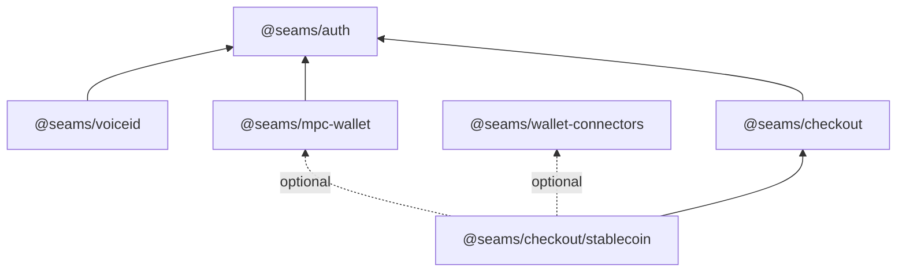

# Refactor 251: Auth, the MPC wallet, wallet connectors and checkout as separate modules

Status: 2026-11-18. Plan only. Nothing is built. [Refactor 250](refactor-250-seams-checkout.md)
(the checkout) builds on this plan. The design of
[Refactor 233](refactor-233-auth-methods-by-factor.md) (factors, gates, one app API for
methods) is the design of the new auth core.

The owner's requests (2026-11-18):

- **Separate three modules.**
  - **Web2 auth.** Auth and its methods (passkey, Email OTP, VoiceID) work alone, for a normal
    login service.
  - **The cryptographic wallets.** The MPC wallet is an optional plugin. A platform uses it
    only when it wants embedded wallets. Separate wallet connectors connect existing wallets
    (MetaMask, Rabby and others).
  - **The checkout.** A standalone library. It requires auth. The wallets are optional.
- **Write new code.** The current wallet code has much generated bloat. Re-implement the auth
  library in a new folder instead of copying files from the wallet. Write the checkout from
  scratch in its own new folder.
- **Then audit.** Check every place where auth touches the wallet, make the two compatible,
  and remove bloat and duplicate code on the way.
- **Names** (after the first choice, `stablecoin-wallet`): `@seams/mpc-wallet`,
  `@seams/mpc-wallet-server` and `@seams/wallet-connectors`. The rename moves from Refactor 250
  into this plan, so that one breaking release does the split and the rename.

## Result

- **Separate packages, one dependency direction.** The MPC wallet depends on auth. The wallet
  connectors depend on nothing. The checkout depends on auth and, optionally, on either wallet
  package. Auth depends on none of them.
- **New code for auth and checkout.** `packages/auth`, `packages/auth-server` and
  `packages/checkout` are new folders. No file is copied from `packages/wallet` or
  `packages/wallet-server`. The old code is a reference for behaviour, not a source of files.
- **An audit closes the gap.** Every touch point between auth and the wallet gets a row in one
  table: the old behaviour, the new owner, the compatibility test and the old code to delete.
  The wallet then uses the new auth core, and its old auth code goes away in the same change.
- **The bloat measures go down.** Each audit slice records a lower `pnpm report:bloat` baseline.
- **A login app loads only auth.** It starts no worker, loads no signing WASM and creates no
  custody record.
- **Auth runs in the account iframe.** The auth core is the core of the account origin. Passkey
  ceremonies, email codes and voice capture stay inside the iframe, away from the app page's
  scripts. The app page gets only results: a login session and a login token. VoiceID and the
  MPC wallet become plugins of auth inside that origin. Today the wallet is the core and
  VoiceID is its plugin.
- **The account origin is today's Wallet origin.** Its host and its passkey relying party ID do
  not change, so every existing passkey keeps working.
- **Two sessions.** A login session says who the user is. A Wallet Session gives permission to
  sign. A login session never opens a custody envelope.
- **The server has accounts.** Auth owns accounts, methods and login sessions. The wallet owns
  wallets, custody envelopes, Wallet Sessions and the signing roles. Each existing wallet gets
  an account with the same ID.
- **External wallets need neither auth nor MPC.** The MetaMask, Rabby and NEAR connectors move
  to their own package, `@seams/wallet-connectors`.
- **One breaking release** for the split, the cutover and the rename.

## Decisions

Decided by the owner on 2026-11-18:

- **D1. Separate modules:** auth, the MPC wallet, the wallet connectors and the checkout.
- **D2. The names:** `@seams/wallet` becomes `@seams/mpc-wallet`, `@seams/wallet-server`
  becomes `@seams/mpc-wallet-server`, and the external connectors become
  `@seams/wallet-connectors`. These replace the first choice, `stablecoin-wallet`.
- **D3. The MPC wallet is an optional plugin** of auth. The connectors for existing wallets are
  a separate package.
- **D4. The checkout requires auth.** Refactor 250 says how a guest still pays.
- **D12. New code, then an audit.** Auth and the checkout are written new in new folders. An
  audit then makes the wallet compatible with the new auth and removes the old auth code and
  the bloat around it.

Open, with a recommendation:

- **D5. The other package names.** Recommended: `@seams/auth` and `@seams/auth-server`, and
  `@seams/mpc-wallet-cli` for the recovery CLI. `@seams/voiceid` keeps its name. The CLI command
  name stays.
- **D6. The account origin keeps the Wallet origin's host.** Recommended: yes. A new host
  changes the relying party ID and breaks every existing passkey.
- **D7. Who checks the factor for a wallet unlock.** Recommended: the wallet server checks the
  passkey assertion, the email code proof or the device key signature itself, with the
  method's public record from auth. A login session is never enough (Fact F8).
- **D8. The login token for app backends.** Recommended: a short-lived signed JWT and a JWKS
  endpoint, so that an app backend checks it with a standard library.
  `@seams/auth-server` gives `verifyLoginToken`.
- **D9. Names in the docs.** Recommended: "Seams Auth", "Seams MPC Wallet", "Seams Wallet
  Connectors" and "Seams Checkout". "Wallet origin" becomes "account origin". "Wallet Session"
  stays.
- **D10. The public API.** Recommended: `createSeamsAuth(config)`,
  `createMpcWallet(auth, config)` and `createCheckout({ auth, ... })`. `SeamsWeb` goes
  away with no alias. The method names in this document are provisional.
- **D11. The repository name.** Recommended: it stays `seams-wallet` for now.
- **D13. The scope of the rewrite.** Recommended: the TypeScript auth layer and the checkout.
  The Rust and WASM cryptography (`crates/`, `wasm/`) and the wallet's signing engine are not
  rewritten. The audit cleans the wallet code that it touches.

## Facts this plan builds on

Checked on 2026-11-18. Paths are the paths before the rename.

- **F1.** A custody envelope is bound to one wallet, one sign-in method and one key set
  ([Spec 2](spec-2-auth-custody-and-credentials.md)).
- **F2.** The custody worker receives `factorSecret`: a passkey PRF result, the Email OTP
  factor key or the VoiceID factor key ([Browser workers](browser-workers.md)).
- **F3.** The Wallet host loads operator plugin code from fixed paths on its own origin, such
  as `/sdk/voiceid/host.js`, and checks `hostApiVersion`
  ([Refactor 232](refactor-232-wallet-plugins-by-evidence.md), F2).
- **F4.** Refactor 233 designs one factor table on the client (`webauthn`, `email_code`,
  `device_key`), gates such as `voice` and one app API for methods. It leaves the server and the
  stored records out.
- **F5.** `wallet_id` appears 1,073 times in `packages/wallet-server/migrations/d1-signer`. The
  server has no record for a user without a wallet.
- **F6.** External connectors exist in `packages/wallet/src/externalEvm` (EIP-6963 and the
  Phantom namespace) and `packages/wallet/src/externalNear` (Intear). They create no Seams
  session and no custody record ([Spec 7](spec-7-hosted-surfaces-and-provider-boundaries.md)).
- **F7.** Google external auth already gives access without custody: `external_authenticated`,
  settings only, with no signing quota (Spec 2).
- **F8.** Spec 2: an app's login cookie or provider session alone does not give Wallet signing
  permission.
- **F9.** A signed-out host starts no signer or custody worker (Browser workers, rule 5).
- **F10.** The `emailOtp` worker holds OTP-released factor secrets and Email OTP warm sessions.
  These exist only to open custody. A login needs only the server's check of the code.
- **F11.** VoiceID keeps its template and its non-extractable device keys in the Wallet
  origin's IndexedDB. The server checks the device key signature
  (`wallet-server/src/authorization/voiceIdDeviceProof.ts`).
- **F12.** Device linking copies a wallet's methods once. Methods do not sync between devices,
  by design.
- **F13.** `@seams/wallet` is named in 172 files (442 times) here and in 102 files in
  `seams-monorepo`. `@seams/wallet-server` is named in 44 files here and in 278 files there.
- **F14.** `@seams/wallet` exports `./voiceid-host`, `./external-evm`, `./external-near`,
  `./react/external-evm` and `./react/external-near` today.
- **F15.** `packages/wallet/src` and `packages/wallet-server/src` hold 486,073 lines of
  TypeScript outside tests. The repository has 59 files over 2,000 lines. Files on the line
  between auth and the wallet are among the largest:

  | File | Lines |
  | --- | ---: |
  | `wallet/src/core/indexedDB/seamsWalletDB/repositories.ts` | 8,322 |
  | `wallet-server/src/router/cloudflare/d1/registration/d1WalletRegistrationService.ts` | 6,365 |
  | `wallet/src/SeamsWeb/operations/registration/registration.ts` | 6,158 |
  | `wallet/src/SeamsWeb/walletIframe/client/router.ts` | 5,036 |
  | `wallet/src/core/rpcClients/relayer/walletRegistration.ts` | 4,781 |
  | `wallet/src/SeamsWeb/walletIframe/host/auth-menu/session.ts` | 4,084 |
  | `wallet-server/src/router/cloudflare/d1/wallet/d1WalletAuthMethodService.ts` | 3,288 |
  | `wallet-server/src/router/cloudflare/d1/auth/d1RouterApiAuthService.ts` | 2,273 |
  | `wallet/src/SeamsWeb/walletIframe/host/ui/auth-menu/AuthMenuSurface.tsx` | 2,020 |

- **F16.** The auth menu has integrator contracts: its corner radius and its copy. Raw errors
  go to the host event as `detail`.

## Unknowns to check first

- **U1.** Can the release workflow publish a new npm package name with trusted publishing, or
  does each new name need one first publish with a token?
- **U2.** Which IndexedDB stores, D1 tables, routes and server secrets belong to auth, and which
  to the wallet? Slice 0 makes this list.
- **U3.** Which `seams-monorepo` routes extend wallet-server routes that move to the Auth
  Worker?

## 1. Modules

| Module | Package | Folder | Runs in | Holds | Depends on |
| --- | --- | --- | --- | --- | --- |
| Auth, browser | `@seams/auth` | `packages/auth` (new) | App page (SDK), account origin (iframe) | Login session, method records on this device | Nothing from Seams |
| Auth, server | `@seams/auth-server` | `packages/auth-server` (new) | Auth Worker | Accounts, methods, login sessions, email provider keys, login token key | Nothing from Seams |
| VoiceID | `@seams/voiceid` | `packages/voiceid` | Account origin | Voice template, device keys | `@seams/auth` |
| MPC wallet | `@seams/mpc-wallet` | `packages/mpc-wallet` (renamed) | App page (SDK), account origin (plugin and workers) | Custody material, Wallet Sessions | `@seams/auth` (peer) |
| Wallet connectors | `@seams/wallet-connectors` | `packages/wallet-connectors` (moved) | App page | Nothing | Nothing from Seams |
| MPC wallet server | `@seams/mpc-wallet-server` | `packages/mpc-wallet-server` (renamed) | Wallet Gateway, router roles | Wallets, envelopes, signing roles | Account IDs from auth |
| Checkout | `@seams/checkout` | `packages/checkout` (new) | See Refactor 250 | Provider keys, orders | `@seams/auth` (peer), the wallet packages (optional peers) |
| Shared code | `@seams-internal/shared-ts` | `packages/shared-ts` | Bundled into each package | Nothing | Nothing |



- Auth imports nothing from the wallet or the checkout.
- The MPC wallet imports nothing from the checkout. `@seams/wallet-connectors` imports nothing
  from auth or from the MPC wallet.
- Each link to another package is a peer dependency, as `@seams/voiceid` uses today.

## 2. How the new code is written

- **New folders, no copied files.** `packages/auth`, `packages/auth-server` and
  `packages/checkout` start empty. An agent can read the old code to learn a behaviour, but
  does not copy a file or a block from it.
- **The specs are the source.** The new code follows the specs, the design of Refactor 233,
  the intended behaviours and the audit table (Section 6), not the structure of the old code.
- **Compatible with data and wire formats, not with old internals.** The new auth keeps:
  - the relying party ID and the passkey credential records (D6)
  - the stored method records in IndexedDB and D1, or a migration that converts them
  - the cryptographic formats: the envelope binding (wallet, method, key set) and the VoiceID
    device proof message `seams:wallet-session:voiceid-device:v1`
  - the server routes that `seams-monorepo` uses, or a coordinated change in the breaking
    release
  - the auth menu's integrator contracts (Fact F16)
- **Lean from the first commit.** No file over 2,000 lines. The validation helpers of
  `packages/shared-ts/src/utils/validation.ts`. `Variant` for union members. No unused export.
  No refactor or phase number in a comment. `pnpm report:bloat --check` passes on every commit.
- **The old tests are the bar.** Before the cutover, the new auth passes the intended behaviours
  for registration, sign-in, unlock, step-up, device linking and recovery that exist today.
- **Small slices.** Each slice is a reviewable change with its own tests.

## 3. Auth alone

A login app installs only `@seams/auth`:

```ts
import { createSeamsAuth, passkey, emailCode } from '@seams/auth';

const auth = createSeamsAuth({ accountOrigin, publishableKey, methods: [passkey(), emailCode()] });
const session = await auth.signIn(); // opens the auth menu in the account iframe
await fetch('/api/me', { headers: { authorization: `Bearer ${session.token}` } });
```

```ts
import { verifyLoginToken } from '@seams/auth-server';

const user = await verifyLoginToken(token, { projectId });
// user.accountId, user.methods, user.email when the user gave one
```

- **Passkey.** A normal WebAuthn assertion. The core asks for the PRF extension only when the
  wallet plugin asks for a wallet ceremony.
- **Email OTP.** The server checks the code. No factor key is released and no worker starts.
- **VoiceID.** The `voice` gate passes, and the device key signs the challenge (Fact F11).
- **Methods.** `auth.methods.list`, `add` and `remove`, from the app API of Refactor 233.
- **Recovery.** A user who loses every method recovers the login by email. This does not
  recover a wallet (Section 5).
- **Google.** Google external auth moves to auth. It gives a login session, as
  `external_authenticated` gives settings access today (Fact F7).
- **The stage dialog.** The new auth core needs a dialog that moves between stages (the auth
  menu, a plugin's screen, an app's card). It is written new in `@seams-internal/shared-ts`.
  The checkout uses the same dialog. The wallet's old overlay (`overlay-controller.ts`, 1,125
  lines) goes away in the audit.

## 4. The MPC wallet as a plugin of auth

- **Loading.** The account origin loads the wallet from a fixed path,
  `/sdk/mpc-wallet/host.js`, only when the app enables the wallet. This keeps the rule
  of Refactor 232: code in the account origin comes only from the operator (Fact F3).
- **Workers.** The wallet plugin owns every worker and WASM module of
  [Browser workers](browser-workers.md). They move as one group, and the separation between
  them does not change. The auth core starts no worker (Fact F9). The worker document gets a
  section for this in the same change.
- **Factor release.** When the wallet creates or unlocks, the auth core runs the method's
  ceremony for the purpose `wallet`. For a passkey, it adds the PRF extension. The core sends
  the factor secret to the custody worker through a transferred `MessagePort`. The plugin's UI
  code never receives it. This is the same path as today, with a new owner at each end.
- **Creating a wallet for an account.** `wallet.create()` makes the custody seed and one
  envelope for each method that can carry one: a passkey with PRF, Email OTP and VoiceID.
- **External wallets.** `@seams/wallet-connectors` keeps the EIP-6963 connector
  (MetaMask, Rabby, and others that announce themselves), the Phantom namespace and the NEAR
  connector (Fact F6). It needs no account.

```ts
import { createMpcWallet } from '@seams/mpc-wallet';
import { connectExternalEvm } from '@seams/wallet-connectors';

const wallet = createMpcWallet(auth, { chains: ['ethereum', 'near'] });
await wallet.create();                       // embedded MPC wallet for the signed-in account
const external = await connectExternalEvm(); // or the customer's own wallet
```

## 5. The server split

- **Auth Worker.** Accounts, methods, login sessions, Email OTP delivery, Google SSO, the login
  token key and the JWKS endpoint. New code in `packages/auth-server`.
- **Wallet Gateway.** Wallets with their `account_id`, custody envelopes, Wallet Sessions and
  the service bindings to the router roles. The envelope binding (wallet, method, key set) does
  not change (Fact F1).
- **Wallet unlock (D7).** The wallet server checks the factor itself with the method's public
  record. It reads that record from the Auth Worker through a service binding. It refuses a
  login session or a login token as proof.
- **Migration.** One additive migration, staging first:
  1. Create an account for each wallet, with `account_id` equal to `wallet_id`.
  2. Copy each method record into the auth tables with the same method ID.
  3. Add `account_id` to the wallet records.
  4. Keep every envelope and its binding unchanged.
  5. Compare counts: every wallet has one account, and every method has one auth record.
- **Recovery.** Auth recovers a login by email. The wallet recovers a seed only with the
  recovery codes or a remaining method. The UI says that a recovered login has no wallet access
  until the wallet is recovered.

## 6. The audit of auth and the wallet

The audit finds every place where the old wallet code does auth work or depends on it. Slice 0
writes the table. The audit slices close each row.

Each row records:

| Column | Content |
| --- | --- |
| Touch point | One behaviour, for example "passkey unlock releases the PRF result to the custody worker" |
| Old code | The files and functions that do it today |
| Old test | The intended behaviour or test that covers it, or "none" |
| New owner | Auth, the wallet plugin, or the boundary between them (the factor release port) |
| Compatibility check | The test that proves the new auth and the wallet agree |
| Old code to delete | The files or functions that go away when the row closes |
| Bloat found | Duplicates, local helper copies, dead exports or long files in the same area |

The areas to search:

1. **Ceremonies.** Passkey registration and assertion, the PRF extension, the relying party ID,
   credential IDs and user handles.
2. **Factor secrets.** The passkey PRF result, the Email OTP factor key (with the Shamir worker)
   and the VoiceID factor key, and each path into the custody worker.
3. **Stored records.** IndexedDB stores (methods on this device, the VoiceID template and keys,
   custody caches), D1 method tables, and the envelope binding to method IDs.
4. **Sessions.** Wallet Session issuance after auth, warm sessions (`passkey-mpc-session`, the
   Email OTP warm sessions) and step-up.
5. **Account changes.** Device linking, recovery codes, adding and removing methods, and adding
   a first passkey while VoiceID is selected.
6. **Wire.** The iframe protocol messages for auth, the server routes for registration and
   unlock, the Google exchange and the application auth assertion.
7. **UI.** The auth menu, the wallet steps (Back and Close), the confirmation surfaces and the
   integrator contracts (Fact F16).
8. **Errors.** Error codes, the host event `detail` and the messages in English and Japanese.

Rules for the cleanup:

- A row closes only when its compatibility check passes and its old code is deleted in the same
  change. No shim, flag or second path stays.
- Bloat in the same area is fixed in the same change: merge duplicates, use the shared
  validation helpers, delete unused exports, and split a file that the change makes larger than
  2,000 lines along a real seam.
- Each audit slice runs `pnpm report:bloat --check` and records the lower measures with
  `pnpm report:bloat --write-baseline`. No measure grows.
- A problem that is outside the audit or too large goes into a new plan.

## 7. Slices

- **Slice 0: decisions and inventory.** Get D5 to D13. Answer U1 to U3. Write the audit table of
  Section 6 from the old code and its tests. No product code.
- **Slice 1: the stage dialog.** New code in `@seams-internal/shared-ts` (Section 3). The
  checkout of Refactor 250 can use it from here.
- **Slice 2: the auth server.** New `packages/auth-server`: accounts, methods, login sessions,
  Email OTP delivery, the login token and JWKS (D8). The additive migration of Section 5. The
  Auth Worker deploys beside the Gateway. The Gateway still serves the old routes.
- **Slice 3: the auth browser core.** New `packages/auth`: the account origin document, the auth
  menu, passkey, Email OTP, the VoiceID plugin interface and the login session. A login-only
  example app signs in with a passkey, Email OTP and VoiceID and loads no wallet code.
- **Slice 4: the audit and the cutover.** Close the rows of the audit table: the wallet becomes
  a plugin of the new auth core, the wallet server checks factors itself (D7), the factor
  release port replaces the old path, and the old auth code in the wallet and the Gateway goes
  away. Update [Browser workers](browser-workers.md). This slice can be several changes, one
  area of Section 6 each. The old and the new auth never both serve one flow.
- **Slice 5: the wallet connectors.** Move `externalEvm` and `externalNear` to
  `packages/wallet-connectors` (`@seams/wallet-connectors`), with no import of auth or MPC code.
  Clean them by the rules of Section 6.
- **Slice 6: the breaking release.**
  - New package names (D2, D5) and the new API (D10), with no aliases.
  - Every import, script, test, example and public doc page here (Fact F13).
  - `seams-monorepo` in one coordinated commit that names the seams-wallet commit.
  - npm deprecation messages on the old names that name the new packages.
  - A new major version of the iframe protocol.
  - History stays: earlier release notes, `docs/evidence` and `docs/archive` keep the old
    names.

Slices 1 to 3 add new code and change no released behaviour. Slices 4, 5 and 6 ship together
in one breaking release. The checkout of Refactor 250 starts after Slice 1.

## 8. Invariants

- The account origin has today's Wallet origin host and passkey relying party ID.
- Passkey ceremonies, email code entry and voice capture happen only in the account iframe. The
  app page receives only SDK results.
- A factor secret never leaves the account origin. It goes only to the wallet plugin's custody
  worker.
- A login session or login token never opens a custody envelope and never gives a signing
  quota.
- The auth core starts no worker and loads no signing WASM.
- The Auth Worker holds no custody material and no signing share. The wallet servers hold no
  email provider key and no login token key.
- `@seams/wallet-connectors` creates no Seams session and no custody record.
- A recovered login never recovers a wallet seed.
- Auth imports nothing from the wallet or the checkout. The wallet imports nothing from the
  checkout.
- No file in `packages/auth`, `packages/auth-server` or `packages/checkout` is a copy of a file
  in the wallet packages.

## 9. Tests

- A login-only app loads no wallet code and starts no worker (a bundle check and a browser
  check).
- A login session and a login token are refused for a wallet unlock and for signing.
- Existing passkeys, Email OTP methods and VoiceID methods unlock existing wallets after the
  migration (staging, with real records).
- The migration counts of Section 5 match.
- A login recovered by email shows no wallet access until wallet recovery.
- Every row of the audit table has a passing compatibility check.
- A packed-package test checks the import rules of Section 1.
  `tests/scripts/check-packed-wallet-boundaries.mjs` is the model.
- A rename test fails if an old package name appears outside the history files.
- The intended behaviours for registration, unlock, signing, device linking and recovery pass
  with the new API.
- `pnpm report:bloat --check` passes, and the recorded baseline after Slice 4 is lower than
  before it.

## 10. Not in this plan

- **Rewriting the cryptography or the signing engine.** The Rust crates, the WASM modules and
  the wallet's signing flows stay (D13). The audit cleans only the wallet code that it touches.
- **Seams as an OpenID Provider for other sites.** The JWT and JWKS of D8 are a first step.
- **Syncing methods between devices.** There is no sync, by design (Fact F12).
- **Other SSO providers.**
- **The checkout.** See [Refactor 250](refactor-250-seams-checkout.md).

## Documents to update when the slices land

- [Spec 1](spec-1-runtime-and-platform-boundaries.md), [Spec 2](spec-2-auth-custody-and-credentials.md),
  [Spec 3](spec-3-wallet-sessions-and-execution-lanes.md) and
  [Spec 7](spec-7-hosted-surfaces-and-provider-boundaries.md): the modules, the two sessions,
  the account origin and the plugins.
- [Browser workers](browser-workers.md): the auth core starts no worker, and the wallet plugin
  owns the workers.
- [Refactor 233](refactor-233-auth-methods-by-factor.md): its Sections 3 to 5 become the design
  of the new auth core.
- [Intended Behaviours](intended-behaviours.md), the README, the doc index and the public docs
  in `apps/docs`, with the new package names and API.
