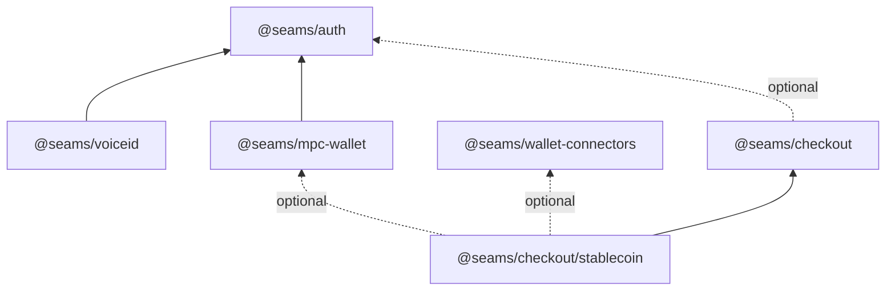

# Refactor 251: Auth, the MPC wallet, wallet connectors and checkout as separate modules

Status: 2026-11-18. Plan only. Nothing is built. Revised on 2026-11-18 after a review of the
architecture. [Refactor 250](refactor-250-seams-checkout.md) (the checkout) builds on this
plan. The design of [Refactor 233](refactor-233-auth-methods-by-factor.md) (factors, gates, one
app API for methods) is the design of the new auth core.

The owner's requests (2026-11-18):

- **Separate three modules.**
  - **Web2 auth.** Auth and its methods (passkey, Email OTP, VoiceID) work alone, for a normal
    login service.
  - **The cryptographic wallets.** The MPC wallet is an optional plugin. A platform uses it
    only when it wants embedded wallets. Separate wallet connectors connect existing wallets
    (MetaMask, Rabby and others).
  - **The checkout.** A standalone library. The wallets are optional.
- **Write new code.** The current wallet code has much generated bloat. Re-implement the auth
  library in a new folder instead of copying files from the wallet. Write the checkout from
  scratch in its own new folder.
- **Then audit.** Check every place where auth touches the wallet, make the two compatible,
  and remove bloat and duplicate code on the way.
- **Names** (after the first choice, `stablecoin-wallet`): `@seams/mpc-wallet`,
  `@seams/mpc-wallet-server` and `@seams/wallet-connectors`.
- **Review changes.** The owner accepted these changes after the review:
  - one proof operation in auth, in place of a special wallet purpose (D14)
  - the wallet pins the public key of each factor (D7)
  - the wallet's account layer is also written new, because the largest files are there (D13)
  - two breaking releases in place of one (D15), and one version for every package (D16)
  - a conformance suite before the new code (Section 2)
  - owners for the frame code, the shared contracts and the project credentials (D17 to D19)

## Result

- **Separate packages, one dependency direction.** The MPC wallet depends on auth. The wallet
  connectors depend on nothing. The checkout depends on nothing from Seams, and can use auth
  and either wallet package. Auth depends on none of them.
- **New code for auth, the checkout and the wallet's account layer.** `packages/auth`,
  `packages/auth-server` and `packages/checkout` are new folders. The wallet's code that
  creates a wallet, adds a method to it and unlocks it is also written new. No file is copied
  from the old code. The old code is a reference for behaviour, not a source of files.
- **One proof operation.** Auth gives one call, `prove`, that proves a method to one audience.
  A login, a wallet unlock and a one-tap payment are the same call with a different audience.
  Auth has no code for the wallet.
- **An audit closes the gap.** Every touch point between auth and the wallet gets a row in one
  table: the old behaviour, the new owner, the compatibility test, the line budget and the old
  code to delete.
- **The bloat measures go down.** Each area has a line budget from Slice 0. Each audit change
  records a lower `pnpm report:bloat` baseline.
- **A login app loads only auth.** It starts no worker, loads no signing WASM and creates no
  custody record.
- **Auth runs in the account iframe.** The auth core is the core of the account origin. Passkey
  ceremonies, email codes and voice capture stay inside the iframe, away from the app page's
  scripts. The app page gets only results. VoiceID and the MPC wallet become plugins of auth
  inside that origin. Today the wallet is the core and VoiceID is its plugin.
- **The account origin is today's Wallet origin.** Its host and its passkey relying party ID do
  not change, so every existing passkey keeps working.
- **Two sessions.** A login session says who the user is. A Wallet Session gives permission to
  sign. A login session never opens a custody envelope.
- **The wallet trusts its own records at unlock.** The wallet server pins the public key of
  each factor when it stores an envelope. It does not read auth at unlock.
- **The server has accounts.** Auth owns accounts, methods and login sessions. The wallet owns
  wallets, custody envelopes, Wallet Sessions and the signing roles. Each existing wallet gets
  an account with the same ID.
- **External wallets need neither auth nor MPC.** The MetaMask, Rabby and NEAR connectors move
  to their own package, `@seams/wallet-connectors`.
- **Two breaking releases.** Release A is the rename and the connectors package. It changes no
  behaviour. Release B is the cutover to the new auth and the new API.

## Decisions

Decided by the owner on 2026-11-18:

- **D1. Separate modules:** auth, the MPC wallet, the wallet connectors and the checkout.
- **D2. The names:** `@seams/wallet` becomes `@seams/mpc-wallet`, `@seams/wallet-server`
  becomes `@seams/mpc-wallet-server`, and the external connectors become
  `@seams/wallet-connectors`. These replace the first choice, `stablecoin-wallet`.
- **D3. The MPC wallet is an optional plugin** of auth. The connectors for existing wallets are
  a separate package.
- **D4. The checkout uses auth as an optional peer.** The first choice was a required
  dependency. The review changed it, because a guest checkout calls no auth code.
  Refactor 250 (its D4) has the interface.
- **D7. The wallet server checks the factor itself, against a pinned key.** It stores the
  public key of the factor with each envelope. At unlock it checks the proof against that key.
  It does not read the Auth Worker. A login session is never enough (Fact F8).
- **D12. New code, then an audit.** Auth and the checkout are written new in new folders. An
  audit then makes the wallet compatible with the new auth and removes the old auth code and
  the bloat around it.
- **D13. The scope of the rewrite.** Three areas of TypeScript are written new: the auth layer,
  the checkout, and the wallet's account layer (Section 5). The Rust and WASM cryptography
  (`crates/`, `wasm/`), the workers and the signing engine are not rewritten. The audit cleans
  the wallet code that it touches.
- **D14. One proof operation.** `auth.prove({ audience, challenge })` replaces a ceremony "for
  the purpose `wallet`" (Section 4).
- **D15. Two breaking releases.** Release A: the rename and the connectors package, with no
  change in behaviour. Release B: the cutover and the new API. One release for everything was
  the first choice.
- **D16. One version.** Every published package and both hosted origins have the same version
  number and release together.
- **D17. A frame kit.** The stage dialog, the frame transport and the message checks live in
  one internal package, `@seams-internal/frame-kit`, not in the shared helpers.
- **D18. The shared helpers hold no contract.** `@seams-internal/shared-ts` keeps only pure
  helpers. Each auth or wallet contract in it moves to the package that owns it (Fact F17).

Open, with a recommendation:

- **D5. The other package names.** Recommended: `@seams/auth` and `@seams/auth-server`, and
  `@seams/mpc-wallet-cli` for the recovery CLI. `@seams/voiceid` keeps its name. The CLI command
  name stays.
- **D6. The account origin keeps the Wallet origin's host.** Recommended: yes. A new host
  changes the relying party ID and breaks every existing passkey.
- **D8. The login token for app backends.** Recommended: a short-lived signed JWT and a JWKS
  endpoint, so that an app backend checks it with a standard library.
  `@seams/auth-server` gives `verifyLoginToken`.
- **D9. Names in the docs.** Recommended: "Seams Auth", "Seams MPC Wallet", "Seams Wallet
  Connectors" and "Seams Checkout". "Wallet origin" becomes "account origin". "Wallet Session"
  stays.
- **D10. The public API.** Recommended: `createSeamsAuth(config)`,
  `createMpcWallet({ auth, ... })` and `createCheckout({ identity: auth, ... })`. Each
  constructor takes one object. `SeamsWeb` goes away in Release B with no alias. The method
  names in this document are provisional.
- **D11. The repository name.** Recommended: it stays `seams-wallet` for now.
- **D19. The owner of the project credentials.** Recommended: one internal package,
  `@seams-internal/project-credentials`, holds the checks of publishable keys, secret keys,
  allowed origins and environments. The Auth Worker, the Wallet Gateway and the checkout Worker
  bundle it. The store of the keys stays with the operator, behind the ports that exist today
  (Fact F18).
- **D20. A file limit for the new code.** Recommended: 1,000 lines for each file in the new
  folders. The repository limit stays 2,000 lines.

## Facts this plan builds on

Checked on 2026-11-18. Paths are the paths before the rename.

- **F1.** A custody envelope is bound to one wallet, one sign-in method and one key set
  ([Spec 2](spec-2-auth-custody-and-credentials.md)).
- **F2.** The custody worker receives `factorSecret`: a passkey PRF result, the Email OTP
  factor key or the VoiceID factor key ([Browser workers](browser-workers.md)).
- **F3.** The Wallet host loads operator plugin code from fixed paths on its own origin, such
  as `/sdk/voiceid/host.js`, and checks `hostApiVersion`
  ([Refactor 232](refactor-232-wallet-plugins-by-evidence.md), F2).
- **F4.** Refactor 233 designs one factor table on the client (`webauthn`, `email_code`,
  `device_key`), gates such as `voice` and one app API for methods. It leaves the server and the
  stored records out.
- **F5.** `wallet_id` appears 1,073 times in `packages/wallet-server/migrations/d1-signer`. The
  server has no record for a user without a wallet.
- **F6.** External connectors exist in `packages/wallet/src/externalEvm` (EIP-6963 and the
  Phantom namespace) and `packages/wallet/src/externalNear` (Intear). They create no Seams
  session and no custody record ([Spec 7](spec-7-hosted-surfaces-and-provider-boundaries.md)).
- **F7.** Google external auth already gives access without custody: `external_authenticated`,
  settings only, with no signing quota (Spec 2).
- **F8.** Spec 2: an app's login cookie or provider session alone does not give Wallet signing
  permission.
- **F9.** A signed-out host starts no signer or custody worker (Browser workers, rule 5).
- **F10.** The `emailOtp` worker holds OTP-released factor secrets and Email OTP warm sessions.
  These exist only to open custody. A login needs only the server's check of the code.
- **F11.** VoiceID keeps its template and its non-extractable device keys in the Wallet
  origin's IndexedDB. The server checks the device key signature
  (`wallet-server/src/authorization/voiceIdDeviceProof.ts`).
- **F12.** Device linking copies a wallet's methods once. Methods do not sync between devices,
  by design.
- **F13.** `@seams/wallet` is named in 172 files (442 times) here and in 102 files in
  `seams-monorepo`. `@seams/wallet-server` is named in 44 files here and in 278 files there.
- **F14.** `@seams/wallet` exports `./voiceid-host`, `./external-evm`, `./external-near`,
  `./react/external-evm` and `./react/external-near` today.
- **F15.** `packages/wallet/src` and `packages/wallet-server/src` hold 486,073 lines of
  TypeScript outside tests. The repository has 59 files over 2,000 lines. Files on the line
  between auth and the wallet are among the largest:

  | File | Lines |
  | --- | ---: |
  | `wallet/src/core/indexedDB/seamsWalletDB/repositories.ts` | 8,322 |
  | `wallet-server/src/router/cloudflare/d1/registration/d1WalletRegistrationService.ts` | 6,365 |
  | `wallet/src/SeamsWeb/operations/registration/registration.ts` | 6,158 |
  | `wallet/src/SeamsWeb/walletIframe/client/router.ts` | 5,036 |
  | `wallet/src/core/rpcClients/relayer/walletRegistration.ts` | 4,781 |
  | `wallet/src/SeamsWeb/walletIframe/host/auth-menu/session.ts` | 4,084 |
  | `wallet-server/src/router/cloudflare/d1/wallet/d1WalletAuthMethodService.ts` | 3,288 |
  | `wallet-server/src/router/cloudflare/d1/auth/d1RouterApiAuthService.ts` | 2,273 |
  | `wallet/src/SeamsWeb/walletIframe/host/ui/auth-menu/AuthMenuSurface.tsx` | 2,020 |

- **F16.** The auth menu has integrator contracts: its corner radius and its copy. Raw errors
  go to the host event as `detail`.
- **F17.** `packages/shared-ts/src` is not only helpers. It has about 37,000 lines, and much of
  it is auth and wallet contracts:

  | Folder | Lines |
  | --- | ---: |
  | `utils` (with the registration and wallet auth method contracts) | 17,833 |
  | `device-linking` | 7,655 |
  | `authorization` | 2,926 |
  | `passkey-custody` | 2,414 |
  | `wallet-recovery` | 2,230 |

- **F18.** The checks of API keys and publishable keys are in
  `wallet-server/src/router/auth/routerApiCredentialAuth.ts` (175 lines) and
  `wallet-server/src/router/framework/apiCredentialPorts.ts` (143 lines). They call the
  operator's store through ports. A publishable key is checked against an origin and an
  environment.
- **F19.** The largest files of Fact F15 create wallets. They are not login code.
  `registration.ts` holds `registerWallet`, `addSigner` and the hosted passkey registration.
- **F20.** Email OTP challenges already carry an operation, such as `wallet_unlock`,
  `transaction_sign` or `export_key`. The server owns the challenge check and the
  recovery-wrapped escrow records. The sealed secret stays in the iframe's IndexedDB
  ([Email OTP](otp/email-otp.md)).
- **F21.** 68 test files name the `SeamsWeb` API, which goes away in Release B.

## Unknowns to check first

- **U1.** Can the release workflow publish a new npm package name with trusted publishing, or
  does each new name need one first publish with a token? Release A answers this.
- **U2.** Which IndexedDB stores, D1 tables, routes and server secrets belong to auth, and which
  to the wallet? Slice 0 makes this list.
- **U3.** Which `seams-monorepo` routes extend wallet-server routes that move to the Auth
  Worker?
- **U4.** What can a compromised Auth Worker do to an Email OTP wallet? The answer depends on
  what the wallet server releases after the email code check (Fact F20, Section 6).
- **U5.** How many lines does each audit area have today? Slice 0 measures them, and the line
  budgets come from these numbers.

## 1. Modules

| Module | Package | Folder | Runs in | Holds | Depends on |
| --- | --- | --- | --- | --- | --- |
| Auth, browser | `@seams/auth` | `packages/auth` (new) | App page (SDK), account origin (iframe) | Login session, method records on this device | Nothing from Seams |
| Auth, server | `@seams/auth-server` | `packages/auth-server` (new) | Auth Worker | Accounts, methods, login sessions, email provider keys, the login token key | Nothing from Seams |
| VoiceID | `@seams/voiceid` | `packages/voiceid` | Account origin | Voice template, device keys | `@seams/auth` |
| MPC wallet | `@seams/mpc-wallet` | `packages/mpc-wallet` (renamed) | App page (SDK), account origin (plugin and workers) | Custody material, Wallet Sessions | `@seams/auth` (peer) |
| Wallet connectors | `@seams/wallet-connectors` | `packages/wallet-connectors` (moved) | App page | Nothing | Nothing from Seams |
| MPC wallet server | `@seams/mpc-wallet-server` | `packages/mpc-wallet-server` (renamed) | Wallet Gateway, router roles | Wallets, envelopes with pinned factor keys, signing roles | `@seams/auth-server` (the proof checks only) |
| Checkout | `@seams/checkout`, `@seams/checkout-server` | `packages/checkout`, `packages/checkout-server` (new) | See Refactor 250 | Provider keys, orders | Nothing from Seams. Auth and the wallet packages are optional peers |
| Frame kit | `@seams-internal/frame-kit` | `packages/frame-kit` (new) | Bundled into each browser package | Nothing | Nothing |
| Project credentials | `@seams-internal/project-credentials` | `packages/project-credentials` (new, D19) | Bundled into each Worker | Nothing. The operator owns the store | Nothing |
| Shared helpers | `@seams-internal/shared-ts` | `packages/shared-ts` | Bundled into each package | Nothing | Nothing |



- Auth imports nothing from the wallet or the checkout.
- The MPC wallet imports nothing from the checkout. `@seams/wallet-connectors` imports nothing
  from auth or from the MPC wallet.
- Each link to another package is a peer dependency, as `@seams/voiceid` uses today.
- The servers follow the same direction. The wallet server imports only the pure proof checks
  of `@seams/auth-server`.
- **The internal packages.** Each published package bundles the internal code that it uses.
  The frame kit defines a small `StageHost` interface with a version. A package accepts each
  object that satisfies it, so two packages on one page share one dialog without a shared
  runtime package.
- **One version (D16).** A page SDK refuses a hosted origin of a different major version, with
  a clear error.

## 2. How the new code is written

- **New folders, no copied files.** `packages/auth`, `packages/auth-server`,
  `packages/checkout`, `packages/checkout-server`, `packages/frame-kit` and the wallet's new
  account layer start empty. An agent can read the old code to learn a behaviour, but does not
  copy a file or a block from it.
- **One exception: a reviewed move.** A small file of security checks can move, in place of a
  rewrite, when each of these is true:
  - it checks a proof or parses a credential (the WebAuthn assertion check, the COSE key
    parser, the VoiceID device proof check)
  - it has its own tests
  - it imports only pure helpers
  - the audit table records the move

  The file moves once. The old code imports it from its new place until the cutover, so
  there is one copy at all times.
- **The specs are the source.** The new code follows the specs, the design of Refactor 233,
  the intended behaviours and the audit table (Section 7), not the structure of the old code.
- **Compatible with data and wire formats, not with old internals.** The new code keeps:
  - the relying party ID and the passkey credential records (D6)
  - the stored method records in IndexedDB and D1, or a migration that converts them
  - the cryptographic formats: the envelope binding (wallet, method, key set) and the VoiceID
    device proof message `seams:wallet-session:voiceid-device:v1`
  - the server routes that `seams-monorepo` uses, or a coordinated change in Release B
  - the auth menu's integrator contracts (Fact F16)
- **A conformance suite comes first.** The old tests call `SeamsWeb` (Fact F21), so they cannot
  test the new code. Slice 2 writes a suite at the boundaries that stay:
  - **Journeys.** Registration, sign-in, unlock, step-up, signing, adding and removing a
    method, device linking and recovery, each written as steps against a small driver
    interface. One driver calls the old API. One driver calls the new API.
  - **Stored records.** Fixtures of IndexedDB stores and D1 rows, made by the old code and
    from staging records. The new code must read each fixture.
  - **Routes.** The request and the response of each route that `seams-monorepo` uses.

  The suite must pass against the old code first. This proves the suite. The old driver goes
  away at the cutover.
- **Line budgets.** Slice 0 measures the lines of each audit area (Unknown U5). The new code
  for an area has fewer lines than the old code that it replaces. The audit table records both
  numbers. No file in the new folders is over 1,000 lines (D20).
- **Lean from the first commit.** The validation helpers of
  `packages/shared-ts/src/utils/validation.ts`. `Variant` for union members. No unused export.
  No refactor or phase number in a comment. `pnpm report:bloat --check` passes on every commit.
- **Small slices.** Each slice is a reviewable change with its own tests.

## 3. Auth alone

A login app installs only `@seams/auth`:

```ts
import { createSeamsAuth, passkey, emailCode } from '@seams/auth';

const auth = createSeamsAuth({ accountOrigin, publishableKey, methods: [passkey(), emailCode()] });
const session = await auth.signIn(); // opens the auth menu in the account iframe
await fetch('/api/me', { headers: { authorization: `Bearer ${session.token}` } });
```

```ts
import { verifyLoginToken } from '@seams/auth-server';

const user = await verifyLoginToken(token, { projectId });
// user.accountId, user.methods, user.email when the user gave one
```

- **Passkey.** A normal WebAuthn assertion. The core asks for the PRF extension only when a
  plugin in the account origin gives a secret sink (Section 4).
- **Email OTP.** The server checks the code. No factor key is released and no worker starts.
- **VoiceID.** The `voice` gate passes, and the device key signs the challenge (Fact F11).
- **Methods.** `auth.methods.list`, `add` and `remove`, from the app API of Refactor 233.
- **Recovery.** A user who loses every method recovers the login by email. This does not
  recover a wallet (Section 6).
- **Google.** Google external auth moves to auth. It gives a login session, as
  `external_authenticated` gives settings access today (Fact F7).
- **The stage dialog.** The auth core needs a dialog that moves between stages (the auth menu,
  a plugin's screen, an app's card). It is written new in the frame kit (D17). The checkout
  uses the same dialog. The wallet's old overlay (`overlay-controller.ts`, 1,125 lines) goes
  away in the audit.

## 4. One proof operation

Auth has one operation under every method: it proves a method to one audience.

```ts
const proof = await auth.prove({
  audience: 'wallet', // the server that checks this proof
  challenge,          // issued by that server
  secretSink: port,   // optional, and only inside the account origin
});
```

- **An audience is a name with one verifier.** The auth core has `login`. A plugin or a
  package registers its own: `wallet` for the MPC wallet, `checkout` for the checkout. To auth
  the name is only text.
- **The audience's server issues the challenge and checks the proof.**
  `@seams/auth-server` exports the checks as pure functions. The Auth Worker, the wallet server
  and the checkout server use the same functions.
- **`signIn` is `prove` for the audience `login`,** and then the Auth Worker makes the login
  session.
- **A proof for one audience is refused by every other server.** The audience name is in the
  bytes that the factor signs.

| Factor | The proof | What a server needs to check it |
| --- | --- | --- |
| `webauthn` (passkey) | An assertion. The server derives the WebAuthn challenge from its nonce and the audience name | The credential's public key |
| `device_key` (VoiceID, after the `voice` gate) | A signature over a message that names the audience and the challenge. For `wallet`, the message stays `seams:wallet-session:voiceid-device:v1` | The device's public key |
| `email_code` | A statement signed by the Auth Worker: account, method, audience, challenge and expiry. The email text names the purpose | The Auth Worker's JWKS |

- **Who can ask.** Each audience says who can ask for it: the app page, or one plugin in the
  account origin. Only the wallet plugin can ask for `wallet`. The app page can ask for
  `login` and `checkout`.
- **The user sees the purpose.** The auth menu shows the purpose text of the audience. The text
  comes from the operator's code, not from the app page.
- **The secret sink.** A plugin in the account origin can pass a `MessagePort` to one of its
  own workers. For a passkey, the core then adds the PRF extension and sends the result into
  the port. The core sends the Email OTP factor key and the VoiceID factor key the same way.
  The app page cannot pass a sink.
- **Operations stay with the audience.** An Email OTP operation such as `transaction_sign`
  (Fact F20) is part of the wallet server's challenge. Auth does not read it.

## 5. The MPC wallet as a plugin of auth

- **One plugin contract, two halves.** VoiceID and the MPC wallet use the same contract:
  - **The host half.** The account origin loads the plugin from a fixed path, such as
    `/sdk/mpc-wallet/host.js`, only when the app enables it. The plugin registers its ID, its
    audiences, its stages and its checks before a method is removed. This keeps the rule of
    Refactor 232: code in the account origin comes only from the operator (Fact F3).
  - **The page half.** `auth.channel(pluginId)` gives a message channel to that plugin only.
    The plugin's SDK uses it: `createMpcWallet({ auth, ... })`. The auth core checks the origin
    and the request, and routes the message. It does not read the body.
- **Workers.** The wallet plugin owns every worker and WASM module of
  [Browser workers](browser-workers.md). They move as one group, and the separation between
  them does not change. The auth core starts no worker (Fact F9). The worker document gets a
  section for this in the same change.
- **Factor release.** When the wallet creates or unlocks, the wallet plugin calls
  `auth.prove` for the audience `wallet` with a secret sink (Section 4). The factor secret goes
  to the custody worker through the transferred port. The plugin's UI code never receives it.
  This is the same path as today, with a new owner at each end.
- **The wallet's account layer is new code (D13).** The account layer is the TypeScript that
  creates a wallet, adds an envelope for a method, unlocks and links a device, in the browser
  and on the server. Today it is the largest code in the repository (Facts F15 and F19). The
  new layer calls the same Rust, WASM, workers and signing engine. It follows the rules of
  Section 2.
- **Creating a wallet for an account.** `wallet.create()` makes the custody seed and one
  envelope for each method that can carry one: a passkey with PRF, Email OTP and VoiceID.
- **External wallets.** `@seams/wallet-connectors` keeps the EIP-6963 connector
  (MetaMask, Rabby, and others that announce themselves), the Phantom namespace and the NEAR
  connector (Fact F6). It needs no account.

```ts
import { createMpcWallet } from '@seams/mpc-wallet';
import { connectExternalEvm } from '@seams/wallet-connectors';

const wallet = createMpcWallet({ auth, chains: ['ethereum', 'near'] });
await wallet.create();                       // embedded MPC wallet for the signed-in account
const external = await connectExternalEvm(); // or the customer's own wallet
```

## 6. The server split

- **Auth Worker.** Accounts, methods, login sessions, Email OTP delivery, Google SSO, the login
  token key and the JWKS endpoint. New code in `packages/auth-server`.
- **Wallet Gateway.** Wallets with their `account_id`, custody envelopes, Wallet Sessions and
  the service bindings to the router roles. The envelope binding (wallet, method, key set) does
  not change (Fact F1).
- **Project credentials (D19).** Each Worker checks publishable keys, secret keys and allowed
  origins with the same internal package. The ports and the operator's store stay (Fact F18).

### Wallet unlock and the pinned key (D7)

- When the wallet server stores an envelope, it also stores the factor's public key in the
  envelope's server record: the passkey credential key, the VoiceID device key, or the email
  address for Email OTP. The cryptographic binding does not change.
- At unlock, the wallet server issues the challenge and checks the proof against the pinned
  key. It does not call the Auth Worker. So an unlock works when the Auth Worker is down, and a
  changed record in auth changes nothing in the wallet.
- It refuses a login session or a login token as proof.

What a compromised Auth Worker can do:

| Method | Result |
| --- | --- |
| Passkey | It can make a login session. It cannot unlock a wallet: the assertion must match the pinned key, and the envelope opens only with the PRF result of the user's authenticator |
| VoiceID | The same. The device key is pinned, and it cannot leave the device |
| Email OTP | It can sign a false statement for the audience `wallet`. Unknown U4 says whether this opens an envelope. Until then, the Auth Worker is in the trust base of Email OTP wallets, as the single server is today |

If Unknown U4 shows that a false statement opens an envelope, the owner chooses one:

- Accept it. It is the same trust as today.
- The wallet server sends and checks its own email code for the audience `wallet`, with its own
  email provider key. Then the invariant about email provider keys changes.

### The lifecycle of a method and its envelope

A method in auth and an envelope in the wallet are separate records. Each change has one rule:

| Event | Auth | Wallet |
| --- | --- | --- |
| A method is added while the wallet is unlocked | A new method record | The wallet plugin offers to add an envelope, and pins the key |
| A method is added while the wallet is locked, or with no wallet | A new method record | No envelope. The method can sign in but cannot unlock. The menu shows "sign-in only", and the wallet offers the envelope at the next unlock |
| A method is removed | The record goes away only after each subscriber agrees | The wallet deletes the envelope and the pinned key. It refuses when this is the last envelope |
| An envelope is removed in the wallet | Nothing. The method still signs in | The envelope and the pinned key go away |
| A device is linked | The method records are copied once | The envelopes are copied once (Fact F12) |
| A login is recovered by email | A new login session | No access. The wallet needs the recovery codes or a remaining method |

- **Removal is reliable.** The wallet does not read auth at unlock, so an envelope that stays
  after its method is removed can still unlock. The Auth Worker therefore calls each removal
  subscriber in its configuration before it commits the removal. The wallet server is one
  subscriber. Auth knows only a URL.
- **In the browser,** the plugin contract gives the same check: a plugin can refuse the
  removal of a method (Section 5).

### Migration

One additive migration, staging first:

1. Create an account for each wallet, with `account_id` equal to `wallet_id`.
2. Copy each method record into the auth tables with the same method ID.
3. Add `account_id` to the wallet records.
4. Add the pinned factor key to each envelope's server record, from the method record.
5. Keep every envelope and its cryptographic binding unchanged.
6. Compare counts: every wallet has one account, every method has one auth record, and every
   envelope has one pinned key.

### Recovery

Auth recovers a login by email. The wallet recovers a seed only with the recovery codes or a
remaining method. The UI says that a recovered login has no wallet access until the wallet is
recovered.

## 7. The audit of auth and the wallet

The audit finds every place where the old wallet code does auth work or depends on it. Slice 0
writes the table. The cutover changes close each row.

Each row records:

| Column | Content |
| --- | --- |
| Touch point | One behaviour, for example "passkey unlock releases the PRF result to the custody worker" |
| Old code | The files and functions that do it today |
| Old test | The intended behaviour or test that covers it, or "none" |
| New owner | Auth, the wallet plugin, or the boundary between them (`auth.prove` and the secret sink) |
| Compatibility check | The conformance test that proves the new code agrees with the old records |
| Old code to delete | The files or functions that go away when the row closes |
| Lines now, and the budget | The measured lines of the old code, and the limit for the new code |
| Bloat found | Duplicates, local helper copies, dead exports or long files in the same area |

The areas to search:

1. **Ceremonies.** Passkey registration and assertion, the PRF extension, the relying party ID,
   credential IDs and user handles.
2. **Factor secrets.** The passkey PRF result, the Email OTP factor key (with the Shamir worker)
   and the VoiceID factor key, and each path into the custody worker.
3. **Stored records.** IndexedDB stores (methods on this device, the VoiceID template and keys,
   custody caches), D1 method tables, and the envelope binding to method IDs.
4. **Sessions.** Wallet Session issuance after auth, warm sessions (`passkey-mpc-session`, the
   Email OTP warm sessions) and step-up.
5. **Account changes.** Wallet creation, device linking, recovery codes, adding and removing
   methods, and adding a first passkey while VoiceID is selected.
6. **Wire.** The iframe protocol messages for auth, the server routes for registration and
   unlock, the Google exchange and the application auth assertion.
7. **UI.** The auth menu, the wallet steps (Back and Close), the confirmation surfaces and the
   integrator contracts (Fact F16).
8. **Errors.** Error codes, the host event `detail` and the messages in English and Japanese.
9. **Shared contracts.** Each folder and file of `packages/shared-ts/src` that holds an auth or
   wallet contract (Fact F17). Each moves to its owner, and the shared package keeps only pure
   helpers (D18).
10. **Project credentials.** The key and origin checks (Fact F18) and each route that uses
    them.

Rules for the cleanup:

- A row closes only when its compatibility check passes and its old code is deleted in the same
  change. No shim, flag or second path stays.
- Bloat in the same area is fixed in the same change: merge duplicates, use the shared
  validation helpers, delete unused exports, and split a file that the change makes larger than
  the limit along a real seam.
- Each cutover change runs `pnpm report:bloat --check` and records the lower measures with
  `pnpm report:bloat --write-baseline`. No measure grows.
- A row that goes over its line budget needs a reason in the table.
- A problem that is outside the audit or too large goes into a new plan.

## 8. Slices

- **Slice 0: decisions, inventory and measures.** Get the open decisions. Answer U2 to U5. Write
  the audit table of Section 7 from the old code and its tests, with the lines of each area and
  the budgets. No product code.
- **Slice 1: Release A, the rename and the connectors.** A mechanical change with no change in
  behaviour:
  - New package and folder names (D2, D5). The `SeamsWeb` API stays in this release.
  - `externalEvm` and `externalNear` move to `packages/wallet-connectors`, with no import of
    auth or MPC code, cleaned by the rules of Section 7.
  - Every import, script, test, example and public doc page here (Fact F13).
  - `seams-monorepo` in one coordinated commit that names the seams-wallet commit.
  - npm deprecation messages on the old names that name the new packages. This answers U1.
  - History stays: earlier release notes, `docs/evidence` and `docs/archive` keep the old
    names.
  - Tell the other sessions first. Each open branch conflicts with a rename of this size.
- **Slice 2: the conformance suite.** The journeys, the record fixtures and the route checks of
  Section 2, with the driver for the old API. The suite passes against the old code.
- **Slice 3: the frame kit.** New `packages/frame-kit`: the stage dialog, the frame transport
  and the message checks (D17). The checkout of Refactor 250 can start from here.
- **Slice 4: the project credentials.** `packages/project-credentials` (D19), as a reviewed
  move of the ports and checks. The Gateway uses it from its new place.
- **Slice 5: the auth server.** New `packages/auth-server`: accounts, methods, login sessions,
  Email OTP delivery, the login token and JWKS (D8), the proof checks and the signed email
  statement (Section 4), and the removal subscribers (Section 6). The additive migration. The
  Auth Worker deploys beside the Gateway. The Gateway still serves the old routes.
- **Slice 6: the auth browser core.** New `packages/auth`: the account origin document, the auth
  menu, `prove`, `signIn`, the methods API, the plugin contract and the channel (Section 5). A
  login-only example app signs in with a passkey, Email OTP and VoiceID and loads no wallet
  code.
- **Slice 7: the wallet's account layer.** New code in the wallet packages for wallet creation,
  envelopes, unlock and device linking, against `auth.prove` and the pinned keys. It passes the
  conformance suite with the new driver. It serves no user yet.
- **Slice 8: the cutover.** Close the rows of the audit table, one area of Section 7 for each
  change: the wallet becomes a plugin of the new auth core, the new account layer replaces the
  old one, the shared contracts move to their owners, and the old auth code in the wallet and
  the Gateway goes away. Update [Browser workers](browser-workers.md). The old and the new code
  never both serve one flow.
- **Slice 9: Release B.**
  - The new API (D10), with no alias for `SeamsWeb`.
  - A new major version of the iframe protocol.
  - `seams-monorepo` in one coordinated commit.
  - The old driver of the conformance suite goes away.

Slices 2 to 7 add new code and change no released behaviour. Slices 8 and 9 ship as Release B.

## 9. Invariants

- The account origin has today's Wallet origin host and passkey relying party ID.
- Passkey ceremonies, email code entry and voice capture happen only in the account iframe. The
  app page receives only SDK results.
- A factor secret never leaves the account origin. It goes only into a secret sink of a plugin
  in that origin. The app page cannot pass a sink.
- A proof names one audience. Every other server refuses it.
- A login session or login token never opens a custody envelope and never gives a signing
  quota.
- The wallet server checks an unlock against its pinned key. It does not read the Auth Worker
  at unlock.
- A method is removed only after each removal subscriber agrees. The wallet never loses its
  last envelope by a removal in auth.
- The auth core starts no worker and loads no signing WASM. It does not read the body of a
  plugin's channel messages.
- The Auth Worker holds no custody material and no signing share. The wallet servers hold no
  email provider key and no login token key.
- `@seams/wallet-connectors` creates no Seams session and no custody record.
- A recovered login never recovers a wallet seed.
- Auth imports nothing from the wallet or the checkout. The wallet imports nothing from the
  checkout. The checkout has no required Seams dependency.
- After the audit, `@seams-internal/shared-ts` holds no auth or wallet contract.
- Every published package and both hosted origins have one version.
- No file in the new folders is a copy of a file in the old code. A reviewed move leaves one
  copy.

## 10. Tests

- The conformance suite passes against the old code before the cutover and against the new code
  after it.
- A login-only app loads no wallet code and starts no worker (a bundle check and a browser
  check).
- A login session and a login token are refused for a wallet unlock and for signing.
- A proof for one audience is refused by the server of each other audience, for each factor.
- The app page cannot ask for the audience `wallet` and cannot pass a secret sink.
- An unlock passes while the Auth Worker is down.
- A changed method record in auth does not change which key unlocks an envelope.
- Each row of the lifecycle table of Section 6 has a test. A method removal fails when the
  wallet server does not answer.
- Existing passkeys, Email OTP methods and VoiceID methods unlock existing wallets after the
  migration (staging, with real records).
- The migration counts of Section 6 match.
- A login recovered by email shows no wallet access until wallet recovery.
- Every row of the audit table has a passing compatibility check and is inside its line budget,
  or has a reason.
- A packed-package test checks the import rules of Section 1.
  `tests/scripts/check-packed-wallet-boundaries.mjs` is the model.
- A rename test fails if an old package name appears outside the history files.
- A page SDK refuses a hosted origin of a different major version.
- `pnpm report:bloat --check` passes, and the recorded baseline after Slice 8 is lower than
  before it.

## 11. Not in this plan

- **Rewriting the cryptography or the signing engine.** The Rust crates, the WASM modules, the
  workers and the wallet's signing flows stay (D13). The audit cleans only the wallet code that
  it touches.
- **Seams as an OpenID Provider for other sites.** The JWT and JWKS of D8 are a first step.
- **Syncing methods between devices.** There is no sync, by design (Fact F12).
- **Other SSO providers.**
- **The checkout.** See [Refactor 250](refactor-250-seams-checkout.md).

## Documents to update when the slices land

- [Spec 1](spec-1-runtime-and-platform-boundaries.md), [Spec 2](spec-2-auth-custody-and-credentials.md),
  [Spec 3](spec-3-wallet-sessions-and-execution-lanes.md) and
  [Spec 7](spec-7-hosted-surfaces-and-provider-boundaries.md): the modules, the two sessions,
  the proof operation, the pinned keys, the account origin and the plugins in it.
- [Browser workers](browser-workers.md): the auth core starts no worker, and the wallet plugin
  owns the workers.
- [Email OTP](otp/email-otp.md): the signed statement and the answer to Unknown U4.
- [Refactor 233](refactor-233-auth-methods-by-factor.md): its Sections 3 to 5 become the design
  of the new auth core.
- [Intended Behaviours](intended-behaviours.md), the README, the doc index and the public docs
  in `apps/docs`, with the new package names and API.
