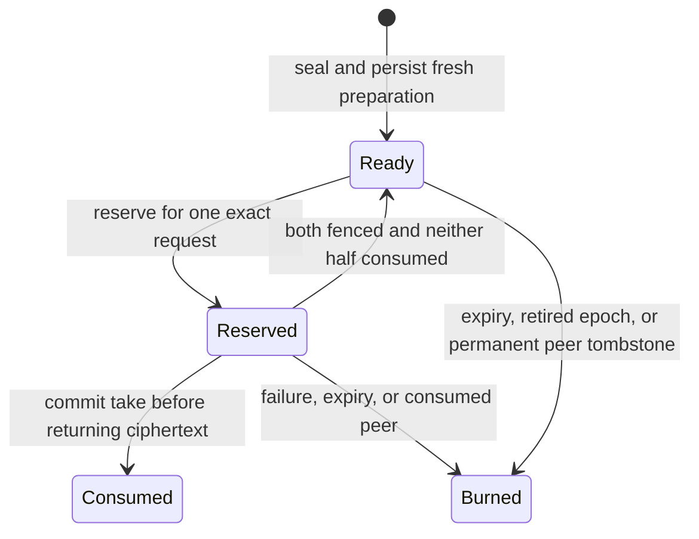

# ML-DSA durable pools and admission

Status: backend storage and private admission implemented, 2026-10-15.
Live Worker signing execution and automatic preparation dispatch remain unwired.
This change does not enable a public Wallet signing route or deploy new infrastructure.
GPU preparation and further preparation-speed work remain deferred.

## Configuration

The self-contained module lives in `crates/router-ab-cloudflare/src/ml_dsa`.
Set deployment-owned `ML_DSA_ADMISSION_POLICY` JSON to configure it:

```json
{
  "wallet_cooldown": { "mode": "enabled", "interval_ms": 60000 },
  "max_active_operations": 1,
  "operation_timeout_ms": 30000,
  "minimum_ready_batches": 2,
  "refill_target_batches": 10
}
```

An absent setting uses these defaults. Malformed configuration fails closed.
Set `interval_ms` to `300000` for five minutes.
Use `"wallet_cooldown": { "mode": "disabled" }` to disable only the wallet cooldown.
Capacity, replay, epoch, and single-use checks remain active.
Requests cannot override this deployment policy.

The wallet identity includes organization, project, environment, and wallet.
The cooldown covers all ML-DSA key slots for that identity and survives restart and recovery.
The service limit covers one Router deployment's shared admission object.
It bounds outstanding claims and admitted operations. It does not yet qualify live execution or preprocessing concurrency.
The executor must honor operation expiry when it is connected.

## Admission and settlement

The Router first claims one coordinator execution. Exact duplicate requests receive stored status without another claim.
A reused operation ID with changed key, epoch, message, or context is rejected.

Both roles must report matching ready batches that remain valid through the operation lease.
The Router reserves the same ordered batch set at both roles before admitting the operation.
The cooldown starts at admission. An admitted failure or lost response does not refund it.
An empty pool returns an explicit advisory retry timestamp before charging the cooldown.
The timestamp does not promise that preparation will finish by that time.

Completion checks the exact admitted public key, message, and context digests.
RustCrypto then verifies the standard ML-DSA-65 signature before the Router stores a successful result.
Exact retries return that stored result. Pre-admission cancellation has a distinct `Declined` state.

Before releasing reserved batches, the Router durably fences the operation at both roles.
Take and Reserve check that fence within their transactions.
The Router collects the union of consumed IDs only after both fences commit.
Successful settlement returns only pairs untouched by both roles. It burns unmatched halves.
Failed or expired admitted operations burn their remaining reservations.
Admission also removes a ready half when its peer has a permanent tombstone.
A temporarily missing or reserved peer does not justify retirement.



Consumed and burned records remain as permanent tombstones.
There is no operation that restores their private material.

## Private storage and recovery

Each participant owns a separate Durable Object namespace and independently keyed encryption.
The Router stores public admission metadata and signatures. It receives no private preparation payload.
HPKE authenticated envelopes bind wallet, key, epoch, public key, schedules, role, batch ID, expiry, and wrapping-key version.
Ciphertext uses bounded base64 encoding on the private wire and bounded chunks in storage.

A consuming core codec stores only fresh role-private preparation.
It reconstructs public circuit topology from trusted schedules after restoration.
It checks role, batch ID, candidate count, schedule digests, coefficient ranges, padding, and exact EOF.
Its plaintext buffers retain zeroizing ownership.

Take deletes ciphertext and records consumption within one storage transaction.
The caller receives the envelope only after commit and can then decrypt and restore it.
A lost response consumes the batch permanently.

Recovery advances the material epoch, retires old preparation, and preserves the canonical public-key digest.
The Router and role store reject a different public key under the same key slot.
This layer changes no wallet-seed derivation or standard FIPS export format.
Database snapshot restoration still requires epoch advancement and disposal of prepared material.
An in-database tombstone cannot protect against rollback of all authoritative stores together.

## Private routes and authority

The strict Router routes share `/router-ab/ml-dsa/`: `activate`, `admit`, `status`, and `complete`.
They require the existing dedicated Gateway-to-Router credential.
The Deriver route `/router-ab/ml-dsa/role` uses existing private service authentication.
Role installation must also read an exact Gateway-authorized activation from the Router's admission store.
A role-shared credential cannot authorize a new key or advance its epoch.

Gateway activation is a trusted custody-completion assertion, not a new cryptographic custody proof.
The Gateway caller must verify owner/session/capability authority and custody completion before using these private routes.
The public Gateway/SDK caller is not connected yet.

Checked-in Router and Deriver templates define the new SQLite Durable Object namespaces.
The Router owns admission. Each Deriver owns only its own pool and can query admission status and active-key metadata.
A status query can settle an expired operation. It cannot authorize a new key or operation.
The shared credential cannot invoke admission-control commands in the Router object.
No template was deployed during this change.

## Validation and remaining work

The [lifecycle E2E](../evidence/ml-dsa-65-durable-admission-e2e-20261015.json) uses three real SQLite stores and independent connections.
It covers restart, single-use consumption, role-key separation, partial-write rollback, and concurrent service claims.
It also covers 60-second and 300-second cooldowns, disabled cooldown, cross-key limits, and failed-attempt charging.
Further cases cover one-sided consumption, successful settlement races, orphan retirement, key-scoped refill demand, expiry, and public-key continuity.
A real standard signature verifies at completion, survives restart, and rejects an altered signature.
These cases use controlled clocks and synthetic preparation payloads. They do not exercise Worker HTTP routes.

The [threshold persistence E2E](../evidence/ml-dsa-65-durable-threshold-e2e-20261015.json) uses genuine GMW preparation in separate role processes.
Preparation is sealed, stored in SQLite, reopened, consumed, decrypted, and restored before activation.
Independent verification accepts resulting standard signatures. Canonical wallet-seed recovery also passes.
The [integration record](../evidence/ml-dsa-65-durable-integration-screen-20261015.json) pins source hashes, commands, and check results.

Remaining integration work:

1. Connect the verified Gateway custody and owner-admission paths to the private lifecycle routes.
2. Connect live Worker consumption through decrypt, restore, and threshold execution. Bind actual message inputs and enforce expiry throughout execution.
3. Dispatch Worker preparation from durable, key-scoped refill requests. Publish matching batches as each pair becomes ready and bound producer concurrency.
4. Validate that flow through local and hosted Worker E2Es, including interruptions, restart, empty pools, and sustained demand.
5. Measure admission, storage reads, decryption, topology restoration, and signing together against the five-second target.

The refill request is persisted immediately after consumption. An automatic preparation executor is not implemented by that request record alone.
The new durable pool holds material assigned to active keys. Persistent unassigned stock for fresh registrations remains a separate integration task.
These results establish component behavior. They do not establish a completed production signer or a hosted latency guarantee.

## Reproduction

From the Wallet repository, run:

```sh
ML_DSA_E2E_REPORT=/private/tmp/ml-dsa-durable-admission-e2e.json \
  cargo test --manifest-path crates/router-ab-cloudflare/Cargo.toml \
  --test ml_dsa_durable_pool_e2e --offline -- --nocapture
cargo run --release --manifest-path tools/ml-dsa-investigation/Cargo.toml --offline -- \
  prepared-keygen /private/tmp/ml-dsa-durable-threshold-e2e.json
```

Check each Worker role with `cargo check`, target `wasm32-unknown-unknown`, and its `strict-worker-ROLE-entrypoint` feature.
Use `router`, `deriver-a`, and `deriver-b` for `ROLE`.
The lifecycle artifact is repeatable with controlled timestamps. Fresh cryptographic randomness changes signature bytes and rejection counts in the threshold artifact.
